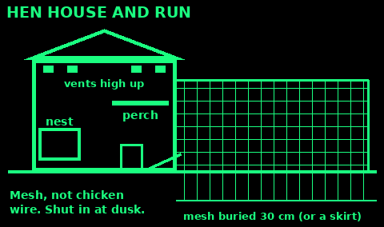
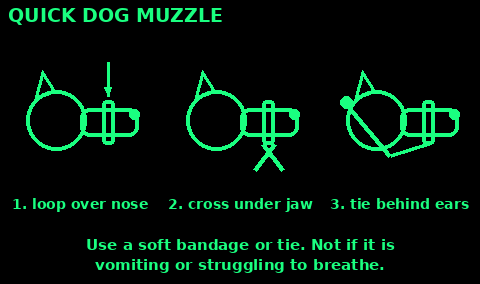

## Before you start (UK rules)

Rules exist to stop animal diseases like bird flu and swine fever spreading.

- Poultry: in England and Wales you must register with APHA even if you keep a single hen, within a month of getting them. Scotland and Northern Ireland have their own registers.
- Goats, sheep and pigs: register the land for a CPH number, get a herd or flock mark from APHA, ear-tag the animals and keep a movement record.
- Kitchen scraps: it is illegal to feed anything that has been in a kitchen to farm animals, including pet hens and pigs, even vegetarian scraps. Garden veg and weeds that never went indoors are fine.
- Killing for food at home: allowed only for your own animals, on your own land, for your household. It must be humane (see the dispatch cards).
- Welfare: every animal needs food, water, shelter, space to behave normally, company of its own kind, and treatment when ill or hurt.

Start small: 3 or 4 hens, or 2 rabbits. Learn before you add more.

## Chickens: housing

A safe house is most of chicken keeping. Foxes, rats and mink kill more hens than illness.

1. A dry, draught-free house with good air holes high up (above the hens' heads).

2. Perches 5 cm wide with rounded edges, about 15 cm of perch per hen, higher than the nest boxes. Hens sleep on the highest place.

3. Nest boxes about 30 cm each way, low and dark. One for every 4 to 5 hens, at least 2.

4. Easy to clean: a removable floor tray or a deep bed of wood shavings or straw.

5. A run: at least 1 to 2 square metres per hen, more is better. Wire mesh, not chicken wire, which foxes can tear. Bury the bottom 30 cm, or lay a skirt of mesh flat on the ground outwards.

6. Shut the pop-hole every night at dusk. Open after dawn.

7. Shade and a dry dust bath (dry soil or sand with a little wood ash). Hens bathe in dust to keep off mites.

## Chickens: feed and water

1. Layers pellets or mash: about 120 g per hen a day, up to 180 g in cold weather. Keep it dry and away from rats.

2. Grit: hens need small stones to grind food in their gizzard. Mixed grit with oyster shell also gives calcium for strong eggshells.

3. Clean water always. A hen drinks about 250 to 500 ml a day, more in heat. Break the ice in winter.

4. Extras: a handful of grain in the afternoon, garden greens, weeds and grass. Grain alone makes poor layers.

5. Free-ranging hens find insects, seeds and greens, and need less bought feed. They still need layers feed.

Never feed: kitchen scraps (illegal in the UK), mouldy food, raw potato peel, avocado, chocolate, salty food.

## Chickens: eggs

Most hens lay well for 2 to 3 years. Hybrids lay about 250 to 300 eggs a year when young; pure breeds fewer. Laying slows or stops in winter and while moulting.

1. Collect eggs at least once a day. Fresh eggs left in the nest get broken, eaten or go broody.

2. Clean nests mean clean eggs. Brush off dirt with a dry cloth. If you must wash, use warm (not cold) water and use those eggs first.

3. Store cool, pointed end down. Eat within 3 weeks.

4. Freshness test: in a bowl of water, fresh eggs lie flat, older eggs stand up, bad eggs float. Throw floaters away.

5. Cook well for babies, pregnant women, and old or sick people.

A broody hen sits on the nest and will not leave. Put fertile eggs under her (you need a cockerel): chicks hatch in 21 days.

No laying? Check for: short days, moult, age, stress, mites, worms, too little feed or calcium, or eggs being eaten.

## Chicken health

Look at your hens every day. A sick hen hides it until she is very ill.

Healthy: bright eyes, red comb, smooth feathers, busy, eating, firm droppings.

Problems:
- Red mite: tiny mites that hide in cracks in the house by day and bite at night. Hens go pale and stop laying. Look under perch ends with a torch at night. Clean the house, scald or treat cracks, repeat weekly.
- Lice and scaly leg: check under the vent and wings, and leg scales lifting.
- Worms: weight loss, pale comb. Wormer from a vet or feed store, or move the run to fresh ground.
- Sneezing, bubbly eyes, rattly breath: separate the hen, keep her warm, get advice.

Many sick or dead birds at once: this can be bird flu. In the UK it must be reported to APHA (03000 200 301). Do not handle dead wild birds.

A badly sick or injured bird that will not recover should be dispatched quickly (see the dispatch cards) rather than left to suffer.

## Rabbits for meat

Rabbits turn grass and hay into lean meat quickly and quietly.

Housing: a large hutch, at least 1.8 m long, off the ground, with a dark sleeping area, attached to a run. Shade in summer, out of wind and rain.

Feed:
1. Lots of good hay or grass: most of their diet, every day.
2. Fresh greens and weeds: dandelion, plantain, clover, kale, carrot tops.
3. A small handful of rabbit pellets.
4. Fresh water always, from a bottle or heavy bowl.

Never feed: lawn mower clippings (they ferment), potato tops, rhubarb leaves, ragwort, foxglove, buttercups.

Breeding: does are ready at about 5 to 6 months. Take the doe to the buck's hutch. Kits are born about 31 days later, 4 to 10 in a litter, in a fur-lined nest. Leave the nest alone for the first days.

Wean kits at 6 to 8 weeks. Meat rabbits are ready at about 10 to 12 weeks old.

Keep cages very clean: dirty bedding causes flystrike in summer, where flies lay eggs in the fur and maggots eat the skin. Check rear ends daily in warm weather.

## Goats

Goats give milk, meat and clear brambles. They are clever, noisy, and escape artists.

1. Never keep one alone. Goats need another goat for company.

2. Fence: strong, 1.2 to 1.5 m high. They climb, jump and push. Electric fence helps.

3. Shelter: a dry shed. Goats hate rain and draughts.

4. Feed: hay or grazing and browse (hedges, brambles, branches) all the time. A little goat mix for milkers. Clean water. A mineral lick.

5. Poisonous to goats: yew, rhododendron, laurel, azalea, foxglove, ragwort, bracken, and garden shrubs you do not know. A few mouthfuls of yew kill.

6. Trim hooves every 6 to 8 weeks.

Milk: a goat must kid to make milk. A dairy goat may give 2 to 4 litres a day for months.

Milking: tie her, clean the udder with a warm damp cloth, throw away the first squirts from each teat, squeeze from the top of the teat down with your whole hand (do not pull), strain the milk through clean cloth and cool it fast. Heat it before drinking (see Paneer in Cooking).

Signs of trouble: off food, not chewing the cud, swollen left side (bloat), scouring, limping. Bloat can kill in hours: get a vet.

## Humane dispatch: the rules

If you keep animals for food, or one is suffering, you must be able to kill it quickly and calmly. A bad kill is cruel and illegal.

UK law (England) for home kill:
- Your own animal, on your own land, for you and your household to eat. You may not sell or give away the meat.
- The animal must be stunned (made unconscious at once) and then killed before it can wake: usually by cutting both big vessels in the neck so it bleeds out.
- Wait until it is dead and bled before you pluck or skin it: at least 90 seconds for chickens.
- You must know how. Watch and learn from someone experienced first.

1. Keep the animal calm. Do it away from the others. No chasing.

2. Have everything ready: a sharp knife, a cone or a hook to hang a bird, a bucket.

3. Act firmly and quickly. Hesitation causes suffering.

4. Check death: no breathing, no blink when the eye is touched, pupils wide.

Goats, sheep and pigs need a captive-bolt gun or a firearm and real training. Ask a vet or a licensed slaughterman.

## Dispatching poultry and rabbits

These are the basic methods allowed in UK guidance. Learn hands-on first.

Chickens (under 3 kg), neck dislocation when no other method is available:

1. Hold the legs in your left hand. Let the bird hang head down until calm.

2. Take the head in your right hand: back of the head in your palm, first two fingers either side of the neck just behind the skull, thumb under the beak.

3. In one firm movement, pull the head down and bend it sharply back. You feel the neck separate and a gap open. Flapping after this is a reflex.

4. Cut the neck under the jaw at once to bleed it. Hang head down for at least 90 seconds.

A strong blow to the back of the head with a heavy stick stuns well, then bleed straight away.

Rabbits (under 5 kg):

1. Hold the rabbit calmly by the back legs, or across a firm surface.

2. One hard blow with a heavy stick to the back of the head, just behind the ears.

3. Cut both sides of the throat straight away to bleed it. It must not wake up.

Then skin and gut it (Hunting & fishing card).

## Animal first aid

An animal in pain may bite, even your own dog. Stay calm and be safe.

1. Approach slowly, talk softly. Muzzle a hurt dog before you touch the injury: a loop of bandage or soft cord over the nose, a knot under the jaw, ends tied behind the ears. Not if it is vomiting or struggling to breathe.

2. Bleeding: press a clean pad firmly on the wound for 5 minutes. Bandage firmly, not tight.

3. Wounds: clip fur away, rinse with lots of clean or salty water (1 teaspoon salt in 500 ml boiled, cooled water). Keep clean and dry. Watch for swelling and pus.

4. Broken leg: keep the animal still and confined. Carry a dog on a board or blanket.

5. Heatstroke (panting, drooling, staggering): into shade, pour cool (not ice-cold) water over the body, fan it, small drinks. Then a vet.

6. Burns: cool running water for 20 minutes.

7. Never give human painkillers. Paracetamol kills cats. Ibuprofen and aspirin poison dogs and cats.

Keep a small pet kit: bandages, tape, saline, tick hook, blunt scissors, a muzzle, a spare lead.

## Poisons for pets and livestock

Dogs: chocolate, grapes and raisins, onions, garlic, xylitol (sweetener in sugar-free gum and sweets), macadamia nuts, cooked bones, ibuprofen, slug pellets, rat poison, antifreeze.

Cats: lilies (any part, even pollen or vase water, kills), paracetamol, dog flea treatments with permethrin, antifreeze, essential oils.

Rabbits and guinea pigs: potato and tomato leaves, rhubarb, buttercups, foxglove, ivy, privet, lawn clippings.

Goats, sheep, horses and cattle: yew, ragwort, rhododendron, laurel, bracken, acorns in quantity, deadly nightshade.

Chickens: mouldy feed, avocado, chocolate, salt, rat poison.

Signs: vomiting, drooling, shaking, fits, staggering, sleepiness, bleeding.

Do not make the animal sick yourself. Keep the packet or plant and call a vet straight away. Speed matters.

## Pets when times are hard

Planning and evacuating with pets: see the Pets card in Emergency plan.

1. Water first: a dog needs about 50 ml per kg of body weight a day, more in heat. A 20 kg dog drinks about 1 litre.

2. Food: stock 2 weeks or more of their usual food. Change food gradually over a week to avoid upset stomachs.

3. Short of pet food: dogs can eat plain cooked rice, oats, potato, eggs, and cooked meat or fish with no bones, no onion, no salt. Cats must have meat or fish: they cannot live on plant food.

4. Keep them inside or on a lead after a disaster. Familiar places change, and lost, scared pets bite or are hit by traffic.

5. ID tag on the collar, microchip up to date.

6. Stress shows as hiding, barking, soiling or biting. Keep their routine, bed and toys. Give them a quiet corner.

7. Keep up flea, tick and worm treatment if you can. Wash hands after handling pets and poo, especially before food.

## Animals sources

Written in our own words from:

GOV.UK poultry registration: gov.uk/guidance/register-as-a-keeper-of-less-than-50-poultry-or-other-captive-birds. Goats: gov.uk/guidance/register-livestock-to-get-a-flock-or-herd-mark and gov.uk/guidance/tag-goats-with-ear-tags-pastern-bands-and-boluses

APHA, kitchen scraps: gov.uk/government/news/apha-warns-not-to-feed-kitchen-scraps-to-farm-animals-because-of-disease-risk and gov.uk/guidance/supplying-and-using-animal-by-products-as-farm-animal-feed

Defra, slaughter for home consumption: gov.uk/guidance/slaughter-poultry-livestock-and-rabbits-for-home-consumption. Humane Slaughter Association: hsa.org.uk

RSPCA hens: rspca.org.uk/adviceandwelfare/pets/chickens. British Hen Welfare Trust: bhwt.org.uk/adopt-hens/hen-setup and bhwt.org.uk/feeding-your-hens

RSPCA, PDSA and Blue Cross pet first aid and poisons (facts only): rspca.org.uk, pdsa.org.uk, bluecross.org.uk

Bird flu reporting: gov.uk/guidance/avian-influenza-bird-flu
