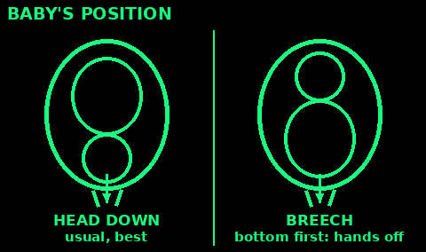
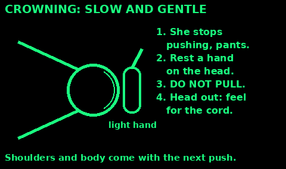
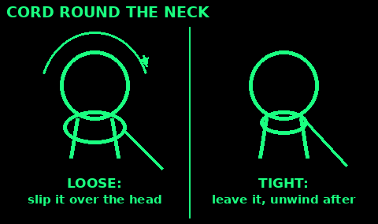
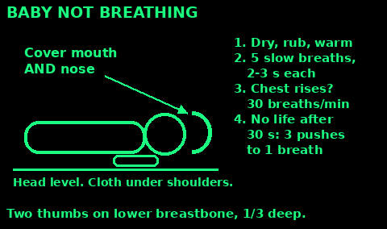
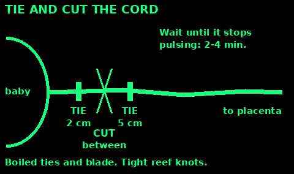
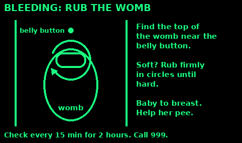

## Signs of labour

Call 999 or a midwife as soon as labour starts, even if help is far away. They can talk you through it.

Labour may be starting when:
- Tightenings (contractions) come regularly and get stronger, longer and closer together.
- A plug of pink or brown jelly comes out (a "show").
- The waters break: a gush or a trickle of clear or pale pink fluid.
- She has low backache, or feels she needs to poo.

The birth is close when:
- She has a strong urge to push.
- Contractions come every 2 to 3 minutes.
- The skin between vagina and bottom bulges, or you can see the baby's head.

Get help urgently if: there is bleeding, the waters are green, brown or smelly, the baby moves less, she is under 37 weeks, a contraction lasts over 2 minutes, or 6 or more come in 10 minutes.

## Get ready

1. Wash your hands and nails with soap and water. Wear clean gloves if you have them. Wash again after touching anything dirty.

2. Warm the room, about 25 °C, with no draughts. Newborn babies lose heat fast.

3. Put plastic under her, then clean towels or sheets on top.

4. Have ready: towels and a blanket for the baby, a hat, pads or clean cloths for her, a bowl for the afterbirth, drinking water, a torch.

5. For the cord: two strong strings or clean cloth strips, and a new razor blade in its wrapper or clean scissors. Boil the ties and blade for 20 minutes, then keep them in the covered pot.

6. Unlock the door and put lights on for the ambulance.

7. Let her eat lightly and drink. Help her pee every hour or two. A full bladder slows labour.

Stay calm and kind. Fear makes labour slower and harder.

## Stages of labour

1. Opening (first stage). Contractions open the neck of the womb to about 10 cm. Early labour can take many hours, even days. Once it is strong and regular it usually takes 8 to 18 hours for a first baby, 5 to 12 hours for later ones.

Help her walk, change position, rock, eat and drink, and pee. Rub her lower back. Breathe slowly with her through each contraction. She should not push yet.

2. Pushing (second stage). From fully open until the baby is born. For a first baby this should take no longer than 3 hours. If she has had a baby before, no longer than 2 hours.

3. Afterbirth (third stage). The placenta comes out, usually within an hour.

## Delivering the baby

1. Let her choose her position: kneeling, on all fours, on her side, squatting or half sitting up. If she lies back, put a pillow under her right hip.

2. She pushes when she feels the urge, with each contraction. She rests in between.

3. When the head stays visible between contractions (crowning), ask her to stop pushing. She pants or blows short breaths, so the head comes out slowly. This saves tearing.

4. Rest one hand gently on the head. Do not pull it. Do not push it back.

5. Once the head is out, it turns to one side. Feel round the neck for the cord.

6. Wait for the next contraction. The shoulders come, then the body slides out fast. Support the baby. It is slippery. Never pull on the head or the cord.

7. Note the time. Lift the baby straight onto her bare chest.

## Cord round the neck

This is common, and usually not a problem.

1. When the head is out, slide a finger round the neck.

2. Cord loose: hook it gently over the baby's head.

3. Too tight to slip over: leave it. Keep the baby's head close to her body as it is born. Unwind the cord after.

4. Do not cut the cord before the baby is born unless a midwife or doctor tells you to.

## Breech and other problems

Call 999 for all of these. Follow what the call handler says.

Breech (bottom or feet first): hands off. Let her stand, squat or kneel on all fours so gravity helps. Do not touch or pull until the body is out to the belly button. Then support the body, wrapped in a towel to keep it warm. If the head is not out within 3 minutes of the body, she must push hard with each contraction.

Shoulders stuck (head out, the body does not come with the next push): she lies back and pulls her knees right up to her chest. A helper presses firmly just above her pubic bone while she pushes. If that fails, turn her onto all fours and try again.

Cord comes out first: she kneels with her chest on the floor and her bottom up. Do not push the cord back. Cover it with a warm damp cloth and handle it as little as possible.

An arm or shoulder first, or twins with no skilled help: she needs a hospital.

## First minutes after birth

1. Put the baby on her bare chest, skin to skin.

2. Dry the baby all over with a warm towel, rubbing the back and head firmly. This also starts the breathing.

3. Remove the wet towel. Cover them both with a dry one and put a hat on the baby.

4. Check: crying or breathing well within a minute, moving, good colour in the face. Blue hands and feet are normal at first.

5. Wipe mucus from the mouth and nose with a clean cloth if needed. Do not poke inside.

6. Keep them skin to skin for at least an hour. Help with the first feed in that hour.

7. Do not bath the baby for the first day. Keep the baby warm.

## Baby not breathing

Do this if the baby is not breathing or only gasping after drying.

1. Keep the baby warm. Lay it on its back on a firm, flat surface.

2. Keep the head level, not tipped back. A folded cloth under the shoulders helps.

3. Cover the baby's mouth and nose with your mouth.

4. Give 5 slow breaths, each 2 to 3 seconds. Watch the chest rise.

5. No chest rise? Check the head position, lift the jaw, try again.

6. Still not breathing: give about 30 breaths a minute, one every 2 seconds. Check every 30 seconds.

7. No signs of life after 30 seconds of good breaths: start chest pushes. Two thumbs on the lower breastbone, press one third of the chest depth. 3 pushes then 1 breath.

Keep going until the baby breathes or help takes over. If you only remember baby CPR from First aid, do that.

## The afterbirth

The placenta (afterbirth) usually comes out by itself within an hour.

1. Do not pull the cord. Pulling can tear it, or pull the womb out with it.

2. Do not press on her belly before the placenta is out.

3. Put the baby to the breast. Feeding helps the womb push.

4. Signs it has come away: a cramp, a small gush of blood, the cord gets longer.

5. She squats or kneels and pushes. Catch it in the bowl.

6. Keep it for the midwife. Check it looks whole. If a piece seems missing, she needs a doctor.

7. Then feel and rub the womb (see Heavy bleeding).

Not out after an hour, or bleeding heavily before it is out: this is an emergency. Get help now.

## Tie and cut the cord

There is no rush. The baby is fine with the cord attached.

1. Wait until the cord stops pulsing and goes white and limp. This usually takes 2 to 4 minutes. You can wait until the placenta is out.

2. Tie one boiled string tightly 2 cm from the baby's belly. Use a reef knot, pulled hard.

3. Tie the second string 5 cm from the belly.

4. Cut between the two ties with the boiled blade or a new one. Cover the baby so you do not cut skin.

5. Check the stump after a few minutes. If it oozes, tie another string closer to the belly.

Keep the stump clean and dry. Nothing on it. Fold the nappy below it. It falls off in 1 to 2 weeks.

Redness spreading onto the belly, pus or a bad smell: get help.

## Heavy bleeding after birth

Some bleeding is normal, like a heavy period. It is too much if it soaks a pad in under 5 minutes, it is more than about 2 cups (500 ml), or she feels faint, pale, cold or her pulse is fast.

1. Call 999.

2. Put the baby to the breast, or rub her nipples. This makes the womb squeeze.

3. Find the top of the womb, near the belly button. If it feels soft, cup your hand and rub firmly in circles until it goes hard like a grapefruit.

4. Help her pee. A full bladder stops the womb tightening.

5. Lay her flat with her legs raised. Keep her warm. Give sips of water if she is awake.

6. Keep checking the womb every 15 minutes for the first 2 hours. Rub again if it goes soft.

## Danger signs: get help

Get her to a doctor or hospital, or call 999, for any of these.

Mother:
- Heavy bleeding (see above), or placenta not out after an hour
- Fits, or a bad headache with blurred vision
- Fever, shivering, or smelly discharge from the vagina
- Fast or hard breathing, or bad belly pain
- Labour over 12 hours of strong contractions, or pushing too long (see Stages)

Baby:
- Not feeding, or too sleepy to feed
- Breathing fast (more than 60 a minute), grunting, or the chest sucks in
- Too hot or too cold to touch
- Fits, floppy, or not moving
- Yellow skin in the first day, or yellow palms and soles at any time
- Cord stump red, smelly or bleeding

## Breastfeeding

Start in the first hour, skin to skin. The first milk (colostrum) is thick and yellow. It is all a newborn needs.

A good latch:
1. Hold the baby close, tummy to her, nose level with the nipple.
2. Wait for a wide-open mouth, then bring the baby to the breast.
3. Chin touches the breast. Lots of the dark skin is in the mouth. Cheeks look round.
4. It should not hurt after the first few sucks. If it does, break the seal with a clean finger and try again.

Feed when the baby wants, 8 to 12 times or more in 24 hours. Use both breasts. From day 5, expect at least 6 wet nappies a day.

Feeding often makes more milk. It also helps the womb shrink and bleed less.

If she cannot breastfeed: use infant formula. Make it with water boiled and cooled for no more than 30 minutes, so it is still at least 70 °C. Cool the bottle before feeding.

## Childbirth sources

Written in our own words from public guidance:

NHS stages of labour: nhs.uk/pregnancy/labour-and-birth/the-stages-of-labour-and-birth

NHS signs of labour, breastfeeding and making up formula: nhs.uk/pregnancy/labour-and-birth/signs-of-labour, nhs.uk/baby/breastfeeding-and-bottle-feeding

WHO Pregnancy, Childbirth, Postpartum and Newborn Care (PCPNC, 3rd ed. 2015): cord ties at 2 cm and 5 cm, danger signs, uterine massage. ncbi.nlm.nih.gov/books/NBK326674

Resuscitation Council UK, Newborn life support: 5 inflation breaths of 2 to 3 seconds, then 30 a minute, 3:1 compressions. resus.org.uk/professional-library/2025-resuscitation-guidelines/newborn-resuscitation-and-support-transition-infants-birth

JRCALC and ambulance guidance on breech and unplanned birth: jrcalc.org.uk

Hesperian, A Book for Midwives and Where There Is No Doctor: ideas only, not copied (free non-commercial use). Boiling tools for 20 minutes: en.hesperian.org/hhg/A_Book_for_Midwives:Clean_and_sterilize_tools

This is emergency help, not a midwife. Get skilled help as soon as you can.
