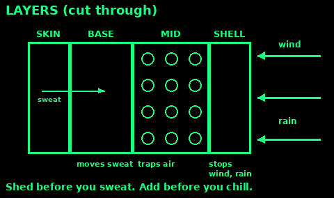
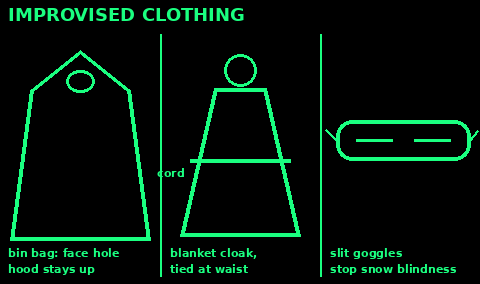
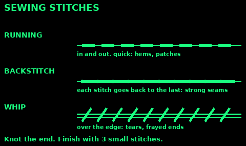
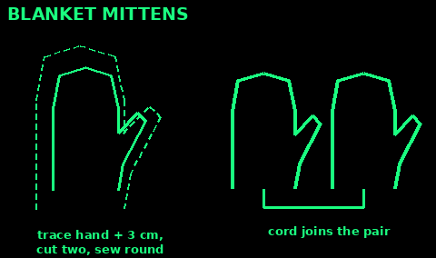
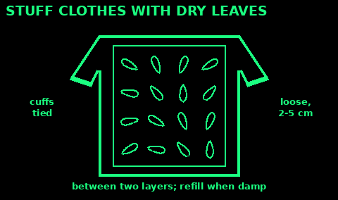
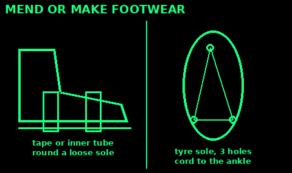
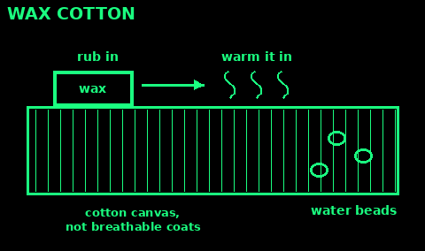
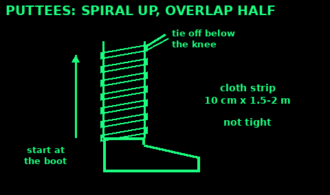

## Layers

Several thin layers beat one thick coat. Each layer traps still air, and still air is what keeps you warm. You can also take one off or put one on as the work and weather change.

From the skin out:

1. Base layer: thin wool or synthetic. It moves sweat off your skin.

2. Mid layer: fleece, wool jumper, down or synthetic jacket. This is the warmth. Add more than one in deep cold.

3. Shell: a jacket and trousers that stop wind and rain.

Take a layer off before you sweat on a climb. Put it back on the moment you stop, before you feel cold. Waiting until you shiver means you are already behind.

The shell traps sweat too. Open the zips while you work. Close them when you stop.

Keep one dry warm layer in your pack for camp. It is your reserve.

## Cotton kills

Cotton soaks up water and holds it. Wet cotton loses most of its warmth and takes hours to dry, using your body heat to do it. Jeans, cotton T-shirts, hoodies and cotton socks are fine in a dry town. They are dangerous on a wet hill.

Wool still keeps you warm when damp. So do fleece and synthetic fibres. They dry faster too.

If cotton is all you have, keep it as an outer layer over something else, keep it dry under a shell, and swap it out the moment you find something better.

In hot, dry weather cotton is useful. A wet cotton shirt or headcloth cools you.

## Insulation

What makes warmth is trapped dead air. Anything fluffy that holds its shape works.

Down is the warmest for its weight but almost useless when wet. Keep it in a dry bag and under a shell.

Synthetic fill (in jackets and sleeping bags) is heavier but still warms when damp.

Wool keeps some warmth when wet and does not stink as fast.

Fleece is light, cheap and dries quickly. Wind blows straight through it, so wear a shell over it.

Improvised fill: dry leaves, dry grass, moss, pine needles, cattail fluff, crumpled newspaper, or bubble wrap. Stuff it between two layers of clothing, or between two sheets of cloth for a quilt. Keep it dry.

Dirt and grease crush the air pockets. Clean clothes are warmer than filthy ones.

## Wet and cold

Wet and windy weather a few degrees above freezing is often more dangerous than a dry, still frost. Water and wind strip heat from you much faster than still air, and people do not take it seriously.

The US Army rule is COLD:
- C: keep clothing Clean.
- O: avoid Overheating. Sweat makes you wet from the inside.
- L: wear clothing Loose and in Layers. Tight clothes and boots cut off blood and squash the air out.
- D: keep clothing Dry.

Cover your head, neck and hands. Mittens are warmer than gloves. Tie mittens to your sleeves so you do not lose them.

Get out of wet clothes as soon as you are in shelter. Wring them out. Dry them by the fire or, if there is no fire, in the sleeping bag with you, a few items at a time. Dry leather boots slowly, never close to flames.

Shivering, clumsy hands, stumbling, slurred speech and confusion mean hypothermia. Get the person into shelter, take off wet clothes, wrap them up, cover the head, and give a warm sweet drink if they are fully awake. See First aid and Medicine.

## Boots and socks

Your feet carry you out. Look after them every night.

Boots should fit with a thick sock, with room to wiggle your toes and your heel held still. Break new boots in on short walks first.

Wear wool or synthetic socks. Carry at least one dry pair in a sealed bag. Change into it in camp.

Every evening: take boots and socks off. Dry and air your feet. Check for red spots, blisters and cuts. Massage them. Sleep with feet up and dry.

Dry wet socks against your body or in the sleeping bag. Do not dry them on a hot stone: you will scorch them.

Trim toenails straight across. Long nails hit the boot front on downhills and blacken.

Gaiters stop snow, mud and stones getting in the top of the boot.

## Trench foot

Trench foot (immersion foot) comes from feet being wet and cold, but not frozen, for many hours or days. It can happen well above freezing, in boggy ground or flooded homes.

Signs: pins and needles, tingling, numbness, then pain. Feet look white, wrinkled and soggy, swell, feel heavy, and later turn red, blue or black.

Prevent it:
1. Dry your feet and put on dry socks at least once a day.
2. Do not sleep in wet socks or boots.
3. Loosen boots and keep blood moving. Wiggle your toes.
4. Sleep with bare feet raised.

If it starts: get out of the wet. Clean and dry the feet gently. Warm them slowly, raise them, and do not walk on them if you can avoid it. Do not rub them. Get medical help soon.

## Blisters

A blister starts as a hot spot. Stop at once. Two minutes now saves days later.

Hot spot: dry the skin, then cover it with tape, a plaster, or moleskin. Fix the cause: a fold in the sock, a stone, a loose lace.

Blister (NHS advice):
1. Do not burst it yourself.
2. Keep it clean. Wash gently and pat dry.
3. Cover it with a soft plaster or padded dressing. A hydrocolloid dressing works well.

If it bursts: wash your hands, let the fluid drain, leave the skin flap in place, and cover it. Do not peel the skin or pick at the edges.

Pus, spreading redness, heat or red streaks mean infection. Get help.

## Improvised clothing

A big rubbish bag is a poncho. Cut a hole for your face in the closed end, not your head, so the hood keeps the rain off. Cut arm slits if needed. A second bag makes a skirt or a vapour liner.

A blanket, tarp or sheet worn as a cloak and tied at the waist with cord is warm and quick.

A spare sock or sleeve makes a hat, a mitten or a neck tube.

Plastic bags over dry socks inside boots keep feet dry for a while. Feet will sweat, so change the socks.

Stuff dry grass or leaves between two shirts for an insulated vest.

Snow and sun glare: a strip of card, bark or cloth with two thin slits over the eyes stops snow blindness. Blacken under your eyes with soot.

## Repair and sewing

Fix a hole while it is small. A small tear grows on the first bramble.

Kit: needles, strong thread or dental floss, safety pins, buttons, duct tape, a patch of cloth. Fishing line or thin cord pulled from paracord works.

Running stitch: in and out along a line. Quick, for patches and hems.

Backstitch: each stitch goes back to meet the last one. Strong, for seams that take load.

Whip stitch (overcast): over the edge and back through. For closing tears and stopping frayed edges.

Knot the thread end. Start and finish with two or three small stitches on the spot.

Patch: cut it 2 cm bigger than the hole all round. Fold the edges under. Sew it on the inside for clothing, outside for packs.

Duct tape on both sides of a tear fixes a jacket or tent for days. Round the corners of the tape so they do not peel.

An awl or a sharpened nail makes holes in leather and heavy canvas. Use waxed thread.

## Sun and heat

In the UK the sun is strongest from 11am to 3pm, from March to October. You can burn on a cloudy day.

Cover up: wide-brimmed hat that shades face, neck and ears, long sleeves and trousers in close-woven cloth, wraparound sunglasses. Clothes protect better than sunscreen.

Sunscreen: at least SPF 30 and 4-star UVA. Put it on 30 minutes before going out and again just before. Reapply every 2 hours and after sweating or water.

Loose, light-coloured clothes keep you cooler. Wetting a shirt or headcloth cools you by evaporation in dry heat.

Make a neck flap from a cloth tucked under a cap.

Snow, water and sand reflect sun up under the hat. Protect your eyes.

Rest in shade in the hottest part of the day. Work early and late.

Heat exhaustion: headache, dizziness, heavy sweating, cramps, thirst. Get into shade, take off spare clothing, drink, and cool the skin with water and fanning. Hot skin that has stopped sweating, confusion or a fit is heatstroke: an emergency. See First aid.

## Mittens and socks from a blanket

Use: cold hands or feet and spare wool cloth (a blanket, jumper or coat lining).

1. Draw round your hand with fingers together and thumb out, 3 cm wider all round. Mittens are warmer than gloves because fingers share heat.

2. Cut two pieces per mitten. Sew round the edge with a whip stitch or backstitch, leaving the wrist open. Turn it inside out.

3. Socks: draw round your foot 3 cm wider, plus a leg 15 cm high. Two pieces per sock, sewn round. Or wrap a square of cloth round the foot like a parcel (a foot wrap).

4. Make a wrist loop of cord joining both mittens, through your sleeves, so you cannot lose one.

5. In wet weather, a plastic bag over a wool mitten keeps it dry.

Mistakes: making them tight. Air trapped inside is what keeps you warm, and tight cloth cuts blood flow.

Check: you can wiggle all your fingers or toes inside.

## Stuff clothes for warmth

Use: you are cold, with too few layers, and dry plant material around.

1. Find dry, fluffy stuff: dead grass, dry bracken, dry leaves, cattail or thistle fluff, crumpled paper, foam or bubble wrap.

2. Wear two layers, such as a shirt under a jacket. Tuck the inner layer in and tie the cuffs and ankles closed with cord.

3. Fill the gap between the layers loosely, 2 to 5 cm thick, all round the body. Do the same in trousers.

4. Fluff it up every few hours. Throw it out and refill when it gets damp or flat.

Check plant matter for ticks and insects first. Avoid nettles, brambles and anything you cannot name.

Mistakes: packing it tight; using damp material, which chills you faster.

Check: you can feel the warmth within 10 minutes. If you start sweating, open a layer.

## Mend or make footwear

Use: a boot or shoe is failing, or you have none.

1. Loose sole: dry and clean it, glue with contact glue or shoe glue, clamp overnight. In the field, wrap duct tape, cord or a strip of inner tube right round the boot.

2. Split upper: stitch with waxed thread through holes made with an awl, then seal with glue or wax.

3. Broken lace: a strip of cord, paracord inner or a strip of cloth. Carry a spare.

4. Tyre sandal: cut a sole from car or bike tyre tread, traced round your foot. Make three holes: one between the first two toes, two beside the heel. Thread cord through and tie round the ankle.

5. Foot wrap: a square of thick cloth or blanket round the foot, then an outer layer of canvas, leather or bark, tied on.

Mistakes: drying leather boots right next to a fire. They shrink and crack. Dry them slowly, stuffed with paper or grass.

Check: walk 100 m and look for rubbing. Fix a hot spot before it becomes a blister.

## Waterproof clothing

Use: your coat or cotton canvas lets rain in.

1. Wax cotton: rub a block of beeswax or wax bar firmly into dry cotton canvas until the fabric is coated.

2. Warm it with a hair dryer or by holding it near (not over) a fire so the wax melts into the weave. Let it cool. Repeat on seams.

3. Breathable coats: wash with a non-detergent tech wash, then reproof with a wash-in or spray proofer. Gentle heat (tumble low or iron cool through a cloth) wakes up the water repellent finish.

4. Seams: dab seam sealer or wax along stitched seams and round the hood.

5. Leather boots: clean, then work in wax or dubbin, especially into seams and the welt.

Mistakes: waxing breathable fabric, which stops it breathing; using too much heat near a fire. Wax burns.

Check: splash water on it. It should bead and roll off, not soak in.

## Gaiters and puttees

Use: wet grass, snow, mud or tick country.

1. Puttees: cut two strips of cloth about 10 cm wide and 1.5 to 2 m long. Old blanket or wool works best.

2. Start at the ankle over the top of the boot. Wrap upwards in a spiral, each turn overlapping the last by half.

3. Stop below the knee. Tuck in the end and tie it with cord or tape. Not tight.

4. Quick gaiter: tuck trousers into socks, then wrap a plastic bag or a strip of tarp round the lower leg and tie it above and below.

Ticks climb from grass. Tucked-in trousers and pale cloth make them easy to see and remove. Check your skin every evening.

Check: you can still bend your knee and ankle easily, and toes stay warm.

## Clothing sources

Written in our own words from public guidance:

US Army FM 21-76 / ATP 3-50.21 Survival (public domain): COLD rule, cold weather clothing, drying, trench foot. Text at theswissbay.ch/pdf/Books/Survival/Survival/Survival%20Library/library2/army/ch15.htm

CDC, preventing trench foot: cdc.gov/natural-disasters/psa-toolkit/preventing-trench-foot-or-immersion-foot.html

NHS: nhs.uk/conditions/blisters, nhs.uk/live-well/seasonal-health/sunscreen-and-sun-safety, nhs.uk/conditions/heat-exhaustion-heatstroke, nhs.uk/conditions/hypothermia

Look up hypothermia, frostbite, trench foot and heatstroke in Medicine for the full signs.

US Army FM 21-76 / ATP 3-50.21 (public domain): improvised footwear and mittens, puttees and leg wraps, stuffing clothing with dry insulation.

Leather and outdoor gear care guidance from boot and fabric makers (wax, dubbin, reproofing). NHS: Lyme disease and tick checks, nhs.uk/conditions/lyme-disease
