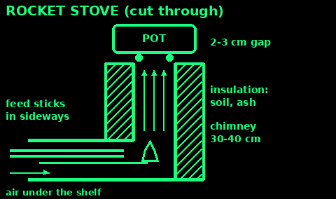
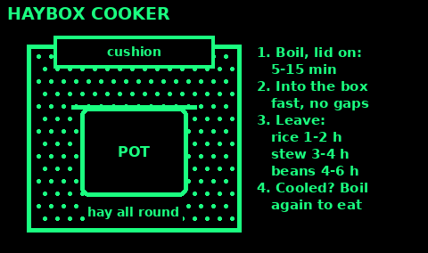
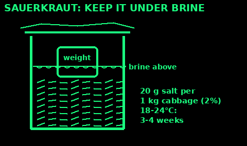
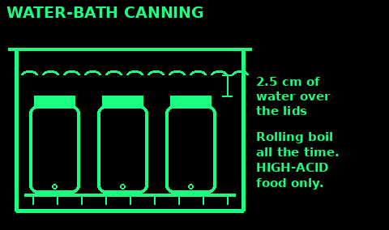
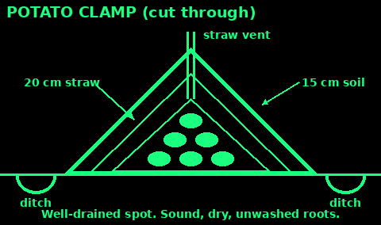

## Flatbread

No yeast, no oven. Ready in 20 minutes.

For 4 breads:
- 250 g flour (about 2 mugs). Plain, wholemeal, or a mix.
- A pinch of salt.
- About 150 ml water (just over half a mug). A spoon of oil or fat if you have it.

1. Mix flour and salt. Add water a little at a time and stir to a soft dough that does not stick to your hands.

2. Knead for 2 or 3 minutes on a floured surface.

3. Cut into 4. Roll or press each into a thin round, about 3 mm thick.

4. Cook in a hot dry pan, on a flat stone, or on a metal sheet over coals, for 1 to 2 minutes a side. It puffs and gets brown spots.

5. Keep them warm wrapped in a cloth.

Oats, barley or maize flour work too but crumble more. Mix with some wheat flour.

On a stick: roll dough into a long snake and wind it round a green stick. Turn it slowly over embers until it sounds hollow.

## Soda bread

Rises with bicarbonate of soda and something sour. No yeast, no waiting.

- 500 g plain flour (white, wholemeal, or half and half)
- 1 level teaspoon bicarbonate of soda
- 1 teaspoon salt
- About 400 ml buttermilk. No buttermilk: 400 ml milk with 2 tablespoons lemon juice or vinegar, left 10 minutes. Natural yoghurt thinned with water also works.

1. Mix the dry things. Make a well. Pour in most of the liquid.

2. Stir quickly with a fork or your fingers into a soft, sticky dough. Do not knead it. Add the rest of the liquid if dry.

3. Shape into a round about 4 cm thick. Cut a deep cross on top.

4. Oven: 200°C for 30 to 40 minutes.

5. Done when the bottom sounds hollow when tapped.

No oven: make farls. Pat the dough into a round 2 cm thick, cut into 4, and cook in a dry, heavy pan on low heat for about 10 minutes a side, until it sounds hollow.

Bake it soon after mixing: the soda starts working as soon as it gets wet.

## Sourdough starter

Wild yeast from flour and air. Once you have it, you can bake raised bread forever.

1. In a clean jar mix 50 g flour (wholemeal or rye is fastest) and 50 ml water. Cover loosely with a cloth.

2. Keep it somewhere warm, about 20 to 25°C.

3. Every day: throw away (or cook) half, then add another 50 g flour and 50 ml water. Stir.

4. In 5 to 10 days it bubbles, smells sour like yoghurt, and doubles in 4 to 8 hours after a feed. It is ready.

5. Keep it in a cool place and feed it once or twice a week. Warm place: feed daily.

Bread: mix 100 g active starter, 500 g flour, 325 ml water and 10 g salt. Knead. Leave covered 6 to 12 hours until it has nearly doubled. Shape, rise 2 more hours, and bake hot.

Pink, orange or fuzzy mould: throw it away and start again. A grey liquid on top is fine: pour it off and feed.

The discard makes pancakes: fry it in a pan.

## Bake without an oven

Pot oven (Dutch oven):

1. A heavy iron pot with a lid. Grease it, or line with baking paper.

2. Put the dough in. Lid on.

3. Set it on a thin bed of coals, not in flames. Shovel more coals onto the lid. About twice as many on top as underneath.

4. Check after 20 minutes. Turn the pot a quarter turn now and then so it browns evenly.

Two-pot oven: a small tin on three pebbles inside a big covered pot with a little water in the bottom. It steams and bakes.

Ash bake: wrap dough in big leaves or foil and bury in hot ash, away from the flames.

Bread is done when it sounds hollow tapped underneath.

## Rocket stove

Cooks a meal on a handful of sticks. Burns hot and clean with little smoke.

It is an L-shaped tube: fuel goes in the side, hot gas rises up an insulated chimney to the pot.

Build from bricks or stones:

1. Lay bricks in an L: a feed tunnel 15 to 20 cm long, and an upright chimney about 30 to 40 cm tall above it. Inside about 12 to 15 cm square.

2. A flat rock or brick shelf halfway along the tunnel: fuel rests on top, air flows in underneath.

3. Pack soil, ash or sand round the outside of the chimney to keep the heat in.

4. Three small stones on top so the pot sits 2 to 3 cm above the chimney and gas can escape.

From tins: a big tin as the body, a smaller tin as the chimney with a hole cut in its side for a tin feed tube, and ash or perlite packed between them.

Use: light small dry sticks at the inner end of the tunnel. Push sticks in as they burn. Only the tips burn.

Outside only. It still makes carbon monoxide.

## Haybox cooker

Bring the pot to the boil, then let trapped heat finish the cooking. Saves up to two-thirds of your fuel.

1. Find a box, crate, basket or a big bag.

2. Line it thickly with insulation: hay, straw, blankets, cushions, sleeping bags, crumpled paper or wool. Leave a nest the shape of your pot.

3. Bring the food to a rolling boil with the lid on. Boil 5 minutes for rice or oats, 15 minutes for stews and soaked beans.

4. Move it fast into the nest. Tuck insulation round and over the lid. No gaps.

5. Leave it: rice 1 to 2 hours, stews 3 to 4 hours, soaked beans 4 to 6 hours.

6. Before eating, check it is cooked. If the food has cooled below steaming hot, bring it back to the boil.

Use a full pot with a tight lid. A half empty pot cools faster.

Dried red kidney beans: soak 12 hours and boil hard for at least 10 minutes before they go in the box. Low heat alone does not destroy their toxin.

## Beans, rice and grains

Cook more for less fuel.

1. Soak dried beans, peas and whole grains overnight. They cook in half the time. Throw away the soak water.

2. Red kidney beans: boil hard for at least 10 minutes first. Undercooked ones cause severe vomiting.

3. Lentils and split peas need no soaking. 20 to 40 minutes.

4. Rice: 1 mug rice to 2 mugs water. Bring to the boil, lid on, lowest heat 12 minutes, then leave off the heat 10 minutes.

5. Porridge: 1 part oats to 2 or 3 parts water or milk. Soak overnight and it needs just a few minutes.

6. Lid on always. Cut food small. Turn the heat down once boiling.

Rice leftovers: cool within 1 hour and eat within 24 hours. Rice germs make toxins that reheating does not kill.

Beans with grain (rice, bread, oats) together give complete protein.

## Ferment vegetables (sauerkraut)

Salt and time. Friendly bacteria turn sugar into acid that keeps the cabbage for months.

Salt: 20 g of salt for every 1 kg of cabbage (2%, about 1 level tablespoon per kilo). Use plain salt with no iodine or anti-caking agent if you can.

1. Take off the outer leaves. Cut out the core. Shred finely.

2. Weigh it. Weigh the salt. Mix with clean hands and squeeze hard for 5 to 10 minutes until juice runs.

3. Pack it tightly into a clean jar or crock, pressing down until the juice rises above it.

4. Keep it under the liquid with a weight: a small jar of water, a clean stone in a bag, a plate.

5. Cover with a cloth. Leave at 18 to 24°C. Ready in 3 to 4 weeks; at 15 to 18°C, 5 to 6 weeks.

6. Not enough juice after a day: top up with brine of 1 level tablespoon salt in 500 ml water.

7. Skim off any white film. Pink, slimy, soft or bad-smelling kraut, or fuzzy mould: throw it out.

Carrots, beans, beets, turnips and peppers ferment the same way in 2% brine.

## Pickling with vinegar

Acid keeps food safe. Use real vinegar of at least 5% acid (it says on the label). Never water it down more than the recipe says.

Quick pickle for the fridge or a cool shelf:

1. Pack clean, sliced vegetables (onions, cucumber, beetroot, cabbage, carrots, beans) into hot, clean jars.

2. Heat 500 ml vinegar with 2 teaspoons salt and 1 to 4 tablespoons sugar until boiling. Spices if you like.

3. Pour over to cover with 1 cm to spare. Lid on.

4. Keep cool and eat within 2 months; in a fridge they keep longer.

For long storage on the shelf, process pickles in a water bath (next card) following a tested recipe.

Beetroot: cook it first, then pickle. Eggs: hard boil and peel, then keep in vinegar in the fridge only.

Never pickle in copper, brass, iron or aluminium pans. Use glass, enamel or stainless steel.

## Water-bath canning

Seals jars so food keeps on a shelf for a year. Only for high-acid food: fruit, jams, pickles, sauerkraut, and tomatoes with added lemon juice.

Never water-bath vegetables, beans, meat, fish, soup or mushrooms. They are low-acid and need a pressure canner, or botulism can grow (next card).

1. Use proper canning jars with new lids. Check for chips.

2. Follow a tested recipe for the food and jar size (USDA or the National Center for Home Food Preservation). Do not invent times.

3. Fill hot jars with hot food. Leave the head space the recipe says, often 1 cm. Run a clean knife round inside to free bubbles. Wipe rims.

4. Lids on, rings finger-tight.

5. Stand jars on a rack or folded cloth in a deep pot, not touching. Cover with water at least 2.5 cm over the lids.

6. Bring to a rolling boil. Start timing only once it boils. Keep it boiling the whole time. Add time above 300 m altitude.

7. Lift out, stand on a towel for 12 to 24 hours.

8. Check the seal: the lid is pulled down and does not pop when pressed. Not sealed: fridge it and eat soon.

Label with the date. Store cool and dark. Use within a year.

## Botulism warning

Botulism is a deadly poison made by a germ that grows in sealed, airless, low-acid, moist food: badly canned vegetables, meat, fish, garlic or herbs kept in oil, and home-cured or fermented fish and meat.

You cannot see, smell or taste it.

Throw away without tasting any jar or tin that:
- has a bulging, leaking or unsealed lid
- spurts liquid or foam when opened
- smells bad, is cloudy, mouldy or fizzy when it should not be
- was low-acid food canned without a pressure canner

Dispose: put sealed jars in a heavy bag in the rubbish. Wear gloves. Clean spills with 1 part bleach to 5 parts water, leave 30 minutes, wipe up.

Signs in a person, 12 to 72 hours after eating: drooping eyelids, blurred or double vision, slurred speech, trouble swallowing, dry mouth, weakness that moves down the body, trouble breathing.

This is an emergency. Call 999. There is an antitoxin.

Garlic or herbs in oil: keep in the fridge and use within 4 days, or freeze.

## Root cellar and clamps

Many vegetables keep for months cold, dark and damp, without power.

Best conditions: just above freezing, 0 to 5°C, with damp air. Potatoes a little warmer, 4 to 7°C, dry and in total darkness.

1. Store only sound, dry, undamaged vegetables. One rotten one spoils the rest.

2. Do not wash them. Brush off soil.

3. Carrots, beetroot, parsnips, turnips: layer in boxes of damp sand or sawdust, not touching.

4. Potatoes: sacks or crates in the dark. Light turns them green and green potatoes are poisonous: cut away all green parts, or throw them out.

5. Onions, garlic and squash: dry them in the sun first. Then keep them dry and airy, in nets or plaits.

6. Apples: wrap singly in paper. Keep away from potatoes and carrots. Apples give off a gas that sprouts potatoes and makes carrots bitter.

7. Check every week. Remove anything soft.

Clamp (outdoor store): on a well-drained spot, lay straw, pile potatoes or roots in a ridge, cover with 20 cm of straw, then 15 cm of soil patted firm. Leave a twist of straw poking out of the top for air. Dig a ditch round it for rain.

A cellar, unheated garage, shed or a barrel buried in the ground also works.

## Butter and buttermilk

1. Use cream: double or whipping cream, or the cream skimmed from the top of milk left to stand in the cold for 12 to 24 hours.

2. Let it warm to about 12 to 15°C (cool room).

3. Fill a jar a third full. Lid on. Shake hard. Or beat with a whisk.

4. It goes thick (whipped cream), then suddenly splits into yellow lumps and thin liquid. 10 to 20 minutes.

5. Pour off the liquid. That is buttermilk: drink it, or use it in soda bread.

6. Wash the butter: pour on very cold water, knead with a spoon, pour off. Repeat until the water runs clear. Milk left in the butter makes it go sour fast.

7. Squeeze out the water. Mix in a pinch of salt per 100 g if you want it to keep longer.

Keep it cold. Wrapped and cool it lasts 1 to 2 weeks; salted, longer. Clarify for long keeping: melt it slowly, skim off the foam, pour the clear yellow fat off the milky part. This ghee keeps for months.

## Paneer (simple cheese)

A fresh cheese with no rennet and no culture. Ready in an hour.

1. 2 litres of whole milk. Bring to the boil in a heavy pan, stirring so it does not burn.

2. Turn the heat off. Stir in 3 to 4 tablespoons of lemon juice or vinegar, one spoon at a time, until it splits into white curds and a clear yellow-green liquid (whey).

3. Line a sieve or bowl with a clean cloth. Pour it in.

4. Rinse the curds with cold water to wash off the sour taste.

5. Gather the cloth, twist and squeeze. For a firm block, press it under a weight for 1 to 2 hours.

Makes about 250 to 300 g. Keep it cold and eat within 3 days. Fry in cubes, add to stews, or crumble on bread.

The whey is good: use it in bread, soup or porridge.

Raw milk from your own goat or cow: heat it first. Hold it at 72°C for 15 seconds, or 63°C for 30 minutes, or just bring it to the boil, then cool it fast. This kills TB, brucella and other germs.

## Store grain and pulses

Dry food keeps for years if you keep out water, air, insects and rodents.

1. Only store it dry: it snaps or cracks, it does not bend. Under 10% moisture is best.

2. Kill insect eggs first: freeze small bags for 3 days, then let them warm up. Repeat after a month if you saw any insects.

3. Containers rodents cannot chew: metal bins, glass jars, thick food-grade buckets with tight lids. Not sacks or plastic bags on the floor.

4. Oxygen absorbers: put them in sealed foil (Mylar) bags or tins with the food. About 300 cc per 4 litres. They kill insects and keep fats from going stale. Only for dry food.

5. Store off the floor and away from walls, cool, dark and dry.

6. First in, first out. Date everything. Check monthly for webbing, holes, insects, damp or a musty smell.

Weevils in flour: sieve them out and use the flour soon, or freeze it. Mouldy, musty, discoloured or clumped grain: throw it away. Some moulds make poisons that cooking does not destroy.

Roughly: white rice, wheat, dried beans and oats keep 10 years or more sealed with absorbers. Brown rice and wholemeal flour go rancid in months: their oils spoil.

## Food safety: temperatures and leftovers

1. Keep cold food cold: fridge 0 to 5°C. Freezer -18°C.

2. Keep hot food hot: above 63°C.

3. Cook: the centre steaming hot, 70°C for 2 minutes (or 75°C for 30 seconds).

4. The danger zone is between 8 and 63°C. Germs double fast. Do not leave food in it for more than 2 hours.

5. Leftovers: cool quickly (spread out in a shallow tray, stand the pot in cold water), cover, and keep cold within 2 hours. Eat within 2 days.

6. Reheat only once, until steaming hot right through. Stir.

7. Rice: cool within 1 hour, eat within 24 hours.

8. Defrost in the fridge or in cold water, never in a warm room. Cook defrosted food within 24 hours.

9. No fridge: cook only what you will eat at that meal. Keep milk and meat in a cool box, a cold stream (in a sealed tin) or a damp-cloth evaporation cooler.

10. Tins that bulge, leak, spurt or are badly dented on a seam: throw away.

Clean hands, clean surfaces and keeping raw meat apart matter as much. See Clean water and food in Sanitation.

## Cooking sources

Written in our own words from:

Food Standards Agency, Cooking your food, Chilling, and Home food fact checker (temperatures, leftovers, rice): food.gov.uk/safety-hygiene. FSA natural toxins (red kidney beans).

National Center for Home Food Preservation (University of Georgia) and the USDA Complete Guide to Home Canning: nchfp.uga.edu (sauerkraut salt ratio and fermenting temperatures, pickling, boiling-water canning, identifying spoiled jars).

CDC botulism and home-canned foods: cdc.gov/botulism/prevention/home-canned-foods.html

Utah State University Extension, oxygen absorbers and storing wheat: extension.usu.edu/preserve-the-harvest

University of Missouri Extension, root cellars: extension.missouri.edu/publications/mp562. UMass Amherst storage conditions and ethylene: umass.edu/agriculture-food-environment

Aprovecho Research Center rocket stove design principles (facts only).

Milk heat treatment: 72°C for 15 seconds or 63°C for 30 minutes, the standard pasteurisation temperatures.

Bread, starter, butter and paneer methods: common household practice, written fresh.
