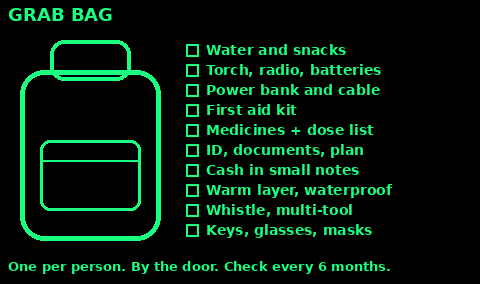
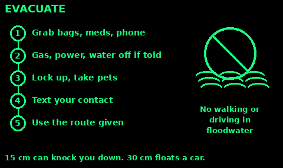
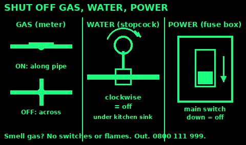
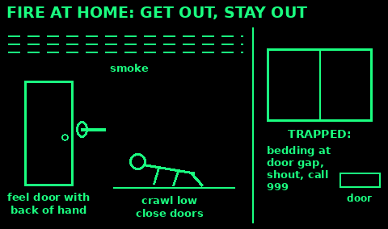
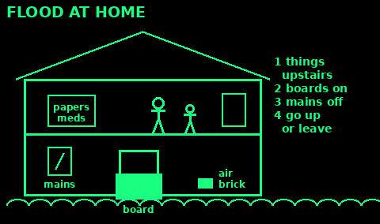
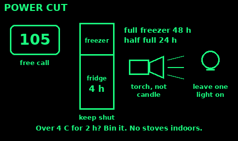
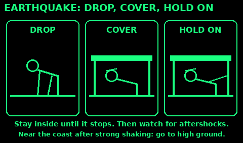
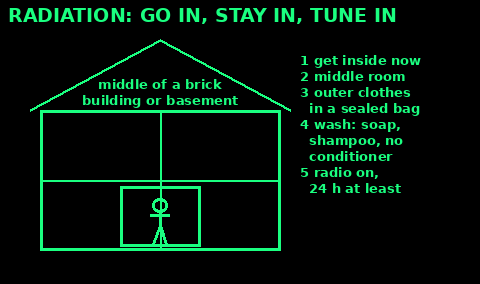
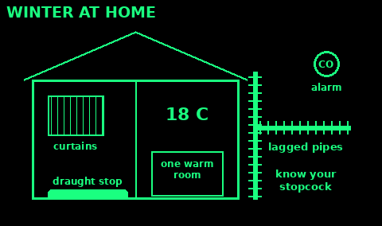

## Make a plan

Sit down with everyone in your home and agree:

- Two meeting places: one just outside the house (for a fire), one away from the area (a friend's house, a library).
- One out-of-area contact everyone phones or texts to say they are safe. Local lines are often jammed while distant ones work.
- Who collects the children, and who checks on neighbours who need help.
- Where the gas, water and electricity shutoffs are, and who can work them.
- Two ways out of every room, and of your street.

Write the plan on paper. Put a copy in each grab bag and on the fridge. Phones go flat.

Practise once a year: walk the escape routes, test alarms, check the kit.

## UK numbers and alerts

- 999 or 112: police, fire, ambulance, coastguard. 112 works from any mobile, any network.
- 111: NHS advice when it is urgent but not life-threatening.
- 101: police, not an emergency.
- 105: power cut (any network operator in Great Britain).
- 0800 111 999: gas leak or carbon monoxide (National Gas Emergency Service).
- 0345 988 1188: Floodline (England, Scotland, Wales).
- Text 999: register first with emergencySMS (text "register" to 999) if you are deaf or cannot speak.

Emergency Alerts: the government can send a loud alarm and message to phones in an area at risk of danger to life. Read the message and do what it says. Do not drive while reading it.

Local radio (BBC local radio, Radio 4) carries news in a big incident. Keep a battery or wind-up radio.

## Grab bag

A grab bag is for leaving fast: fire, flood, gas leak, evacuation order. One per person if you can, in a rucksack by the door.

Pack:
- Water (a litre or two) and snacks
- Torch, wind-up or battery radio, spare batteries
- Charged power bank and phone cable
- First aid kit and at least a week of your regular medicines, with a list of doses
- Copies of ID, insurance, prescriptions; a written plan and phone numbers
- Some cash in small notes
- Warm layer, waterproof, hat; spare glasses
- Whistle, multi-tool, pen and paper
- Wipes, hand gel, face masks, sanitary items
- Spare keys for home and car
- Baby, pet or care items if needed

Check it every six months: water, food, batteries and medicine dates.

## 72-hour kit

For staying put for three days without power, water or shops.

Water: at least 3 litres per person per day for drinking, plus more for washing. Fill bottles now. In a warning, fill the bath and pans too.

Food: ready-to-eat tins and packets that need no cooking: tinned fish, beans, fruit, oat bars, nuts, crackers. A manual tin opener.

Heat and light: warm blankets, sleeping bags, torches and lanterns (LED, not candles if you can), spare batteries.

Cooking: a camping stove only outdoors or in a well-aired place. See Power, Carbon monoxide.

Hygiene: bin bags and a bucket for a toilet, toilet paper, wipes, bleach. See Sanitation.

Information: radio, this guide, printed plan, paper maps.

Medicine: a week's supply of regular medicines, and simple painkillers.

Rotate food and water: eat the oldest and replace it.

## Shelter in place

Stay indoors when told to (a chemical or smoke cloud, a severe storm), or when going out is more dangerous.

Go in, stay in, tune in:
- Get everyone and pets inside.
- Close and lock windows and outside doors.
- Turn off fans, extractors, air conditioning and other systems that bring air in from outside.
- Go to an inner room, ideally upstairs for chemical and flood risks, or lower floor and away from windows for storms.
- Listen to radio or phone alerts for when it is safe.

Do not go to collect children from school unless told to: schools have their own plans.

## Evacuate

Leave when the emergency services tell you to, or before if your home is unsafe (fire, gas smell, floodwater rising).

Before you go, if there is time and it is safe:
- Take your grab bags, medicines, phone and charger.
- Turn off gas, electricity and water if told to (see Utilities).
- Put valuables and documents upstairs if flooding.
- Lock up. Take pets.
- Tell your contact where you are going.

On the way:
- Follow the route the police give. Shortcuts may be blocked.
- Do not walk or drive through floodwater. 15 cm of fast water can knock you over. 30 cm can float a car.
- Help neighbours who need it, if it is safe.

Do not go home until you are told it is safe.

## Utilities shutoff

Learn where these are now, in daylight, and label them.

Gas: at the meter. Turn the lever a quarter turn so it sits across the pipe. Along the pipe is on, across is off. If you smell gas: no flames, no light switches, open doors and windows, turn off at the meter, leave, call 0800 111 999 from outside.

Water: the inside stopcock is usually under the kitchen sink, or where the pipe enters the house. Turn clockwise to close. Shut it if a pipe bursts or if told to.

Electricity: the consumer unit (fuse box). Push the main switch to off. Never touch it with wet hands or while standing in water. If water has reached the box, keep away and call 105.

Turning gas back on: only do it if you are sure all appliances are off. If in doubt, ask a Gas Safe registered engineer. Pilot lights need relighting.

## Pets

Pets are not allowed in many rest centres. Plan ahead:
- A friend or family member out of the area who will take them.
- Carrier or lead with an ID tag, and a microchip with up-to-date details.
- Pet grab bag: food and water for 3 days, bowls, medicines, poo bags or litter, a recent photo, vet details.

Never leave pets tied up in an evacuation. If you must leave them, leave them indoors with plenty of food and water, and tell the emergency services.

## Checklists

Now:
- Plan written and shared
- Grab bags packed
- Know the gas, water and electric shutoffs
- Smoke alarm on every floor; CO alarm by boilers and fires
- Sign up for flood warnings: gov.uk/sign-up-for-flood-warnings
- Register with your power network's Priority Services Register if someone needs power for medical kit

Warning given:
- Charge phones and power banks
- Fill water bottles and the bath
- Bring in loose garden items
- Check on neighbours
- Fuel the car

After:
- Check for gas smells, damaged wiring and cracks before going back in
- Throw out food that was warm for more than 4 hours or touched by floodwater
- Photograph damage for insurance
- Look after each other. Talking helps.

## Fire at home

Use: smoke or flames in your home. Get out, stay out, call 999.

1. Shout "Fire!" to wake everyone. Do not stop to look for the cause or to pick things up.

2. Before you open a closed door, touch it with the back of your hand. If it is warm, do not open it. Use another way out.

3. Smoke rises. Crawl low with your face near the floor, where the air is cleaner.

4. Close doors behind you. A shut door holds back fire and smoke for minutes.

5. Meet at your outside meeting place. Call 999 from outside. Never go back in for anything; tell the fire service if someone is missing.

Trapped: get into a room with a window, close the door and push bedding or towels along the bottom gap. Open the window, shout "Help, fire" and call 999. If you must escape from a low first-floor window, drop bedding to land on, climb out feet first, lower yourself to arm's length, then drop.

Clothes on fire: stop, drop and roll. Pan on fire: never use water. Turn off the heat if safe, leave the pan, close the door and get out.

Check: test smoke alarms monthly, one on every floor.

## Flood at home

Use: a flood alert or warning for your area. Floodline 0345 988 1188.

1. Alert (possible): move car, pets, papers, medicines and valuables upstairs or to high ground. Pack the grab bag.

2. Warning (expected): fit flood boards or covers over doors and air bricks if you have them. Sandbags or bags of soil help a little.

3. Turn off gas, electricity and water at the mains before water comes in, only if it is safe. Never touch switches standing in water.

4. Fill containers with clean water. Put plugs in sinks and baths and weigh them down to slow sewage coming back up.

5. Go upstairs or leave when told. Take a torch, phone, radio, water and warm clothes up with you.

Afterwards: floodwater carries sewage. Wear gloves and boots, wash hands, throw out food it touched. Do not switch power back on until an electrician has checked it.

Check: you know where your mains switches are and how to work them in the dark.

## Power cut

Use: the lights go out at home. Call 105, free, or check powercut105.com.

1. Check if neighbours have power. If they do, check your own fuse box: a tripped switch may just need resetting.

2. Turn off appliances that heat (cooker, iron, heaters) so they do not come on unattended. Leave one light on to show when power returns.

3. Keep the fridge and freezer shut. A fridge stays cold for about 4 hours, a full freezer about 48 hours, a half-full one about 24.

4. Use torches and LED lanterns, not candles if you can. If you use candles, keep them in holders away from curtains, and never leave them.

5. Keep warm in one room. See Shelter, Buildings and cars, Warm one room.

Never run a generator, barbecue or camping stove indoors or in a garage. Carbon monoxide kills. See Power, Carbon monoxide.

Who needs extra help: anyone on home oxygen, dialysis or other powered medical kit. Register them on the Priority Services Register now.

Check: food that has been above 4 °C for more than about 2 hours goes in the bin.

## Earthquake

Use: the ground shakes. Rare and small in the UK; important when travelling.

1. Drop to your hands and knees where you are.

2. Cover your head and neck under a sturdy table or desk. If none, crouch by an inside wall away from windows and cover your head with your arms.

3. Hold on until the shaking stops. Be ready to move with the table.

4. Do not run outside during the shaking. Most injuries come from falling glass and debris near doorways and walls.

5. Outdoors: move away from buildings, trees and power lines, then drop. In a car, stop away from bridges and buildings and stay in it.

After: expect aftershocks. Check for gas smells, fires and injuries. Use the stairs, not lifts. Near the coast, if the shaking was strong or long, go to high ground at once in case of a tsunami.

Check: in bed, stay there and cover your head with a pillow.

## Illness spreading (pandemic)

Use: a serious infection is going round and health advice says to limit contact.

1. Follow public health advice on the radio or Emergency Alerts. It changes as more is known.

2. Wash hands with soap for 20 seconds, often. See Sanitation, Handwashing.

3. Let fresh air through: open windows a little, especially when others visit.

4. Stay at home when you are ill. Wear a well-fitting face mask around others if you must go out or care for someone.

5. Keep two weeks of food, regular medicines, paracetamol, soap and cleaning supplies. Plan who will shop for you.

6. Look after the sick in one room, with one carer. See Sanitation, Nursing someone infectious.

Mistakes: giving up on routine. Get up, get dressed, keep in touch with people by phone. See Mental health.

Check: know the warning signs that need 999: struggling to breathe, blue lips, confusion, or a child who is floppy or very hard to wake.

## Radiation emergency

Use: an official alert of a nuclear or radiation release, or you see a nuclear flash.

1. Get inside a building at once, before any dust arrives. Brick or concrete is best. A car or tent gives too little protection.

2. Go to the middle of the building or the basement, away from outside walls and the roof.

3. If you were outside, take off your outer clothes and put them in a sealed bag away from people. This can remove up to 90% of the dust.

4. Shower with soap and shampoo, no conditioner, or wipe skin and hair with a damp cloth. Put on clean clothes.

5. Stay in for at least 24 hours unless told otherwise. Keep the radio on. Turn off fans that bring outside air in.

Eat and drink only packaged food and water stored inside. Do not take potassium iodide or iodate tablets unless public health officials tell you to.

Check: you go out only when officials say it is safe, or to escape a greater danger such as fire.

## Winter at home

Use: before the cold months, and when cold weather is forecast.

1. Keep at least one room you live in at 18 °C or more if you can, especially for babies, older people and the ill.

2. Lag pipes and the water tank in lofts and outside walls. Know where your stopcock is. Leave the heating on low when away.

3. Stop draughts: curtains closed at dusk, a draught excluder or rolled towel along doors, tape or foam on gaps. Keep vents for boilers and fires clear.

4. Stock: blankets, hot water bottles, warm hats, a week of food and medicines, torches, grit or salt for paths.

5. Have the boiler, chimney and gas fire checked once a year. Fit a carbon monoxide alarm.

Check on older neighbours in a cold snap. Hypothermia can start indoors in a cold room. See Weather, Cold snap, and Repairs, Frozen and burst pipes.

Check: a thermometer in the main room reads 18 °C or more.

## Emergency sources

Written in our own words from public guidance:

GOV.UK Prepare: prepare.campaign.gov.uk and gov.uk/government/publications/preparing-for-emergencies

GOV.UK Emergency Alerts: gov.uk/alerts

GOV.UK and Environment Agency floods: gov.uk/prepare-for-flooding, gov.uk/sign-up-for-flood-warnings, gov.uk/help-during-flood

British Red Cross emergency kit and plan: redcross.org.uk/get-help/prepare-for-emergencies

National Gas Emergency Service and Gas Safe Register: gassaferegister.co.uk/help-and-advice/gas-emergencies

Power cuts: powercut105.com

emergencySMS: relayuk.bt.com/how-to-use-relay-uk/contact-999-using-relay-uk.html

US Ready.gov 72-hour kit ideas: ready.gov/kit

Fire services (London Fire Brigade, National Fire Chiefs Council): escape plan, door check, crawl low, trapped in a room, stop drop and roll.

CDC power outages and food safety: fridge 4 hours, full freezer 48 hours, half full 24 hours.

Ready.gov and the Earthquake Country Alliance: Drop, Cover and Hold On; tsunami after strong shaking.

CDC radiation emergencies: get inside, remove outer clothing (up to 90%), shower without conditioner, stay in 24 hours. UKHSA: stable iodine only on official advice.

NHS and UKHSA: infection control at home, keep warm (18 °C), cold weather health.

Environment Agency: flood kit, flood boards and air brick covers, turn off mains supplies.

