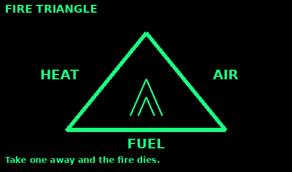
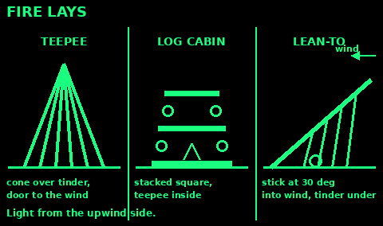
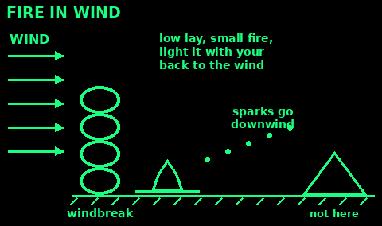

## Fire triangle

A fire needs three things: heat, fuel and air. Take any one away and it dies.

Heat: the match, spark or coal. A new fire is mostly heat looking for fuel. Do not swamp it.

Fuel: wood does not burn directly. Heat drives gas out of it, and the gas burns. That is why thin, dry wood catches first: it heats through fastest.

Air: a fire packed too tight smothers. Leave gaps. Blow gently at the base, not the top.

Use it to diagnose: lots of smoke and no flame usually means too little heat or wet fuel. Add thinner, drier sticks. A flame that dies when you add wood means you added too much at once.

Use it to put a fire out: water takes the heat, dirt takes the air, raking the logs apart takes the fuel.

## Site and putting it out

Clear a circle down to mineral soil, wider than the fire will be. Rake leaves and duff back until you see dirt. Roots and peat burn underground and come up later as a wildfire.

Keep the fire downwind of the shelter, a body-length away, and out from under branches. A spark in a debris hut is the end of the hut.

Build small. A fire that fits inside a ring the size of a dinner plate will boil water and dry socks. A bonfire spends your wood and drives you backward.

Before you sleep or leave: drown it, stir the ashes with a stick, drown it again, and feel for heat with the back of your hand held close, not pressed into the coals. Cold ashes are dead. Warm ashes are a fire you have not finished putting out. If you do not have water, stir in dirt and stay until there is no glow and no warmth.

## Tinder, kindling, wood

Gather all of it before you light anything. A flame with nothing ready to feed it is a wasted match.

Tinder takes the spark or the match. It must be fine and dry: dry grass, the inner bark of dead cedar or birch, fluff from a cattail, shavings you carve so thin they curl, or a nest the size of a fist made of threads. If it does not light from a match held at the edge, it is too coarse or too damp. Split dead wood and take the dry wood from the inside.

Kindling is pencil-thick to thumb-thick, dry, and a pile as big as your hat before you start. Dead twigs still on the tree, under a branch, are drier than twigs on the ground.

Fuel is wrist-thick and larger. Dead standing wood is better than a log lying in the moss. If it bends without snapping, it is too green or too wet for the first fire. Use it later, after you have coals.

Stack the wood where sparks will not land in it, close enough that you can feed the fire without getting up and hunting in the dark.

## Lighting and feeding

Match or lighter: shield the flame with your body. Touch it to the downwind edge of the tinder so the flame burns into the nest, not away from it. Nurse it. Do not drop a log on a new flame.

Spark from a ferro rod: scrape sparks down into the tinder nest, then lift the nest and blow gently at the base of the glow until it flames. Blowing hard scatters it.

Lens: a round lens from a headlamp, binoculars, or glasses that are magnifying, not just flat. Aim a bright dot at dark tinder. Hold still until it smokes, then blow it the way you would a spark.

Once the tinder is a flame, add kindling in a small cone or a lean-to of sticks over the flame, with a gap for air on the windward side. Fire needs air. A solid pile smothers it. When the kindling is burning on its own, add fuel one stick at a time.

If everything outside is wet, look for pitch wood, the fat-rich wood in a dead conifer stump, and split dry centers out of dead branches. Feather-stick the split face: cut shavings and leave them attached so one stick becomes its own tinder.

Keep a small store of dry tinder in a pocket for the morning. The night's dew will wet what you leave in the open.

## Fire lays: teepee, log cabin, lean-to

Build the lay first, with tinder in the middle, then light it from the upwind side.

Teepee: lean kindling in a cone over the tinder, leaving a door on the windward side to reach in with the flame. Burns fast and hot. Good for getting a fire going and for wet wood, because the flame climbs and dries the sticks above it. As it burns, the sticks fall inward and feed it.

Log cabin: tinder and a small teepee in the middle. Stack pairs of sticks around it at right angles, like a cabin, getting smaller toward the top. Lots of air, quick coals. Good for cooking and for a signal fire.

Lean-to: push a green stick into the ground at about 30 degrees, pointing into the wind. Tinder goes deep underneath. Lean kindling against the stick. Good in wind and drizzle.

Star fire: lay thick logs like wheel spokes with their tips meeting in the fire. Push them in as the ends burn. Saves wood and needs no chopping.

## Wet-weather fire

1. Look up, not down. Dead twigs still on trees, and dead lower branches of conifers, are drier than anything on the ground.

2. Split it. The inside of dead wood is dry even after days of rain. Split thumb-thick sticks to get dry faces.

3. Make feather sticks: shave thin curls down a split stick and leave them attached. Make several.

4. Find fatwood: resin-soaked wood from old conifer stumps and branch joints. It smells of turpentine and burns even when damp. Birch bark burns wet too, because of its oils. Take bark only from dead or fallen birch.

5. Build off the wet ground on a platform of thumb-thick sticks or bark.

6. Shelter the fire. Light it under a tarp held high, or against a log or rock on the windward side. Watch the tarp.

7. Gather twice the kindling you think you need. Wet fires eat it.

8. Lay damp fuel near the fire to dry before you add it.

Keep dry tinder in a pocket or a bag, always.

## Fire in wind

Use: lighting and keeping a fire when the wind blows. In strong wind on dry ground, do not light one at all.

1. Get out of the wind first: the lee of a bank, boulder, wall or thick bush.

2. Build a windbreak on the windward side: rocks, logs, your pack, a low wall of turf.

3. Or dig in: a shallow trench, or a Dakota hole (see Fires for jobs).

4. Kneel with your back to the wind and shield the flame with your body and hands.

5. Use a lean-to lay with the stick pointing into the wind, or a low log cabin.

6. Keep it small. Wind feeds it fast and throws sparks downwind.

7. Clear a bigger area downwind and keep water ready.

Mistakes: lighting from the downwind side (the flame blows away from the tinder); a tall teepee that blows over.

Check: nothing that can burn lies downwind within 5 m or more, and the flame sits low and steady.

## Fire safety

Check the rules first. The Countryside Code says: do not light fires, and only have barbecues where signs say you can. On private land you need the owner's permission. In a real emergency, keep the fire small and safe.

Do not light a fire in dry, windy weather, on peat, or among roots. Peat and roots can smoulder underground for days and come up somewhere else.

Keep the fire at least 5 m from tents, shelters and bushes, with nothing overhanging. Keep water or a shovel and dirt at hand before you light it.

Never use petrol or other fuel to start or revive a fire. The vapour explodes.

Never burn plastic, batteries, aerosols or sealed tins. Do not cook over burning rubber or oil.

No fire, stove or candle in a closed shelter or tent. Carbon monoxide kills without warning.

Never leave a fire alone. If it is too hot to touch, it is too hot to leave: drown, stir, drown, feel.

Burns: cool under cool running water for 20 minutes. See First aid.
