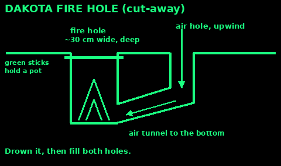
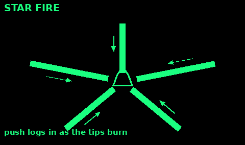
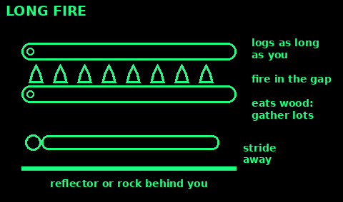
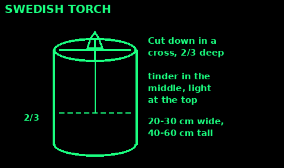
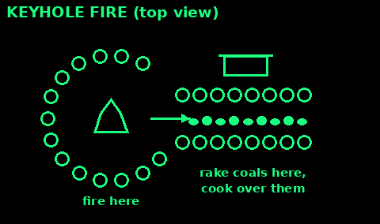
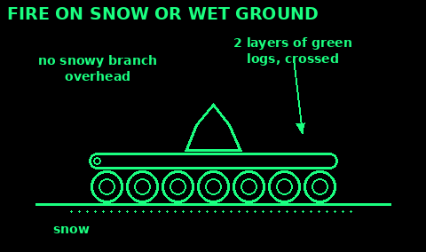
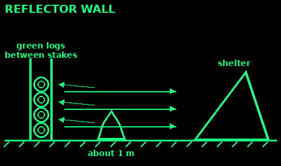

## Dakota fire hole

A fire in a hole with an air tunnel. It burns hot with little wood, hides most of the flame, and works in strong wind. Not for peat, roots or soggy ground.

1. Dig a hole about 30 cm wide and 30 cm deep. Widen the bottom a little.

2. Upwind, about 30 cm away, dig a second, narrower hole about 15 cm wide.

3. Tunnel from the bottom of the small hole into the bottom of the fire hole. This feeds air under the fire.

4. Build a small teepee in the fire hole and light it. Feed short sticks in from above.

5. Lay green sticks across the top to hold a pot.

6. To put it out: drown it, stir, then fill both holes with the soil you dug, and check it is cold.

## Star fire

Use: a long, slow fire that saves wood and needs no chopping.

1. Light a small teepee fire.

2. Lay four to six thick logs round it like wheel spokes, ends meeting in the fire.

3. As the ends burn, push the logs in.

4. For a bigger flame, push them in more. To die down, pull them out.

5. To put it out: pull the logs apart and douse each burning end.

Mistakes: logs piled on top (it becomes a bonfire); forgetting the outer ends lie where people walk.

Check: only the inner tips burn. The rest of each log stays whole.

## Long fire

Use: warmth along your whole body when you sleep beside a fire, or many pots at once.

1. Lay two long green or thick logs side by side, as long as you are tall, a hand to a forearm apart.

2. Build a fire along the gap between them, from one end to the other.

3. The logs hold the fire in a line and hold pots across the gap.

4. Sleep parallel to it, a full stride away, with a reflector wall or rock behind you.

5. Feed it with long sticks laid along the gap.

Mistakes: too close to the bed; sleeping with nobody awake to watch it; dry grass nearby.

It eats wood. Gather far more than you think before dark.

Check: the flame runs evenly the length of the logs, and sparks cannot reach your bed.

## Swedish torch

Use: a fire built in one log. Gives a flat cooking top and burns 1 to 2 hours.

1. Pick a dry, dead log about 20 to 30 cm across and 40 to 60 cm tall. Flat ends.

2. Stand it up on bare ground. Saw or split down into it in a cross, two-thirds of the way. Four or six slots.

3. Stuff tinder and thin kindling into the centre where the cuts meet.

4. Light it at the top. It burns down inside, drawing air up the slots.

5. Put a pot on top once it is burning well.

No saw: stand split logs upright, tied tight in a bundle with wire, with tinder in the middle.

Mistakes: cuts too shallow; wet wood; a pot that blocks all the slots.

Check: flames roar up the middle and out of the top like a chimney.

## Keyhole fire

Use: cooking with steady heat while the fire keeps burning.

1. Make a ring of stones or a shallow pit shaped like a keyhole: a round end and a narrow slot about 30 cm long.

2. Build and feed the fire in the round end.

3. Rake hot coals into the slot.

4. Cook over the slot on a grill, green sticks, or a pot on stones.

5. Add new coals from the round end as they cool.

Mistakes: cooking in the flames (burns the outside, raw inside); stones from rivers (they can burst).

Check: the round end has flames, the slot has a bed of glowing coals.

## Fire on snow or wet ground

Use: keep the fire from sinking into snow or being drowned by a wet floor.

1. On snow: lay a platform of green logs, wrist thick, side by side. Then a second layer across them.

2. On wet ground or mud: a platform of dry sticks, bark slabs, or flat stones from a dry place.

3. Build the fire on top.

4. On deep snow, dig down to the ground if you can, or keep adding logs under it.

5. Keep it clear of snow-laden branches overhead. Heat drops the snow onto the fire.

Mistakes: a single layer (it melts through); river stones (they can burst); lighting on peat, which can burn underground.

Check: the fire sits on a firm, dry deck that is not hissing.

## Reflector wall

Use: throw more of the fire's heat toward you and your shelter. Also shields the fire from wind.

1. Push two pairs of green stakes into the ground on the far side of the fire from you, about a stride apart.

2. Stack green logs between each pair, to about knee to hip height.

3. Place it about 1 m from the fire, leaning a little toward you.

4. A rock face or a big boulder works the same.

5. You sit or sleep on the other side, a body-length from the flames.

Mistakes: dry logs (they catch); too far from the fire; stones from streams in the heat.

Check: you feel heat on your back from the wall as well as the fire on your front.

## Low-smoke fire

Use: a cleaner fire: less smoke in your eyes and lungs, and less to bother neighbours or draw attention.

1. Burn only dry, dead hardwood. Thin sticks, not logs.

2. Keep it small and hot, with plenty of air.

3. No green leaves, wet wood, conifer or rubbish.

4. Use a Dakota hole or a rocket stove. See Cooking.

5. Under trees, the branches break up the smoke.

6. Cook on coals, not flames.

Mistakes: smothering it to hide it (more smoke); wet wood; a big fire.

At night the light shows further than the smoke. A fire in a hole shows least.

Check: you can barely see smoke a few metres above the fire.
