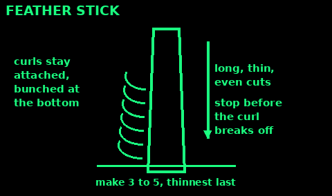
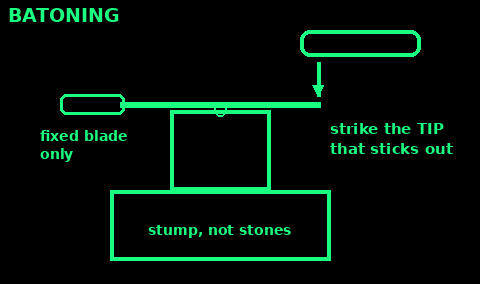

## Birch bark

Use: the best natural tinder in Britain. Its oil burns even when damp.

1. Find a dead or fallen silver or downy birch. White, papery bark that peels in strips.

2. Peel thin outer bark only. Never strip a living tree: it can kill it.

3. Tear it into strips as thin as paper, a big handful.

4. For a ferro rod, scrape some strips with your knife spine into fine fluff and put it on top.

5. It flares up with black smoke. Have kindling over it ready.

Mistakes: thick pieces (they curl and smoke); green inner bark (wet).

Carry a pocketful dry. It keeps for years.

Check: a strip lit at one edge burns on its own like a candle.

## Fatwood

Use: resin-soaked pine. Lights in the rain and burns long and hot.

1. Look in old stumps of dead pine, and where dead branches join the trunk.

2. It is heavy, amber or red-brown, often sticky, and smells strongly of turpentine.

3. Split out a piece. Shave thin curls, or scrape a pile of fine dust.

4. Light it with a match, or with ferro rod sparks on the dust.

5. Add thin sticks while it burns. One finger-sized stick of fatwood can light a whole fire.

Mistakes: taking light, pale wood (not resin-filled); cutting live trees.

It makes thick black smoke. Cook on coals, not on the fatwood flame.

Check: a sliver burns with a big smoky yellow flame even when damp.

## Fungus tinders: cramp ball and amadou

Use: fungi that catch a spark and smoulder for a long time. Good for carrying fire.

Cramp ball (King Alfred's cakes):
1. Black, round, lumpy, like a burnt bun, 2 to 7 cm. Mostly on dead ash wood.
2. Break one: inside are thin rings like an onion.
3. Pick dry ones. Dry them more by the fire.
4. Char one in a tin (as for char cloth), or catch sparks straight on the broken face.
5. Once lit it glows for an hour or more. Blow it into a tinder nest.

Horse's hoof fungus (amadou):
1. Grey bracket shaped like a hoof, on dead or dying birch.
2. Cut out the soft, brown, felty layer between the hard crust and the pores.
3. Slice it thin, beat it flat and dry it.
4. It takes sparks from flint and steel and smoulders slowly.

Mistakes: damp fungus; taking every one you see. Leave most for the wood.

Check: a spark makes a glowing spot that slowly spreads.

## Grass, cattail and plant fluff

Use: tinder you can find in fields and wetlands.

1. Dry dead grass: from inside a tussock or under a hedge. Rub it between your palms until it is soft and fine.

2. Roll it into a nest the size of your fist with a dip in the middle for the coal or spark.

3. Cattail (bulrush, reedmace) heads: the brown head breaks into a mass of fluff. It flashes up in a second, so mix it into grass or bark.

4. Others: thistle down, old man's beard (wild clematis) seed fluff, dead bracken, dry pine needles, shredded inner bark of dead willow, lime or honeysuckle.

5. Fine on the inside, coarser on the outside of the nest.

Mistakes: too little; damp fibres from the ground; packing the nest so tight air cannot get in.

Check: the nest is fist-sized, fluffy, and crackles when squeezed.

## Feather sticks

Use: turn one dry stick into its own tinder and kindling. The way to start a fire in wet woods.

1. Split a dry, straight-grained stick about thumb thick. Use the dry inside face.

2. Hold the stick upright, tip on a log, not the ground.

3. Lock your knife wrist. Push the blade down the stick in a long, thin, even cut, using your shoulder.

4. Stop before the curl breaks off. Leave it attached at the bottom.

5. Repeat in the same line, so the curls bunch up. Make the last ones as thin as paper.

6. Make three to five sticks. Light the finest curls.

Mistakes: cuts too deep (thick chips); wet outer wood; cutting toward your leg.

Kneel, so the blade goes past your thigh, not into it.

Check: a bunch of thin curls as big as your fist on each stick.

## Batoning

Use: split small logs with a knife to reach dry wood inside.

1. Only with a strong fixed-blade knife. Never a folding knife.

2. Pick a straight, knot-free piece shorter than the blade, wrist thick or less.

3. Stand it on a log or stump, not on stones.

4. Rest the blade across the top. Some blade must stick out on the far side.

5. Tap the back of the blade down with a club of wood (the baton).

6. When the blade is in, strike the tip that sticks out, not the handle.

Mistakes: knots (the blade sticks); too thick a log; hitting the handle; legs in line with the blade.

A wooden wedge driven into the split saves the knife on bigger pieces.

Check: the log splits along the grain, and the blade tip always sticks out the far side.

## Choosing firewood

Use: picking the wood that gives heat, not smoke.

Dry matters more than species. Dead standing wood is driest. Cut wood needs 1 to 2 years of drying, longer for oak. Seasoned wood is light, cracked at the ends, has loose bark and knocks hollow.

Best (dense hardwoods): ash (burns well even a little green), oak, beech, hornbeam, hawthorn, blackthorn, apple and other fruit woods.

Good: birch (hot, fast, great for kindling), hazel, sycamore, cherry, holly.

Poor: willow, poplar and alder (smoky and quick unless very dry), horse chestnut (spits), elder.

Conifers (pine, spruce, larch): light fast for kindling, but spit sparks and make soot. Keep them small and outdoors.

Never burn: painted, varnished or treated wood, plywood, chipboard, MDF, or anything with plastic on it. The smoke is toxic.

Mistakes: green wood on a new fire; burning wood from the ground in wet weather.

Check: wood snaps cleanly with a crack. If it bends, it is green or wet.
