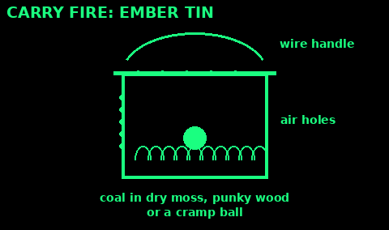
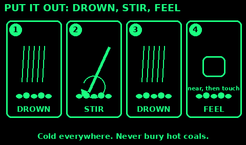

## Bank a fire overnight

Use: keep coals alive till morning so you do not have to relight. Only in a safe, cleared pit on a calm night, with you sleeping close by. If it is dry or windy, put it out instead.

1. Before bed, rake the coals into a tight heap.

2. Lay one or two thick dry hardwood logs (oak, ash, beech) on the heap.

3. Cover the heap with ash, then a thin layer of soil round the edges. Leave only a little air.

4. Check that nothing burnable is within 2 to 3 m.

5. In the morning, scrape the ash off, blow on the glow, and add fine kindling.

In a stove: load it, then close the air control most of the way.

Mistakes: a heap left open to the wind; banking among roots or peat; no one near.

Check: the heap is covered and quiet, with no flames showing.

## Carry fire

Use: take fire from one camp to the next without lighting again.

Ember carrier (tin):
1. A tin with a lid. Punch a few small holes in the lid and sides.
2. Line it with dry moss, punky dry rotten wood, or a cramp ball.
3. Put in one or two hot coals. Close it.
4. Carry it by a wire handle, away from your body. Open it every half hour to check and feed it.

Fire bundle:
1. A glowing coal or cramp ball in the middle of dry grass and shredded bark.
2. Wrap it in green leaves or bark, then tie it loosely.
3. Carry it so air reaches it. Blow on it now and then.

Mistakes: too little air (it dies); too much (it flames up); carrying it against your clothes.

Check: a warm tin, or a thread of smoke from the bundle, and a coal that glows when you blow.

## Put it out properly

Use: every time you leave a fire or go to sleep.

1. Let it burn down to ash if you have time.

2. Drown it. Pour slowly, all over, not just on the red parts. Stand back from the steam.

3. Stir with a stick. Scrape the burnt ends of logs.

4. Drown it again.

5. Feel for heat with the back of your hand held close above it. Then touch. It must be cold.

6. No water: mix in soil or sand and stir, again and again, until there is no glow and no warmth.

Do not bury hot coals. They smoulder under the soil for hours.

On peat, or if it spreads into roots, ground or grass and you cannot stop it: get away and call 999.

At home: hot ash goes in a metal bucket with a lid, outdoors, for a few days.

Mistakes: leaving when there is no smoke but heat; burying it.

Check: cold to the touch everywhere. If it is too hot to touch, it is too hot to leave.

