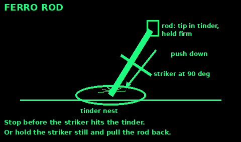
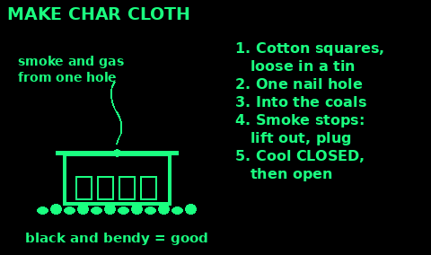
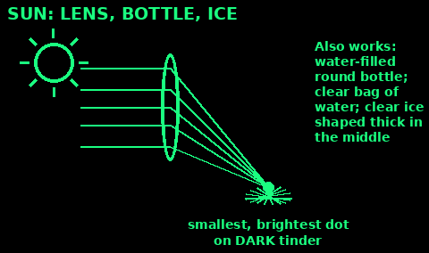
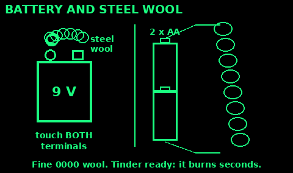
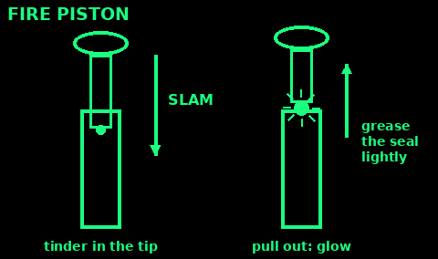
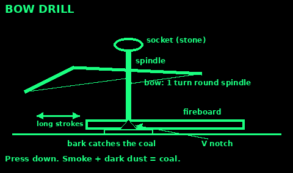
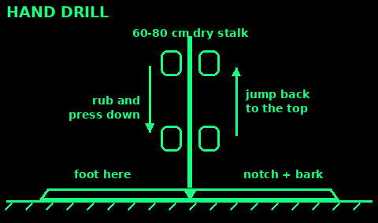
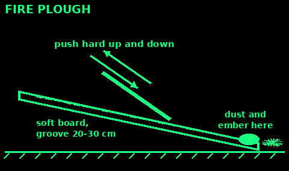
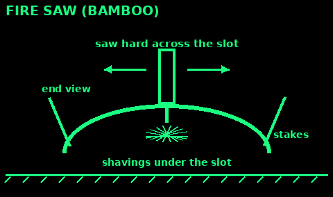
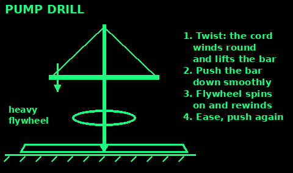

## Which method?

Use: choosing how to light a fire with what you have.

Best to worst for most people:

1. Lighter or matches. Carry two lighters and a box of matches in a sealed bag.

2. Ferro rod. Thousands of fires, works wet.

3. Sun through a lens. Free, but only in bright sun.

4. Battery and steel wool. Fast, one shot per wad.

5. Flint and steel or a fire piston. Needs char cloth or fungus.

6. Chemical: potassium permanganate and glycerine. Only with care.

7. Friction: bow drill, hand drill, plough, fire saw, pump drill. Hard. Learn before you need it.

Every method needs the same thing first: a fist of fine dry tinder, then kindling, then fuel, all gathered before you start.

Check: tinder, kindling and fuel are in three piles beside you before you strike anything.

## Ferro rod

A ferro rod (metal match) throws hot sparks wet or dry, hot or cold, for thousands of fires. It needs a sharp, square edge to strike with: the striker, or the spine of a knife.

1. Have everything ready: a fist of fine dry tinder on a dry base, then kindling, then fuel.

2. Put the tip of the rod into the edge of the tinder, held firmly.

3. Hold the striker edge at about 90 degrees to the rod.

4. Push down hard and steady along the rod. Or hold the striker still and pull the rod back, so you do not knock the tinder apart.

5. Stop the stroke before the striker hits the tinder.

6. When it catches, cup it and blow softly at the base.

Scrape a little powder from the rod or a magnesium block onto the tinder first if the tinder is poor. Practise at home. Keep the rod dry and free of rust.

## Flint and steel

Strike a hard, sharp-edged stone against carbon steel to throw sparks. Flint, chert or quartz work. Stainless steel does not spark well.

The sparks are small and cool. They will not light grass. They need tinder that catches a spark as a glowing ember: char cloth is best, or some dry fungi.

Char cloth catches these sparks best. See Make char cloth, next. Cramp ball and horse's hoof fungus work too: see Tinder and firewood.

To strike: hold the stone with the char cloth on top of it, held by your thumb near the sharp edge. Strike down glancingly with the steel. When a spark lands, the cloth glows. Put it in a tinder nest and blow it to flame.

Check: a spreading orange glow on the cloth, not just a black pinhole.

## Make char cloth

Use: making tinder that catches a weak spark (flint and steel, fire piston, sun).

1. Cut 100% cotton or linen into squares the size of a matchbox. Old jeans or T-shirts. No polyester.

2. Lay them loosely in a small tin with a tight lid. Make one nail hole in the lid.

3. Put the tin in hot coals, not flames.

4. Smoke and gas jet from the hole. It may flame. That is fine.

5. When the smoke stops, lift the tin out. Plug the hole with a twig.

6. Let it go fully cold before you open it. Air on hot char makes it burn away.

Mistakes: opening it hot; too long in the fire (grey ash); synthetic cloth (melts).

The same tin chars punky rotten wood, cattail heads, cramp balls and dry fungus.

Check: black, whole and bendy; a spark makes a spreading orange glow.

## Sun: lens, bottle or ice

Use: a clear, bright sun high in the sky (late morning to mid afternoon).

Lens: a magnifying glass, reading glasses for long sight (they make print bigger), a camera or binocular lens, or a flat plastic page magnifier (Fresnel).

1. Use dark tinder: char cloth, charred punky wood, dark dry fungus. Blacken pale tinder with charcoal.

2. Angle the lens to face the sun.

3. Move it nearer and farther until the light is the smallest, brightest dot you can get.

4. Hold it there, steady. Brace your arm on your knee. It takes seconds to a minute.

5. When it smokes and glows, blow it into a tinder nest.

No lens: a clear round bottle full of water, or a clear plastic bag of water twisted into a tight ball, makes a weaker lens. Clear ice, shaped thick in the middle and polished smooth with warm hands, also works.

Mistakes: a big blurry patch; pale tinder; haze or thin cloud.

Do not stare at the bright dot. Never point a lens at a person. Do not leave bottles and glass lying in the sun: they start wildfires.

Check: a bright point no bigger than a pinhead, and smoke within a minute.

## Battery and steel wool

Use: a quick flame from a 9 V battery or two torch batteries and very fine steel wool (grade 0000 is best).

1. Have the tinder nest and kindling ready. Steel wool burns for only a few seconds.

2. Fluff a wad of steel wool out to the size of an egg.

3. 9 V battery: touch both of its terminals to the wool at the same time.

4. Torch batteries: hold two AA or bigger in a row, end to end. Touch one strand of wool to the bottom and the other to the top.

5. It glows and spreads. Put it straight into the tinder and blow gently.

Mistakes: coarse pan-scrub wool (will not catch); wool that is damp or oily; tinder not ready.

Keep the 9 V battery's cap on, and keep it away from steel wool, keys and coins. A 9 V battery in a pocket can start a fire by itself.

Check: the wool glows orange the moment both ends touch.

## Batteries: what not to do

Use: read this before you try any battery fire.

1. Never short, cut or pierce a lithium battery: phone, laptop, power bank, vape, tool battery. It can burn in a jet of flame, explode, and give off toxic smoke. Water does not put it out quickly.

2. A swollen, hot or hissing lithium battery: move it outside onto bare ground or stone if you can do it safely, and stay back.

3. Do not use a car battery for fire. Sparks near it can explode the hydrogen it gives off.

4. Only small 1.5 V cells and 9 V batteries with steel wool, as on the steel wool card.

5. Do not carry loose batteries in a pocket or bag with keys, coins or foil.

Check: the only battery you are touching to anything is a 9 V or small torch cells.

## Potassium permanganate and glycerine

Use: a chemical fire starter. Potassium permanganate (purple crystals, sold as a disinfectant) and glycerine (from a chemist) burst into flame a short time after they touch. It works, but treat it with care.

1. Pick bare ground, away from your face and your kit.

2. Put about half a teaspoon of finely crushed permanganate on dry bark or a dry leaf, in the tinder.

3. Make a small dip in the top.

4. Add a few drops of glycerine, about half as much as the powder. Step back.

5. It smokes, then flames after 20 seconds to a minute or more. Slower in the cold. Finer powder is faster.

Mistakes: leaning over it to watch; coarse crystals in the cold (it may not light); waiting too close.

Safety:
- Keep the two in separate, labelled, sealed containers, apart from each other, fuel and food.
- Never mix them except to light a fire.
- Permanganate stains skin brown and harms eyes. Harmful if swallowed. Keep it from children.

Check: you are at arm's length or more before you add the last drop.

## Fire piston

Use: a sealed tube and plunger. Squashing air fast makes it hot enough to light char cloth. Made ones are sold; they work well when kept clean.

1. Put a pinch of char cloth or amadou in the hollow at the tip of the plunger.

2. Grease the seal lightly (the oil or grease the maker says).

3. Start the plunger in the tube.

4. Hold the tube firmly. Slam the plunger down hard and fast with your palm.

5. Pull it straight out at once.

6. If the tinder glows, tip it into a tinder nest and blow.

Mistakes: a slow push; a dry or worn seal; too much tinder.

Never use it with fuel vapour or anything but its tinder in the tube.

Check: you see a tiny glow in the tip as soon as it comes out.

## Bow drill

A friction fire. It is hard work and takes practice. Learn it before you need it.

Parts: a bow about the length of your arm with a cord. A straight, dry spindle about 2 cm thick and 25 to 30 cm long. A dry softwood fireboard about 2 cm thick (willow, lime, poplar, alder, hazel, sycamore). A socket for the top: a stone or hard wood with a dip. A flat piece of bark under the board.

1. Cut a small dip near the board's edge. Spin the spindle in it until it is burned black and round.

2. Cut a V notch from the board edge into the centre of that hole, about one eighth of the circle.

3. Put the bark under the notch. Kneel with your foot on the board.

4. One turn of the cord round the spindle. Spindle in the hole, socket on top, wrist braced against your shin.

5. Long, full, steady strokes. Press down firmly. Speed up when it smokes.

6. When the notch is full of dark powder that keeps smoking after you stop, you have a coal. Tip it gently into a tinder nest, fold the nest round it, and blow softly until it flames.

Resinous wood like pine glazes and will not work.

## Hand drill

Use: friction fire with no cord. Best in dry, warm weather. Hard on the hands.

Kit: a straight, dry, light stalk 60 to 80 cm long and about as thick as your little finger (mullein, teasel, burdock, dead elder shoots). A soft, dry hearth board (lime, willow, poplar, ivy). Bark under the notch.

1. Burn in a socket near the board edge, then cut a V notch to its centre, as for the bow drill.

2. Kneel. Foot on the board. Spindle upright in the socket.

3. Rub your flat palms back and forth on the spindle, pressing down. Your hands slide down as you go.

4. At the bottom, stop pressing for a moment, jump your hands back to the top, and carry on. Keep the spindle in the hole.

5. Start slowly to warm it, then go fast and hard for the last 20 to 30 seconds.

6. A smoking pile of dark dust in the notch is a coal. Tip it into the tinder nest.

Mistakes: a bent or green stalk; letting the tip leave the hole; stopping when it first smokes.

Two people can take turns without letting the spindle stop.

Do not use hogweed stems: the sap burns skin in sunlight.

Check: dark, fine dust that keeps smoking on its own.

## Fire plough

Use: friction fire with only two pieces of wood. Hard work; works best in hot dry weather.

1. Hearth: a dry, soft wood board. Cut a straight groove along it, about 20 to 30 cm long and a finger wide.

2. Plough: a harder dry stick, as thick as your thumb, with a blunt point.

3. Kneel at one end. Rest the far end of the board on the ground, with tinder at the far end of the groove.

4. Hold the plough at about 45 degrees. Push it hard up and down the groove.

5. Dust piles up at the far end. Go faster and press harder for the last half minute.

6. When the dust smokes on its own, tip it into the tinder and blow.

Mistakes: a groove that wanders; pushing the dust out of the groove; damp wood.

Check: a hot, dark dust pile that smokes after you stop.

## Fire saw (bamboo)

Use: friction fire where there is dry bamboo.

1. Split a dry bamboo section in half along its length.

2. Hearth: one half, curved side up. Cut a thin slot across it, through the wall, in the middle.

3. Scrape fine bamboo shavings from the inside. Ball them up under the slot, held in by the curve.

4. Pin the hearth to the ground with stakes, or brace it with a knee.

5. Saw: the other half, edge down, across the slot. Saw hard and fast back and forth.

6. Hot dust falls through the slot onto the shavings and glows. Lift them and blow.

Mistakes: green bamboo; a hearth that rocks; slow sawing.

Split bamboo edges are razor sharp. Wear gloves or wrap your hands. A sealed green section can burst in a fire.

Check: smoke rising through the slot from below.

## Pump drill

Use: friction fire with less effort than a bow drill once it is made. It also drills holes.

1. Spindle: a straight stick 60 to 90 cm long, as for a bow drill.

2. Flywheel: a heavy disc of wood or a stone with a hole, fixed tight on the spindle near the bottom.

3. Crossbar: a flat stick about forearm length with a hole in the middle. Slide it over the spindle.

4. Tie a cord from one end of the crossbar, over the top of the spindle, to the other end.

5. Turn the spindle so the cord winds round it and lifts the crossbar.

6. Push the crossbar down smoothly. The spindle spins, the flywheel carries on, and the cord winds back up. Ease off, then push again.

7. Fireboard and notch as for a bow drill.

Mistakes: a light flywheel; pushing too hard so it stalls; a wobbly spindle.

Check: steady even rhythm, smoke from the notch in a minute or so.

