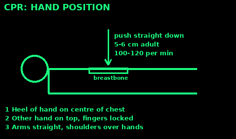
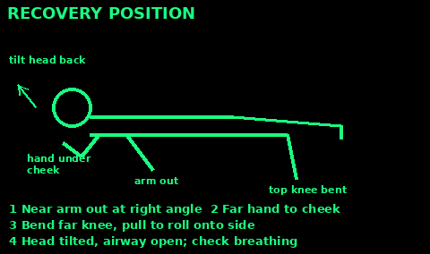
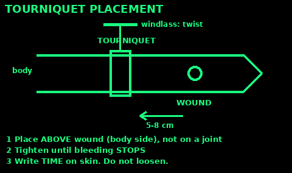
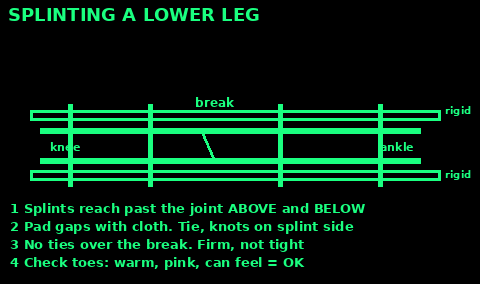
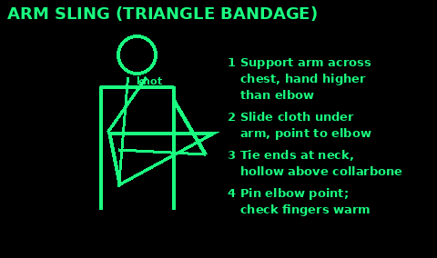

## Scene safety and DRABC

Do this in order every time.

1. Danger: look for fire, traffic, falling rock, water, power lines, angry animals. Do not become a second casualty.

2. Response: tap shoulders, shout "Can you hear me?"

3. Airway: one hand on forehead, two fingers under the chin. Tilt the head back.

4. Breathing: look, listen, feel for 10 seconds. Gasps are not normal breathing.

5. Circulation: look for heavy bleeding and stop it.

Not breathing normally: start CPR. Breathing but unresponsive: recovery position. Send someone for help. See Signals & Radio under More.

## CPR: adult

Use when the person is unresponsive and not breathing normally.

1. Kneel beside them. Heel of one hand on the centre of the chest, other hand on top.

2. Arms straight. Push down 5 to 6 cm, let the chest come fully back up.

3. Speed: 100 to 120 a minute. Count out loud.

4. After 30 pushes, tilt the head, pinch the nose, seal your mouth over theirs. Give 2 breaths, each about 1 second, watch the chest rise.

5. Keep going 30:2. If you cannot or will not give breaths, push without stopping.

Stop only if they breathe normally, help takes over, or you are exhausted or in danger.

## CPR: child and baby

Children usually stop breathing first, so breaths matter more.

1. Open the airway. Give 5 rescue breaths first.

2. Child: push the centre of the chest with one or two hands, one third of the chest depth (about 5 cm).

3. Baby under 1: two fingers or two thumbs on the centre of the chest, about 4 cm deep. Cover mouth and nose with your mouth for breaths. Keep the head level, not tipped far back.

4. Rate 100 to 120 a minute. 15 pushes then 2 breaths. If you only know adult CPR, 30:2 is fine.

5. Alone with no phone: do 1 minute of CPR, then go for help.

## Recovery position

For someone unresponsive who is breathing normally.

1. Kneel beside them. Put the near arm out at a right angle, palm up.

2. Bring the far arm across the chest. Hold the back of that hand against their near cheek.

3. Pull the far knee up so the foot is flat.

4. Pull on the knee to roll them toward you onto their side.

5. Bend the top leg at hip and knee. Tilt the head back so fluid drains out of the mouth.

Check breathing every minute. If it stops, roll back and start CPR. Possible spine injury: keep head and body in line while rolling.

## Choking

Adult or child over 1 year:

1. Can they cough? Tell them to keep coughing.

2. Cannot cough, speak or breathe: lean them forward. Give up to 5 sharp back blows between the shoulder blades with the heel of your hand.

3. Still blocked: stand behind, fist just above the belly button, other hand over it. Pull sharply in and up. Up to 5 times.

4. Still blocked: call 999 (or send someone) and keep alternating 5 back blows and 5 thrusts.

No blind finger sweeps in the mouth. Pregnant or too big to reach round: put your hands higher, on the lower breastbone, and give chest thrusts.

Baby under 1: lay face down along your forearm, head low, 5 back blows. Then turn face up, 2 fingers on the breastbone, 5 chest thrusts. Never belly thrusts on a baby.

If they go unresponsive, start CPR. Anyone given abdominal thrusts must be checked by a doctor.

## Severe bleeding

1. Press hard right on the wound with a pad, cloth or your gloved hand. Keep pressing for at least 10 minutes. Do not peek.

2. Blood soaks through: add more cloth on top. Do not remove the first pad.

3. Deep wound: pack cloth firmly into it, then press.

4. Tie a bandage firmly over the pad. Check fingers or toes beyond it stay warm and pink.

5. Lay them down. Keep them warm. Watch for shock.

Something stuck in the wound: leave it in. Press around it, not on it.

Arm or leg bleeding that will not stop with pressure: tourniquet, next card.

## Tourniquet

Only for life-threatening limb bleeding that pressure cannot stop.

1. Place it 5 to 8 cm (2 to 3 inches) above the wound, between wound and body. Never over a joint (elbow, knee, wrist, ankle). Wound near or below a joint: go above the joint. If you cannot see where it bleeds from, go high on the limb.

2. Use a strip at least 4 cm wide. Thin cord cuts skin.

3. Tie it, put a stick on the knot, tie again. Twist the stick until the bleeding stops. It will hurt.

4. Lock the stick in place with another tie.

5. Write the time on the skin or the tourniquet.

Do not loosen it. Do not cover it. If bleeding continues, add a second one above the first. Getting help is now urgent.

## Clean a wound

Cleaning is the best way to prevent infection.

1. Wash your hands. Stop the bleeding first.

2. Rinse the wound with lots of clean water: boiled and cooled, or safe drinking water. Pour from a height or squirt from a bag with a pin hole. A litre or more for a dirty wound.

3. Pick out dirt with tweezers boiled for 1 minute.

4. Saline is optional: 1 level teaspoon of salt in 500 ml boiled water. Plain clean water works about as well.

5. Do not pour strong antiseptics, alcohol or peroxide deep into the wound. They harm tissue.

6. Cover with a clean dressing. Change it daily or when wet.

## Close a wound without stitches

Only close small, clean, straight cuts less than 12 hours old.

1. Clean it first (last card). Dry the skin around it.

2. Use wound closure strips or thin tape strips. Stick one side, push the edges together, stick the other side.

3. Start in the middle. Space strips about 3 mm apart.

4. Cover with a dressing.

Leave OPEN and just dress: bites, puncture wounds, very dirty wounds, old wounds, anything already red or hot. Closing these traps germs. Pack loosely with clean damp cloth and change daily.

Get help for wounds that gape wide, on the face or hands, or that go deep.

## Signs of infection

Watch every wound daily for 2 weeks.

Infection signs:

1. Redness spreading around the wound.

2. Swelling, heat, and pain that gets worse after day 2.

3. Pus or a bad smell.

4. Red lines running up the limb.

5. Fever, chills, feeling very unwell.

What to do: open the dressing, clean again, let pus drain, rinse well. Keep the limb raised and rested. Change dressings more often.

Get help urgently if: red streaks, fever, the person is confused, or redness spreads fast. They need antibiotics. Tetanus is a risk with dirty wounds if vaccines are not up to date.

## Burns

1. Stop the burning. Remove from heat. Smother flames: stop, drop, roll.

2. Cool with cool running water for 20 minutes. Not ice. Cooling helps up to 3 hours after.

3. Take off rings, watches and clothing near the burn, unless stuck to skin.

4. Cover loosely with cling film laid on, not wrapped, or a clean non-fluffy cloth.

5. Keep the person warm. Cool the burn, not the person.

6. Do not burst blisters. No butter, oil or toothpaste.

Get help if: the burn is bigger than the person's hand, on face, hands, feet, groin or joints, is white or charred, is from chemicals or electricity, or the person is a child, elderly, or breathed in smoke.

## Fractures and splints

Signs: pain, swelling, odd shape, cannot use it, grating feeling.

1. Do not try to straighten it unless there is no pulse beyond the break and help is far away.

2. Pad and support it in the position you found it.

3. Splint with anything stiff: sticks, poles, rolled newspaper, a sleeping mat.

4. The splint must reach past the joint above and the joint below the break.

5. Tie at several points, never over the break. Firm, not tight.

6. Check fingers or toes every 15 minutes. Cold, blue, numb: loosen.

Open fracture (bone through skin): cover with clean dressing, press around it, splint.

## Arm sling

For a broken arm, wrist, collarbone or bad sprain.

1. Have them hold the injured arm across the chest, hand a little higher than the elbow.

2. Slide a large triangle of cloth under the arm. Point at the elbow, top corner over the uninjured shoulder.

3. Bring the bottom corner up over the arm to the injured side shoulder.

4. Tie the corners in the hollow above the collarbone.

5. Twist or pin the point at the elbow.

No cloth: pin the sleeve to the shirt, or button the hand into the jacket. Check fingers stay warm and pink.

## Sprains and strains

Twisted joint, swelling, pain, but can bear some weight.

1. Rest it for 2 to 3 days. Use a stick or crutch.

2. Cool it: cold wet cloth or ice wrapped in cloth, 20 minutes every 2 to 3 hours. Never ice straight on skin.

3. Wrap it with a bandage firm enough to support, loose enough for 2 fingers under.

4. Raise it above heart level when you can.

5. After 2 to 3 days start gentle movement.

Pain relief: paracetamol, or ibuprofen after the first 48 hours.

Treat as a fracture if: cannot take any weight, bone feels wrong, numbness, or no better after a week.

## Shock

Shock is when blood flow fails. It kills. Common after heavy bleeding, burns, or severe allergy.

Signs: pale, cold, clammy skin. Fast weak pulse. Fast shallow breathing. Thirst. Confusion, sleepiness.

1. Treat the cause: stop bleeding.

2. Lay them flat. If no leg injury, raise the legs.

3. Keep them warm: insulate from the ground, cover them.

4. Loosen tight clothes.

5. Do not give food or drink. Wet the lips if thirsty.

6. Stay with them. Check breathing often. Be ready for CPR.

This needs hospital care. Signal for help now.

## Hypothermia

Body too cold. Watch for the "umbles": stumbles, mumbles, fumbles, grumbles.

Mild: shivering, cold, clumsy. Severe: shivering stops, confused, drowsy.

1. Get out of wind and wet. Shelter.

2. Replace wet clothes with dry. Insulate from the ground.

3. Wrap in blankets, sleeping bag, foil sheet. Cover the head.

4. Warm sweet drinks if fully awake and able to swallow.

5. Share body heat in a sleeping bag.

6. Warm slowly. Do not rub limbs or use hot baths.

7. Handle gently. Severe cases can stop the heart.

No alcohol. If unresponsive and not breathing normally, start CPR.

## Heat exhaustion and heatstroke

Heat exhaustion: headache, dizzy, sweating, pale clammy skin, cramps, sick, very thirsty.

1. Move to shade or somewhere cool.

2. Lie down, raise feet a little.

3. Drink water or ORS (see the dehydration card).

4. Cool the skin: wet cloths, fan them.

Should improve within 30 minutes.

Heatstroke is an emergency: temperature very high, hot skin that may be dry, confused, fits, or collapse.

1. Cool fast: soak with water, fan hard, cold packs in armpits and neck.

2. Recovery position if unresponsive.

3. Get help urgently.

## Dehydration and ORS recipe

Signs: thirst, dark yellow pee or little pee, dry mouth, headache, dizziness. Children: sunken eyes, no tears, floppy.

Homemade oral rehydration salts (WHO recipe):

1. 1 litre of safe water, boiled and cooled.

2. 6 level teaspoons of sugar.

3. Half a level teaspoon of salt.

4. Stir until dissolved. It should taste no saltier than tears.

Sip often. Small sips if vomiting, every few minutes. Make fresh every 24 hours.

Evidence: strong. ORS saves millions of lives. Packet ORS is better if you have it.

Get help if: no pee for 8 hours, very sleepy or confused, cannot keep fluid down, or a baby with a sunken soft spot.

## Diarrhoea

Usually clears in 5 to 7 days. The danger is losing water.

1. Drink ORS after every loose stool. Adults about 200 to 400 ml. Children 50 to 100 ml (under 2) or 100 to 200 ml (older).

2. Keep breastfeeding babies.

3. Eat small plain meals when hungry.

4. Wash hands with soap after the toilet and before food. Boil water.

5. Adults only: loperamide can help (see medicine cards). Not if there is blood in the poo or a high fever.

Get help if: blood in poo, high fever, more than 7 days (2 days in children), signs of dehydration, or severe belly pain.

## Allergic reaction and anaphylaxis

Mild: itchy rash, hives, sneezing, puffy eyes. Give an antihistamine (see medicine cards). Watch them.

Anaphylaxis is life-threatening. Signs: swelling of lips, tongue or throat; trouble breathing, wheeze; hoarse voice; pale, floppy, faint; collapse.

1. Use their adrenaline auto-injector now. Outer thigh, through clothing if needed. Hold as the device says.

2. Lie them flat with legs raised. If breathing is hard, let them sit up.

3. No improvement after 5 minutes: give a second injector if available.

4. Antihistamines are not enough for anaphylaxis.

5. Be ready for CPR. Get help urgently, even if they improve.

## Bites and stings

Bee sting: scrape the sting out sideways with a fingernail or card. Wash, cool with a cold cloth.

Tick: grip close to the skin with fine tweezers, pull straight up slowly. Wash. Watch 4 weeks for a spreading red ring rash or fever.

Animal bite: wash with soap and lots of running water for several minutes. Do not close it. Rabies risk if the animal could carry it: get help.

Snake bite: keep still and calm. Keep the limb still and at heart level. Remove rings. No cutting, sucking, ice or tourniquet. Note the time. Get help.

Watch all bites and stings for anaphylaxis and infection.

## Eye injuries

Grit: blink. Rinse with clean water from the inner corner outward. Do not rub.

Chemical in eye: rinse with lots of clean water for at least 20 minutes. Hold the eye open. Tilt so water runs away from the other eye. Get help.

Object stuck in the eye: do not remove it. Cover both eyes loosely (eyes move together). A paper cup over the object helps. Get help.

Blow to the eye: cool cloth for 15 minutes, no pressure on the eye.

Get help if: changes in vision, pain that does not settle, blood in the eye, or anything stuck.

## Medicine safety first

Rules for the dose cards that follow. Doses are from NHS guidance. Packet instructions win if they differ.

1. Check the label: name, strength (mg), and expiry.

2. Never give more than the maximum in 24 hours. Write down every dose and the time.

3. Many cold and flu products already contain paracetamol. Do not double up.

4. Children: use the syringe or spoon that comes with the liquid, not a kitchen spoon.

5. Do not use for more than 3 days without advice.

Do not give ibuprofen to anyone with asthma made worse by it, stomach ulcers, kidney problems, pregnancy, or dehydration. Never give aspirin to under 16s.

## Dose: paracetamol

Adults and 16+: 500 mg to 1 g (1 or 2 x 500 mg tablets). Wait at least 4 hours between doses. No more than 8 x 500 mg tablets (4 g) in 24 hours. Under 50 kg: you may need a lower dose. No more than 3 days without advice.

Infant liquid 120 mg in 5 ml:

3 to 5 months: 2.5 ml

6 to 23 months: 5 ml

2 to 3 years: 7.5 ml

4 to 5 years: 10 ml

Six plus liquid 250 mg in 5 ml:

6 to 7 years: 5 ml

8 to 9 years: 7.5 ml

10 to 11 years: 10 ml

12 to 15 years: 10 to 15 ml

16 to 17 years: 10 to 20 ml

Children 3 months+: up to 4 doses in 24 hours, at least 4 hours apart. Babies 2 to 3 months, over 4 kg and born after 37 weeks: 2.5 ml infant liquid, up to 2 doses a day, 4 hours apart. Under 2 months: get medical advice. No more than 3 days without advice. Overdose can harm the liver even if they seem fine: get help.

## Dose: ibuprofen

Adults: 200 to 400 mg, up to 3 times a day with food, at least 4 hours apart. Over-the-counter maximum 1,200 mg in 24 hours.

Infant liquid 100 mg in 5 ml, every 6 to 8 hours:

3 to 6 months (over 5 kg): 2.5 ml, up to 3 a day

6 to 12 months: 2.5 ml, 3 or 4 a day

1 to 3 years: 5 ml, 3 a day

4 to 6 years: 7.5 ml, 3 a day

7 to 9 years: 10 ml, 3 a day

Seven plus liquid 200 mg in 5 ml, 10 to 12 years: 7.5 ml, 3 a day

12 to 17 years: 200 to 400 mg (1 or 2 x 200 mg tablets), every 6 to 8 hours, max 6 tablets a day.

Stop and get help if: black poo, vomiting blood, bad stomach pain, wheeze. Children: do not give ibuprofen and paracetamol at the same time. Adults can take both together.

## Dose: antihistamine and loperamide

Cetirizine (non-drowsy), for rash, hives, hay fever, itchy bites:

Adults and 12+: 10 mg once a day.

6 to 11 years: 5 mg twice a day.

2 to 5 years: 2.5 mg twice a day.

Under 2: get advice. A doctor works out the dose by weight.

Loperamide (2 mg capsules), for short-term diarrhoea, adults and children 12+:

2 capsules at first, then 1 after each loose stool. Maximum 6 capsules in 24 hours (bought over the counter). Stop when stools firm up. No more than 48 hours without a doctor.

Not for children under 12 unless a doctor prescribes it. Not if blood in poo or fever. Too much can cause heart rhythm problems.

ORS: no maximum. Drink to replace losses.

## Natural remedies: what works

Honest evidence levels.

Honey on wounds and burns: moderate evidence it helps healing. Medical-grade honey is best; plain honey is less tested. Never give honey to babies under 1, by mouth or on wounds.

Clean water irrigation: strong evidence. Tap-quality water is as good as saline for cleaning.

Home ORS (sugar and salt): strong evidence.

Cool water on burns: strong evidence.

Honey for cough in children over 1: moderate evidence. Half to 1 teaspoon.

Ginger for nausea: weak to moderate evidence.

Garlic, tea tree oil, herbal poultices on wounds: weak evidence, can irritate. Do not rely on them.

Urine on stings: no evidence. Do not.

## Build a first aid kit

Keep it dry in a clear box. Check every 6 months.

1. Gloves, tweezers, small scissors, safety pins.

2. Plasters, closure strips, sterile pads, crepe and triangle bandages, tape.

3. Trauma dressing and a commercial tourniquet if you can get one.

4. Foil blanket, cling film for burns.

5. Saline pods or a syringe for rinsing.

6. Paracetamol, ibuprofen, cetirizine, loperamide, ORS sachets. Child liquids if you have children.

7. Thermometer, pencil and notebook to log doses.

8. Any personal meds: adrenaline auto-injectors, inhalers.

9. Soap and hand gel.

## Sources

Written in our own words from public guidance:

NHS medicines: nhs.uk/medicines/paracetamol-for-adults, nhs.uk/medicines/paracetamol-for-children, nhs.uk/medicines/ibuprofen-for-adults, nhs.uk/medicines/ibuprofen-for-children, nhs.uk/medicines/cetirizine, nhs.uk/medicines/loperamide

NHS: nhs.uk/conditions/burns-and-scalds. NHS 111 Wales choking: 111.wales.nhs.uk/encyclopaedia/ch/article/choking. British Red Cross first aid: redcross.org.uk/first-aid

Resuscitation Council UK 2025 guidelines: resus.org.uk/professional-library/2025-resuscitation-guidelines/adult-basic-life-support-guidelines, resus.org.uk/professional-library/2025-resuscitation-guidelines/paediatric-basic-life-support-guidelines, resus.org.uk/professional-library/2025-resuscitation-guidelines/first-aid-guidelines (choking)

WHO ORS and diarrhoea: who.int/news-room/fact-sheets/detail/diarrhoeal-disease and who.int/news-room/questions-and-answers/item/cholera-outbreaks (home ORS recipe)

Tourniquet: stopthebleed.org (American College of Surgeons) and the Stop the Bleed tourniquet sheet at dhs.gov/sites/default/files/publications/STB_Applying_Tourniquet_08-06-2018_0.pdf

British Red Cross and American Red Cross first aid guidance.

CDC: wound care, heat illness, tick removal, snakebite (cdc.gov).

US Army FM 21-76 / ATP 3-50.21 Survival (public domain).

Hesperian, Where There Is No Doctor (free non-commercial).

This is first aid, not a doctor. Get medical help as soon as you can.
