## Scene safety and DRABC

Do this in order every time.

1. Danger: look for fire, traffic, falling rock, water, power lines, angry animals. Do not become a second casualty.

2. Response: tap shoulders, shout "Can you hear me?"

3. Airway: one hand on forehead, two fingers under the chin. Tilt the head back.

4. Breathing: look, listen, feel for 10 seconds. Gasps are not normal breathing.

5. Circulation: look for heavy bleeding and stop it.

Not breathing normally: start CPR. Breathing but unresponsive: recovery position. Send someone for help. See Signals & Radio under More.

## CPR: adult

Use when the person is unresponsive and not breathing normally.

1. Kneel beside them. Heel of one hand on the centre of the chest, other hand on top.

2. Arms straight. Push down 5 to 6 cm, let the chest come fully back up.

3. Speed: 100 to 120 a minute. Count out loud.

4. After 30 pushes, tilt the head, pinch the nose, seal your mouth over theirs. Give 2 breaths, each about 1 second, watch the chest rise.

5. Keep going 30:2. If you cannot or will not give breaths, push without stopping.

Stop only if they breathe normally, help takes over, or you are exhausted or in danger.

## CPR: child and baby

Children usually stop breathing first, so breaths matter more.

1. Open the airway. Give 5 rescue breaths first.

2. Child: push the centre of the chest with one or two hands, one third of the chest depth (about 5 cm).

3. Baby under 1: two fingers or two thumbs on the centre of the chest, about 4 cm deep. Cover mouth and nose with your mouth for breaths. Keep the head level, not tipped far back.

4. Rate 100 to 120 a minute. 15 pushes then 2 breaths. If you only know adult CPR, 30:2 is fine.

5. Alone with no phone: do 1 minute of CPR, then go for help.

## Defibrillator (AED)

Anyone can use one. No training is needed. It talks you through every step and only shocks a heart that needs it.

1. Keep CPR going. Send someone for the AED. Public ones hang in cabinets on walls; 999 can give the code and say where the nearest one is.

2. Open the lid or press the power button. Do what the voice says.

3. Bare the chest. Wipe it dry. Peel off any medicine patch.

4. Pads as the picture on them shows: one below the right collarbone, one on the left side of the chest, below the armpit. Not over a pacemaker bump under the skin: move the pad aside.

5. While it checks the heart, nobody touches the person.

6. Shock advised: shout "Stand clear!", look that nobody touches, press the shock button if it asks.

7. Straight back to CPR after a shock or a "no shock" message. Leave the pads on. Keep following the voice.

Child: use child pads or the child setting if there is one. If not, adult pads are fine. If the pads would touch on a small chest, put one on the front centre and one on the back.

Wet person: move them off water and dry the chest first.

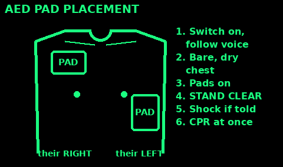

## Drowning

Do not swim out to someone. Many rescuers drown.

1. Shout to them to float on their back, arms and legs out. Cold water causes gasping for about the first minute; floating for 60 to 90 seconds lets it pass.

2. Reach with a stick, branch, pole or piece of clothing while you lie flat on the bank. Or throw a rope or anything that floats.

3. Call 999 and ask for the Coastguard at the coast, or Fire and Rescue inland.

Once they are out:

4. Not breathing normally: give 5 rescue breaths first, then CPR 30 pushes to 2 breaths. Alone with no phone: do 1 minute of CPR, then go for help.

5. Vomiting is common. Turn the head to the side, clear the mouth, carry on.

6. Breathing: recovery position, wet clothes off, wrap them up warm. See Hypothermia.

Anyone who breathed in water must see a doctor, even if they seem fine. Breathing problems can start hours later.

## Recovery position

For someone unresponsive who is breathing normally.

1. Kneel beside them. Put the near arm out at a right angle, palm up.

2. Bring the far arm across the chest. Hold the back of that hand against their near cheek.

3. Pull the far knee up so the foot is flat.

4. Pull on the knee to roll them toward you onto their side.

5. Bend the top leg at hip and knee. Tilt the head back so fluid drains out of the mouth.

Check breathing every minute. If it stops, roll back and start CPR. Possible spine injury: keep head and body in line while rolling.

## Choking

Adult or child over 1 year:

1. Can they cough? Tell them to keep coughing.

2. Cannot cough, speak or breathe: lean them forward. Give up to 5 sharp back blows between the shoulder blades with the heel of your hand.

3. Still blocked: stand behind, fist just above the belly button, other hand over it. Pull sharply in and up. Up to 5 times.

4. Still blocked: call 999 (or send someone) and keep alternating 5 back blows and 5 thrusts.

No blind finger sweeps in the mouth. Pregnant or too big to reach round: put your hands higher, on the lower breastbone, and give chest thrusts.

Baby under 1: lay face down along your forearm, head low, 5 back blows. Then turn face up, 2 fingers on the breastbone, 5 chest thrusts. Never belly thrusts on a baby.

If they go unresponsive, start CPR. Anyone given abdominal thrusts must be checked by a doctor.

## Heart attack

A blocked artery starves part of the heart. Fast help saves heart muscle.

Signs:
- Crushing, squeezing or heavy pain in the centre of the chest. It may spread to the arms, neck, jaw, back or belly.
- Short of breath, sweating, feeling sick, grey or pale.
- Some people (often women, older people and diabetics) feel only breathless, sick or "indigestion".

1. Call 999 at once. Do not let them walk or drive.

2. Sit them on the floor, knees bent, back against a wall or your legs. This eases the heart.

3. Aspirin 300 mg, chewed slowly, for adults who are not allergic to it. If you only have 75 mg tablets, 4 of them make 300 mg. Not for under 16s.

4. If they have angina spray (GTN), help them use it.

5. Loosen tight clothes. Keep them calm and still.

6. Check breathing often. If they become unresponsive and stop breathing normally, start CPR and get an AED.

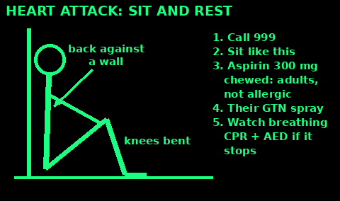

## Stroke: FAST

A stroke is a blocked or burst vessel in the brain. Every minute counts.

Think FAST:
- Face: has one side drooped? Ask them to smile.
- Arms: can they lift both arms and hold them up? One may drift down.
- Speech: slurred, muddled, or no words?
- Time: call 999 now if you see any one of these.

Other signs: sudden weakness or numbness down one side, sudden loss of sight, dizziness and falling, confusion, a sudden very bad headache.

1. Call 999. Note the time the signs started. Doctors need it.

2. Do not give food, drink or tablets. Swallowing may not work.

3. Awake: let them rest, propped up and comfortable. Reassure them; they may understand you even if they cannot speak.

4. Unresponsive but breathing: recovery position, weak side up. Not breathing: CPR.

Signs that come and go still need 999 the same day. It can be a warning stroke.

A diabetic with a low sugar can look like a stroke. If they can swallow, see Diabetic emergency.

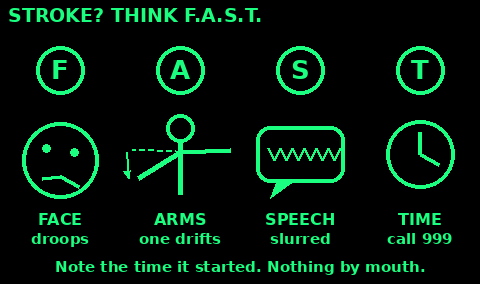

## Asthma attack

Signs: wheeze, cough, tight chest, short of breath, cannot finish a sentence. Getting worse quickly.

1. Sit them up straight, leaning slightly forward. Stay calm and keep them calm. Loosen tight clothes.

2. Blue reliever inhaler (salbutamol): 1 puff every 30 to 60 seconds, up to 10 puffs. Shake it between puffs. Use a spacer if they have one.

3. AIR or MART inhaler (one inhaler for both prevention and relief): 1 puff every 1 to 3 minutes, up to 6 puffs.

4. Their own asthma plan wins if it says something different.

Call 999 if: they get worse at any time, they are no better after the full dose, or they have no inhaler.

Still no better after 10 minutes and no ambulance yet: repeat the same dose.

Danger signs: blue or grey lips, too breathless to talk, exhausted, confused, or the wheeze goes quiet but they still cannot breathe.

After any attack they should see a doctor or nurse within 2 days.

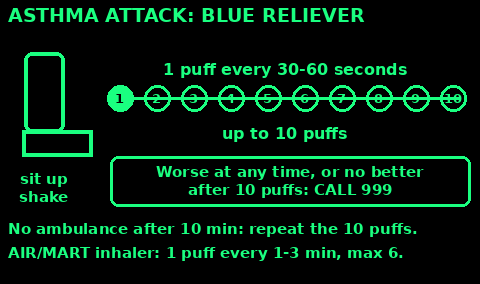

## Seizures (fits)

Most seizures stop on their own within a few minutes. Your job is to keep the person safe.

During the seizure:

1. Note the time it starts.

2. Move hard or hot things away. Only move the person if they are in danger, such as a road, water or a fire.

3. Cushion the head: a folded coat, or your hands.

4. Loosen anything tight round the neck.

5. Do not hold them down. Do not put anything in their mouth, not even a finger. They will not swallow their tongue.

After it stops:

6. Roll them onto their side (recovery position). Check breathing.

7. Stay and talk calmly. They may be confused, sleepy or embarrassed. Nothing to eat or drink until fully awake.

Call 999 if: it is their first seizure, it lasts more than 5 minutes (or longer than usual for them), another starts before they wake, they are injured, or breathing is a problem afterwards.

People with epilepsy may carry a card or a care plan with their own rescue medicine. Follow it if you have been shown how.

## Diabetic emergency: low sugar

Low blood sugar (a "hypo") comes on in minutes in people who take insulin or some diabetes tablets.

Signs: shaky, sweaty, pale, hungry, grumpy or odd, confused, blurred vision, drowsy. It can look like being drunk.

If they are awake and can swallow:

1. Sit them down. Give 15 to 20 g of fast sugar: 5 glucose or dextrose tablets, or a small glass of fruit juice or a sugary (not diet) fizzy drink, or 4 large jelly babies, or 2 tubes of glucose gel.

2. Wait 10 to 15 minutes. Check their sugar with their meter if they have one: aim for above 4 mmol/L.

3. Still unwell or under 4: give the same again and check after another 10 to 15 minutes. Still low after 3 rounds: get medical help.

4. Once better, give a starchy snack: a sandwich, biscuits, or their next meal.

Unresponsive or cannot swallow safely:

5. Nothing by mouth. They will choke.

6. Recovery position. Call 999. If they have a glucagon kit and you know how to use it, give it.

Not sure if it is low or high sugar? Give sugar. It helps a low quickly and does little harm to a high.

## Severe bleeding

1. Press hard right on the wound with a pad, cloth or your gloved hand. Keep pressing for at least 10 minutes. Do not peek.

2. Blood soaks through: add more cloth on top. Do not remove the first pad.

3. Deep wound: pack cloth firmly into it, then press.

4. Tie a bandage firmly over the pad. Check fingers or toes beyond it stay warm and pink.

5. Lay them down. Keep them warm. Watch for shock.

Something stuck in the wound: leave it in. Press around it, not on it.

Arm or leg bleeding that will not stop with pressure: tourniquet, next card.

## Tourniquet

Only for life-threatening limb bleeding that pressure cannot stop.

1. Place it 5 to 8 cm (2 to 3 inches) above the wound, between wound and body. Never over a joint (elbow, knee, wrist, ankle). Wound near or below a joint: go above the joint. If you cannot see where it bleeds from, go high on the limb.

2. Use a strip at least 4 cm wide. Thin cord cuts skin.

3. Tie it, put a stick on the knot, tie again. Twist the stick until the bleeding stops. It will hurt.

4. Lock the stick in place with another tie.

5. Write the time on the skin or the tourniquet.

Do not loosen it. Do not cover it. If bleeding continues, add a second one above the first. Getting help is now urgent.

## Chest wound

A wound that goes through the chest wall can let air in round the lung. You may hear sucking or see bubbles when they breathe.

Current UK guidance (Resuscitation Council UK, 2025):

1. Call 999.

2. Leave the wound open to the air. Do not cover it with plastic, tape or any airtight dressing. Sealing it can trap air inside the chest and squeeze the lung and heart.

3. If it bleeds, press beside or on it with a pad to control the bleeding, then lift the pad away when it stops.

4. Trained, with a vented chest seal? You may use that, because it lets air out. Watch that blood does not clog the vent.

5. Sit them up, leaning toward the injured side, if that helps their breathing.

6. Something stuck in the chest: leave it in. Pad around it.

7. Watch closely: worse breathing, blue lips, faster pulse, collapse. Be ready for CPR.

Older books say to tape plastic on three sides. That is no longer advised for first aiders.

## Nosebleed

1. Sit down and lean forward, head tilted forward, mouth open. Do not tip the head back: blood runs down the throat and makes you sick.

2. Pinch the soft part of the nose, just above the nostrils, firmly.

3. Hold for 10 to 15 minutes by the clock. Breathe through the mouth. Do not let go to check.

4. Spit blood out rather than swallow it.

5. A cold pack on the bridge of the nose may help a little.

After it stops, for 24 hours: do not blow or pick the nose, no hot drinks or alcohol, no heavy lifting, and do not lie flat.

Get help if: it is still bleeding after 15 minutes of good pressure, it is heavy, it started after a blow to the head, they feel faint or weak, they are on blood thinners, or breathing is hard.

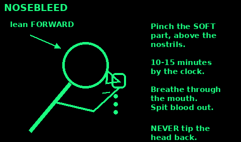

## Clean a wound

Cleaning is the best way to prevent infection.

1. Wash your hands. Stop the bleeding first.

2. Rinse the wound with lots of clean water: boiled and cooled, or safe drinking water. Pour from a height or squirt from a bag with a pin hole. A litre or more for a dirty wound.

3. Pick out dirt with tweezers boiled for 1 minute.

4. Saline is optional: 1 level teaspoon of salt in 500 ml boiled water. Plain clean water works about as well.

5. Do not pour strong antiseptics, alcohol or peroxide deep into the wound. They harm tissue.

6. Cover with a clean dressing. Change it daily or when wet.

## Close a wound without stitches

Only close small, clean, straight cuts less than 12 hours old.

1. Clean it first (last card). Dry the skin around it.

2. Use wound closure strips or thin tape strips. Stick one side, push the edges together, stick the other side.

3. Start in the middle. Space strips about 3 mm apart.

4. Cover with a dressing.

Leave OPEN and just dress: bites, puncture wounds, very dirty wounds, old wounds, anything already red or hot. Closing these traps germs. Pack loosely with clean damp cloth and change daily.

Get help for wounds that gape wide, on the face or hands, or that go deep.

## Signs of infection

Watch every wound daily for 2 weeks.

Infection signs:

1. Redness spreading around the wound.

2. Swelling, heat, and pain that gets worse after day 2.

3. Pus or a bad smell.

4. Red lines running up the limb.

5. Fever, chills, feeling very unwell.

What to do: open the dressing, clean again, let pus drain, rinse well. Keep the limb raised and rested. Change dressings more often.

Get help urgently if: red streaks, fever, the person is confused, or redness spreads fast. They need antibiotics. Tetanus is a risk with dirty wounds if vaccines are not up to date.

## Splinters

1. Wash your hands and the skin with soap and water.

2. Sterilise tweezers and a needle: boil for 1 minute, or hold in a flame until red and let it cool, or wipe with alcohol.

3. Part of it sticks out: grip it close to the skin and pull out slowly, at the same angle it went in.

4. All under the skin: gently lift the skin over one end with the needle until you can grip it. Do not dig deep.

5. Squeeze gently to make it bleed a little, wash again, and cover.

6. Hard to see? Soak the skin in warm water for 10 minutes first, or use a magnifier in good light.

Leave it and get help if: it is deep, large, or in an eye, under a nail you cannot reach, or near a joint. Glass and metal often need a doctor.

Watch for infection over the next days (see Signs of infection). Tetanus is a risk with soil-dirty splinters if vaccines are not up to date.

## Burns

1. Stop the burning. Remove from heat. Smother flames: stop, drop, roll.

2. Cool with cool running water for 20 minutes. Not ice. Cooling helps up to 3 hours after.

3. Take off rings, watches and clothing near the burn, unless stuck to skin.

4. Cover loosely with cling film laid on, not wrapped, or a clean non-fluffy cloth.

5. Keep the person warm. Cool the burn, not the person.

6. Do not burst blisters. No butter, oil or toothpaste.

Get help if: the burn is bigger than the person's hand, on face, hands, feet, groin or joints, is white or charred, is from chemicals or electricity, or the person is a child, elderly, or breathed in smoke.

## Electric shock

Never touch someone who may still be touching the power.

House power (mains, 230 V):

1. Switch off at the fuse box (consumer unit), or pull the plug out.

2. Cannot switch off? Stand on something dry that does not conduct: a rubber mat, a wooden box, a thick pile of newspaper. Push the person, or the cable, away with a dry wooden broom handle or chair.

3. Or loop a dry rope round their ankles or under their arms and pull, without touching them.

High voltage (power lines, pylons, substations, railways):

4. Keep everyone at least 18 metres away. Power can jump through the air. Call 999 and say "high voltage". In the UK call 105 to report damaged power lines.

5. Do not go near until the power company says it is off.

Once the power is off:

6. Check breathing. Start CPR and use an AED if needed.

7. Cool burns with cool running water for 20 minutes. Look for two burns: where the power went in and where it came out.

Everyone who had a big shock must see a doctor. It can upset the heart rhythm and burn deep inside.

Lightning: people struck are safe to touch straight away. Start CPR if needed; lightning victims often recover.

## Fractures and splints

Signs: pain, swelling, odd shape, cannot use it, grating feeling.

1. Do not try to straighten it unless there is no pulse beyond the break and help is far away.

2. Pad and support it in the position you found it.

3. Splint with anything stiff: sticks, poles, rolled newspaper, a sleeping mat.

4. The splint must reach past the joint above and the joint below the break.

5. Tie at several points, never over the break. Firm, not tight.

6. Check fingers or toes every 15 minutes. Cold, blue, numb: loosen.

Open fracture (bone through skin): cover with clean dressing, press around it, splint.

## Arm sling

For a broken arm, wrist, collarbone or bad sprain.

1. Have them hold the injured arm across the chest, hand a little higher than the elbow.

2. Slide a large triangle of cloth under the arm. Point at the elbow, top corner over the uninjured shoulder.

3. Bring the bottom corner up over the arm to the injured side shoulder.

4. Tie the corners in the hollow above the collarbone.

5. Twist or pin the point at the elbow.

No cloth: pin the sleeve to the shirt, or button the hand into the jacket. Check fingers stay warm and pink.

## Head injury and concussion

Most bumps are minor. Watch for signs that the brain is hurt.

Call 999 if they:
- were knocked out and have not woken, or cannot stay awake
- have a fit, are confused, or their behaviour changes
- have trouble seeing, hearing, speaking, walking or with balance
- have clear fluid or blood from the ears or nose, or bruising behind the ears
- have new weakness or numbness, or a dent or a wound with something in it
- fell more than 1 metre or 5 stairs, or were hit at high speed

Get advice soon (111) if they are being sick, are dizzy, take blood thinners, or had been drinking.

At home after a minor knock:

1. Cold pack wrapped in a cloth, a few minutes at a time.

2. Paracetamol for headache.

3. An adult stays with them for at least 24 hours. They may sleep; you do not need to keep them awake. Check they wake normally.

4. Rest. No alcohol. No sport or rough play for at least 3 weeks for adults. Back to work or school only when feeling better.

Concussion: headache, dizziness, feeling sick, foggy thinking, poor memory, mood changes. Stop all activity and get it checked. Symptoms can last 2 weeks or more.

Any head injury: suspect a neck injury too (next card).

## Spinal injury and log roll

Suspect a neck or back injury after a fall from height, a dive into shallow water, a crash, or a crush.

1. Tell them not to move. If awake, let them hold their own head in the most comfortable position. Never force the head straight.

2. Unresponsive on their back: kneel behind the head and hold it steady with a hand over each ear. Keep the nose in line with the belly button.

3. Airway first, always. If they are not breathing, open the airway with a jaw thrust (fingers behind the angles of the jaw, push the jaw forward). If that fails, tilt the head. Breathing beats the neck.

4. Do not move them unless they are in danger or they are vomiting.

Log roll (needs at least 3, better 4 or 5 people):

5. The person at the head is in charge. Everyone else kneels on one side: one at the shoulders, one at the hips, one at the legs.

6. Head person says "Ready, steady, roll". Everyone turns them together as one stiff log, toward the helpers. Head, shoulders and hips stay in line.

7. To lay them back, the head person counts again.

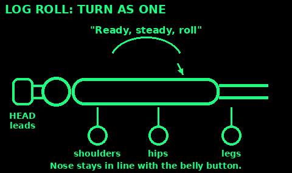

## Dislocations

A bone has come out of its joint. Shoulders, fingers, kneecaps, elbows and hips are most common.

Signs: severe pain, the joint looks the wrong shape, cannot move it, swelling.

1. Do not try to put it back. That needs a doctor and pain relief, and can break bone or trap nerves and blood vessels.

2. Support it in the position you found it. Pad the gaps with clothing.

3. Arm or shoulder: a sling, or a towel tucked under the arm and tied round. Leg: pad and splint as for a fracture.

4. Cold pack wrapped in a cloth for up to 20 minutes every 2 to 3 hours.

5. Paracetamol for pain. Nothing else to eat or drink if they may need an operation soon.

6. Check below the joint every 15 minutes: warm, pink, can feel your touch. Cold, white or numb: this is urgent.

A kneecap or finger sometimes slips back on its own. It still needs checking for breaks.

Hip, elbow or any dislocation with no pulse or feeling beyond it: get help fast. Treat it like a fracture while you wait.

## Sprains and strains

Twisted joint, swelling, pain, but can bear some weight.

1. Rest it for 2 to 3 days. Use a stick or crutch.

2. Cool it: cold wet cloth or ice wrapped in cloth, 20 minutes every 2 to 3 hours. Never ice straight on skin.

3. Wrap it with a bandage firm enough to support, loose enough for 2 fingers under.

4. Raise it above heart level when you can.

5. After 2 to 3 days start gentle movement.

Pain relief: paracetamol, or ibuprofen after the first 48 hours.

Treat as a fracture if: cannot take any weight, bone feels wrong, numbness, or no better after a week.

## Shock

Shock is when blood flow fails. It kills. Common after heavy bleeding, burns, or severe allergy.

Signs: pale, cold, clammy skin. Fast weak pulse. Fast shallow breathing. Thirst. Confusion, sleepiness.

1. Treat the cause: stop bleeding.

2. Lay them flat. If no leg injury, raise the legs.

3. Keep them warm: insulate from the ground, cover them.

4. Loosen tight clothes.

5. Do not give food or drink. Wet the lips if thirsty.

6. Stay with them. Check breathing often. Be ready for CPR.

This needs hospital care. Signal for help now.

## Hypothermia

Body too cold. Watch for the "umbles": stumbles, mumbles, fumbles, grumbles.

Mild: shivering, cold, clumsy. Severe: shivering stops, confused, drowsy.

1. Get out of wind and wet. Shelter.

2. Replace wet clothes with dry. Insulate from the ground.

3. Wrap in blankets, sleeping bag, foil sheet. Cover the head.

4. Warm sweet drinks if fully awake and able to swallow.

5. Share body heat in a sleeping bag.

6. Warm slowly. Do not rub limbs or use hot baths.

7. Handle gently. Severe cases can stop the heart.

No alcohol. If unresponsive and not breathing normally, start CPR.

## Frostbite

Skin and the tissue under it freeze. Fingers, toes, nose and ears go first.

Early: cold, white or red, numb, stinging or burning. Worse: hard, waxy, white, grey or blue, then blisters, then black.

1. Treat hypothermia first. Get them out of the wind and wet.

2. Take off rings, wet gloves and tight boots from the area.

3. Warm hands in the armpits, or feet on a companion's belly. Do not rub or massage. Do not use snow.

4. Rewarm in warm water, about 37 to 39°C: comfortable to your own elbow, not hot. Keep it in for about 30 minutes, until the skin is soft and colour returns. It will hurt: give paracetamol.

5. Never use a fire, stove, radiator, hot water bottle or heat lamp. Numb skin burns easily.

6. Dry gently. Loose clean dressing, with gauze between fingers or toes. Raise the part.

7. Do not burst blisters. Do not walk on thawed feet if you can avoid it.

If it might freeze again before you reach shelter, do not thaw it yet. Thawing then refreezing does the most damage.

Hard frozen skin, swelling or blisters: get medical help.

## Heat exhaustion and heatstroke

Heat exhaustion: headache, dizzy, sweating, pale clammy skin, cramps, sick, very thirsty.

1. Move to shade or somewhere cool.

2. Lie down, raise feet a little.

3. Drink water or ORS (see the dehydration card).

4. Cool the skin: wet cloths, fan them.

Should improve within 30 minutes.

Heatstroke is an emergency: temperature very high, hot skin that may be dry, confused, fits, or collapse.

1. Cool fast: soak with water, fan hard, cold packs in armpits and neck.

2. Recovery position if unresponsive.

3. Get help urgently.

## Sunburn

1. Get out of the sun.

2. Cool the skin with a cool shower or damp towels. Do not put ice on it. Take care that a baby or small child does not get too cold.

3. Drink plenty of water.

4. After-sun or a plain, unperfumed moisturiser. No petroleum jelly.

5. Paracetamol or ibuprofen for pain (see the dose cards).

6. Do not pop blisters or peel the skin. Loose clothes. Keep it covered from sun until healed.

Get help if: large blisters or swelling, fever or chills, dizzy, sick, headache or cramps (these are heat exhaustion signs), or a baby or young child is burnt.

Prevent it: shade from 11am to 3pm, hats, long sleeves, sunscreen SPF 30 or more, put on again after sweating or swimming.

## Dehydration and ORS recipe

Signs: thirst, dark yellow pee or little pee, dry mouth, headache, dizziness. Children: sunken eyes, no tears, floppy.

Homemade oral rehydration salts (WHO recipe):

1. 1 litre of safe water, boiled and cooled.

2. 6 level teaspoons of sugar.

3. Half a level teaspoon of salt.

4. Stir until dissolved. It should taste no saltier than tears.

Sip often. Small sips if vomiting, every few minutes. Make fresh every 24 hours.

Evidence: strong. ORS saves millions of lives. Packet ORS is better if you have it.

Get help if: no pee for 8 hours, very sleepy or confused, cannot keep fluid down, or a baby with a sunken soft spot.

## Diarrhoea

Usually clears in 5 to 7 days. The danger is losing water.

1. Drink ORS after every loose stool. Adults about 200 to 400 ml. Children 50 to 100 ml (under 2) or 100 to 200 ml (older).

2. Keep breastfeeding babies.

3. Eat small plain meals when hungry.

4. Wash hands with soap after the toilet and before food. Boil water.

5. Adults only: loperamide can help (see medicine cards). Not if there is blood in the poo or a high fever.

Get help if: blood in poo, high fever, more than 7 days (2 days in children), signs of dehydration, or severe belly pain.

## Poisoning and overdose

Medicines, cleaning products, plants, mushrooms, fumes, alcohol and drugs.

1. Your safety first. Fumes or gas: get them and yourself into fresh air. Do not enter a room full of fumes or smoke.

2. Swallowed: do not make them sick. Nothing to eat or drink. Wipe out the mouth.

3. On the skin: take off the clothes and rinse the skin with lots of running water for 20 minutes. Wear gloves.

4. In the eye: see Eye injuries.

5. Call 999 if they are drowsy, unresponsive, fitting, or breathing badly. Otherwise call 111 for advice.

6. Unresponsive and breathing: recovery position. Not breathing: CPR. Use a face shield if their mouth may be contaminated.

7. Keep the packet, bottle, plant or mushroom, and any vomit, to show the medics. Note what, how much, and when.

Paracetamol overdose: get help even if they feel well. Liver damage shows up days later, and treatment works best early.

Opioid overdose (heroin, methadone, strong painkillers): very slow or no breathing, pinpoint pupils, cannot be woken. Call 999. In the UK anyone may give naloxone to save a life; follow the kit instructions. It can wear off before the drug does, so stay with them.

Alcohol: keep them on their side, warm, and watched. Never leave someone very drunk to "sleep it off" alone.

## Allergic reaction and anaphylaxis

Mild: itchy rash, hives, sneezing, puffy eyes. Give an antihistamine (see medicine cards). Watch them.

Anaphylaxis is life-threatening. Signs: swelling of lips, tongue or throat; trouble breathing, wheeze; hoarse voice; pale, floppy, faint; collapse.

1. Use their adrenaline auto-injector now. Outer thigh, through clothing if needed. Hold as the device says.

2. Lie them flat with legs raised. If breathing is hard, let them sit up.

3. No improvement after 5 minutes: give a second injector if available.

4. Antihistamines are not enough for anaphylaxis.

5. Be ready for CPR. Get help urgently, even if they improve.

## Bites and stings

Bee sting: scrape the sting out sideways with a fingernail or card. Wash, cool with a cold cloth.

Tick: see Ticks and Lyme disease.

Animal bite: wash with soap and lots of running water for several minutes. Do not close it. Rabies risk if the animal could carry it: get help.

Snake bite: keep still and calm. Keep the limb still and at heart level. Remove rings. No cutting, sucking, ice or tourniquet. Note the time. Get help.

Watch all bites and stings for anaphylaxis and infection.

## Ticks and Lyme disease

Ticks live in long grass, bracken and woods across the UK. Remove them fast: the longer one feeds, the higher the risk of Lyme disease.

Check: after being outdoors, look over the whole body, especially behind knees, groin, armpits, waist, and hair and behind the ears in children. Check pets too.

Remove it:

1. Use fine-tipped tweezers or a tick hook.

2. Grip the tick as close to the skin as you can, by its head, not its body.

3. Pull upward slowly and steadily. Do not twist hard, squeeze, burn or smother it with oil or cream.

4. Clean the bite with soap and water. Wash your hands.

5. Write down the date and where on the body.

A bit of mouth left in the skin usually works out on its own. Do not dig.

Lyme disease signs, 1 to 4 weeks later (up to 3 months):
- A round or oval red rash spreading out from the bite, sometimes like a bullseye. On brown or black skin it can look like a bruise. Usually not itchy.
- Flu-like illness: fever, headache, aching muscles and joints, tiredness.

Either sign: see a doctor and say you were bitten. Antibiotics work well when started early.

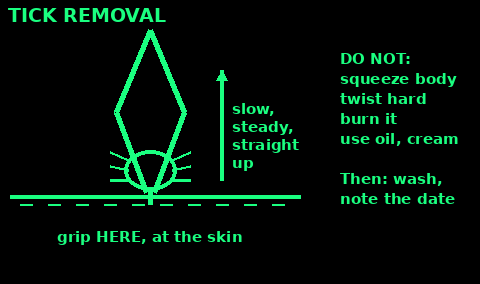

## Eye injuries

Grit: blink. Rinse with clean water from the inner corner outward. Do not rub.

Chemical in eye: rinse with lots of clean water for at least 20 minutes. Hold the eye open. Tilt so water runs away from the other eye. Get help.

Object stuck in the eye: do not remove it. Cover both eyes loosely (eyes move together). A paper cup over the object helps. Get help.

Blow to the eye: cool cloth for 15 minutes, no pressure on the eye.

Get help if: changes in vision, pain that does not settle, blood in the eye, or anything stuck.

## Dental emergencies

Knocked-out adult tooth (speed matters: best within 30 to 60 minutes):

1. Find it. Hold it by the white crown only. Never touch the root.

2. Dirty: rinse it briefly in milk, saline or their own spit. Do not scrub it or use water for long.

3. Push it gently back into its socket, the right way round.

4. Bite on a clean folded cloth to hold it. See a dentist as soon as possible.

5. Cannot put it back? Keep it in milk, or in their spit in a cup, and go to a dentist now.

Baby tooth knocked out: do not put it back. It can damage the adult tooth underneath. See a dentist.

Broken tooth: keep the pieces in milk. Cover a sharp edge with sugar-free gum or dental wax.

Toothache:
- Paracetamol or ibuprofen (see the dose cards). No aspirin under 16.
- Warm salt water rinse, adults: half a teaspoon of salt in a glass of warm water. Rinse and spit. Not for children.
- Soft food. Chew on the other side. Avoid sweet, very hot and very cold food.
- Clove oil (a licensed toothache remedy, adults and over-2s): a little on a cotton bud, on the tooth or into the hole only. It burns gums and skin. Swallowing a few millilitres can poison a small child: keep it locked away.

Go to A&E if the face or neck swells, or swelling makes it hard to breathe, swallow or open the eye. That is a spreading infection.

## Moving a casualty

Do not move an injured person unless they are in danger, or you must reach help or shelter. Moving can worsen injuries, especially to the spine.

Protect your back: bend your knees, keep your back straight, hold the load close, lift with your legs.

Drags (one rescuer, quick, over short distances):
- Clothing drag: grip the collar and shoulders of their coat, support the head on your forearms, walk backwards.
- Blanket drag: roll them onto a blanket, coat or tarp, pull from the head end.

Walking wounded: human crutch. Stand at the injured side, their arm round your neck, your arm round their waist.

Two rescuers:
- Two-handed seat: for a person who cannot hold on. Squat each side, hands under thighs and behind the back.
- Four-handed seat: for a person who can hold on with both arms. Each rescuer grips their own right wrist and the other's left wrist to make a square seat.
- Chair carry: sit them on a sturdy chair, one rescuer at the back, one at the front legs. Good on stairs.

Never use a carry for someone you think has a neck or back injury. Wait for help and keep them still and warm.

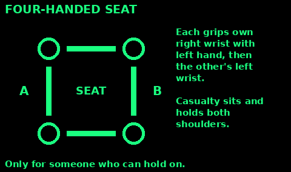

## Improvised stretcher

For long carries, an unresponsive person, or a leg injury.

Blanket and poles:

1. Two strong poles about 2 to 2.5 m long, and a blanket or tarp.

2. Lay the blanket flat. Put one pole a third of the way across. Fold that side over it.

3. Put the second pole on the folded edge, a little apart from the first. Fold the rest of the blanket over it.

4. The casualty's weight holds the folds shut.

Jackets and poles: zip up 2 or 3 strong coats, turn the sleeves inside, and push the poles through the sleeves.

Before use: test it with an uninjured person of similar weight.

Carrying:
- Four carriers if you can, one at each corner. Lift together on a count.
- Strap or tie the person on, with padding, and keep them warm.
- Feet first on the flat. On slopes and stairs keep the head uphill.
- Swap carriers often. Short steps, out of step with each other to stop swaying.

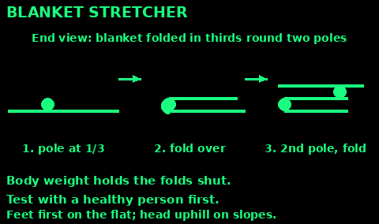

## Triage: many hurt

When there are more hurt people than helpers, sort them fast so the ones who can be saved get help first. Spend under a minute on each. Only stop to open airways and stop heavy bleeding. This follows the START method.

1. Shout: "If you can walk, come to me." Those who walk are GREEN (minor). Use them as helpers.

2. Go to each person who is left, nearest first.

3. Not breathing: open the airway once. Still not breathing: BLACK (dead or not survivable now). Starts breathing: RED. Move on.

4. Breathing more than 30 times a minute: RED (immediate).

5. No pulse at the wrist, or the nail bed takes more than 2 seconds to pink up after you press it: RED. Press on heavy bleeding, put a helper on it, move on.

6. Cannot follow a simple order ("squeeze my hand"): RED.

7. Everyone else: YELLOW (can wait a while).

Children are different: breathing under 15 or over 45 a minute is RED. If a child is not breathing but has a pulse, give 5 rescue breaths before you decide.

Mark each person (tape, a label, a pen on the forehead). Check everyone again as soon as you can. People change.

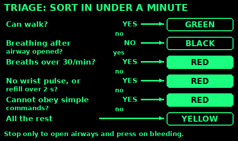

## Caring for a sick person

Most fevers, colds, flu and stomach bugs get better at home with rest, fluids and watching.

1. Bed rest in a warm (not hot), airy room. One carer if possible.

2. Fluids: small, frequent drinks. Water, weak tea, soup, ORS if there is diarrhoea or vomiting. Aim for pale yellow pee.

3. Fever (38°C or more): light clothing and a sheet. Do not wrap up a feverish child. Do not sponge with cold water. Paracetamol or ibuprofen for comfort (see the dose cards).

4. Food: small plain meals when they want them. Fluids matter more than food for a few days.

5. Keep them clean: wash the face and hands, clean the mouth and teeth, sips of water for dry lips.

6. Bedbound: help them change position at least every 2 hours. Check heels, hips and the base of the spine for red patches (pressure sores). Get them sitting up and moving as soon as they can.

7. Stop the spread: their own cup, plate and towel. Wash your hands after every contact. See Sanitation for nursing someone infectious.

8. Keep a log: temperature, pulse, breathing, pee, drinks and medicines, with the time (next card).

## Observations and when to worry

Check and write down every 4 hours, more often if they are getting worse.

Breathing: count chest rises for 30 seconds, times 2. Count while they think you are checking the pulse.

Pulse: two fingers on the thumb side of the wrist. Count 30 seconds, times 2.

Temperature: under the tongue or armpit thermometer. Normal is about 37°C.

Also note: drinks taken, pee (when and colour), awake and making sense or not, skin colour.

Normal adult at rest: breathing 12 to 20 a minute, pulse 60 to 100.

Worry and get urgent help (adult) if:
- Breathing 25 or more a minute, or 8 or fewer
- Pulse over 130, or under 40
- Temperature 39°C or more that will not come down, or under 35°C
- New confusion, slurred speech, very sleepy
- Blue, grey, pale or blotchy skin, lips or tongue
- No pee all day, or a rash that does not fade when you press a glass on it

Children: worry if under 3 months with 38°C or more, 3 to 6 months with 39°C or more, breathing very fast or grunting, floppy or hard to wake, a weak high cry, or no pee for 12 hours.

These can be sepsis. Trust your instincts: if you think something is seriously wrong, get help now.

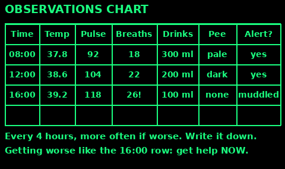

## Medicine safety first

Rules for the dose cards that follow. Doses are from NHS guidance. Packet instructions win if they differ.

1. Check the label: name, strength (mg), and expiry.

2. Never give more than the maximum in 24 hours. Write down every dose and the time.

3. Many cold and flu products already contain paracetamol. Do not double up.

4. Children: use the syringe or spoon that comes with the liquid, not a kitchen spoon.

5. Do not use for more than 3 days without advice.

Do not give ibuprofen to anyone with asthma made worse by it, stomach ulcers, kidney problems, pregnancy, or dehydration. Never give aspirin to under 16s.

## Dose: paracetamol

Adults and 16+: 500 mg to 1 g (1 or 2 x 500 mg tablets). Wait at least 4 hours between doses. No more than 8 x 500 mg tablets (4 g) in 24 hours. Under 50 kg: you may need a lower dose. No more than 3 days without advice.

Infant liquid 120 mg in 5 ml:

3 to 5 months: 2.5 ml

6 to 23 months: 5 ml

2 to 3 years: 7.5 ml

4 to 5 years: 10 ml

Six plus liquid 250 mg in 5 ml:

6 to 7 years: 5 ml

8 to 9 years: 7.5 ml

10 to 11 years: 10 ml

12 to 15 years: 10 to 15 ml

16 to 17 years: 10 to 20 ml

Children 3 months+: up to 4 doses in 24 hours, at least 4 hours apart. Babies 2 to 3 months, over 4 kg and born after 37 weeks: 2.5 ml infant liquid, up to 2 doses a day, 4 hours apart. Under 2 months: get medical advice. No more than 3 days without advice. Overdose can harm the liver even if they seem fine: get help.

## Dose: ibuprofen

Adults: 200 to 400 mg, up to 3 times a day with food, at least 4 hours apart. Over-the-counter maximum 1,200 mg in 24 hours.

Infant liquid 100 mg in 5 ml, every 6 to 8 hours:

3 to 6 months (over 5 kg): 2.5 ml, up to 3 a day

6 to 12 months: 2.5 ml, 3 or 4 a day

1 to 3 years: 5 ml, 3 a day

4 to 6 years: 7.5 ml, 3 a day

7 to 9 years: 10 ml, 3 a day

Seven plus liquid 200 mg in 5 ml, 10 to 12 years: 7.5 ml, 3 a day

12 to 17 years: 200 to 400 mg (1 or 2 x 200 mg tablets), every 6 to 8 hours, max 6 tablets a day.

Stop and get help if: black poo, vomiting blood, bad stomach pain, wheeze. Children: do not give ibuprofen and paracetamol at the same time. Adults can take both together.

## Dose: antihistamine and loperamide

Cetirizine (non-drowsy), for rash, hives, hay fever, itchy bites:

Adults and 12+: 10 mg once a day.

6 to 11 years: 5 mg twice a day.

2 to 5 years: 2.5 mg twice a day.

Under 2: get advice. A doctor works out the dose by weight.

Loperamide (2 mg capsules), for short-term diarrhoea, adults and children 12+:

2 capsules at first, then 1 after each loose stool. Maximum 6 capsules in 24 hours (bought over the counter). Stop when stools firm up. No more than 48 hours without a doctor.

Not for children under 12 unless a doctor prescribes it. Not if blood in poo or fever. Too much can cause heart rhythm problems.

ORS: no maximum. Drink to replace losses.

## Natural remedies: what works

Honest evidence levels.

Honey on wounds and burns: moderate evidence it helps healing. Medical-grade honey is best; plain honey is less tested. Never give honey to babies under 1, by mouth or on wounds.

Clean water irrigation: strong evidence. Tap-quality water is as good as saline for cleaning.

Home ORS (sugar and salt): strong evidence.

Cool water on burns: strong evidence.

Honey for cough in children over 1: moderate evidence. Half to 1 teaspoon.

Ginger for nausea: weak to moderate evidence.

Garlic, tea tree oil, herbal poultices on wounds: weak evidence, can irritate. Do not rely on them.

Urine on stings: no evidence. Do not.

## Build a first aid kit

Keep it dry in a clear box. Check every 6 months.

1. Gloves, tweezers, small scissors, safety pins.

2. Plasters, closure strips, sterile pads, crepe and triangle bandages, tape.

3. Trauma dressing and a commercial tourniquet if you can get one.

4. Foil blanket, cling film for burns.

5. Saline pods or a syringe for rinsing.

6. Paracetamol, ibuprofen, cetirizine, loperamide, ORS sachets. Child liquids if you have children.

7. Thermometer, pencil and notebook to log doses.

8. Any personal meds: adrenaline auto-injectors, inhalers, glucose tablets for diabetics.

9. Aspirin 300 mg (adults, for a suspected heart attack), fine tweezers or a tick hook, a face shield for rescue breaths, clove oil for toothache, a small torch.

10. Soap and hand gel.

## Sources

Written in our own words from public guidance:

NHS medicines: nhs.uk/medicines/paracetamol-for-adults, nhs.uk/medicines/paracetamol-for-children, nhs.uk/medicines/ibuprofen-for-adults, nhs.uk/medicines/ibuprofen-for-children, nhs.uk/medicines/cetirizine, nhs.uk/medicines/loperamide

NHS: nhs.uk/conditions/burns-and-scalds. NHS 111 Wales choking: 111.wales.nhs.uk/encyclopaedia/ch/article/choking. British Red Cross first aid: redcross.org.uk/first-aid

Resuscitation Council UK 2025 guidelines: resus.org.uk/professional-library/2025-resuscitation-guidelines/adult-basic-life-support-guidelines, resus.org.uk/professional-library/2025-resuscitation-guidelines/paediatric-basic-life-support-guidelines, resus.org.uk/professional-library/2025-resuscitation-guidelines/first-aid-guidelines (choking)

WHO ORS and diarrhoea: who.int/news-room/fact-sheets/detail/diarrhoeal-disease and who.int/news-room/questions-and-answers/item/cholera-outbreaks (home ORS recipe)

Tourniquet: stopthebleed.org (American College of Surgeons) and the Stop the Bleed tourniquet sheet at dhs.gov/sites/default/files/publications/STB_Applying_Tourniquet_08-06-2018_0.pdf

British Red Cross and American Red Cross first aid guidance.

CDC: wound care, heat illness, tick removal, snakebite (cdc.gov).

US Army FM 21-76 / ATP 3-50.21 Survival (public domain).

Hesperian, Where There Is No Doctor (free non-commercial).

Added in batch 6 (our own words):

NHS: nhs.uk/conditions/heart-attack/treatment, nhs.uk/conditions/stroke/symptoms, nhs.uk/conditions/asthma/asthma-attack, nhs.uk/symptoms/what-to-do-if-someone-has-a-seizure-fit, nhs.uk/conditions/low-blood-sugar-hypoglycaemia, nhs.uk/conditions/head-injury-and-concussion, nhs.uk/conditions/dislocated-shoulder, nhs.uk/conditions/nosebleed, nhs.uk/conditions/frostbite, nhs.uk/conditions/sunburn, nhs.uk/conditions/poisoning, nhs.uk/conditions/lyme-disease, nhs.uk/conditions/knocked-out-tooth, nhs.uk/conditions/toothache, nhs.uk/conditions/sepsis

Resuscitation Council UK 2025 first aid guideline (chest pain and aspirin 300 mg, hypoglycaemia 15-20 g glucose, open chest wounds left open, cervical spine, drowning 5 breaths, opioid overdose, stroke FAST): resus.org.uk/professional-library/2025-resuscitation-guidelines/first-aid-guidelines. AED use: resus.org.uk/public-resource/how-do-cpr

St John Ambulance electric shock: sja.org.uk/first-aid-advice/electrocution. British Red Cross drowning and seizures: redcross.org.uk/first-aid/learn-first-aid. RNLI Float to Live: rnli.org

Wilderness Medical Society frostbite guideline 2024 (rewarm at 37-39°C, avoid refreezing): wms.org

Clove Oil BP product information: medicines.org.uk/emc/product/4817/smpc

START and JumpSTART triage: chemm.hhs.gov/startalgotext.htm. Observation limits based on the NHS National Early Warning Score (NEWS2), Royal College of Physicians.

This is first aid, not a doctor. Get medical help as soon as you can.
