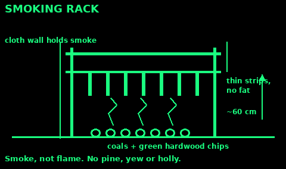
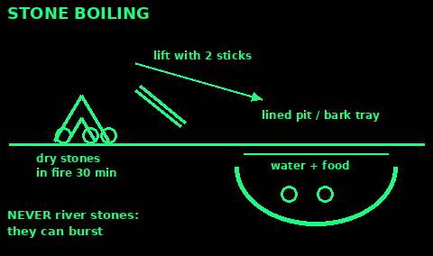

## Food

Cook meat, fish, and shellfish all the way through. If you would not eat the center as it sits, cook it longer. Boil dried meat if you are not sure of it.

Boil water and milk you did not treat. Soup is a way to get the water and the food in one pot.

Throw food out when the can bulges, hisses, or spurts, when the lid is loose, or when the food smells sour, tastes fizzy, or foams. Heating bad canned food does not make it safe. Do not taste it to decide.

A hard frost does not make spoiled meat safe. Drying does not make already rotten meat safe.

To dry food you trust: slice it thin, hang it in sun and moving air, off the ground and under cloth so insects cannot lay in it. Bring it in at night. It is ready when a piece bends and does not weep moisture. Keep it covered and dry. If it smells rotten rather than smoky or plain, discard it.

Salt, sugar, oil, and hard cheese keep longer than fresh meat. Eat the fresh food first.

Do not eat wild mushrooms. Do not eat a plant you cannot already name with certainty. "Looks like" is how people poison themselves when they are hungry. Hunger is not a reason to run the experiment. If a plant is in the medical archive or the travel guide under a name you are sure of, read that entry before you eat it.

Store food and garbage away from where you sleep, hung if animals are around. A bear or a dog in the shelter at night is a worse problem than a cold walk to the hang.

## Foraging rules (UK)

Only eat a wild plant you can name with total certainty. If any part of you says "probably", leave it.

1. Learn a plant in every season: leaf, flower, seed, smell. Check every feature against a field guide, not just one.

2. Pick away from busy roads, sprayed fields, old industrial ground and dog paths. Avoid plants low to the ground where animals foul.

3. Do not pick anything bruised, mouldy or damaged.

4. Wash everything. Cook it until steaming hot if you can.

5. First time trying a plant: eat a small amount, then wait.

6. Keep a sample of what you ate. If you get ill, it helps doctors identify it.

7. Children do not pick or eat wild food without you.

8. Take only what you need. Leave plenty for the plant and for wildlife.

The law: picking leaves, flowers, fruit and seeds of common plants is usually fine. Digging up any wild plant needs the landowner's permission. Some rare plants are protected completely.

Never eat wild mushrooms unless an expert you trust has checked them in your hand. Mushroom mistakes kill.

## Nettle and cleavers

Stinging nettle: upright, up to 2 m. Pointed, toothed leaves in opposite pairs, covered in stinging hairs. Tiny greenish flowers hang in strings near the top.

Pick the top 4 to 6 leaves of young plants, spring to early summer. Wear gloves or pinch the leaves firmly from underneath. Boiling or steaming for a couple of minutes removes the sting. Eat like spinach, or in soup or tea. Avoid old plants once they flower: the leaves get tough and gritty.

Cleavers (goosegrass, sticky willy): a scrambling plant that sticks to clothes. Square stems with tiny hooked hairs. Narrow leaves in rings (whorls) of 6 to 8 round the stem. Tiny white four-petalled flowers, then small round hooked seeds.

Pick young shoots in spring and cook them as greens or in soup. Older plants are too hairy and stringy. The hard ripe seeds can be roasted as a coffee substitute.

Both are safe beginner plants. Nettle has no dangerous lookalike that also stings.

## Dandelion

Leaves in a flat rosette from the root, long and deeply toothed. One hollow, leafless stem per flower, with milky sap. One bright yellow flower head on each stem, closing at night, then a round seed clock.

All parts are edible. Young leaves raw in salad, older leaves cooked (they get bitter). Flowers raw or in batter. Roots scrubbed and cooked, or dried, roasted and ground as a coffee substitute.

Lookalikes such as cat's-ear and hawkbits are not dangerous, but they have branched or hairy stems. True dandelion: smooth, hollow, unbranched stem, one flower.

Dandelion leaf is a diuretic: it makes you pee more. Do not lean on it when water is short.

## Blackberry and hazelnut

Blackberry (bramble): thorny, arching stems. Leaves of 3 to 5 toothed leaflets. White or pink flowers, then berries that ripen from green to red to black, late summer to autumn. Pick ripe, black berries above dog height. Each berry is a cluster of small round bobbles. No poisonous UK berry looks like that on a thorny bramble.

Hazel: shrub or small tree, often many stems. Round, soft, hairy leaves with a pointed tip and double-toothed edge. Yellow catkins ("lambs' tails") in late winter. Nuts in a frilly green husk, in clusters of 1 to 4, ripe in September and October when the shell turns brown. Squirrels get most of them. Eat raw or roasted. Nuts are rich in fat and protein: high calories for little weight.

Throw out any nut with a hole in it, or that looks or tastes mouldy.

## Wild garlic or lily of the valley?

Wild garlic (ramsons) is a top spring food. Lily of the valley grows in the same woods, looks similar before it flowers, and is highly poisonous: it contains heart poisons.

Wild garlic: each leaf rises on its own stalk straight from the ground. Leaves broad, pointed, soft and floppy. Flowers are white stars, about 25 in a round ball-shaped head on a bare stem. Crush a leaf: it smells strongly of garlic.

Lily of the valley: usually two or three leaves wrapped around one stem, stiffer and shinier. Flowers are small white bells hanging down one side of the stem. Crushed leaves do not smell of garlic.

The smell test is not enough on its own. After picking garlic, your fingers smell of garlic and every leaf seems to. Check the growth habit of each leaf you pick. Do not grab handfuls. Lords-and-ladies (arum) leaves also grow among wild garlic and are poisonous: they are arrow-shaped.

Eat the leaves raw or wilted, best before the flowers open. The flowers are edible too.

## Deadly: hemlock and water dropwort

Many plants in the carrot family have white umbrella-shaped flower heads and feathery leaves. Some are deadly. The universal advice is: do not eat any wild plant from the carrot family unless you are an expert.

Hemlock: up to 2 m tall. Smooth, hollow stems with purple blotches and spots, and no hairs. Leaves finely divided, like a fern or parsley. Mature plants smell unpleasant, like mice. Grows on verges, ditches and stream edges. A small amount of any part can paralyse breathing and kill.

Hemlock water dropwort: one of the most poisonous plants in the UK. Grows in and beside water: streams, ditches, canals and wet woods. Up to 1.5 m. Grooved hollow stems, parsley-like leaves, white umbrella flowers. The roots are fat, pale tubers like fingers or small parsnips, and are often washed out of banks. Mistaken for wild celery, wild parsnip or water parsnip. Eating even a little root can cause fits and death within hours. Wash your hands after touching it.

Cow parsley, wild carrot and others are edible, but they look too close to these two. Do not take the risk.

## Deadly: foxglove and death cap

Foxglove: tall spike of pink-purple tube flowers with dark spots inside, June to September. In the first year it is only a rosette of soft, hairy, toothed leaves, and that is when it is mistaken for comfrey or other greens. Comfrey leaves have smooth edges. Foxglove contains heart poisons. Every part is toxic.

Death cap: a mushroom found in deciduous woods, often under oak and beech. Cap olive-green to yellowish, 5 to 15 cm. White gills. A floppy ring on the stem, and a swollen base sitting in a cup, often hidden in the soil. Young "button" death caps look like edible mushrooms.

Half a cap can kill an adult. Symptoms may not start for 6 to 24 hours, then seem to get better, while the liver is failing. Death cap causes most mushroom deaths worldwide. Cooking does not destroy the poison.

If anyone has eaten a plant or fungus that might be poisonous: get medical help at once, even if they feel fine. Take a sample of the plant. Do not make them vomit.

## Universal edibility test: last resort

The US Army survival manual describes a test for unknown plants. Know its limits before you think about using it.

It will not protect you from the worst poisons. Hemlock, water dropwort, foxglove and death cap can taste mild and cause no early reaction, then kill. The test is useless for mushrooms. Never test those.

In the UK, with time to search, you are far better off finding plants you know. A healthy adult can live for weeks without food, but not days without water. Hunger is uncomfortable. Poisoning can kill.

If you are truly stranded somewhere unknown, the manual's outline: test only plants that are plentiful, one plant and one part at a time. Reject anything with milky sap, a bitter or soapy taste, an almond smell, carrot-like or parsley-like leaves, three-part leaves, beans or seeds in pods, or fine hairs and spines. Then rub on skin, hold to the lip, hold in the mouth, and swallow a tiny amount, waiting hours at each stage, and about 24 hours in total per part.

Stop at the first burning, numbness, bitterness or sickness. Even a plant that passes can make you ill in large amounts.

## Drying and smoking

Drying removes the water germs need. Smoke adds a layer that keeps insects and some germs off.

Drying: start with fresh, good meat or fish only. Trim all the fat: fat goes rancid. Cut along the grain into strips about 5 mm thick. Hang in hot sun and moving air, off the ground, covered from flies. Turn the strips. Bring them in from dew. Done when a strip cracks when bent but does not snap clean. Salt speeds it up.

Smoking: build a rack about 60 cm above a bed of hot coals. Drape a tarp or cloth round it to hold the smoke in. Put green hardwood chips or damp hardwood on the coals for smoke, not flame. Do not use resinous wood like pine. Never use holly, yew or any wood you cannot name.

Rough guide from the US Army manual: meat smoked overnight keeps about a week. Two days of steady smoking keeps it up to a month. Properly smoked meat is dark, curled and brittle and can be eaten without more cooking.

Fruit, berries, mushrooms you know and sliced roots dry the same way.

Store dried food in a dry, sealed bag or tin. If it gets damp, smells off or grows mould, throw it out.

## Salting

Salt pulls water out of meat and fish so germs cannot grow. It takes a lot of salt.

1. Use fresh meat or fish, cut thin. Fish: gut, split flat and remove the head.

2. Rub salt into every surface. Pack in layers in a clean container with salt between every layer, so no pieces touch.

3. Keep it cool. Pour off the liquid that forms, or let it drain.

4. After a few days, rinse, then hang to dry in wind and shade, or smoke it.

5. Soak in several changes of water before cooking, to remove salt. Boil it.

At the coast, sea water can be used to soak meat for a short time, but it is weaker than packed salt and is not a long-term cure. Wash it before cooking.

Salt cures need care. Home-cured meat that was not salted enough can carry botulism, which you cannot see or smell. If in doubt, boil it hard before eating.

Eat salted food with plenty of water. If water is short, eat less salty food.

## Cooking without pots

Stone boiling: fill a container that cannot go on a fire, such as a bark tray, a hollow log, or a hole lined with a tarp, with water and food. Heat dry stones in the fire for half an hour. Lift them with two sticks, knock off the ash, and drop them in. Add more as they cool until it boils. Never use stones from rivers or wet ground: water trapped inside can make them burst in the fire.

Plank or stick: skewer meat or fish on green sticks and turn it beside the fire, not in the flames. Or pin a split fish to a board facing the heat.

Leaf or clay bake: wrap food in large non-poisonous leaves, or pack fish in clay with the skin and scales left on, and bury it in hot coals. When the clay is hard and cracked, the fish is done and the skin peels away with the clay.

Hot rock: lay a flat dry stone in the fire. Brush it clean and cook thin slices on it.

Ash bake: roots and tubers can be buried in hot ash under the coals.

Always cook meat and fish until the centre is steaming hot, with no pink juices.

## Calories and rationing

As a guide, the NHS says an average man needs about 2,500 kcal a day and an average woman about 2,000. Cold, hard work and carrying loads can double that. Children need less but should not go hungry first.

Water comes before food. If you have less than about 1 litre of water a day, eat little, and avoid dry, salty and high-protein food: digesting them uses water. Sugary and starchy food is easier on your water.

Rationing:

1. Count everything: food, water, people and days you may need to last.

2. Eat perishable food first, then canned, then dried.

3. Ration food, not water. Drink what you need if you have it.

4. Share equally, with a little extra to anyone doing heavy work, ill, pregnant or breastfeeding.

5. Rest more and work in the cool hours. Wasted energy is wasted food.

6. Keep warm. Shivering burns calories fast.

Rough energy: fats and oils about 9 kcal per gram. Sugar, flour, rice, oats, protein about 4. Nuts about 6. A handful of nuts gives more than a bucket of greens.

Most foraged greens give almost no calories. They are for vitamins. Your calories come from stores, nuts, seeds, roots, fish and meat.

## Food sources

Written in our own words from:

Food Standards Agency / UK Government, Guidance for safe foraging (Open Government Licence): gov.uk/government/publications/guidance-for-safe-foraging/guidance-for-safe-foraging

Woodland Trust (facts only): woodlandtrust.org.uk/blog/2020/04/edible-garden-weeds, woodlandtrust.org.uk/trees-woods-and-wildlife/plants/wild-flowers/wild-garlic, woodlandtrust.org.uk/trees-woods-and-wildlife/plants/wild-flowers/lily-of-the-valley, woodlandtrust.org.uk/trees-woods-and-wildlife/plants/wild-flowers/foxglove, woodlandtrust.org.uk/trees-woods-and-wildlife/plants/wild-flowers/bramble, woodlandtrust.org.uk/trees-woods-and-wildlife/british-trees/a-z-of-british-trees/hazel, woodlandtrust.org.uk/trees-woods-and-wildlife/fungi-and-lichens/deathcap, woodlandtrust.org.uk/blog/2020/07/uk-poisonous-plants, woodlandtrust.org.uk/visiting-woods/things-to-do/foraging/foraging-guidelines

US Army ATP 3-50.21 Survival, chapter 4: food needs, water and food, edibility test, sun drying, smoking, stone boiling, baking (public domain, armypubs.army.mil).

NHS calories: nhs.uk/live-well/healthy-weight/managing-your-weight/understanding-calories

National Center for Home Food Preservation (University of Georgia): nchfp.uga.edu/how/dry and nchfp.uga.edu/how/cure-smoke

Food Standards Agency cooking: food.gov.uk/safety-hygiene/cooking-your-food
