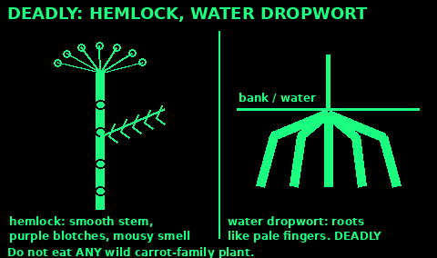
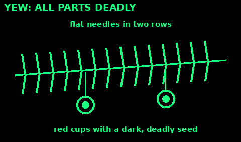
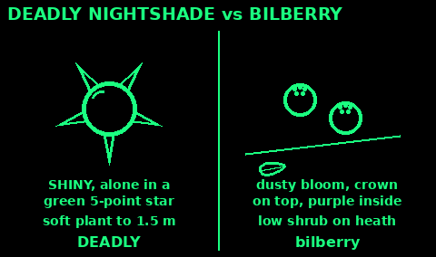
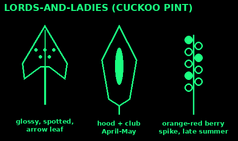

## Deadly: hemlock and water dropwort

Many plants in the carrot family have white umbrella-shaped flower heads and feathery leaves. Some are deadly. The universal advice is: do not eat any wild plant from the carrot family unless you are an expert.

Hemlock: often 1.5 to 2.5 m tall. Smooth, hollow stems with purple blotches and spots, and no hairs. Leaves finely divided, like a fern or parsley. Mature plants smell unpleasant, like mice. Grows on verges, ditches and stream edges. A small amount of any part can paralyse breathing and kill.

Hemlock water dropwort: one of the most poisonous plants in the UK. Grows in and beside water: streams, ditches, canals and wet woods. Up to 1.5 m. Grooved hollow stems, parsley-like leaves, white umbrella flowers. The roots are fat, pale tubers like fingers or small parsnips, and are often washed out of banks. Mistaken for wild celery, wild parsnip or water parsnip. Eating even a little root can cause fits and death within hours. Wash your hands after touching it.

Cow parsley, wild carrot and others are edible, but they look too close to these two. Do not take the risk.

## Deadly: foxglove and death cap

Foxglove: tall spike of pink-purple tube flowers with dark spots inside, June to September. In the first year it is only a rosette of soft, hairy, toothed leaves, and that is when it is mistaken for comfrey or other greens. Comfrey leaves have smooth edges. Foxglove contains heart poisons. Every part is toxic. Do not eat comfrey either: it contains chemicals that damage the liver.

Death cap: a mushroom found in deciduous woods, often under oak and beech. Cap olive-green to yellowish, 5 to 15 cm. White gills. A floppy ring on the stem, and a swollen base sitting in a cup, often hidden in the soil. Young "button" death caps look like edible mushrooms.

Half a cap can kill an adult. Symptoms may not start for 6 to 24 hours, then seem to get better, while the liver is failing. Death cap causes most mushroom deaths worldwide. Cooking does not destroy the poison.

If anyone has eaten a plant or fungus that might be poisonous: get medical help at once, even if they feel fine. Take a sample of the plant. Do not make them vomit.

## Yew

Use: recognise it so you never eat, chew or brew any part of it.

1. Evergreen tree or hedge, often in churchyards and gardens.

2. Flat, dark green needles, 1 to 4 cm, in two rows along the twig, paler underneath.

3. Red berry-like cups (arils) round a dark seed, in autumn.

4. Reddish, flaky bark.

All parts are deadly, especially the needles and seeds, fresh or dried. A small amount can stop the heart. Do not eat the red berries either: the seed inside is deadly.

Keep children, dogs, horses and livestock away from yew and from hedge clippings.

Do not use yew twigs as skewers, or yew branches in a transpiration bag.

If eaten: call 999 at once.

Check: flat needles in two rows and red cups: yew. Hands off.

## Deadly nightshade

Use: recognise it. Its berries look like bilberries or black cherries.

1. Bushy plant up to about 1.5 m, in woodland edges, scrub and waste ground, often on chalk or limestone.

2. Dull green, oval, pointed leaves, often a big and a small leaf together.

3. Bell-shaped, purple-brown flowers in summer.

4. Shiny black berries, cherry-sized, each sitting alone in a green, five-pointed star (the calyx).

All parts are deadly. Signs: wide pupils, dry hot skin, fast heart, confusion, seeing things.

Bilberries are on low shrubs and have a small crown on top, not a star underneath. Sloes have a waxy bloom and grow on a thorny shrub.

Woody nightshade (bittersweet), a climber with purple and yellow flowers and red berries, is also poisonous.

If eaten: call 999.

Check: a single shiny black berry in a green star: do not touch.

## Lords-and-ladies

Use: recognise it. Also called cuckoo pint or wild arum. Its spring leaves grow among wild garlic and look like sorrel.

1. Shady hedges and woods. Leaves come up from the ground in early spring.

2. Glossy, arrow-shaped leaves on long stalks, often with dark spots. Leaf edges smooth, net veins.

3. In April and May, a pale green hood wrapped round a purple or yellow club.

4. In late summer, a spike of shiny orange-red berries on a bare stalk.

All parts contain needle-like crystals that burn and swell the mouth and throat. Swelling can block breathing. Children eat the berries.

Do not taste to check. Sorrel tastes lemony, but tasting lords-and-ladies hurts you.

If eaten: rinse the mouth, give sips of cold water, call 111. Call 999 if breathing is hard.

Check: glossy, net-veined arrow leaf that does not smell of garlic on its own: lords-and-ladies. Crush each leaf alone and wash your hands between, because garlic smell on your fingers fools you.

## Laburnum

Use: recognise it in gardens, parks and hedges.

1. Small tree. Leaves in threes, like clover.

2. Long hanging chains of yellow pea-like flowers in May and June ("golden chain").

3. Flat brown pods like pea pods with small dark seeds, in late summer and autumn.

All parts are poisonous, especially the seeds. Children mistake the pods for peas.

Signs: vomiting, sweating, drowsiness, a fast or slow heart, fits.

If eaten: call 111, or 999 if they are unwell.

Check: leaves in threes and pea pods on a tree: laburnum. Not food.

## Ragwort

Use: recognise it so you do not eat it and keep it away from animals.

1. Upright, 30 to 100 cm, on roadsides, wasteland and poor grazing.

2. Ragged, deeply cut, dark green leaves.

3. Flat-topped clusters of yellow daisy-like flowers with about 13 petals each, June to November.

4. Often has black and yellow striped cinnabar moth caterpillars on it.

Poisonous to people and deadly to horses and cattle: it damages the liver, even dried in hay.

Wear gloves to pull it. Do not compost it where animals graze.

Check: yellow daisy clusters on ragged leaves: ragwort. Not food, not fodder.
