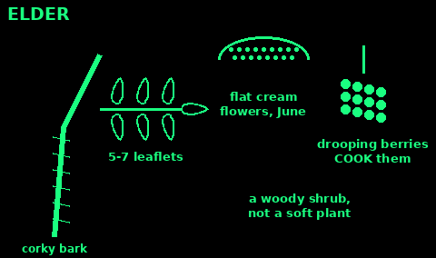
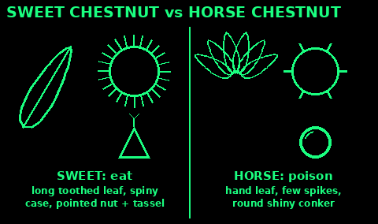
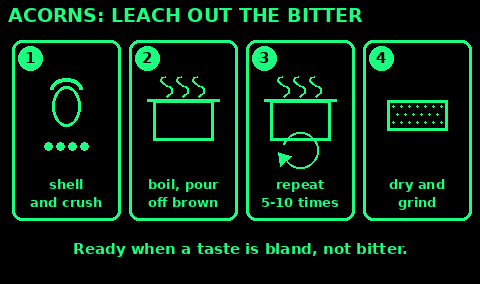

## Blackberry and hazelnut

Blackberry (bramble): thorny, arching stems. Leaves of 3 to 5 toothed leaflets. White or pink flowers, then berries that ripen from green to red to black, late summer to autumn. Pick ripe, black berries above dog height. Each berry is a cluster of small round bobbles. No poisonous UK berry looks like that on a thorny bramble.

Hazel: shrub or small tree, often many stems. Round, soft, hairy leaves with a pointed tip and double-toothed edge. Yellow catkins ("lambs' tails") in late winter. Nuts in a frilly green husk, in clusters of 1 to 4, ripe in September and October when the shell turns brown. Squirrels get most of them. Eat raw or roasted. Nuts are rich in fat and protein: high calories for little weight.

Throw out any nut with a hole in it, or that looks or tastes mouldy.

## Hawthorn

Use: haws (berries) in autumn, young leaves in spring.

1. Thorny shrub or small tree, common in hedges.

2. Small leaves deeply cut into 3 to 7 lobes.

3. White or pink blossom in May ("may blossom").

4. Dark red haws, September to November, in clusters, each with one large stone.

5. Eat the flesh raw (dry and mealy) or cook it into jelly or sauce. Spit out or sieve out the stones.

6. Young leaves and buds in April are a nibble ("bread and cheese").

Do not eat the stones: they contain a cyanide-forming chemical.

Red berries on shrubs without lobed leaves and thorns (cotoneaster, holly, yew) are not haws. Leave them.

Check: thorns, lobed leaves, one stone per berry.

## Rosehip

Use: hips are rich in vitamin C, September to November. Good for syrup and tea.

1. Wild rose (dog rose): arching, thorny stems, leaves of 5 to 7 toothed leaflets, pink or white flowers in June.

2. Red or orange oval hips after the flowers.

3. Inside are seeds covered in fine hairs. The hairs irritate the mouth and gut.

4. Cut open and scrape out the seeds and hairs, or boil chopped hips and strain the juice twice through a fine cloth.

5. Syrup: simmer the juice with sugar. Tea: steep dried, cleaned hips.

Mistakes: eating hips whole; straining through a coarse sieve (hairs get through).

Check: no hairs left in the juice: hold it up to the light.

## Elder: cooked berries only

Use: flowers in June, berries in late August and September.

1. Shrub or small tree with grey, corky, furrowed bark. Twigs have white pith.

2. Leaves of 5 to 7 toothed leaflets, with a rank smell when crushed.

3. Flat heads of tiny cream flowers, sweet smelling.

4. Drooping heads of purple-black berries on red stalks.

5. Strip ripe berries off with a fork. Cook them well: jam, syrup, pies.

6. Flowers: cordial, fritters, tea. Shake out insects.

Raw berries, unripe berries, leaves, stems, bark and roots cause vomiting and diarrhoea. Cook the berries. Remove all stalks.

Lookalikes: dwarf elder (a non-woody plant under 2 m, berries held upright): poisonous. Hemlock and hogweed also have white flower heads but are soft-stemmed plants, not woody shrubs. See Deadly plants.

Check: woody shrub, drooping berry heads, and the berries are cooked.

## Crab apple

Use: small sour apples, September to November. Full of pectin to set jams.

1. Small, often thorny tree in hedges and woods.

2. Oval toothed leaves, pink-white blossom in spring.

3. Small hard apples 2 to 3 cm, green to yellow or red.

4. Very sour raw. Cook them: jelly, sauce, or with sweeter fruit.

5. Cook and sieve to remove pips.

Do not crush and eat large amounts of pips.

Check: looks like a tiny apple, cut across shows a star of five pip chambers.

## Sloe

Use: the fruit of blackthorn, October to November, best after a frost.

1. Dense, very thorny shrub with dark bark. White flowers cover it in March and April, before the leaves.

2. Small oval leaves.

3. Blue-black berries, 1 to 1.5 cm, with a dusty blue bloom that rubs off, each with one stone.

4. Very sour and drying raw. Cook them for jelly or syrup, or steep in drink.

5. Freeze them to soften the taste if there has been no frost.

Do not crack or eat the stones.

Lookalikes: deadly nightshade (shiny, no bloom, on a soft-stemmed plant, one berry in a green star). See Deadly plants. Buckthorn has black berries in clusters and is a strong laxative.

Check: a thorny shrub, waxy bloom, one stone.

## Bilberry

Use: small blue berries on heath and moor, July to September.

1. Low shrub, ankle to knee high, on acid heath, moor and pine woods.

2. Bright green, angled stems. Small oval toothed leaves.

3. Single dark blue-black berries with a dusty bloom.

4. A small ring like a crown on top of each berry. Purple inside.

5. Eat raw or cooked.

Cowberry (red berries) and crowberry (black, on heather-like shoots) on the same moors are edible.

Lookalike: deadly nightshade: a tall soft plant in woodland, with shiny berries sitting in a green star, no crown. See Deadly plants.

Check: knee-high shrub, a crown on each berry, purple flesh.

## Sweet chestnut or horse chestnut?

Use: sweet chestnuts are good food in October and November. Horse chestnuts (conkers) are poisonous.

Sweet chestnut:
1. Long, narrow leaves with sharp saw teeth, one leaf per stalk.
2. Case covered in many long, fine, needle-sharp spines, like a hedgehog.
3. Two or three flattish nuts inside, each with a pointed tip and a tiny tassel.
4. Roast (slit the skin first or they burst) or boil, then peel.

Horse chestnut (do NOT eat):
1. Big leaves like a hand, 5 to 7 leaflets from one point.
2. Case with a few short, thick spikes.
3. One or two round, shiny conkers, no point, no tassel.

Mistakes: picking up nuts under a mixed row of trees without looking at the case and leaf.

Check: hedgehog-spiny case, pointed tip with a tassel: sweet chestnut.

## Beech nuts

Use: small, rich nuts in September and October, plentiful in some years.

1. Big smooth grey trunk. Oval, shiny leaves with a wavy edge.

2. Small woody husks with soft bristles split into four, holding two or three small three-sided nuts.

3. Peel off the brown shell and skin.

4. Toast them in a dry pan. Toasting makes them safer and tastier.

5. A small handful at a time.

Raw, in quantity, they can cause stomach upset, headache and nausea.

Check: three-sided nuts, toasted, in small amounts.

## Acorns: leach first

Use: a big supply of starch and fat in autumn. Raw acorns are full of bitter tannins that upset the gut and in quantity can harm the kidneys.

1. Collect brown, ripe acorns without holes. Throw away any that float in water.

2. Shell them. Chop or crush the kernels.

3. Hot leach: boil in water until it turns brown, pour it off, add fresh boiling water, repeat. Often 5 to 10 changes.

4. Cold leach (keeps more starch for flour): put the crushed kernels in a cloth bag in clean cold water. Change the water twice a day for several days, or in a clean stream.

5. Ready when a bit tastes bland, not bitter.

6. Dry and grind into flour for bread and porridge, or roast.

Mistakes: stopping when still bitter; using mouldy acorns.

Check: taste a small bit. No bitterness at all.

