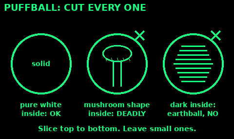
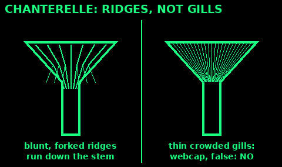

## Why to say no

Use: read this before you pick any mushroom.

1. A few British mushrooms kill. Death cap and destroying angel cause liver failure. Webcaps destroy the kidneys.

2. The worst do not taste bad. Symptoms can wait 6 to 24 hours, or days for webcaps, then seem to get better before the liver fails.

3. Cooking, drying or freezing do not make them safe.

4. There are no rules of thumb that work: not colour, smell, peeling, silver spoons or animals eating them.

5. Mushrooms give few calories. The risk is not worth it.

6. Only eat a wild mushroom if a real expert has checked that very mushroom in your hand.

7. If anyone feels ill after eating wild mushrooms: call 111, or 999 if very unwell. Keep the leftovers and a whole one for identification.

Never eat a white mushroom with white gills, a ring on the stem and a bag-like cup at the base. That is how amanitas, the deadliest, look.

Check: if you are not an expert, the answer is no.

## Giant puffball

Use: one of the easiest to know, in late summer and autumn. Still check every one.

1. A large white ball, from a big grapefruit to a football, on grass, meadow edges and nettle beds.

2. No stem, no cap, no gills.

3. Cut it from top to bottom.

4. Eat only if it is pure white all through, firm, like marshmallow or tofu.

5. Throw it away if it is yellow, brown, green or purple inside, or shows any outline of a cap, stem or gills.

6. Slice and fry well.

Lookalikes: a young deadly amanita still in its white egg (cut it and you see a mushroom shape inside). Common earthball (warty, yellowish skin, hard, black or purple inside: poisonous). Small puffballs are easy to confuse with both: leave them.

Check: big, white skin, white solid inside, no outline when sliced.

## Chanterelle

Use: a prized egg-yolk-yellow mushroom in woods, July to November. Many people get it wrong.

1. Yellow to orange, funnel-shaped cap with a wavy edge.

2. Underneath: blunt, shallow ridges like wrinkles that fork and run down the stem. Not thin, knife-edge gills.

3. Solid stem, the same colour. Pale flesh inside.

4. Often smells of apricots.

5. Cook it well.

Deadly lookalike: deadly webcap and other orange-brown webcaps (true gills, a rusty-brown spore print, a cobweb-like veil when young; mainly in pine and birch woods). They destroy the kidneys days later.

Other lookalikes: false chanterelle (true, thin, crowded orange gills: upsets the gut); jack o'lantern (grows in clusters on wood, true gills: poisonous).

Check: blunt forked ridges, not gills, on every one, checked by an expert.

## Chicken of the woods

Use: a bright bracket on trees, May to September.

1. Big, bright sulphur-yellow and orange shelves stacked on a trunk or stump.

2. No gills: tiny pores underneath, yellow.

3. Soft and moist at the edges when young. Old ones are dry, pale and crumbly: leave them.

4. Mostly on oak, willow, cherry and sweet chestnut.

5. Cook it thoroughly. Eat a small amount the first time: some people react to it.

Never take it from yew: it can carry yew's poisons. Avoid it on conifers, eucalyptus and cedar too.

Check: bright yellow and orange, pores not gills, young, on a broadleaf tree, never yew.

## Penny bun (cep)

Use: a big brown mushroom with a sponge underneath, August to November, under oak, beech, birch and pine.

1. Brown cap like a glazed bun, 8 to 25 cm.

2. Underneath: a sponge of tiny pores, white when young, then yellow to olive. Not gills.

3. Fat, pale stem with a fine white net pattern near the top.

4. White flesh that does not change colour when cut.

5. Cook it.

Lookalikes: bitter bolete (pinkish pores, dark net on the stem, bitter: not deadly, but it ruins the meal). Devil's bolete and others with red or orange pores: poisonous.

Simple rule for boletes: leave any with red or orange pores, or flesh that turns blue when cut.

Check: pores not gills, white net on the stem, no colour change, checked by an expert.
