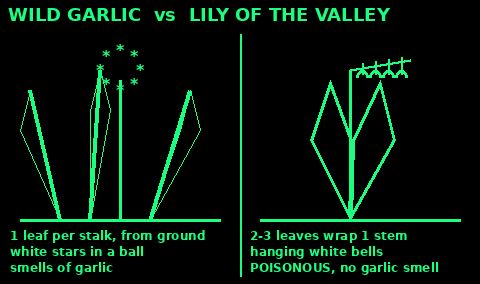
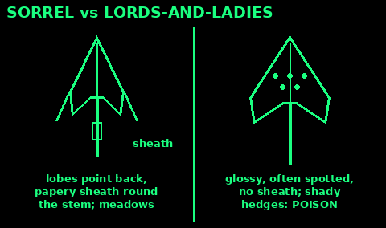
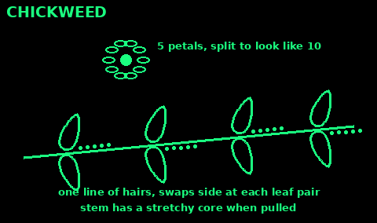

## Nettle and cleavers

Stinging nettle: upright, up to 2 m. Pointed, toothed leaves in opposite pairs, covered in stinging hairs. Tiny greenish flowers hang in strings near the top.

Pick the top 4 to 6 leaves of young plants, spring to early summer. Wear gloves or pinch the leaves firmly from underneath. Boiling or steaming for a couple of minutes removes the sting. Eat like spinach, or in soup or tea. Avoid old plants once they flower: the leaves get tough and gritty.

Cleavers (goosegrass, sticky willy): a scrambling plant that sticks to clothes. Square stems with tiny hooked hairs. Narrow leaves in rings (whorls) of 6 to 8 round the stem. Tiny white four-petalled flowers, then small round hooked seeds.

Pick young shoots in spring and cook them as greens or in soup. Older plants are too hairy and stringy. The hard ripe seeds can be roasted as a coffee substitute.

Both are safe beginner plants. Nettle has no dangerous lookalike that also stings.

## Dandelion

Leaves in a flat rosette from the root, long and deeply toothed. One hollow, leafless stem per flower, with milky sap. One bright yellow flower head on each stem, closing at night, then a round seed clock.

All parts are edible. Young leaves raw in salad, older leaves cooked (they get bitter). Flowers raw or in batter. Roots scrubbed and cooked, or dried, roasted and ground as a coffee substitute.

Lookalikes such as cat's-ear and hawkbits are not dangerous, but they have branched or hairy stems. True dandelion: smooth, hollow, unbranched stem, one flower.

Dandelion leaf is a diuretic: it makes you pee more. Do not lean on it when water is short.

## Wild garlic or lily of the valley?

Wild garlic (ramsons) is a top spring food. Lily of the valley grows in the same woods, looks similar before it flowers, and is highly poisonous: it contains heart poisons.

Wild garlic: each leaf rises on its own stalk straight from the ground. Leaves broad, pointed, soft and floppy. Flowers are white stars, about 25 in a round ball-shaped head on a bare stem. Crush a leaf: it smells strongly of garlic.

Lily of the valley: usually two or three leaves wrapped around one stem, stiffer and shinier. Flowers are small white bells hanging down one side of the stem. Crushed leaves do not smell of garlic.

The smell test is not enough on its own. After picking garlic, your fingers smell of garlic and every leaf seems to. Check the growth habit of each leaf you pick. Do not grab handfuls. Lords-and-ladies (arum) leaves also grow among wild garlic and are poisonous: they are arrow-shaped.

Eat the leaves raw or wilted, best before the flowers open. The flowers are edible too.

## Sorrel

Use: a lemony leaf for salads and sauces, spring to autumn.

1. Grassland, meadows and verges. Grows as a clump.

2. Leaves shaped like an arrowhead, with two small lobes at the base pointing down and back.

3. Where the leaf joins the stem there is a thin papery sheath wrapped round the stem.

4. Rusty-red flower spikes in early summer.

5. Leaves taste sharp and lemony.

Lookalike: lords-and-ladies, whose young arrow leaves grow in shady hedges, are glossy and often spotted, have no papery sheath, and burn the mouth. See Deadly plants.

Sorrel holds oxalic acid. Eat it in modest amounts. Avoid it if you have kidney stones or gout.

Mistakes: picking arrow leaves in shady hedges; eating big bowlfuls.

Check: a papery sheath round the stem and a meadow, not a hedge bottom.

## Chickweed

Use: a mild raw salad green, almost all year, even in winter.

1. Low, sprawling mats in gardens, fields and bare soil.

2. Small, oval, pointed, smooth leaves in opposite pairs.

3. Tiny white star flowers: 5 petals, each split so deep it looks like 10.

4. A single line of fine hairs runs along one side of the stem, changing sides at each leaf pair.

5. Pull a stem gently apart: a stretchy thread inside holds it together.

Lookalikes: scarlet pimpernel (orange-red flowers, square hairless stem, black dots under the leaves: poisonous); petty spurge (milky sap: poisonous).

Mistakes: picking without the flower; pulling up a mixed handful.

Check: the line of hairs and the stretchy core, on every stem.

## Plantain

Use: common leaf in lawns and paths. Edible, and a traditional dressing for stings.

1. Greater plantain: broad oval leaves in a flat rosette. Ribwort plantain: long narrow leaves.

2. 3 to 7 strong ribs run the length of the leaf, side by side.

3. Tear a leaf across: the ribs pull out like strings.

4. Flower spikes on leafless stalks: long and thin (greater) or short dark heads (ribwort).

5. Young leaves raw or cooked. Older leaves are stringy: cook them and remove the strings.

Foxglove leaves in early spring are soft, furry and net-veined, not ribbed. See Deadly plants.

Mistakes: old tough leaves; picking from dog-walking paths.

Check: parallel ribs that pull out as strings.

## Burdock

Use: the long root of a first-year plant is a good starchy food.

1. Very large, heart-shaped leaves, woolly and whitish underneath. Leaf stalks are grooved.

2. Second year: tall branched stems with purple thistle-like flowers, then hooked burrs that stick to clothes.

3. Dig roots from first-year plants (leaves only, no flower stem), in autumn or early spring. You need the landowner's permission to dig up wild plants.

4. Scrub and peel. Slice and boil or roast until soft. Young peeled leaf stalks can be cooked too.

Lookalikes: rhubarb (leaves poisonous) and young foxglove (smaller, softer, wrinkled leaves; deadly). Look for the woolly white underside and, nearby, last year's burrs.

Mistakes: old woody roots; second-year roots (tough).

Check: woolly leaf undersides and burrs on old stems nearby.

## Sea beet

Use: wild spinach of the coast, nearly all year.

1. On shingle, sea walls, cliffs and salt marsh edges.

2. Thick, glossy, dark green leaves, often triangular or spoon-shaped, a bit leathery.

3. Spikes of tiny green flowers in summer.

4. Pick a few leaves from each plant. Wash well.

5. Raw when young, or cook like spinach for a few minutes.

Pick away from sewage outfalls, harbours and dog-walking paths. Some coasts are protected nature sites: take a little.

Mistakes: picking old, tough leaves in late summer; confusing it with docks inland.

Check: glossy thick leaves, on the coast, tasting of spinach.

## Marsh samphire

Use: a salty, crunchy vegetable of salt marsh and mudflats, July and August.

1. Small, bright green, fleshy, jointed stems like tiny cacti, with no proper leaves.

2. Grows on muddy salt marsh covered by high tides.

3. Cut the tops with scissors. Do not pull up the roots. Many marshes are protected: take only a little.

4. Rinse well in clean water.

5. Steam or boil 2 to 3 minutes. Pull the soft flesh off the woody core with your teeth.

Danger: tides come in fast over flat marsh, and soft mud traps people. Know the tide times. See Navigation.

Rock samphire, on sea cliffs, is a different plant in the carrot family. Leave it to experts.

Check: jointed, leafless, green stems in tidal mud, and the tide is going out.
