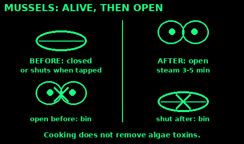

## Seaweeds

Use: plentiful food on rocky shores all year. No common British shore seaweed is deadly.

Good ones to start: sea lettuce (thin, bright green sheets), laver (thin purple-brown sheets), dulse (red-purple, flat, forked), kelp and sugar kelp (big brown straps), bladderwrack (brown, with air bubbles), carrageen (small, red-purple, fan-shaped).

1. Pick at low tide, from clean water far from sewage outfalls, harbours and river mouths.

2. Cut living seaweed that is still attached. Leave the base (holdfast) so it regrows. Never take washed-up seaweed.

3. Rinse in clean water. Eat raw, add to soups, or dry in the sun and crumble.

4. Eat in small amounts. Kelp in particular has a lot of iodine, which can upset the thyroid.

Avoid acid weed (Desmarestia, feathery, olive-brown, from deep water): it holds acid and upsets the gut.

Mistakes: rotting seaweed from the strandline; pulling it off with the holdfast.

Check: firm, fresh, attached, and cut not pulled.

## Mussels and limpets

Use: shellfish food from clean rocky shores. Read Shellfish poisoning first.

Mussels:
1. Collect at low tide, from rocks washed by clean open sea. Not near harbours, outfalls, marinas or river mouths.
2. Take only closed mussels, or ones that shut when tapped. Heavy, not cracked.
3. Keep them in a bucket of clean seawater for a few hours so they spit out grit.
4. Scrub and pull off the beard.
5. Steam with a little water, lid on, until they open: about 3 to 5 minutes.
6. Throw away any that stay shut.

Limpets:
1. Knock them off with a sudden sideways blow of a stone. If they clamp down, try the next one.
2. Boil or roast for a few minutes. They are chewy: slice thin or put in soup.

Mistakes: open, dead shellfish; collecting in warm months near any bloom.

Check: alive before cooking, open after cooking, from clean water.

## Shellfish poisoning

Use: before you eat any wild mussel, cockle, clam, oyster or scallop.

1. Shellfish filter seawater. They collect poisons from algae blooms and germs from sewage.

2. Cooking does NOT destroy the algae poisons. Nor does freezing.

3. Risk is highest from about April to September. Brown, red or discoloured water and dead fish or birds mean a bloom.

4. Look for local notices, and check the council or Food Standards Agency closures for the area if you can.

5. Never collect near sewage outfalls, harbours or after heavy rain.

Signs (minutes to hours after eating): tingling or numb lips, tongue and fingers, dizziness, vomiting, diarrhoea, weakness. Paralytic poisoning can stop breathing: call 999. Be ready to give rescue breaths. See First aid.

Check: no warnings, no bloom, clean open water, a cold month.
