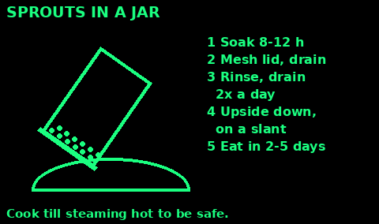
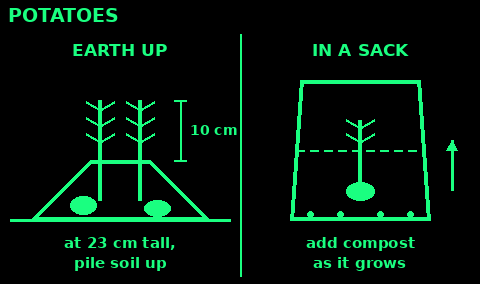
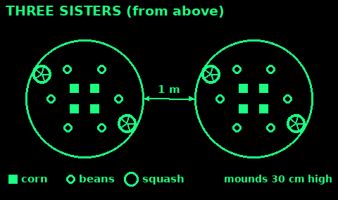
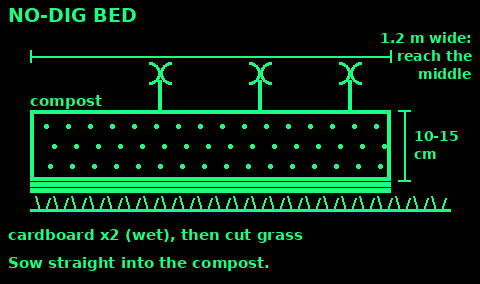
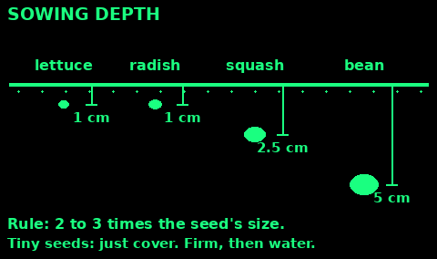

## Fast crops

Start with these while the slow crops grow.

Sprouts: 2 to 5 days in a jar on a windowsill. See Sprouts in a jar.

Microgreens: sow seeds thickly on damp compost in a tray on a sunny windowsill. Cut the seedlings in 2 to 3 weeks. Good: kale, radish, mustard, cress, peas, beetroot.

Salad leaves: sow lettuce, rocket, mustard or spinach thinly, 1 cm deep. Pick young leaves from about 3 to 6 weeks. Cut, and they grow back several times.

Radish: sow 1 cm deep, 2.5 to 5 cm apart, from spring to late summer. Ready in about 4 weeks in warm weather. Pull them small. Old radishes go woody.

Sow a short row of each every 2 weeks for a steady supply.

Leaves give vitamins, not calories. For calories, grow potatoes, beans and squash.

## Sprouts in a jar

Any season, no soil, no sun.

1. Use seeds sold for sprouting or eating: mung beans, green lentils, chickpeas, alfalfa, mustard. Never seed packets for the garden: they may be treated with chemicals.

2. Put 2 tablespoons in a clean jar. Cover with water. Soak 8 to 12 hours (alfalfa 6 to 8).

3. Cover the top with a clean cloth or mesh, held with a band. Drain.

4. Rinse with clean water and drain at least twice a day. Leave the jar upside down at a slant so it drains.

5. Keep it out of direct sun, at room temperature.

6. Eat in 2 to 5 days, when the shoots are 1 to 3 cm long.

Sprouts can carry food bugs. Cook them until steaming hot, especially for children, pregnant women, the old and the ill. Throw out any that are slimy or smell bad. Do not sprout red kidney beans.

## Potatoes

The biggest food crop for a small space in a cool climate.

1. Use seed potatoes if you can: certified free of disease. Shop potatoes may grow, but can carry disease.

2. Chit earlies first: stand them eyes up in egg boxes, cool and light, for 4 to 6 weeks, until they have short, sturdy shoots (up to about 5 cm).

3. Plant from late March (earlies) to early May (maincrop), in a trench 15 cm deep. Earlies 30 cm apart, rows 60 cm apart. Maincrop 37 cm apart, rows 75 cm.

4. Earth up: when shoots are about 23 cm tall, pull soil round them, leaving the top 10 cm showing. Repeat every few weeks.

5. Water well in dry spells, most of all once flowers appear.

6. Lift earlies when they flower, from about 12 weeks (June to July). Maincrop from late August to October. Store them dry, dark and cool.

Never eat green potatoes, or the leaves or berries. They are poisonous. Earthing up stops the potatoes turning green.

## Beans, squash and kale

Beans: protein, and dried beans store for a year. They feed the soil too.
- Broad beans: hardy. Sow 5 cm deep in autumn or late winter to spring.
- French and runner beans: sow 5 cm deep after the last frost, or indoors from late April. Climbing kinds need poles 2 m or more.
- Let some pods dry on the plant for dried beans and next year's seed.
- Dried beans: soak for 12 hours, then boil hard for at least 10 minutes, then cook until soft. Raw or undercooked red kidney and runner beans are poisonous.

Squash and pumpkin: sow indoors from mid to late April, plant out after the last frost. Give each plant a hole of compost 30 cm wide and deep, and 90 cm to 1.5 m of space. Winter squash keep for months somewhere cool and dry.

Kale: sow March to June, 1 cm deep. Plant 30 to 60 cm apart. Pick leaves from autumn through winter. One of the hardiest greens.

## Three Sisters

Corn, beans and squash grown together, a Native American method. The corn holds up the beans. The beans feed the soil. The big squash leaves shade out weeds and keep the soil damp.

1. After the last frost, make low flat mounds about 30 cm high and 50 cm to 1 m wide, 1 to 1.2 m apart.

2. Sow 4 to 6 sweetcorn seeds in the middle, 15 cm apart. Thin to the best 3 or 4.

3. When the corn is about 15 cm tall, sow 4 to 6 climbing beans round it, 15 cm out from the corn.

4. A week later, sow squash at the edge of the mound, about 30 cm from the beans. Thin to 1 or 2 plants.

5. Water the mounds well. Guide bean tips onto the corn.

In the UK this works best in the south and in warm summers. Use a dwarf sweetcorn and a borlotti or other drying bean. Runner beans can swamp corn.

## No-dig bed

Quick to make, few weeds, and the soil stays alive.

1. Pick a spot with at least 6 hours of sun.

2. Cut grass and weeds short. Leave the roots.

3. Lay a double layer of plain brown cardboard. Overlap it well. Take off tape and staples.

4. Wet the cardboard.

5. Cover it with 10 to 15 cm of compost or well-rotted manure.

6. Sow or plant straight into the compost. For potatoes, push through to the soil.

7. Each autumn, add about 5 cm more compost on top.

Make beds about 1.2 m wide so you can reach the middle without standing on them. Paths about 45 cm.

## Sowing seeds

Rule: sow a seed about 2 to 3 times as deep as it is wide. Check the packet if you have it.

- Tiny seeds (lettuce, carrot): just cover, about 1 cm.
- Radish, kale, beetroot: 1 to 2 cm.
- Squash, sweetcorn: 2.5 cm.
- Peas and beans: about 5 cm.

1. Rake the soil fine. Make a straight groove (a drill) with a stick.

2. Water the groove first.

3. Sow thinly. Cover with fine soil and press it down gently.

4. Label the row with the crop and date.

5. Keep the soil damp until the seedlings are up.

6. Thin seedlings to the right spacing. Eat the thinnings.

Tender crops (beans, squash, corn, tomatoes) die in frost. Wait until after the last frost: mid May in the south, early June in the north.

## Watering

1. Water the soil at the roots, not the leaves.

2. Water well and less often. A good soak every few days beats a daily sprinkle. It makes deep roots.

3. Early morning or evening is best. Less water is lost.

4. Push a finger into the soil. Dry 2 to 3 cm down? Water.

5. Seedlings and new plants need water often. Never let them dry out.

6. Most needed when: potatoes flower, beans flower and pod, squash swell, salads grow.

7. Mulch with compost, grass cuttings or straw to keep water in.

8. Catch rain from roofs in butts and buckets.

Containers dry out fast. In summer they may need water every day.

## Pests and companions

Check plants often. Small problems are easy. Big ones are not.

- Slugs and snails: go out at dusk with a torch and pick them off. Sink a jar of beer into the soil as a trap. Clear hiding places near seedlings.
- Aphids (greenfly, blackfly): squash them with your fingers or spray hard with water. Ladybirds and hoverflies eat them.
- Caterpillars on cabbages and kale: cover with fine net, and pick off the eggs and caterpillars.
- Birds and pigeons: net crops, or use string and strips of foil.
- Carrot fly: cover carrots with fine mesh.

Companions that help:
- Nasturtiums draw blackfly and caterpillars away from crops.
- French marigolds near tomatoes may keep whitefly off.
- Flowers such as calendula bring in insects that eat pests.
- Mix crops rather than growing big blocks of one.

Move crop families to a new bed each year to stop pests and diseases building up.

## Compost

Turns waste into food for the soil. Ready in 6 months to 2 years.

Greens (wet, rich): veg peelings, fruit scraps, grass cuttings, young weeds, tea leaves, coffee grounds.

Browns (dry, woody): cardboard, paper, straw, dead leaves, chopped twigs.

Aim for 25 to 50 percent greens, the rest browns. Mix them as you add.

Do not add: meat, fish, dairy, cooked food (rats), dog or cat poo, diseased plants, roots of perennial weeds.

1. Use a bin or a heap about 1 m across, on bare soil.

2. Add layers. Keep it damp like a wrung-out sponge.

3. Turn or fork it through every few months to add air.

4. Too wet and smelly: add browns. Too dry: add greens or water.

Ready when dark, crumbly and smelling like a wood.

## Saving seeds

Save seed from your best plants, and you never need to buy it again.

Do not save from F1 hybrids. Their seed does not come true. Save from open-pollinated or heritage kinds.

Easiest:
- Beans and peas: leave some pods on the plant until brown and rattly. Shell and dry.
- Tomatoes: scoop seeds and juice into a jar with a little water. Leave 2 to 3 days until a mould skin forms. Rinse, sieve, and dry on a plate.
- Lettuce: let a few plants flower. When the heads go fluffy, shake the seed into a bag.

1. Dry seeds for 1 to 2 weeks somewhere airy, out of sun.

2. Store in paper envelopes in a sealed jar, cool, dry and dark.

3. Label every packet with crop, variety and year.

Most seed keeps 2 to 4 years, some longer.

## Containers

Food on a balcony, a step or a roof.

1. Any container works if it has holes in the bottom: buckets, sacks, crates, tins, bags.

2. Bigger holds more water. Salad and herbs: 15 cm deep. Potatoes, tomatoes, beans: 30 cm wide and deep or more.

3. Fill with peat-free compost, or mix garden soil with compost.

4. Potatoes in a sack: 15 cm of compost, 1 seed potato per 30 cm of width, just below the surface. Add compost as the shoots grow until the sack is nearly full.

5. Water often: daily in hot weather.

6. Feed after about 6 weeks: a liquid feed, or nettle or comfrey leaves soaked in water for a few weeks, diluted about 1 part to 10 of water.

7. Sunniest spot you have. Move pots into shelter on frosty nights.

## UK growing calendar

Times for southern England. In the north or high ground, go 2 to 3 weeks later.

Jan to Feb: plan beds. Chit seed potatoes. Sprouts and microgreens indoors.

Mar: sow broad beans, peas, lettuce, radish, spinach, kale. Plant first early potatoes late in the month.

Apr: plant second earlies and maincrop. Sow carrots, beetroot. Sow squash and sweetcorn indoors from mid month.

May: sow French and runner beans indoors. After the last frost (mid to late May), plant out tender crops.

Jun: sow beans and squash outdoors. Keep sowing salad and radish. Earth up potatoes. Water.

Jul to Aug: harvest. Sow salads, spring cabbage, winter radish. Save seed. Dry beans on the plant.

Sep to Oct: lift maincrop potatoes. Harvest and cure squash. Plant garlic. Sow broad beans for next year. Add compost to beds.

Nov to Dec: mulch beds. Harvest kale, leeks and roots. Repair tools. Order seeds.

## Growing sources

Written in our own words from:

RHS Grow Your Own: rhs.org.uk/vegetables/potatoes/grow-your-own, rhs.org.uk/vegetables/radishes/grow-your-own, rhs.org.uk/vegetables/kale/grow-your-own, rhs.org.uk/vegetables/squash/grow-your-own, rhs.org.uk/vegetables/french-beans/grow-your-own

RHS no-dig, composting and sowing: rhs.org.uk/soil-composts-mulches/no-dig-gardening, rhs.org.uk/soil-composts-mulches/composting, rhs.org.uk/propagation/how-to-sow-seeds-outdoors

RHS seed saving: rhs.org.uk/education-learning/school-gardening/resources/planet-friendly/tips-on-saving-your-own-seeds

Three Sisters: Cornell Cooperative Extension, warren.cce.cornell.edu/gardening-landscape/warren-county-master-gardener-articles/creating-a-three-sisters-garden

Sprouting and food safety: Food Standards Agency advice on sprouted seeds; University of Vermont Extension, uvm.edu/extension/news/sprouts-superfood-grow-home

Kidney beans: Food Standards Agency, food.gov.uk

FAO home gardens and FAO "Grow more with less" ideas (fao.org).
