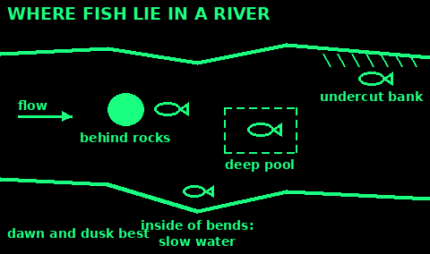
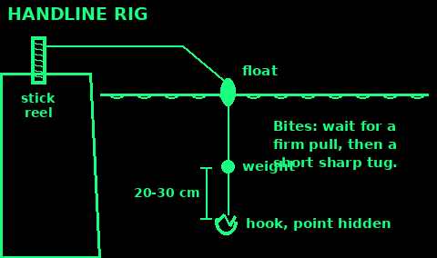
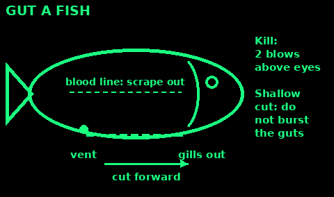
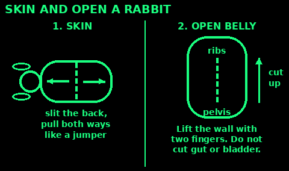

## The law first (UK)

Fishing:
- England and Wales: a rod licence from age 13 for freshwater fish, trout, salmon and eels (free for 13 to 16). Plus permission from whoever owns the fishing.
- Scotland: no rod licence, but you need permission. No salmon or sea trout fishing on Sundays.
- Northern Ireland: a licence from DAERA or the Loughs Agency, plus a permit.
- Sea fishing from the shore needs no licence. Check size limits.
- England: no coarse fishing on rivers from 15 March to 15 June.
- Never leave a line in the water unattended. Night lines (set lines) and nets are illegal without Environment Agency permission.

Hunting and trapping:
- You need the landowner's permission. Taking game without it is poaching.
- Rabbits, grey squirrels and rats are pest species and may be killed with permission. Snares: see the Tools card.
- All wild birds, their eggs and nests are protected, except listed game and pest birds under licence and in season.
- Protected: badgers, otters, bats, hedgehogs, red squirrels, dormice, water voles, pine martens, wildcats.
- Deer only with the right licensed firearm, in season. Guns need a certificate.

These are for food and for keeping animals away. Never set anything that could hurt a person or a pet.

## Where fish are

Fish want three things: food, shelter and calm water where they do not have to swim hard.

Rivers:
- Behind and in front of big rocks, where the current breaks.
- Deep, slow pools below rapids and weirs.
- Under undercut banks, tree roots and overhanging branches.
- Where two currents meet, and on the edge of fast and slow water.
- On the inside of bends, where water slows down.

Lakes and ponds:
- Near weed beds, reeds and lily pads.
- Where a stream flows in.
- Shallow edges at dawn and dusk; deeper water in the heat of the day.

Times: early morning and evening are best. Before a storm fish often feed hard. Cloudy days beat bright sun.

Move quietly. Keep your shadow off the water. Fish feel footsteps through the bank.

## Handline fishing

The simplest kit. Fits in a tin.

You need: line, a hook, a small weight (a stone, nut or split shot), and a float (cork, a stick, a feather quill).

1. Wind 10 to 20 m of line onto a short stick, a can or a bottle. This is your reel.

2. Tie on the hook with a clinch knot: through the eye, 5 turns round the line, back through the first loop, wet and pull tight.

3. Pinch the weight onto the line 20 to 30 cm above the hook.

4. Fix the float above that, so the bait hangs just off the bottom or at the depth you want.

5. Bait the hook so the point is hidden.

6. Swing or throw the bait out. Hold the line over a finger to feel bites.

7. The float dips or the line twitches: wait for a firm pull, then strike with a short sharp tug. Pull in steadily, hand over hand.

No float: let the weight sit on the bottom and feel for bites (ledgering).

## Rod from a stick

A rod lets you reach past weed and drop bait softly in the right spot.

1. Cut a straight, springy stick 2 to 3 m long: hazel, willow, ash or bamboo. Thick as a thumb at the butt.

2. Trim side shoots flush. Leave the tip thin and whippy.

3. Tie the line on near the butt and wrap it round the rod down its whole length to the tip. Then tie it at the tip. If the tip snaps, you keep the fish.

4. Leave line from the tip about the length of the rod.

5. Float, weight and hook as for the handline.

Hooks with no shop: see Fish hooks from wood and bone (Tools card). A bent safety pin or a needle heated and bent works for small fish.

Lure: a shiny strip of tin or a spoon bowl with a hook on one end, pulled through the water so it wobbles.

## Bait

Use what the fish already eat there.

Worms: the best all-round bait. Dig in damp soil, under logs and stones, or pick from a wet lawn at night with a dim light.

Others: maggots, grubs, caterpillars, slugs, grasshoppers, small fish, fish guts, shellfish, bread paste (bread squeezed with water), sweetcorn, cheese, cooked potato.

1. Hook worms once or twice through the body so they still wriggle.

2. Small fish and guts catch bigger fish such as pike and perch.

3. Keep bait cool and damp in a tin with soil or moss.

4. No bites in 20 to 30 minutes: change bait, depth or place.

Throw a few loose bits of bait in to draw fish (groundbait). Do not overfeed them.

## Kill and clean a fish

Kill it quickly. Leaving it to suffocate is cruel, and the flesh is worse.

1. Hold the fish firmly in a wet cloth.

2. Hit it hard on the top of the head, just above and behind the eyes, with a heavy stick or stone. Two sharp blows.

3. Bleed it: cut through the gills and let it bleed in water. It keeps better.

Gut it:

4. Scale it if it has big scales: scrape from tail to head with the back of a knife.

5. Push the knife point into the vent (the hole under the tail end). Cut forward up the belly to the gills. Keep the cut shallow so you do not burst the guts.

6. Pull the guts out. Cut out the gills.

7. Scrape out the dark blood line along the backbone with your thumbnail or a spoon.

8. Rinse in clean water. Cook within a few hours, or keep it cold.

Bury guts away from camp and water, or use them as bait.

Shellfish (mussels, cockles, clams) gathered yourself can carry toxins that cooking does not destroy. Avoid unless the area is known to be safe.

## Skin and gut a rabbit

Wear gloves if you have them. Do it soon after the kill, away from camp and water.

1. Check the animal is dead: no blink when you touch the eye.

2. Pinch up the skin on the back, cut a small slit across. Push two fingers in each way.

3. Pull the skin apart, one hand toward the head, one toward the tail. It comes off like a jumper.

4. Cut off the feet at the joints, the head and the tail.

5. Belly: pinch the thin belly wall, cut a small hole, then slide two fingers in and lift the wall away from the guts while you cut up from pelvis to ribs. Do not cut the gut or the bladder.

6. Tip the guts out. Keep the heart, liver and kidneys if they look healthy.

7. Check the liver now (next card).

8. Wash the carcass in clean water and cut it into legs, back (saddle) and ribs.

Any smell of guts on the meat: wash it off quickly. Cool the meat fast.

## Is the meat safe?

Do not eat an animal that:
- you found dead, unless you saw it die minutes ago
- moved oddly, had no fear of you, was very thin, or had sores, swellings or a discharge
- smells bad, or has green, slimy or bloated flesh

Look inside before you cook:
- Liver: should be smooth, deep red-brown and even. Many small white or yellow spots, like grains of rice: throw the whole animal away. In rabbits and hares this can be tularaemia ("rabbit fever") or a parasite. You cannot tell them apart by eye.
- Lungs: pink and spongy. Not lumpy or full of pus.
- Meat: no cysts (small pale bubbles in the muscle), no abscesses, no yellow pus.

Tularaemia has not been found in UK wildlife, but is common in Europe and North America. It spreads through cuts on the hands and by breathing in dust from the fur. Wear gloves, do not skin a sick-looking animal, and wash hands well.

Rabbits with myxomatosis (swollen, weeping eyes) are not known to infect people, but do not eat them.

Lean meat alone is not enough. Rabbit with no fat or plants for weeks causes sickness ("rabbit starvation"). Eat fat, organs, fish, roots and greens too.

## Bigger game basics

Deer, wild boar and sheep-sized animals spoil fast if you are slow.

1. Bleed it straight away: cut across the throat to open the big vessels in the neck.

2. Gut it within the hour. Lay it on its back on a slope, head uphill.

3. Cut the skin and belly wall from the pelvis to the ribs, two fingers under the blade to lift it off the guts. Do not cut the paunch (stomach) or bladder.

4. Cut round the anus and tie it off. Cut the windpipe and gullet high up in the chest. Roll the whole gut pile out.

5. Prop the body open with a stick. Wipe it out. Hang it in the shade, off the ground, in moving air, covered from flies.

6. Cool it as fast as you can. Large game must get below 7°C. In warm weather, cut it up and cook or dry it the same day.

7. Skin it from the hanging legs downward. Cut into quarters at the joints.

Wild boar, pigs, bears and badgers can carry trichinella worms: always cook these all the way through. Smoking, salting and drying do not kill them.

Drying, smoking and salting: see the Food cards.

## Pluck and draw a bird

Pigeon, pheasant, duck or chicken.

1. Pluck while still warm: pull a few feathers at a time, against the way they lie, holding the skin flat with your other hand so it does not tear.

2. Ducks and geese: dip in very hot water for a minute first, or just skin them.

3. Small birds: often quickest to skin and keep only the breast. Push your thumbs under the breast skin, peel it back, and cut the breast meat off the bone.

4. Draw (gut): cut off the head and feet. Cut a slit above the vent. Hook two fingers in, sweep round the inside, and pull the guts out. Keep heart, liver (cut off the green gall bladder carefully) and gizzard.

5. Pull out the crop (the bag at the neck) through the neck end.

6. Rinse and cool.

Singe off fine hairs over a flame.

## Cook meat thoroughly

Wild meat often carries more germs and parasites than shop meat.

1. Cook until the centre is steaming hot and the juices run clear, with no pink left. Wild meat should not be served rare.

2. With a thermometer: the thickest part must reach 70°C and stay there for 2 minutes (or 75°C for 30 seconds).

3. Cut big pieces small, or stew them. Boiling for 20 minutes or more is the surest method. Keep the broth.

4. Offal (liver, kidneys, heart) is good food, but cook it well.

5. Shot game: cut out the lead pellets and the bruised meat round each one. Children and pregnant women should eat lead-shot game rarely.

6. Raw meat has its own knife and board. Wash hands after handling it.

Cooked meat keeps: eat it the same day, or cool and keep it cold. See Food safety in Cooking.

## Use the whole animal

Wasting an animal wastes your effort and its life.

Hide:
1. Scrape off all fat and flesh with a blunt blade over a log.
2. To keep it: rub it with lots of salt and fold flesh-side in, or stretch it on a frame and dry it in shade.
3. Rawhide (dried, hair off) makes lashings and ties that shrink tight as they dry. Soak to soften before use.
4. Fur on: rabbit skins make warm hat, mitten and boot linings.

Sinew: the long tendons along the backbone and in the legs. Dry them, pound them, peel off fibres. Wet them in your mouth and wrap: they shrink and glue themselves. Strong thread for sewing and binding arrow-tips and hooks.

Bones: crack for marrow (rich fat). Boil for broth. Split shards make needles, awls and fish hooks.

Fat: render it slowly in a pot to tallow. For cooking, candles and lamps (Repairs card) and soap (Sanitation card).

Guts and stomach: cleaned and dried they make bags and containers. Fish and rabbit guts make bait.

Feathers: insulation in a jacket or bed, fletching, fishing floats (quills).

Bury what is left, well away from camp and water.

## Hunting & fishing sources

Written in our own words from:

GOV.UK fishing licences: gov.uk/fishing-licences and gov.uk/fishing-licences/fishing-in-scotland-and-northern-ireland

National rod fishing byelaws, England (close season, unattended lines): gov.uk/guidance/national-rod-fishing-byelaws-for-england-freshwater-fishing-with-a-rod-and-line

Fisheries Management Scotland, fishing and the law: fms.scot/fishing-and-the-law

Wildlife and Countryside Act 1981, schedules 5 and 6: legislation.gov.uk/ukpga/1981/69. Protection of Badgers Act 1992. Hunting Act 2004: legislation.gov.uk/ukpga/2004/37

Food Standards Agency wild game guidance and cooking temperatures (70°C for 2 minutes): food.gov.uk

CDC tularemia and trichinellosis: cdc.gov/tularemia and cdc.gov/trichinellosis/prevention. UKHSA human tularaemia case report 2023 (no UK animal source found): doi.org/10.3201/eid3010.240479. ECDC tularaemia factsheet: ecdc.europa.eu/en/tularaemia/facts

US Army FM 21-76 / ATP 3-50.21 Survival (public domain): fishing, fish cleaning, game preparation, using the whole animal.

Missouri Department of Conservation and Michigan DNR, rabbit health and liver spots (facts only).
