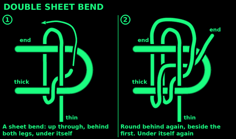
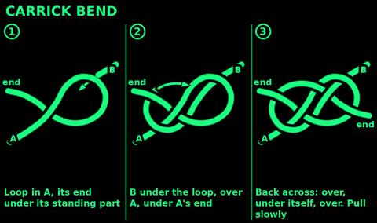
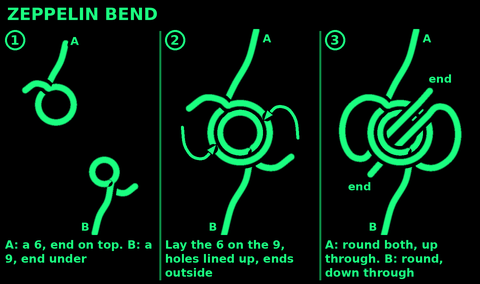
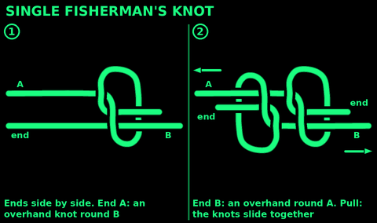

## Double sheet bend

Use: join a thin cord to a thick rope, or join wet, stiff or slippery rope. More secure than a single sheet bend.

1. Tie a sheet bend: thin end up through a bight in the thick rope, round behind both legs, under itself.
2. Take the end round behind both legs a second time, beside the first turn.
3. Tuck it under itself again, next to the first tuck.
4. Pull both standing parts.

Check: two turns side by side round the bight. Both tails on the same side.

## Carrick bend

Use: join two heavy or stiff ropes, cables or hawsers. It does not jam, even wet and loaded.

1. Make a loop in rope A, its end lying under its standing part.
2. Lay rope B's end under that loop.
3. Take B over A's standing part, then under A's end.
4. Weave B across the loop: over, under itself, over. Under and over now alternate at every crossing.
5. Pull both standing parts slowly.

Check: before pulling, every strand goes over, under, over, under. The two ends leave on opposite sides, diagonally. Under load it rolls into a lump. That is normal.

## Zeppelin bend

Use: join two ropes of similar size. Secure, will not jam, easy to untie after a load.

1. Rope A: make a 6. Its end lies on top of its standing part.
2. Rope B: make a 9. Its end lies under its standing part.
3. Lay the 6 on top of the 9, the holes lined up. Both ends outside.
4. A's end: round both ropes and up through the middle.
5. B's end: round both ropes and down through the middle, the other way.
6. Pull both standing parts, then both ends.

Check: the ends leave the middle in opposite directions, each beside the other rope's standing part.

## Single fisherman's knot

Use: join two thin lines or cords. Quick. Light loads only.
Do not use: for climbing or heavy loads. Use the double fisherman's knot.

1. Lay the two ends side by side, pointing opposite ways.
2. With end A, tie an overhand knot round rope B.
3. With end B, tie an overhand knot round rope A.
4. Pull both standing parts so the knots slide together.

Check: the two knots jam against each other. Tails a hand long.

## Double fisherman's knot

Use: join two ropes or cords of similar size when it must not slip. Close a Prusik loop.
Do not use: where you must untie it. It jams, often for good.

1. Lay the ends side by side, pointing opposite ways, an arm's length of overlap.
2. End A: wrap it twice round both ropes, back toward its own standing part.
3. Push end A back through those two wraps. Snug it.
4. End B: the same, the other way.
5. Pull both standing parts. The two knots slide together.

Check: two neat X shapes on one face, four parallel lines on the other. Tails a hand long.

## Water knot

Use: join two pieces of flat tape (webbing) or strap, or tie tape into a sling.
Do not use: on round rope.

1. Tie a loose overhand knot in the end of one tape.
2. Feed the other tape's end in where the first tail comes out.
3. Follow the first tape back through the whole knot, flat against it.
4. Pull all four parts hard.

Check: the tapes lie flat, never twisted, and the tails are at least three fingers long. Check the tails often: they creep.

