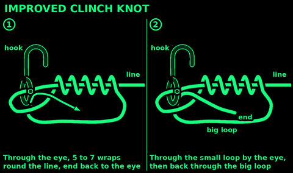
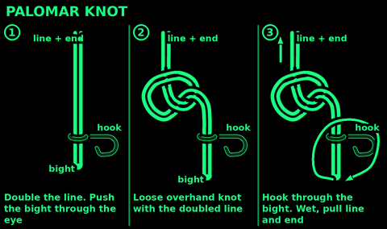
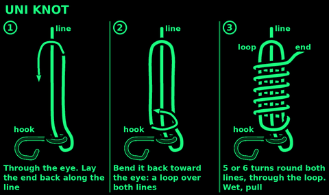
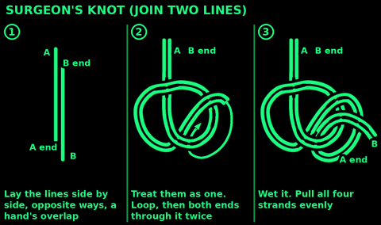
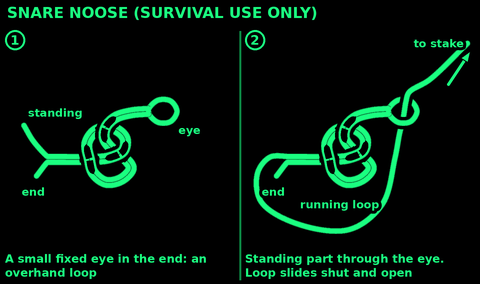

## Improved clinch knot

Use: tie fishing line to a hook, swivel or lure. Best in thin and medium line.

1. Push the end through the hook eye. Pull through a hand's length.
2. Wrap the end round the line 5 to 7 times. Fewer turns in thick line.
3. Pass the end through the small loop next to the eye.
4. Then back through the big loop you just made.
5. Wet it. Pull the line, so the turns slide down tight on the eye.

Check: neat coils, not crossed. Trim the end, leaving a few millimetres.

## Palomar knot

Use: tie line to a hook or swivel. Very strong, easy to tie in poor light. Good for braided line.

1. Double the line into a bight a hand long. Push the bight through the eye.
2. Tie a loose overhand knot with the doubled line. The hook hangs from it.
3. Pass the hook through the bight.
4. Wet it. Pull the line and the end together, so the knot closes on the eye.

Check: two strands through the eye, the knot snug above it. Trim the end.

## Uni knot

Use: tie line to a hook, swivel or ring. One knot to remember for most jobs. Two uni knots tied round each other join two lines.

1. Push the end through the eye. Lay it back along the line, a hand long.
2. Bend the end back toward the eye, making a loop over both lines.
3. Wrap the end round both lines and through the loop, 5 or 6 times.
4. Wet it. Pull the end to close the turns.
5. Pull the line to slide the knot down onto the eye.

Check: neat turns, tight on the eye. Trim the end.

## Surgeon's knot

Use: join two fishing lines, even of different thickness. Quick and strong.
Not the same as: the surgeon's knot used to tie a dressing.

1. Lay the two ends side by side, pointing opposite ways, a hand's length of overlap.
2. Treat the two lines as one. Make a loop.
3. Pass the end of one line and the whole of the other through the loop. Twice.
4. Wet it. Pull all four strands evenly.

Check: a double overhand in two lines, both ends trimmed close.

## Snare noose

Law first: read "Snares: the law first" in Tools and wildlife before you set one. In the UK self-locking snares are illegal everywhere, and snares are banned in Wales and Scotland. Survival emergency only.

Use: a loop that closes when pulled, and opens again: a survival snare.

1. Tie a small fixed eye in the end: a figure-eight or overhand loop, finger-sized.
2. Pass the standing part through the eye. That makes the running loop.
3. Size the loop and set it as the Tools and wildlife card says.
4. Tie the other end to a firm stake: round turn and two half hitches.

Check: the loop slides shut and slides open freely. Nothing must stop it opening: a noose that locks is illegal and cruel.

