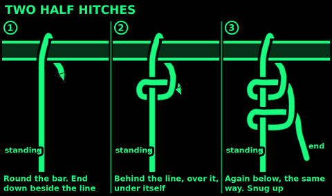
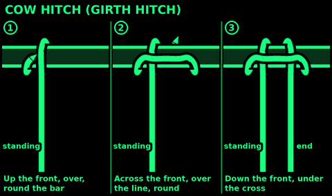
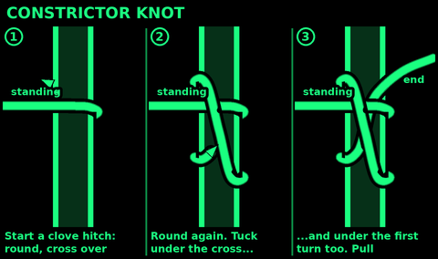
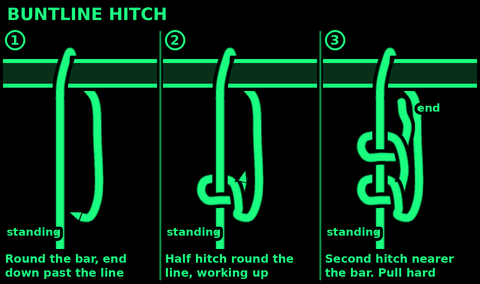
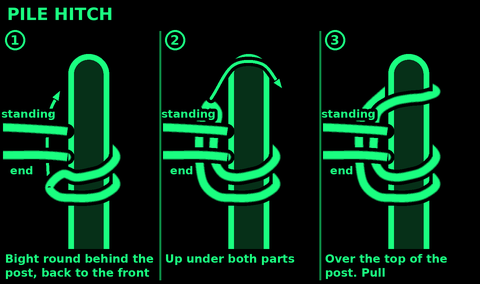
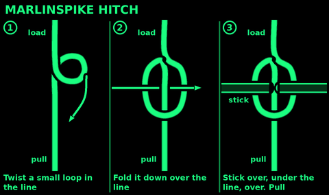
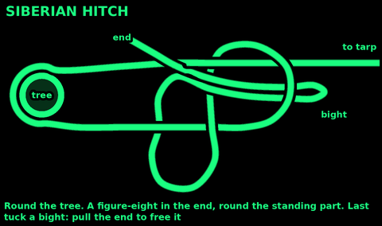
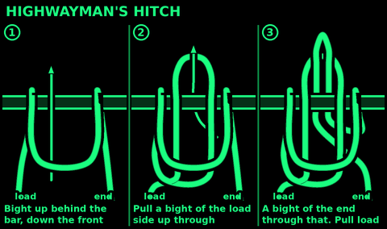
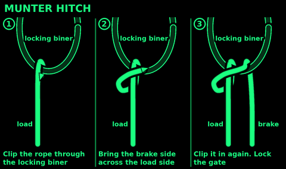

## Two half hitches

Use: a quick tie to a ring, rail or branch for a light load. Finishing other knots, like the trucker's hitch.
Do not use: for a heavy or jerking load. Put a round turn on first.

1. End round the bar and down beside the standing part.
2. Behind the standing part, over it, and under itself. One half hitch.
3. A second one below the first, the same way round.
4. Slide both up to the bar.

Check: the two hitches together look like a clove hitch on the standing part.

## Cow hitch

Also called: girth hitch, lark's head.
Use: put a loop or sling round a pole, ring or strap. Hang a bag from a branch. Tie a tag on. Best when both legs pull together.
Do not use: with only one leg loaded. It slips. Use a clove hitch.

With a loop or sling: pass it round the pole, then pull the far end through the near end.

With an end:
1. Up the front of the bar, over, and round behind.
2. Across the front, over its own line, and round the bar again, the other way.
3. Down the front, under that cross.

Check: a collar across the front, two legs side by side under it.

## Constrictor knot

Use: a binding that bites hard. Tie a sack neck, a bundle of sticks, a hose on a pipe, a rope end before you cut it.
Do not use: on anything you need to untie. Never on a person.

1. Start a clove hitch: round the post, cross over its own line, round again.
2. Tuck the end under the cross...
3. ...and carry on under the first turn too. The ends cross under the cross, like an overhand knot.
4. Pull both ends hard.

Check: one strand lies over the crossing of the two ends.
To remove: cut the top strand with a knife, on the far side from the ends. It falls apart.

## Timber hitch

Use: drag or lift a log, start a diagonal lashing, tie round a bundle. Falls off when slack, so it never jams.

1. Pass the end round the log.
2. Take it round the standing part.
3. Twist the end round its own turn, 3 times or more, lying against the log.
4. Pull the standing part. The turn bites the log.

Check: at least 3 twists. To drag a log straight, add a half hitch round the log near the front end.

## Buntline hitch

Use: a hitch to a ring or rail that is shaken or jerked: a flapping tarp, a bucket, a swinging load. It tightens when shaken.
Do not use: if you must untie it quickly after a heavy load. It jams more than two half hitches.

1. Pass the end round the bar or through the ring. Bring it down past the standing part.
2. Half hitch round the standing part: behind it, round, over, and under itself.
3. A second half hitch the same way, above the first, nearer the bar.
4. Pull the standing part hard.

Check: the end points back at the bar, trapped inside the knot.

## Pile hitch

Use: a very fast tie to a post you can reach the top of: a stake, fence post, mooring post. A row of them makes a rope fence. No end needed.
Do not use: if the post has no free top, or for a tie you will leave for days.

1. Pass a bight round behind the post.
2. Bring the bight back round to the front, under the standing part.
3. Lift the bight over the top of the post and drop it down.
4. Pull the standing part.

Check: the bight sits round the post above where the ropes cross.

## Marlinspike hitch

Use: put a stick in a line to haul hard on it. Tighten a lashing. Rungs for a rope ladder. A toggle.

1. Twist a small loop in the line.
2. Fold the loop down over the line, so the line runs across the middle of it.
3. Push the stick over one side of the loop, under the line in the middle, and over the other side.
4. Pull. The loop tightens on the stick.

Check: the part of the line that goes under the stick is the side that takes the load. If the stick pulls free, fold the loop the other way.

## Siberian hitch

Use: a quick-release hitch for a ridge line or tarp guy. You can tie it with gloves on.
Do not use: for anything that matters, or for people. One pull on the end undoes it.

1. Palm down. Lay the rope over the back of your hand, round the tree, and back across your hand.
2. Take the end under your hand, over both ropes, and back under both ropes.
3. Pinch a bight of the end between your fingers. Pull it back through the turn round your hand.
4. Slide your hand out. Pull the standing part and the bight to set it.
5. Slide the knot up to the tree.

Check: it is a slipped figure-eight round the standing part. Pull the free end and it falls apart.

## Highwayman's hitch

Use: a light load you need to free in a second: a pack hung on a rail, a tarp you may need to drop.
Do not use: for anything that matters. It can capsize and spill if not tightened, or on a thick post. Never for people.

1. Push a bight up behind the bar and down over the front.
2. Reach through that bight. Pull a bight of the standing part through it.
3. Reach through the new bight. Pull a bight of the end through it.
4. Pull the standing part hard to set it.

Check: the load pulls on the middle bight. The end's bight locks it.
To release: pull the end.

## Munter hitch

Use: lower a load, or a person in an emergency, with a locking carabiner. The rope rubs on itself to slow it.
Warning: learn it from a trained person before you trust a life to it. Use a large locking carabiner, gate locked. The brake hand never lets go. It twists and wears the rope. Wear gloves.

1. Clip the rope through the carabiner.
2. Bring the brake side across the front of the load side.
3. Clip that part in too. Lock the gate.
4. Hold the brake side. Ease it to let rope out. Hold it beside the load side to stop.

Check: test it with a load near the ground first. Keep the brake rope on the spine side, away from the gate: a moving rope can undo the gate.

