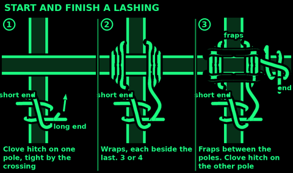
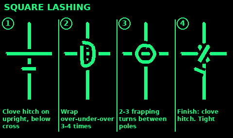
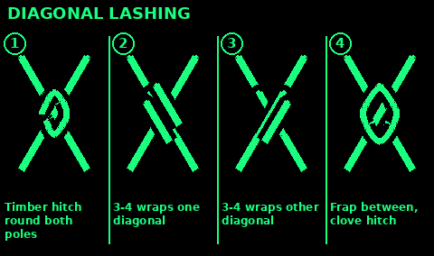
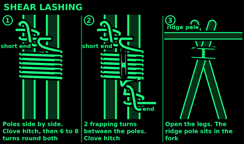
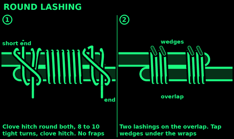
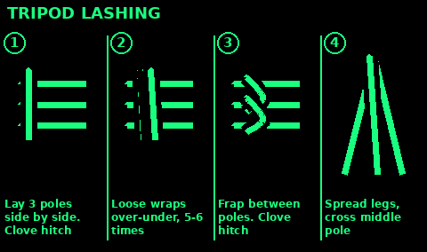
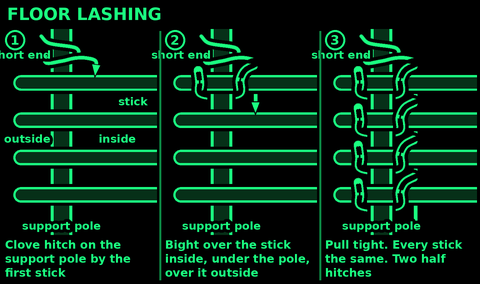

## Start and finish lashings

Start: a clove hitch on one pole, tight against where the poles meet. Twist the short end round the long cord, or lay it along the pole so the first wraps bury it.
Diagonal lashing: start with a timber hitch instead.

Wraps: each one tight and beside the last, never on top. 3 or 4 are usually enough.
Fraps: 2 or 3 turns between the poles, round the wraps. Pull each one hard. They tighten everything.

Finish: a clove hitch on the other pole, pushed tight against the lashing. Tuck the end under the wraps.

Check: push and twist the poles. Nothing should move. Wet natural cord shrinks and dry cord slackens: check lashings each morning.

## Square lashing

Use: join two poles that cross at a right angle: shelter frames, racks, ladders.

1. Clove hitch on the upright pole, just below the crossbar.
2. Up over the crossbar, behind the upright, down over the crossbar, behind the upright.
3. Do this 3 or 4 times. Each wrap outside the last on the crossbar, inside on the upright.
4. Frap: 2 or 3 turns between the poles, round the wraps. Pull hard.
5. Clove hitch on the crossbar.

## Diagonal lashing

Use: poles that cross at an angle, or that spring apart: cross-braces.

1. Timber hitch round both poles, along one diagonal. Pull the poles together.
2. 3 or 4 wraps along that same diagonal.
3. 3 or 4 wraps across the other diagonal.
4. 2 or 3 frapping turns between the poles, round the wraps.
5. Clove hitch on one pole.

## Shear lashing

Use: two poles side by side that you open into an A-frame or shear legs. Hold up a ridge pole.

1. Lay the two poles side by side. Clove hitch on one pole.
2. Wrap both poles together, 6 to 8 turns, beside each other. Not too tight.
3. Frap: 2 turns between the poles, round the wraps.
4. Clove hitch on the other pole.
5. Open the legs. If they will not open, the wraps are too tight: redo them looser.

## Round lashing

Use: join two poles side by side into one longer pole, or fix a pole along a post. Use two lashings, one near each end of the overlap.

1. Clove hitch round both poles.
2. Wrap both poles tightly, 8 to 10 turns, side by side.
3. Clove hitch round both poles to finish. No fraps.
4. Tap small wedges under the wraps to tighten them.

## Tripod lashing

Use: a tripod for a cooking pot, a water filter or a shelter frame.

1. Lay three poles side by side, the middle one pointing the other way.
2. Clove hitch on an outer pole.
3. Weave over and under the poles, 5 or 6 loose turns. Too tight and the legs will not open.
4. Frap 2 turns between each pair of poles.
5. Clove hitch on the other outer pole.
6. Stand it up and spread the legs.

## Floor lashing

Use: fix a row of sticks across two poles: a platform, a raft deck, a table top, a bed off the ground.

1. Lay the sticks across the two support poles, ends sticking out a few fingers.
2. Clove hitch on a support pole, right beside the first stick.
3. Make a bight in the cord. Pass it over the first stick, inside the support pole.
4. Take the bight under the support pole and loop it over the same stick, outside.
5. Pull the cord tight. Do the same for every stick.
6. Finish with two half hitches round the support pole. Then lash the other side.

