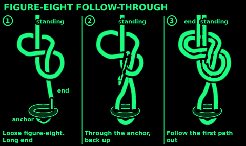
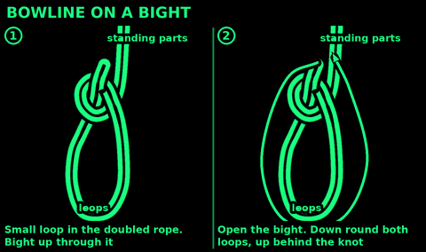
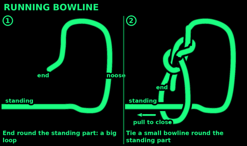
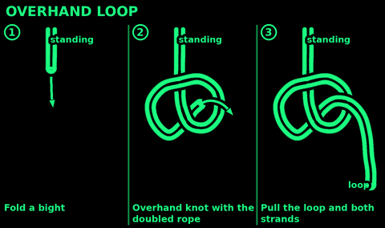
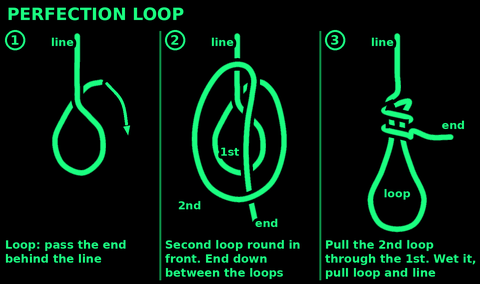
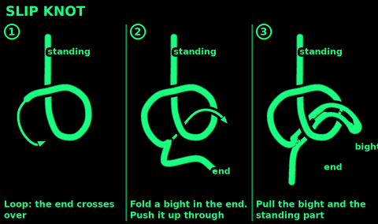

## Figure-eight follow-through

Use: a fixed loop round a tree, through a ring, harness or anchor. The loop knot for anything that holds a person.

1. Tie a loose figure-eight a forearm from the end.
2. Pass the end round the tree or through the ring.
3. Feed the end back into the 8, beside the end leaving it.
4. Follow the first strand all the way, side by side: over where it goes over, under where it goes under.
5. Dress it: the pairs lie flat and never cross. Pull all four strands.

Check: a clear doubled 8 and a tail a hand long. Any crossed pair, untie and follow again.

## Bowline on a bight

Use: two fixed loops in the middle of a rope, with no end needed. A seat for lifting a person in an emergency. Spreading a load between two points.

1. Double the rope into a long bight.
2. Make a small loop in the doubled rope, as for a bowline.
3. Push the bight up through the small loop.
4. Open the bight and pass it right round the two big loops and up behind the knot.
5. Pull the two big loops and the standing parts.

Check: the bight now sits round the standing parts above the knot. Two loops below. Pull each loop on its own: it must not slip.

## Running bowline

Use: a noose that slides closed and opens again easily: retrieve a branch or object, throw over a post or stump, tighten round a bundle.
Do not use: round a person or an animal's neck.

1. Pass the end round the standing part, making a big loop.
2. With the end, tie a small bowline round the standing part.
3. Pull the standing part through the small bowline to close the big loop.

Check: the big loop slides freely and the small bowline does not.

## Alpine butterfly

Use: a fixed loop in the middle of a rope, both ends free. A loop for a trucker's hitch. A clip point on a line. Takes a pull in any direction. Can isolate a damaged section of rope inside the loop.

1. Take a bight in the middle of the rope.
2. Twist it a full turn, so you have a crossing and a loop.
3. Twist it a second full turn the same way. Now there is a top loop and a small eye between the twists.
4. Fold the top loop down behind the twists, and push it up through that small eye.
5. Pull the loop, then both ends.

Check: the loop stands out of a neat knot. The two ends leave on opposite sides. Pull the two ends apart hard: the loop must not shrink.

## Overhand loop

Use: a quick fixed loop in cord, string or fishing line. A loop to clip or hang something from.
Do not use: if you need to untie it after a load. It jams. In rope, use a figure-eight loop.

1. Fold a bight.
2. Tie an overhand knot with the doubled rope.
3. Pull the loop and both strands.

Check: the two strands lie side by side through the whole knot.

## Perfection loop

Use: a small, neat loop in the end of a fishing line or thin cord, in line with the line.
Do not use: if you need to untie it. It jams. In rope, use a figure-eight loop.

1. Make a loop by passing the end behind the standing line.
2. Make a second loop in front of the first by taking the end round in front.
3. Lay the end between the two loops.
4. Pull the second loop through the first.
5. Wet the line. Pull the loop and the line together.

Check: the loop sits straight in line with the standing part. Trim the end close.

## Slip knot

Use: a knot that comes undone with one pull on the end: a temporary tie, closing a bag, a quick stopper you can shake out.
Do not use: for anything that must hold. It undoes when the end is pulled.

1. Make a loop: the end crosses over the standing part.
2. Fold a bight in the end.
3. Push that bight up through the loop, as if tying an overhand.
4. Pull the bight and the standing part.

Check: a pull on the free end and the knot falls out.

