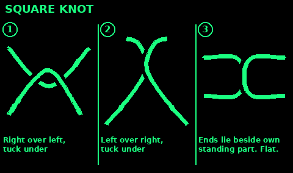
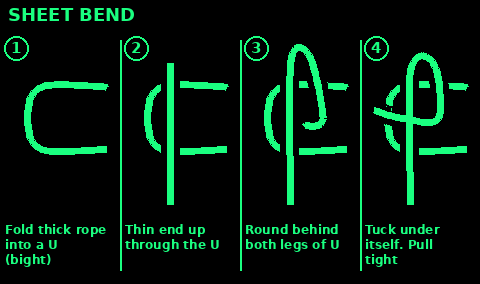
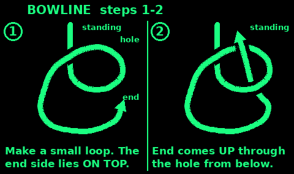
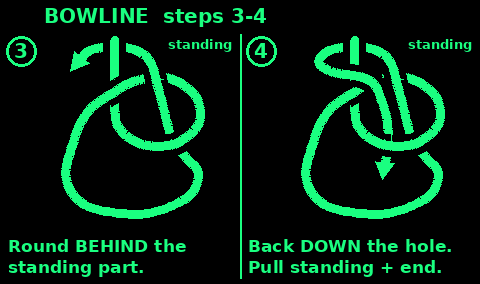
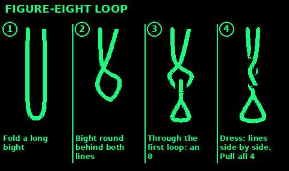
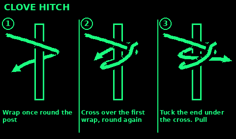
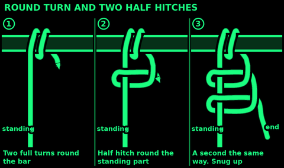
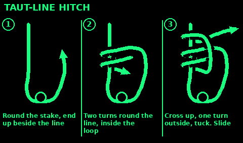

## Square knot

Use: bind a bundle, tie the two ends of the same bandage or cord, close a sack.
Do not use: to join two different ropes, or any line that will hold a person. It spills if the ropes differ or if one end is pulled sideways.

Names: each loose end is a working end. The rest of that rope is its standing part.

1. Cross the right working end over the left. Tuck it under. Pull snug. You have one half-knot.

2. Cross the end that is now on the left over the end that is now on the right. Tuck it under. Pull snug.

3. Look at it. Each working end should leave the knot on the same side as its own standing part. The knot is two loops sitting against each other, flat.

        standing     standing
            \         //
             \_______//
             /       \
            /    X    \
            \_______/
            /         \
        working       working

4. If the ends come out sideways, at right angles to their standing parts, you tied a granny. It will slip. Untie it and do step 2 again, the other way over.

5. Pull both standing parts and both ends to set it. Leave ends at least a hand long.

## Sheet bend

Use: join two ropes, including ropes of different thickness. The thicker rope makes the bight.
Do not use: as a loop around a person. For slippery line, or a large difference in size, use the double sheet bend in step 6.

1. Fold the thicker rope back on itself so you have a bight, a narrow U. Hold the two legs of the U together.

2. Pass the thinner rope up through that U, from underneath.

3. Take the thinner rope around behind both legs of the U.

4. Tuck the thinner rope under itself, right where it first came up through the U. Do not tuck it under both legs. Tuck it under its own standing part only.

5. Pull the standing part of each rope. The thin rope's tail and the thick rope's tail should lie on the same side. If they lie on opposite sides, you tied it backward. It is weaker. Retie it.

        thick bight
          __|__
         /     \
        |   ____|____  thin rope comes up,
         \  \       then around both legs,
          \__\___   then under itself

6. Double sheet bend: at step 3, wrap the thin rope around the bight twice, then tuck under itself as in step 4. Use this for wet line, smooth line, or a thin cord on a thick rope.

7. Set it with a hard pull. Leave a hand of tail on both ropes.

## Bowline

Use: a fixed loop at the end of a rope. Throwing a line over a branch and making a loop you can haul on. A loop around a pack.
Limit: if the loop flaps with no load, a bowline can work loose. Leave a long tail. For a loop you cannot afford to have slip, use the figure-eight loop.

The story that matches the steps: the standing part is the tree. A small loop in it is the hole. The working end is the rabbit.

1. Form a small loop in the standing part, leaving enough rope below it for the big loop you want. This small loop is the hole. Twist it so the side that leads on to the working end lies ON TOP of the standing part where they cross. If that side is underneath, the finished knot will not hold its shape: shake it out and twist the loop the other way.

2. Pass the working end up through the hole. The rabbit comes out of the hole.

3. Take the working end around behind the standing part. The rabbit goes around the tree.

4. Pass the working end back down through the hole, beside itself. The rabbit goes back into the hole.

5. Pull the standing part with one hand and the working end with the other. The small hole should close up into the knot. The big loop is the useful one. It should not shrink when you pull the standing part.

        tree (standing part)
              |
          ____|____
         /    |    \
        |     O     |   O is the hole that closed
         \____|____/
              |
           [ loop you use ]

6. Test it. Pull the loop and the standing part hard. Then shake the loop loose on purpose. If the knot capsizes into a simple sliding noose, cut it off and retie it. The working end must finish inside the loop, next to the leg it went in on.

Tail: at least a hand long. Longer if the rope is stiff.

## Figure-eight loop

Use: a loop at the end of a rope that must not slip and must be easy to check by eye. A ridge line you will load. A haul loop. Prefer this over a bowline when you cannot stand there and watch the knot.

You are tying a figure-eight, passing the end around the anchor, then tracing the first knot backward.

1. Leave a long working end, several feet if the rope is thick. You need enough to trace the whole knot and still have a tail.

2. Tie a loose figure-eight in the standing part:
   Make a loop. Pass the working end around behind the standing part and back through the loop. Stop. You should see a figure eight. Do not pull it tight.

3. Pass that working end around the tree, post, or whatever the loop is for. If the loop is only a handhold and has no anchor, skip this and use the rewoven form on a bight if you already know it. The follow-through below is the one to learn.

4. Trace backward. Feed the working end into the figure-eight right beside the standing part, and follow the rope that is already there, in the opposite direction, all the way through. Where the first rope goes over, the working end goes over. Where it goes under, the working end goes under. Two strands, side by side, the whole way around.

5. When you finish, the working end exits beside the standing part. Look at every crossing. If one strand skips a bend, you left the path. Untie the trace and follow it again. Do not "fix" a missed crossing by adding a half hitch.

6. Dress it. Work the slack out from the anchor toward the tail until the two strands sit parallel and the knot is a compact stack of turns. Pull it hard.

7. The tail should be at least a hand long. This knot is hard to untie after a heavy load. That is the point.

## Clove hitch

Use: a fast hitch to a post, carabiner, or branch when you will see it and the load is steady. Hanging a light line. Starting a lashing.
Do not use: as the only hitch for a load that will jerk, or on a smooth pole. It rolls. Add a half hitch, or use a round turn and two half hitches instead.

1. Pass the working end around the post.

2. Cross it over its own standing part, making an X in front of the post.

3. Pass it around the post a second time, below the first wrap if the pull is upward, above it if the pull is downward. The second wrap goes on the side the load will pull toward.

4. Tuck the working end under the cross of the X.

5. Pull both the standing part and the working end. The cross sits between the two wraps, clamped.

        ||  post
       _||_
      | || |
       \||/     the cross is under the working end
        ||

6. If you can roll the hitch around the post with your thumb, it is not safe for that load. Add a half hitch around the standing part, or retie as a round turn and two half hitches.

## Round turn and two half hitches

Use: tie a rope to a post, ring, tree, or pack frame when the load actually matters. The round turn does the holding. The hitches only keep the turn from unwinding.

1. Pass the working end around the anchor. Then pass it around a second time. Two full turns. The standing part now has friction on the anchor before you tie anything.

2. Bring the working end in front of the standing part and tuck it around the standing part and back through, making a half hitch snug against the turns.

3. Make a second half hitch, further out on the standing part, and slide it down against the first.

4. Pull the standing part hard, then pull the working end. The two hitches should sit tight against the round turn, not wander up the rope.

You should be able to let go of the working end after the round turn, before the hitches, and the load should already be mostly held. If it is not, add nothing magical. Take another turn around the anchor, then put the two half hitches on.

Tail: a hand long. This knot is easier to untie than a figure-eight after a heavy pull.

## Taut-line hitch

Use: a guy line you need to tighten and later loosen. Tent corners. A tarp edge. A clothesline that sags.

The hitch slides when you push it and holds when the guy line pulls it.

1. Pass the working end around the stake or tree and back toward the standing part, so the rope forms the loop that will be your guy line.

2. Wrap the working end twice around the standing part, inside that loop. Wrap toward the anchor, coil beside coil, not on top of each other in a tangle.

3. Now outside the loop, tie one half hitch around the standing part, on the side away from the anchor.

4. Dress the two inside wraps so they sit neat. Slide the whole hitch toward the anchor to tighten the guy. Slide it away to loosen.

5. Test it. Pull the guy as the wind will pull it. The hitch should jam and hold. If it slips under that pull, you wrapped away from the load instead of toward it. Untie and wrap the other direction.

Retie it if the rope dries or stretches a lot. A taut-line on stiff cold rope can creep. Check guy lines before sleep.

