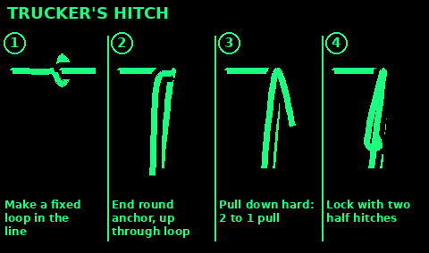
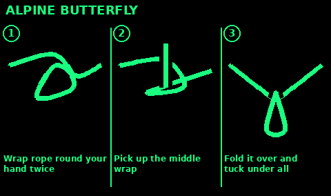
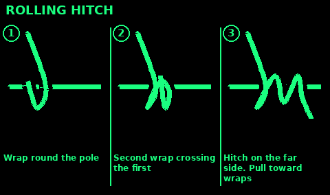
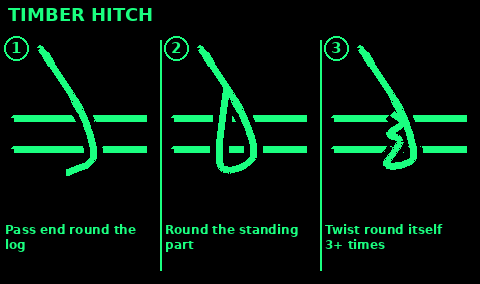
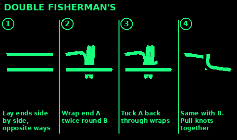
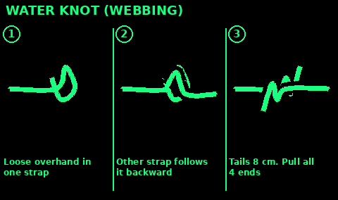
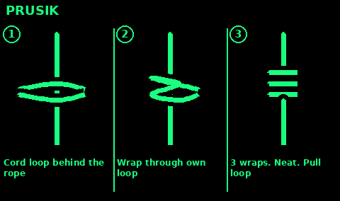

## Trucker's hitch

Use: pull a ridge line, a lashing, or a tarp much tighter than your arms alone can pull. You get a rough 2-to-1 pull.

1. A short distance from the far anchor, put a small fixed loop in the standing part. Use an alpine butterfly, or a figure-eight on a bight if you have slack to fold the rope. This loop is the pulley. It must not slip.

2. Pass the working end around the anchor you are pulling toward, and back to that loop.

3. Feed the working end through the loop.

4. Pull the working end back toward the anchor, away from the loop. You are pulling against the loop the way you would pull a bowstring. The section between anchor and loop shortens hard.

5. While you hold that tension, pinch the rope where it leaves the loop. Tie two half hitches around the standing part, close to the loop, without letting the tension go.

6. Set the half hitches. Ease your pinch. The load should stay.

Do not stand inside the V of rope while you haul. If the anchor or the loop fails, the line comes through that space. Haul from the side.

To release: untie the two half hitches while keeping your weight out of the V, then let the end slip back through the loop.

## Alpine butterfly

Use: a loop in the middle of a rope when you need both ends free. A middle attachment on a ridge line. An anchor point that can be pulled in any of the three directions.

1. Make a loop in the bight. You are not using the ends.

2. Twist that loop once, so the ropes cross and you have a smaller hole above a larger hole.

3. Twist a second time in the same direction. You want a figure-eight shape, with a clear hole in the upper part.

4. Fold the top bend down and push it through the lower hole.

5. Pull that bend through and dress the knot. The useful loop stands out of a compact barrel of rope. The two standing parts leave opposite sides.

Pull each standing part, then pull the loop. It should not collapse. If it collapses into a slip knot, you only twisted once. Untie and put the second twist in.

This loop is strong enough to be the pulley loop in a trucker's hitch.

## Rolling hitch

Use: pull along a spar, or attach a small cord to a larger rope that is already tight, when the pull is almost parallel to that rope or spar.

1. Lay the working end along the spar, pointing against the direction you will pull.

2. Wrap it around the spar, crossing over itself, and wrap a second turn on the side toward the pull. The two turns sit side by side. The pull will jam them together.

3. Take the working end past those turns and tie a half hitch around the spar on the far side, away from the direction of pull.

4. Pull the standing part. The hitch should grip and not walk along the spar. Push the wraps the other way and it should slide so you can reset it.

If it slips toward the load, the second turn is on the wrong side. The extra turn belongs on the side the pull comes from.

## Timber hitch

Use: drag a log, start a lashing around a pole, or tow a bundle when the pull will stay steady.

1. Pass the working end around the log.

2. Bring it across the standing part and around the standing part once.

3. Tuck the working end back through the space between that wrap and the log, then twist the working end around itself three or four more times, following the wrap, so the twists lie against the log. You are not tying half hitches out on the standing part. The twists are on the working end, dogged around itself.

4. Pull the standing part. The twists should jam between the standing part and the log. More pull, more jam.

5. If the log needs to be steered, add one half hitch around the log closer to the front, then lead the standing part from that hitch.

A timber hitch with no load will fall off. That is normal. Put the load on it before you trust it, and look at it when the pull changes direction.

## Double fisherman's knot

Use: join two ropes of similar size when the join must not slip and you can accept a knot that is miserable to untie. Also the knot that closes a prusik loop.

1. Overlap the two ends, pointing opposite directions, overlap about two hands long.

2. With the first working end, wrap twice around both ropes, back toward its own standing part. Pass the end through those two wraps. You have a double overhand knot strangling the other rope. Pull it snug, not yet crushed.

3. With the other working end, do the same in the opposite direction. Two wraps around both ropes, end through the wraps.

4. Pull the two standing parts. The two barrels slide together and should seat against each other, wraps matching, tails sticking out opposite ends.

5. Tails at least a hand long. If a barrel has only one wrap, you tied a single fisherman's. Wet or slick cord will creep. Retie with two wraps.

Do not use this where you must untie in a hurry. Cut it if you have to.

## Water knot

Use: join two pieces of flat webbing or a seatbelt strap.
Do not use: on round rope. Use a sheet bend or a double fisherman's knot for rope.

1. Tie a loose overhand knot in one end of the webbing. Do not tighten it. An overhand is the simple knot you tie in one strand before it becomes a granny: end through a loop in itself.

2. Take the other end and feed it into that overhand so it follows the first strap backward, in contact with it the whole way. It enters where the first tail exits, follows every bend, and exits beside the first standing part.

3. You now have two straps tracing one overhand, tails leaving opposite sides. Pull all four directions: both standing parts and both tails. The knot should lie flat, not bunched on one edge.

4. Tails at least three fingers long. Webbing is slippery when wet. Short tails pull through.

5. Look at both faces. If one strap skipped a bend, the knot is only an overhand with a strap lying next to it. It will pull out. Retie it.

## Prusik

Use: a cord that grips a thicker rope when loaded and slides when you hold the load off it. Hang a pack from a ridge line. Inch a load along a tight line. The cord must be thinner than the rope it grips, or it will not grab.

1. Join the cord into a loop with a double fisherman's knot. The loop wants to be big enough to wrap the main rope and still give you a tail to hold, typically an arm's length of cord before you join it. Test and adjust.

2. Pass the loop around the main rope and back through itself. That is one wrap. Dress it.

3. Pass the loop around the main rope and through itself again. Two wraps. On icy, muddy, or slick rope, add a third wrap.

4. The wraps must sit next to each other, neat, not crossed over each other in a pile. A crossed prusik slips.

5. Pull the loop. The wraps should clamp and hold. Take the load off and push the barrel of wraps with your hand. It should slide.

6. Do not shock-load it. Sit your weight on slowly the first time. If it slips, add a wrap or use a thinner cord. If the cord is as thick as the rope, no number of wraps will save it.

This hitch holds a load on a rope. It is not a substitute for a belay you do not know how to build. Use it for camp loads you can afford to have drop a short distance while you test it.

## Sheepshank

Use: shorten a rope without cutting it, or take the strain off a worn section.
Do not use: on anything you cannot watch. It falls apart when the load goes slack.

1. Fold the slack into an S shape so there are three parallel lines. Put the worn part in the middle line.

2. Make a small half hitch in the standing part near one end. Drop it over the bend at that end.

3. Do the same at the other end.

4. Pull both ends slowly so the hitches bite.

5. For more safety, push a stick through each end bend, or tie each bend to the standing part with cord.

