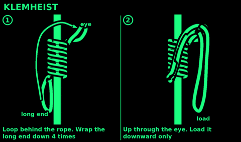
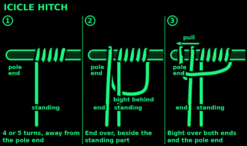

## Rolling hitch

Use: pull along a pole or along a tight rope. Tie a cord to a ridge line or a jammed line to take the strain.

1. Wrap the end round the pole, crossing over the standing part.
2. Wrap again beside the first, also over the standing part, on the side toward the pull.
3. Take the end round on the other side of the standing part, away from the pull. Tuck it under itself.
4. Pull the standing part along the pole, toward the two turns.

Check: two turns on the pull side, one hitch on the other. Pulled that way it grips. Pulled the other way it slides.

## Prusik

Use: a cord loop that grips a rope when loaded and slides when it is not. Hang things from a ridge line, then slide them. Holds both ways.
Cord: clearly thinner than the rope, for example 6 mm cord on 10 to 11 mm rope. Same size will not grip.

1. Join the cord into a loop with a double fisherman's knot.
2. Hold the loop behind the rope.
3. Pass one end round the rope and through the other end.
4. Do it twice more, each pass inside the last. Three wraps.
5. Dress the wraps neat and side by side. Keep the fisherman's knot out of the wraps.
6. Load the loop slowly.

Check: loaded, it grips. Unloaded, push the wraps, not the loop, and it slides. Slips? Add a wrap.

## Klemheist

Use: a friction hitch that grips in one direction only. Works with flat tape as well as cord. Quicker to slide up a rope than a Prusik.

1. Hold a cord loop or sling behind the rope, a short end at the top.
2. Wrap the long end round the rope 4 times, working down from the top.
3. Pass the long end up through the short end's eye at the top.
4. Load the long end downward only.

Check: the wraps are neat and the load hangs below them. Slips? Add a turn. Loading it upward undoes it.

## Icicle hitch

Use: hang a load from a smooth or tapered pole or post when the pull runs along it. It grips even where other hitches slide off.

1. Wrap the end round the pole 4 or 5 times, working away from the direction of pull.
2. Bring the end back beside the standing part, leaving a long bight hanging behind the pole.
3. Bring the bight over both ends and over the end of the pole.
4. Pull both parts, then load the standing part along the pole.

Check: the load pulls along the pole toward the side where you started the wraps. The more pull, the tighter it grips.

## Trucker's hitch

Use: pull a ridge line, a load lashing or a tarp much tighter than your arms can. About a 2 to 1 pull, less friction.

1. Tie a fixed loop in the line a short way from the far anchor. Use an alpine butterfly.
2. Pass the end round the anchor and back to the loop.
3. Feed the end through the loop.
4. Pull the end back toward the anchor. The line tightens hard.
5. Pinch where the end leaves the loop. Tie two half hitches round both legs, below the loop.

Check: the line stays tight when you let go. For a quick release, make the last half hitch with a bight.
Never stand in the V of rope while you pull. If anything fails the rope comes through there.

