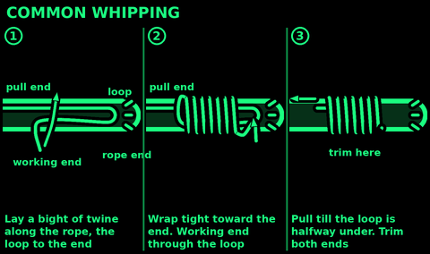
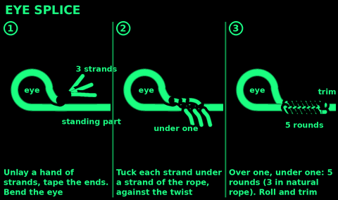
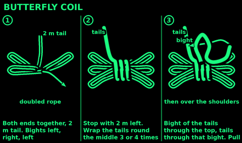
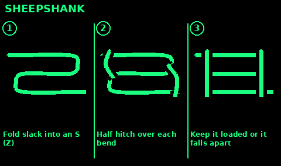
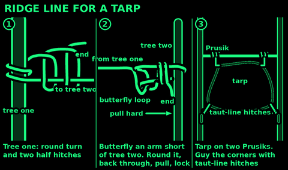

## Rope care and strength

Knots weaken rope. In tests on 12.5 mm rescue rope (CMC Rescue), a figure-eight loop kept about 70 to 80 percent of the rope's strength, a bowline about 58 to 75 percent, and a double fisherman's knot about 80 percent. A water knot in 25 mm tape kept about 64 percent.

So: the strength printed on a rope is for new, dry, unknotted rope. Never load rope anywhere near it.

Weakens rope: sun, heat, sharp edges, grit inside the fibres, battery acid, fuel and solvents. Nylon rubbing fast on nylon can melt through.
Do: pad sharp edges with cloth or bark. Never stand on a rope. Wash muddy rope in clean water. Dry it out of the sun before you store it.
Check it: run it through your hands. Retire rope with cuts, flat or stiff spots, glazed or melted patches, or core showing. Retire it after a big fall.
Cut ends: melt synthetic rope ends in a flame. Whip natural rope.

## Common whipping

Use: stop a cut rope end fraying. Needs thin strong twine.

1. Lay a bight of twine along the rope, the loop pointing to the end.
2. Wrap the twine tightly round the rope and the bight, working toward the end, each turn beside the last.
3. Stop when the wraps are about as long as the rope is thick. Leave the loop sticking out.
4. Push the working end of the twine through the loop.
5. Pull the other twine end. The loop and end draw under the wraps. Stop halfway.
6. Trim both ends of twine close.

Check: tight wraps that will not slide off. Whip a hand back from where you will cut, then cut.

## Eye splice

Use: a permanent loop in three-strand rope. Stronger than any knot. Mooring lines, anchors, a loop round a post.

1. Tape the end. Unlay the three strands, about a hand. Tape each strand end.
2. Bend the rope to make the eye the size you want.
3. Tuck the middle strand under one strand of the rope, against the twist.
4. Tuck the next strand under the next rope strand along.
5. Turn it over. Tuck the last strand under the last rope strand.
6. Now each strand comes out between a different pair. Keep going: over one, under one, against the twist.
7. Do at least 5 full rounds for synthetic rope, 3 for natural fibre.
8. Roll it under your foot. Trim the ends, not flush. Melt synthetic ends.

## Butterfly coil

Use: carry a long rope on your back, untangled, ready to throw out.

1. Take both ends together. Leave a long tail, about 2 m.
2. Lay the doubled rope across your hand, left then right, in arm-length bights. Do not twist it.
3. Stop when about 2 m is left.
4. Wrap the tails tightly round the middle of the coil, 3 or 4 times.
5. Push a bight of the tails through the top of the coil. Pass the tails through that bight and pull.
6. To carry: coil on your back, tails over your shoulders, round your waist, tie them off in front.

Store rope: clean and dry, loosely coiled, out of sun and away from fuel and acid.

## Sheepshank

Use: shorten a rope without cutting it, or take the load off a worn part.
Do not use: on a line that goes slack or that you cannot watch. It falls apart. Better: an alpine butterfly with the worn part inside the loop.

1. Fold the slack into an S: three parallel lines. Put the worn part in the middle line.
2. Make a half hitch in the standing part near one end. Drop it over the bend there.
3. Do the same at the other end.
4. Pull both ends slowly so the hitches bite.

Check: for more safety, push a stick through each end bend.

## Tie a ridge line

A worked example: a tight line between two trees to hang a tarp.

1. Trees a little more than the tarp's length apart. Line at chest height.
2. Tree one: round turn and two half hitches. Or a Siberian hitch to free it fast.
3. Walk to tree two. About an arm's length short of it, tie an alpine butterfly.
4. Round tree two and back through the butterfly: a trucker's hitch.
5. Pull hard. Pinch, then lock with two half hitches. Make the last one with a bight for a quick release.
6. Hang the tarp: two Prusik loops on the line, one at each end of the tarp. Slide them to tension it.
7. Guy the corners with taut-line hitches.

Check: push down on the middle. It should give a little and spring back. Check it before dark and after rain.

