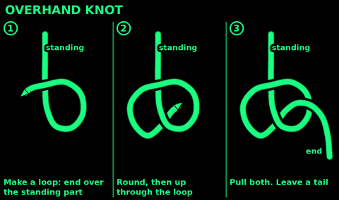
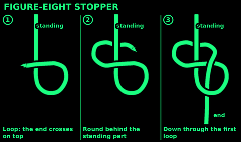
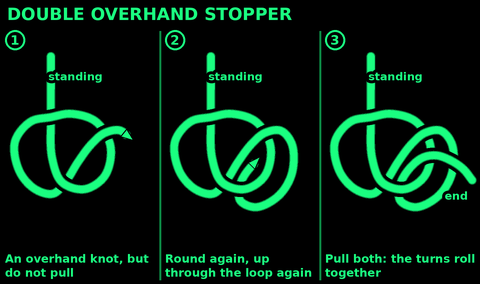

## Overhand knot

Use: the simplest stopper. Stops a cord end fraying or slipping through a hole. Part of many other knots.
Do not use: where you must untie it after a load. It jams. Use a figure-eight stopper.

1. Make a loop: the end crosses over the standing part.
2. Take the end round and up through the loop, from behind.
3. Pull both parts tight.

Check: a small round knot with a tail a hand long. Too small for the hole? Use a double overhand.

## Figure-eight stopper

Use: the standard stopper in the end of a rope: through a pulley, a grommet, a belay or lowering rope. Easy to untie.

1. Make a loop: the end crosses over the standing part.
2. Take the end on round, behind the standing part.
3. Push the end down through the first loop, from the front.
4. Pull both parts.

Check: you can see a clear 8. Tail a hand long.

## Double overhand stopper

Use: a fatter, firmer stopper. A cord end in a large hole. A backup knot tied round the standing part next to another knot.
Do not use: if you need to untie it. It jams hard.

1. Tie an overhand knot but do not pull it.
2. Take the end round again and through the loop a second time, beside the first pass.
3. Hold the loop open while you pull both parts. The turns roll into a short barrel.

Check: two turns lie side by side round the knot. Tail a hand long.

