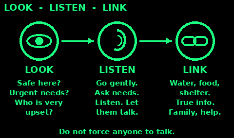
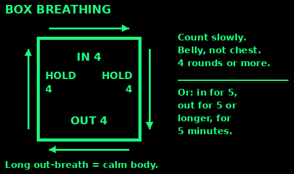
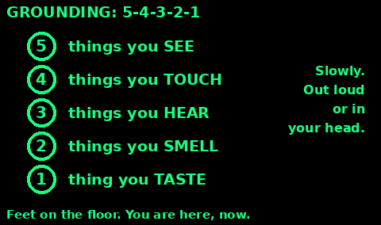

## Stress is normal

After a disaster most people feel some of these for days or weeks:
- Shaky, jumpy, tired, or unable to sleep
- Sad, angry, numb, guilty or tearful
- Thoughts and pictures of what happened coming back
- Headaches, stomach upsets, no appetite

These are normal reactions to an abnormal time. They do not mean someone is weak or going mad. For most people they ease with time, safety, sleep and support.

What helps most: feeling safe, feeling calm, being with people, feeling you can do something, and having hope.

Get extra help for someone who cannot look after themselves or their children, who is a danger to themselves or others, or who still cannot cope after a month.

## Psychological first aid

A simple way to help someone in distress. You do not need to be an expert.

Prepare: learn what has happened, what help exists, and if there are dangers.

Look:
- Is it safe here?
- Who needs urgent help: injured, lost children, very upset?

Listen:
- Go to people gently. Say who you are. Ask what they need.
- Listen more than you talk. Let them tell it, or not.
- Help them feel calm: a quiet spot, a drink, a blanket.

Link:
- Help with basics: water, food, shelter, phone.
- Give true, simple information. Do not make promises you cannot keep.
- Connect them with family, friends and services.

Do not force anyone to talk about what happened.

## Calm breathing

Slow breathing calms the body. Practise when calm, so it works when you need it.

Slow out-breath:
1. Sit or stand with feet flat. Drop your shoulders.
2. Breathe in gently through your nose, counting 1 to 5.
3. Breathe out slowly through your mouth, counting 1 to 5 or longer.
4. Keep going for at least 5 minutes.

Box breathing:
1. In for 4.
2. Hold for 4.
3. Out for 4.
4. Hold for 4. Repeat 4 or more times.

Breathe into your belly, not your chest. If you feel dizzy, breathe normally for a while. Do it with a child: "smell the flower, blow out the candle".

## Grounding: 5-4-3-2-1

When thoughts race or the past feels like it is happening now, bring yourself back to the present with your senses.

Name, out loud or in your head:
- 5 things you can see
- 4 things you can touch: feel them
- 3 things you can hear
- 2 things you can smell
- 1 thing you can taste

Other quick ways: press your feet into the floor; hold something cold; say where you are, the day and the date.

You can talk someone else through it. Use a calm, slow voice and their name.

## Panic attack

A sudden rush of fear: racing heart, fast breathing, sweating, shaking, tight chest, dizziness, a feeling of doom. It is frightening, but not dangerous. Most last 5 to 20 minutes.

If it is you:
1. Stay where you are if it is safe.
2. Slow your breathing. Make the out-breath longer.
3. Tell yourself: "This is panic. It will pass."
4. Use 5-4-3-2-1 grounding.

If it is someone else:
1. Stay with them. Speak calmly. Do not crowd them.
2. Breathe slowly with them and count out loud.
3. Do not tell them to calm down. Say "you are safe, it will pass".

Chest pain, a first attack, or diabetes, asthma or heart trouble: treat it as a medical problem first.

## Sleep under stress

Poor sleep is common after a shock. It usually improves.

1. Get up and go to bed at the same times each day.
2. Get daylight and some movement in the day.
3. Cut tea, coffee and cola from the afternoon. Alcohol spoils sleep.
4. Wind down: dim light, quiet talk, a wash, a simple task.
5. Write worries down before bed, with one small next step for each.
6. Make the bed as warm, dark and quiet as you can. Share sleeping space if it feels safer.
7. Cannot sleep? Get up, do something calm in low light, go back when sleepy.
8. Take turns on watch so others can rest.

Rest still helps even if you do not sleep.

## Routine and purpose

Routine tells the body it is safe. Purpose gives hope.

1. Keep set times for waking, meals, work, rest and sleep.
2. Give everyone a job, even small ones: children too. Being useful protects mental health.
3. Meet once a day: share news, plan, solve problems, give thanks.
4. Make decisions together where you can. Feeling in control helps.
5. Share true news at set times. Stop rumours.
6. Keep small normal things: washing, shaving, clean clothes, songs, games, prayer, stories.
7. Mark days: a birthday, a rest day, a meal together.
8. Look after the body: water, food, movement, daylight.

Check on people who go quiet or stay alone.

## Helping children cope

Children take their cue from the adults around them.

1. Keep them with their family or carers. Reunite separated children fast.
2. Keep them safe and away from distressing sights and news.
3. Tell the truth simply, for their age. "We are safe now. Here is what will happen next."
4. Listen to their questions and fears. It is fine to say "I do not know".
5. Keep routines: meals, bedtime, school time, chores.
6. Let them play, draw and run. Play is how children work things out.
7. Expect clinginess, bad dreams, tantrums, bedwetting or acting younger. Be patient. It usually passes.
8. Give extra hugs and time. Tell them it is not their fault.

Get help if a child stops eating, talking or playing for weeks, or talks of hurting themselves.

## Grief and loss

Grief is the price of love. There is no right way or right time to grieve.

People may feel: shock, numbness, deep sadness, anger, guilt, relief, or all of these in waves.

How to help:
1. Be there. Sit with them. Silence is fine.
2. Say the person's name and share memories, if they want to.
3. Help with practical things: food, water, children, chores.
4. Hold a simple farewell together: words, a song, a candle, a marked grave.
5. Do not say "they are in a better place" or "I know how you feel". Say "I am so sorry" and listen.
6. Expect hard days at anniversaries and birthdays.

Grief is not a problem to fix. Get extra help if someone cannot function for weeks, stops eating, or talks of wanting to die.

## Someone at risk of suicide

Warning signs:
- Talking about wanting to die, or being a burden
- Feeling hopeless, trapped or in unbearable pain
- Saying goodbye, giving things away, making plans
- Pulling away from people
- Drinking more, or taking big risks
- A sudden calm after a long low time
- Looking for ways to do it

Take every sign seriously. Most people who think of suicide do not want to die. They want the pain to stop.

## Ask and keep them safe

Asking about suicide does not put the idea in their head. It can be a relief.

1. Find a private moment. Ask clearly: "Are you thinking about suicide?"
2. Listen. Stay calm. Do not judge, argue or lecture.
3. Ask: "Have you thought about how? Do you have what you need?"
4. Remove what they could use: pills, blades, rope, guns, poisons. Keep medicines locked or with someone else.
5. Do not leave them alone if the danger is high.
6. Make a plan together: who to call, where to go, what helps, reasons to live.
7. Get help. UK: 999 if life is in danger now. Samaritans 116 123, free, day and night. NHS 111, option 2 for mental health (England).

Do not promise to keep it secret. Look after yourself too: this is heavy to carry alone.

## Anger and conflict

Stress shortens tempers. Act early.

If someone is angry:
1. Keep yourself safe. Stay calm, keep your voice low, and stand to the side with space.
2. Listen. Say back what you heard: "You are angry because..."
3. Do not argue, threaten or touch them.
4. Offer a break: "Let's talk after we eat."

To keep peace in a group:
1. Agree simple, fair rules together. Write them down.
2. Share food, water and jobs openly. Use a rota.
3. Meet daily. Raise problems early, before they grow.
4. Talk about the problem, not the person: "I need..." not "You always...".
5. A neutral person can help two sides talk.
6. Separate people who cannot cool down.

No one is allowed to hurt another person. Protect the vulnerable.

## Look after yourself

Helpers burn out. You cannot pour from an empty cup.

1. Eat, drink and sleep. Take breaks, even short ones.
2. Share the load. Swap shifts. Say no when you must.
3. Talk to someone you trust about what you saw.
4. Do small things you enjoy: a walk, music, a joke.
5. Avoid using alcohol or drugs to cope.
6. Notice warning signs in yourself: snapping at people, numbness, not sleeping, drinking more.
7. Remember what you did well. You cannot fix everything.

Check on other helpers and let them check on you.

## Mental health sources

Written in our own words from public guidance:

WHO, War Trauma Foundation and World Vision International, Psychological First Aid: Guide for Field Workers (2011): who.int/publications/i/item/9789241548205

NHS breathing exercise and panic: nhs.uk/mental-health/self-help/guides-tools-and-activities/breathing-exercises-for-stress, nhs.uk/mental-health/conditions/panic-disorder

NHS urgent help and sleep: nhs.uk/nhs-services/mental-health-services/where-to-get-urgent-help-for-mental-health, nhs.uk/every-mind-matters/mental-health-issues/sleep

Samaritans: samaritans.org (116 123), including myths about suicide.

Mind, supporting someone who is suicidal: mind.org.uk/information-support/suicidal-thoughts-and-suicide-prevention/how-to-help-someone-who-feels-suicidal

British Red Cross psychosocial support: redcross.org.uk

This is self-help and peer support, not therapy. Get professional help when you can.
