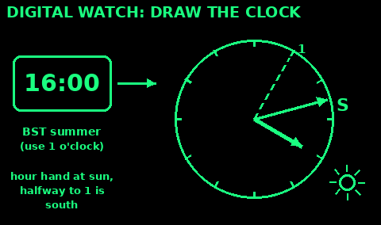
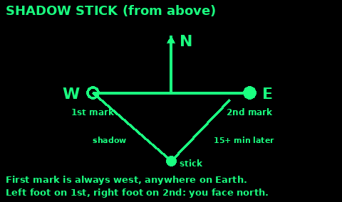
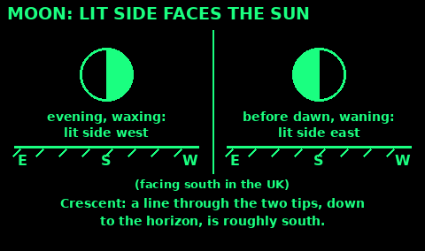
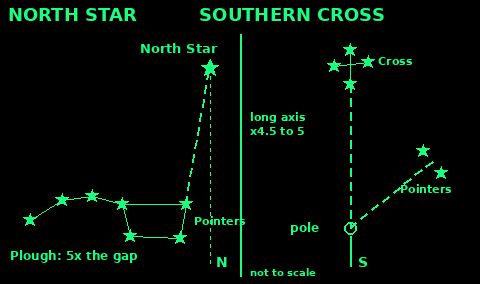
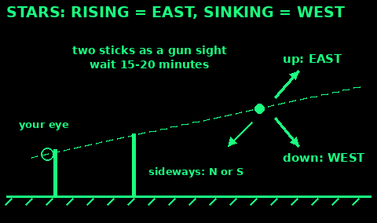
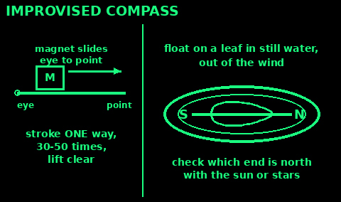

## Sun and watch

The sun rises roughly in the east and sets roughly in the west. In the UK it is due south at about 1 pm in summer time (BST) and about midday in winter (GMT), up to half an hour later in the far west.

Watch method, northern hemisphere, with a dial watch set to local time:
1. Hold the watch flat. Point the hour hand at the sun.
2. Halfway between the hour hand and 12 is south. In summer time use 1 instead of 12.

Southern hemisphere: point the 12 at the sun. Halfway between 12 and the hour hand is north. On daylight saving time use 1 instead of 12.

If unsure which end is which, remember the sun is in the east in the morning and in the west in the afternoon.

This is rough. It is worst in the middle of the day and near the tropics, where the sun is high. A digital watch works if you draw a clock face on the ground with the time on it.

## Digital watch or phone clock

Use: the sun is out and you have the time but no dial.

1. Draw a clock face on the ground or on paper. Mark the hour hand at the time shown, 12 at the top.

2. Hold the drawing flat and turn it until your drawn hour hand points at the sun.

3. In the UK in summer time (BST), use 1 o'clock as your "12". In winter (GMT), use 12.

4. Halfway between the hour hand and that 12 (or 1) is south. The opposite way is north.

Mistakes: halving the wrong way (go the short way round, through the smaller angle); forgetting summer time.

Check: in the morning south should be to the right of the sun, in the afternoon to its left.

## Shadow stick

When you have sun and 15 to 30 minutes:

1. Push a straight stick upright into flat, open ground.

2. Mark the tip of its shadow with a pebble.

3. Wait until the tip has moved a few centimetres, at least 15 minutes. Mark it again.

4. A line from the first mark to the second runs west to east. The first mark is always west, anywhere on Earth.

5. Stand with the first mark on your left and the second on your right. You are facing north.

Use a taller stick and wait longer for a better line. A fuzzy shadow under thin cloud gives a poor result. The US Army says not to rely on it above 60 degrees latitude, where the sun stays low.

## Moon

Use: at night with a moon, for a rough east-west line.

The moon shines by the sun's light, so the lit side faces where the sun is.

1. Moon up before the sun has set (a waxing moon, lit on the right in the UK): the lit side faces west.

2. Moon rising after midnight (a waning moon, lit on the left in the UK): the lit side faces east.

3. A full moon sits roughly opposite the sun. In the UK it is about due south at midnight GMT, or 1 am BST.

4. For a crescent, a line through the two tips, carried down to the horizon, points roughly south in the northern hemisphere.

Mistakes: treating it as exact. It is good to about one compass quarter.

Check: confirm against a star method if the sky is clear.

## North Star

In the northern hemisphere, find the Plough (Big Dipper): seven bright stars shaped like a saucepan.

The two stars at the end of the pan, furthest from the handle, are the Pointers. Follow the line through them away from the bottom of the pan, about five times the gap between them. You reach the North Star (Polaris). It is not very bright, but it is alone.

On the other side of the North Star from the Plough is Cassiopeia, a W of five stars. If the Plough is behind cloud, use the W.

The North Star is within 1 degree of true north. It stays put while the rest of the sky turns around it. Drop a line straight down from it to the horizon. That is north.

Its height above the horizon is about your latitude: about 50 to 60 degrees up in Britain.

## Southern Cross

In the southern hemisphere there is no bright south star. Use the Southern Cross: four bright stars in a kite shape, with two bright Pointer stars beside it.

1. Run a line along the long axis of the cross, from the top star through the foot star.

2. Carry it on about four and a half to five times the length of the cross.

3. Draw a second line at right angles out from the middle of the two Pointers.

4. Where the lines meet is near the south celestial pole. Drop straight down to the horizon. That is south.

Do not confuse it with the False Cross nearby. The False Cross is larger and dimmer and has no Pointers.

The sky turns, so check every 15 to 30 minutes and pick a new landmark on the horizon.

## Stars rising and setting

Use: anywhere, when you cannot find a known star.

Stars move across the sky from east to west. Watch any bright star that is not overhead.

1. Push two sticks into the ground, one about 1 m behind the other. Sight past their tops at a star, as with a gun sight.

2. Wait 15 to 20 minutes without moving your head. See which way the star has moved from the tip.

3. Rising: it is in the east. Sinking: it is in the west.

4. Hard to tell? It is probably high in the south (in the northern hemisphere). Pick a star lower down.

Mistakes: moving your eye position between looks. Keep your head on the same rest, such as a rock.

Check: it agrees with the North Star if you can see it.

## Improvised compass

Use: you have a steel needle, pin or razor blade and nothing better.

1. Magnetise it. Stroke the needle about 30 to 50 times from eye to point with one end of a magnet (phone speaker, fridge magnet, magnetic clasp). Always one way, lifting it clear each time.

2. No magnet: wrap insulated wire round the needle 20 or more times and touch the bare ends to a battery for a few seconds. The wire gets hot. Stroking it on silk or hair also works, but weakly.

3. Float it. Push the needle through a small leaf, cork slice or paper scrap. Lay it on still water in a cup, out of the wind. Or hang it on a single thread so it balances.

4. It settles north-south. Use the sun or stars to tell which end is north, and mark that end.

Mistakes: steel or a phone nearby; stroking back and forth, which undoes the magnetism; ripples on the water.

Check: turn the cup slowly. The needle should keep pointing the same way. Re-stroke it every few hours.

## Natural signs and their limits

These are weak on their own. Use two or three that agree, and check with the sun.

Moss grows where it is damp and shady. That can be any side of a tree, rock or wall. Do not navigate by moss.

On a lone tree in the open, the sunny side (south in the UK) often has more and fuller branches.

In Britain the strongest winds mostly come from the west and south-west. Exposed trees and bushes often lean or are swept to the north-east. Snow drifts form on the side away from the wind.

Many old churches in England were built with the altar at the east end. Not all.

Satellite TV dishes in the UK point roughly south-east.

Streams run downhill. Roads, villages and the sea are more likely downstream. In steep ground, a stream can drop over a waterfall or into a gorge. Walk the bank, not the bed, and go round.

If signs disagree with the compass, believe the compass, unless it is next to metal.
