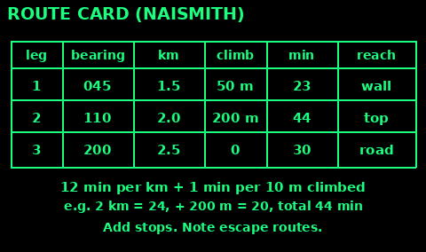
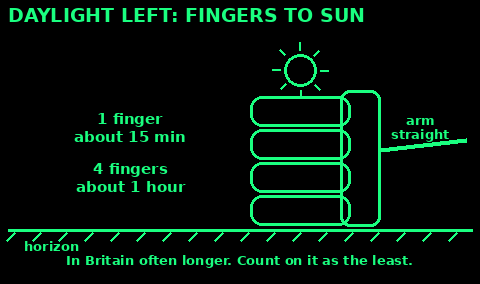
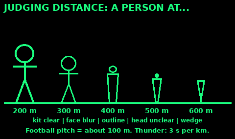
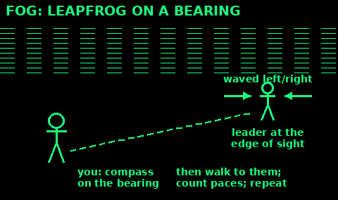
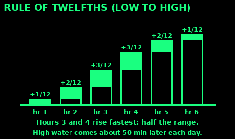
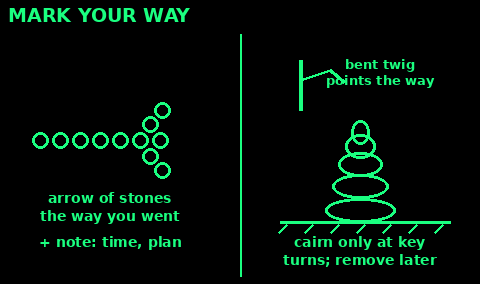
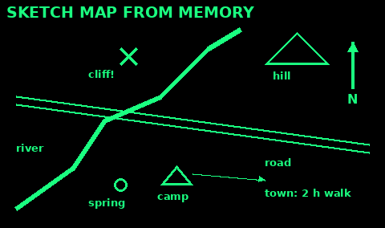

## Plan a route: Naismith

Use: before any walk, to know how long it really takes.

1. Split the route into legs between features you will see: a wall corner, a stream junction, a summit.

2. For each leg write: bearing, distance, height climbed and what you will reach.

3. Time: 12 minutes per km on the flat (5 km/h). Add 1 minute for every 10 m you climb.

4. Steep downhill is slow too. Over about 12 degrees, add 10 minutes per 300 m of descent. On gentle slopes of 5 to 12 degrees, take off 10 minutes per 300 m.

5. Add rests, and allow more for a group, loads, rough ground, snow or darkness. Note escape routes off the hill.

Example: 6 km with 400 m of climb is 72 + 40 = about 1 hr 50 min, before stops.

Mistakes: planning for your fittest person; forgetting the walk back.

Check: write the time you should be at the end of each leg. If you are far behind, turn back early.

## Daylight left: hand method

Use: to judge how much time is left before sunset.

1. Stretch your arm out straight. Turn your hand flat and sideways, fingers together, below the sun.

2. Count finger widths between the bottom of the sun and the horizon.

3. Each finger is about 15 minutes. A hand of four fingers is about one hour.

In Britain the sun sets at a slant, so you often have a bit longer than this says. Treat it as the time you can count on, not a promise of more. Light goes faster in woods, valleys and under cloud. Dusk lasts about 30 to 60 minutes after sunset.

Mistakes: bending your arm; looking straight at the sun. Look past it, not at it.

Check: make a shelter or reach the road with at least one hand of daylight in hand.

## Judging distance

Use: to know how far a feature or person is, with no map.

1. Unit method: picture a football pitch, about 100 m. Count how many fit between you and it.

2. Appearance method, for a standing person: at 200 m you can see clothes and kit clearly. At 300 m the face is a blur. At 400 m you see only the body outline. At 500 m the body tapers and the head is unclear. At 600 m it is a wedge with no head.

3. Lightning: count seconds from flash to thunder. Divide by 3 for km.

4. Average two people's guesses.

Things look closer in bright sun, across water or snow, and when big. They look farther in poor light, across dips, and when small or half hidden.

Check: when you reach it, compare your guess. You get better fast.

## Night navigation

Use: when you must move in the dark. Staying put is often wiser.

1. Plan short legs to big features: walls, streams, track junctions.

2. Use red or dim light to read the map, so your eyes stay used to the dark. It takes about 20 to 30 minutes to see well again after bright light.

3. Walk on a compass bearing and count paces. Your pace is shorter at night. Add about a fifth.

4. Look slightly to one side of things. You see faint shapes better that way.

5. Keep together, close enough to touch or hear. Check numbers often.

Mistakes: walking towards a light you think is a house; going down steep ground; speeding up when unsure.

Check: every leg ends at something you can feel or hear, such as a fence or a stream.

## Fog and whiteout

Use: when you cannot see your next landmark.

1. Stop and fix where you are before visibility gets worse.

2. Walk short legs on a bearing. Pace every leg. Keep a pebble count.

3. Leapfrog: send one person ahead to the edge of sight. Wave them onto the bearing, walk to them, repeat.

4. Use the slope. Check that the ground goes up or down, and faces the way the map says.

5. In a whiteout on snow, throw a snowball ahead. If it disappears, stop: it may be an edge. Keep well back from ridge edges; snow cornices overhang and break.

Mistakes: following other people's tracks; drifting downhill without noticing; forgetting the pace count.

Check: if nothing appears where it should, stop, go back to the last sure point.

## Coast and tides

Use: on beaches, estuaries, sands and coastal paths.

Tide times come from tide tables or the harbour board. Check before you go.

1. High tides are about 12 hours 25 minutes apart, so the times move about 50 minutes later each day.

2. Rule of twelfths: in the six hours from low to high, the water rises 1/12 in hour one, 2/12 in hour two, 3/12 in hours three and four, 2/12 in hour five, 1/12 in hour six. The middle hours are fastest.

3. Spring tides come a day or two after new and full moon, with the biggest range and fastest water. Neap tides fall between.

4. Plan to be off sands, causeways and below cliffs well before the tide turns. Note the last safe time to return.

Mistakes: walking round a headland on a rising tide; trusting dry sand, which can be a channel later.

Check: in trouble at the coast in the UK, call 999 or 112 and ask for the Coastguard.

## Mark your route and cairns

Use: so others can follow you, or so you can find the way back.

1. Leave a note with your plan, route and time out with someone, or at a car or camp.

2. Arrow of stones or sticks on the ground at each turn, pointing the way you went. Add the time scratched on a stone or written on paper.

3. Short broken twigs at shoulder height, bent the way you went. Bright tape or cloth works well.

4. A cairn is a stack of stones that stands out. Build one only at key places, such as a turn or where you left a path.

On popular UK hills, do not add cairns for fun. They mislead others and damage the ground. Take down your markers when you no longer need them.

Check: look back after each marker. Can you see it from the way people would come?

## Draw a map from memory

Use: no map, but you know the area, or must explain the route to others.

1. Draw north at the top with an arrow.

2. Put the big features first: rivers, coast, main roads, hills, towns.

3. Add your start, your camp and where water, shelter and help are.

4. Write rough distances or walking times between places.

5. Mark hazards: cliffs, bogs, fast rivers, busy roads.

Mistakes: drawing to scale at first. Get the order and directions right; distances can be rough.

Check: ask someone else to follow it in their head and point.
