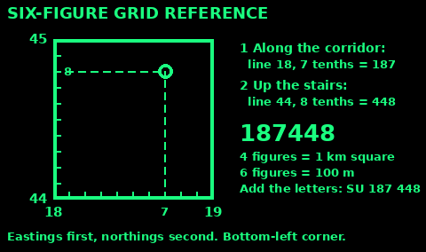
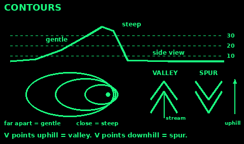
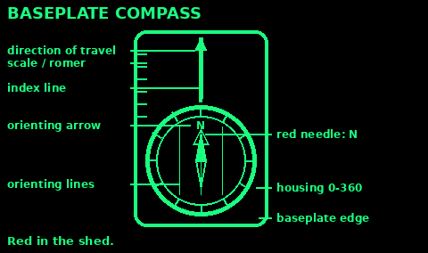
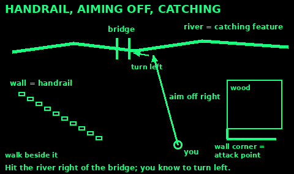
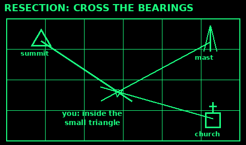

## Lost? STOP

Stop. Stand still or sit down. Walking fast in the wrong direction is how a small mistake becomes a long night.

Think. Where did you last know for sure where you were? How long ago, and which way did you go after that?

Observe. Look at the land: hills, streams, roads, power lines, the sun. Check the map and compass if you have them. Count your water, food, light and daylight.

Plan. Make one decision and say it out loud. If you are not sure, the plan is to stay.

Staying put is a plan. Searchers look first at the place you were meant to be and the route between. Build shelter while you still have light and heat. Drink, and eat a little.

If you must move, leave a note or an arrow of stones showing your direction and the time. Walk to a handrail you are sure of: a road, a wall, a river, a big track. Do not walk a streambed when it is storming upstream.

In the UK, call 999 or 112. Ask for police, then mountain rescue (or coastguard on the coast). Give a six-figure grid reference if you can.

## Read a map

Scale tells you how far. On a 1:25 000 map (OS Explorer) 4 cm on the map is 1 km on the ground. On a 1:50 000 map (OS Landranger) 2 cm is 1 km.

The blue grid lines on OS maps are 1 km apart on both scales. One square is about 15 minutes of walking on the flat.

The key (legend) explains the symbols. Learn: footpath, track, wall, fence, wood, marsh, cliff, spot height, trig point, church, pub. On Explorer maps public rights of way are green. On Landranger maps they are magenta.

Set (orient) the map before you read it. Turn it until the features on it line up with the features in front of you. With a compass: lay it on the map and turn the map until the needle points to the top of the map, along the grid lines.

Hold the map so your route goes away from you. Fold it so the next few kilometres show. Keep your thumb on where you are and move it as you walk.

## Grid references

A grid reference tells someone exactly which square you are in. Read along the corridor, then up the stairs: eastings (the numbers along the bottom) first, northings (up the side) second.

Four figures: the square whose bottom-left corner is at those two lines. 1844 is the square to the right of line 18 and above line 44. That is a 1 km square.

Six figures: split the square into tenths each way in your head. 7 tenths across and 8 tenths up in square 1844 is 187448. That is a 100 m square, good enough for a rescue team to find you.

Eight figures use hundredths, to 10 m. Most people only need six.

In Great Britain, two letters in front name the 100 km square, for example SU 265 166. Give the letters too when you call for help. They are printed on the map in blue.

## Contours

Contour lines (thin brown or orange) join points of the same height above sea level. The gap between lines is usually 10 m, or 5 m on flatter ground. The map key says which.

Close lines mean steep. Lines far apart mean gentle or flat. Lines touching mean a cliff or crag.

Contour numbers are written so they read uphill. If the number is upside down, you are looking at the slope from the top.

A V or U of lines that points uphill is a valley. Streams sit in these. A V that points downhill is a spur, a ridge running down off a hill.

Small closed rings are hilltops. Two hilltops with a low dip between them make a saddle (col). That is often the easiest way across a ridge.

Before you set off, look at the contours along your route. A short line on the map can be a long hard climb.

## Compass parts

A baseplate (orienteering) compass is the useful kind. Parts:

1. Baseplate: the clear plastic base. Its long edge lines up your route on the map.

2. Direction-of-travel arrow: at the front of the baseplate. You walk the way it points.

3. Housing (bezel): the round dial you turn. Marked 0 to 360 degrees.

4. Orienting arrow and orienting lines: printed inside the housing. They turn with it. You line them up with the map's grid lines.

5. Needle: the red end points to magnetic north.

6. Index line: where you read the bearing, at the front of the housing.

7. Romer and scales: rulers on the edge for measuring distance and grid references.

Keep phones, knives, cameras, magnets and steel away from the compass when you read it. Car bodies, fences and pylons pull the needle too.

## Take a bearing from the map

1. Lay the long edge of the baseplate on the map from where you are to where you want to go. The direction-of-travel arrow points to the target.

2. Hold the baseplate still. Turn the housing until the orienting lines are parallel to the grid lines going up the map, with the orienting arrow pointing to the top of the map (north). Ignore the needle for this step.

3. Read the bearing where the housing meets the index line.

4. Add or take away magnetic variation if it matters. See Magnetic variation.

To take a bearing to something you can see, do the opposite. Point the direction-of-travel arrow at it. Turn the housing until the red needle sits inside the orienting arrow. Read the index line.

A back bearing (the way home) is the bearing plus 180, or minus 180 if the number is over 180.

## Follow a bearing

1. Hold the compass flat, at your belly, with the direction-of-travel arrow pointing straight out from you.

2. Turn your whole body, not just the compass, until the red needle sits inside the orienting arrow. Red in the shed.

3. Look along the direction-of-travel arrow. Pick a landmark on that line: a tree, a rock, a gate.

4. Put the compass down and walk to the landmark. Then do it again.

In fog or dark, send a companion ahead to the edge of sight. Wave them left or right onto the line, then walk to them.

Around an obstacle: turn 90 degrees, count paces past its side, turn back to your bearing and walk past it, turn 90 degrees the other way and walk the same number of paces. Turn to the bearing again. You are back on your line.

Do not change the setting on the housing while you walk. That is the most common mistake.

## Magnetic variation

There are three norths. True north is the North Pole. Grid north is the way the blue lines on the map run. Magnetic north is where the needle points. Magnetic north drifts year by year.

The map margin gives the difference (variation or declination) for a date, and how fast it changes.

If magnetic north is west of grid north: map to compass, add the angle. Compass to map, take it away.

If magnetic north is east of grid north: map to compass, take it away. Compass to map, add it.

In Great Britain in 2026 the difference is small: about -1 to 4 degrees depending on where you are. Ordnance Survey says beginners can ignore it on short legs. In much of the rest of the world it can be 10 or 20 degrees, and you must correct it.

Why it matters: 1 degree off is about 17 m wide after 1 km. 4 degrees off is about 70 m. In fog that is the difference between the bridge and the river.

## Pacing and dead reckoning

A pace here is two steps: count every time your left foot lands. An average adult takes about 65 paces per 100 m on flat ground. Measure your own over a known 100 m, two or three times.

You take more paces uphill, on mud, sand, snow or heather, in strong head wind, in the dark, and when tired or loaded. Add some for each.

Do not trust memory. Move a pebble from one pocket to the other, or tie a knot in a cord, every 100 m.

Time works too. At 4 km per hour, 100 m takes about 1.5 minutes. For hills, add about 1 minute for every 10 m of climb (Naismith's rule: 5 km per hour plus half an hour per 300 m of ascent).

Dead reckoning is knowing where you are from where you started, the bearing you walked and the distance you covered. Break the route into short legs between features you will recognise. Write each leg down: bearing, distance, time, what you should reach. Tick it off when you get there.

## Handrails and catching features

You do not have to walk a perfect bearing if the land does the work.

A handrail is a long feature that runs the way you are going: a wall, fence, stream, forest edge, track, ridge or power line. Walk beside it and you cannot drift.

A catching feature lies across your route just past your target: a river, road or the edge of a wood. If you reach it, you have gone too far. Turn back and look again.

Aiming off: if your target is a point on a long feature, like a bridge on a river, aim deliberately to one side of it. When you hit the river you know which way to turn.

Attack point: when the target is small, like a sheepfold or a spring, first go to something big and certain near it, like a wall corner. From there, walk a short careful bearing and pace the distance.

## Resection: where am I?

Use: you can see two or three features you can find on the map, but you do not know where you are.

1. Pick features far apart, ideally about 60 to 90 degrees apart: a summit, a mast, a church, a lake end.

2. Take a compass bearing to the first one. Point the direction-of-travel arrow at it, turn the housing until red sits in the shed, read the bearing.

3. Correct for magnetic variation (compass to map) if it matters where you are.

4. Lay the compass on the map with the edge touching the feature. Turn the whole compass until the orienting lines run with the grid lines, north up. Do not turn the housing.

5. Draw a line along the edge back from the feature towards you. You are somewhere on it.

6. Do the same for the second and third features. Where the lines cross is you.

The lines usually make a small triangle (a cocked hat). You are inside it. A big triangle means a bad bearing: do it again.

Shortcut: if you are on a handrail, such as a path or river, one bearing to one feature is enough. Where its line crosses the handrail is you.

Check: the shape of the land around you matches the contours at that point.

## Places

Look up the place name in Places if you know a town, park, river or country. The travel guide on this Pi describes towns, roads, transport and where to find help.
