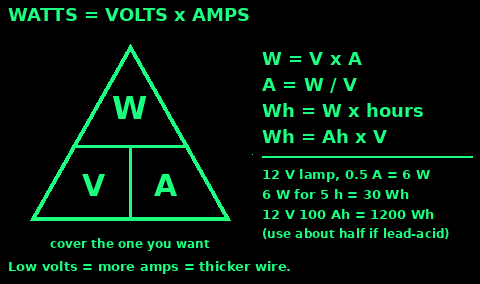
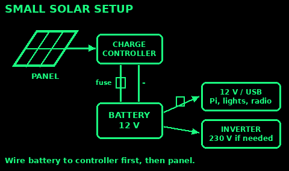
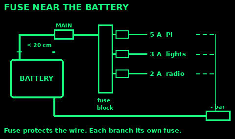
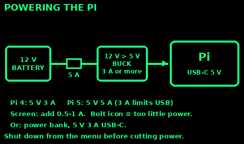
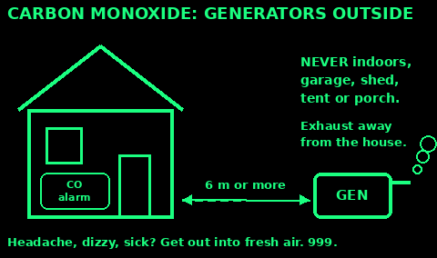

## Volts, amps, watts

Volts (V) are the push. Amps (A) are the flow. Watts (W) are the work being done.

Watts = volts x amps. A 12 V lamp drawing 0.5 A uses 6 W.

Watt-hours (Wh) are energy: watts x hours. That 6 W lamp for 5 hours uses 30 Wh.

Amp-hours (Ah) on a battery: Wh = Ah x volts. A 12 V 100 Ah battery holds about 1,200 Wh, but you can only use part of it (see Batteries).

Higher current needs thicker wire. Lower volts means more amps for the same watts, so 12 V cables are thicker than mains cables for the same power.

Mains (230 V in the UK) can kill. Keep to 12 V and 5 V. Leave house wiring to an electrician.

## Batteries

Lead-acid (car, leisure, AGM, gel): heavy, cheap, forgiving. Use only about half the capacity. Draining below 50% often shortens its life. Charging gives off hydrogen: charge in a ventilated place, no flames or sparks nearby. The acid burns skin and eyes.

Resting voltage of a 12 V lead-acid battery, after a few hours with no load or charge:
- 12.7 V: full
- 12.4 V: about 75%
- 12.2 V: about 50%. Stop here.
- 12.0 V or less: nearly flat. Recharge now.

Lithium iron phosphate (LiFePO4): light, lasts for thousands of cycles, can use about 80-90%. Needs a built-in battery management system (BMS) and a lithium charge setting. The safest lithium type for home use.

Lithium-ion (phones, power banks, e-bikes): a lot of energy in a small pack. A damaged, swollen, hot or wet pack can catch fire and is hard to put out.
- Use the right charger. Do not charge unattended overnight or near your exit.
- Never charge below freezing.
- Stop using a swollen or hissing pack. Move it outside onto bare ground or sand, away from anything that burns.
- If one catches fire, get out and call 999.

## 12 V systems

Most small off-grid kit runs on 12 V DC: car and leisure batteries, LED lights, radios, USB chargers, small fridges.

A basic layout:
- Battery
- Main fuse, close to the battery positive
- A fused distribution block, one fuse per circuit
- Loads: lights, USB charger for the Pi, radio

Use proper 12 V sockets, crimp terminals and red/black cable. Label every wire.

Mixed batteries: do not wire old and new, or lead-acid and lithium, together. Join only identical batteries.

## Solar setup

Four parts, always in this order:

Panel: makes DC from light. A "100 W" panel makes much less on a dull day.

Charge controller: stops the battery over-charging. PWM is cheap. MPPT gets 10-30% more from the same panel. Set it to your battery type.

Battery: stores the energy for the night and dull days.

Inverter: turns 12 V DC into 230 V AC. It wastes power even when idle, so skip it if everything runs on 12 V or USB. Use one only for kit that needs mains.

Connect the battery to the controller first, then the panel. Disconnect in reverse. Cover the panel with a blanket while wiring: it is live in daylight.

Point the panel south in the UK, tilted about 35-40 degrees in summer and steeper (about 60) in winter. Keep it out of shade: one shaded cell cuts output a lot.

## Sizing for a Pi and lights

Step 1, daily use. Add up watts x hours:
- Raspberry Pi 4 and small screen: about 6 W x 24 h = 144 Wh
- Two LED lamps: 3 W x 2 x 5 h = 30 Wh
- Radio and phone charging: about 20 Wh
- Total: about 200 Wh a day

Step 2, battery. For two days with no sun: 2 x 200 = 400 Wh.
- Lead-acid, using half: 800 Wh / 12 V = about 70 Ah. Buy 100 Ah.
- LiFePO4, using 80%: 500 Wh / 12 V = about 40 Ah. Buy 50 Ah.

Step 3, panel. Divide daily use by sun hours, then add a third for losses.
- UK summer, about 4 good sun hours: 200 / 4 x 1.33 = about 70 W. Use 100 W.
- UK winter, about 1 hour: you would need 250 W or more. Cut use instead: turn the Pi off when not reading.

Turning the Pi and screen off at night halves the need.

## Wiring and fuses

A fuse protects the wire, not the gadget. A short circuit on a battery can melt cable and start a fire in seconds.

Rules:
- Put the main fuse as close to the battery positive as you can (within about 20 cm).
- Each branch gets its own fuse, sized for that branch's wire.
- Fuse rating: above the normal current, below what the wire can carry. A load drawing 4 A gets a 5 A fuse on wire rated for 10 A or more.
- Thicker wire for longer runs. Voltage drops over distance at 12 V. Keep runs short.

Common cable (car/marine, copper, 12 V, short runs): 0.75 mm2 up to about 5 A, 1.5 mm2 about 10-15 A, 2.5 mm2 about 20 A, 6 mm2 about 40 A. Check the maker's rating.

Connect the negative first and remove it last on vehicles. Take off rings and watches: a battery across a ring will burn a finger.

## Powering the Pi

The Pi wants a steady 5 V. Too little and it slows, corrupts the SD card or reboots. A lightning bolt icon on screen means under-voltage.

Needs:
- Pi 4: 5 V 3 A USB-C supply
- Pi 5: 5 V 5 A USB-C supply for full use; it runs on a 3 A supply with USB power limited
- Small screen: add about 0.5-1 A

From 12 V: use a good 12 V to 5 V USB-C converter (buck converter or car charger) rated 3 A or more. Fuse its feed at 5 A. Cheap car chargers often sag below 5 V.

From a power bank: one rated 5 V 3 A on USB-C works. A 20,000 mAh bank holds about 70 Wh, enough for 8-12 hours of a Pi 4 with screen.

Shut down properly (Power off in the menu) before cutting power. Pulling the plug can damage the SD card.

## Car batteries

A car battery is built for short, big bursts to start the engine, not for slow draining. It works as a store, but deep draining kills it.

To use one:
- Take power from a 12 V socket with a fused plug, or clamp on with a fused lead. Never connect straight to the terminals with thin wire.
- Stop at 12.2 V resting so it still starts the car.
- Recharge by running the engine outside, in the open, never in a garage, even with the door open.

A car running at idle gives about 14 V and plenty of current. Twenty to thirty minutes a day keeps a small system going, but uses fuel.

An old car battery out of a car still holds charge for a while. Keep it upright, in a box, away from children. Recycle it at a tip when done.

## Crank and bike power

People are weak generators. A fit adult on a bike sustains about 50-100 W. A hand crank gives a few watts.

An hour of steady pedalling into a battery gives perhaps 30-50 Wh after losses: about 5-8 hours of a Pi with screen, or a week of an LED lamp.

Hand-crank radios and torches are worth having. A minute of cranking runs a radio for a few minutes. Crank slowly and steadily.

Bike generators: buy a made one with a proper regulator and charge controller. A bare dynamo or motor sends out varying voltage that can damage a battery or a Pi. Never feed one straight into the Pi.

Eat and drink more if you pedal for power. It costs food.

## Lighting

LED is best: a 3 W LED gives about as much light as a 25-40 W old bulb. Head torches leave both hands free. Keep spare batteries.

Candles and oil lamps are the main cause of fires in power cuts.
- Use a stable holder on a non-burnable surface. A jar or a sand tray.
- Keep 30 cm clear above and around. Away from curtains, bedding and paper.
- Never leave one burning unattended or in a child's or pet's room. Never go to sleep with one lit.
- Use only the fuel the lamp is made for. Never fill a lamp while lit or hot.
- Keep lamp oil and spare fuel outside the living space, labelled, away from children.

Have a working smoke alarm on each floor. Test it weekly. Keep a way out clear at night.

## Carbon monoxide

Carbon monoxide (CO) has no colour, smell or taste. It kills people every year in power cuts and cold spells.

Sources: generators, camping stoves, barbecues, patio heaters, gas or paraffin heaters, blocked flues, car engines.

Rules:
- Never run a generator indoors, in a garage, shed, tent, porch or basement. Not even with a door open.
- Run it outside, at least 6 m from doors, windows and vents, exhaust pointing away.
- Never bring a barbecue indoors or into a tent, even after cooking. Embers still give off CO.
- Cook with a stove only in a well-aired space. Open a window.
- Fit a CO alarm (BS EN 50291) in each room with a fuel-burning appliance and where you sleep.

Symptoms: headache, dizziness, sickness, tiredness, confusion, breathlessness. Often several people and pets in the house feel ill at once, and feel better outside.

If you suspect CO: get everyone out into fresh air now, turn off the source if it is safe, and call 999. For a gas leak call 0800 111 999.

## Power sources

Written in our own words from public guidance:

GOV.UK and Health and Safety Executive: hse.gov.uk/gas/domestic/co.htm, hse.gov.uk/electricity, gov.uk/government/publications/carbon-monoxide-co-recognising-signs-and-symptoms

NHS carbon monoxide poisoning: nhs.uk/conditions/carbon-monoxide-poisoning

London Fire Brigade and fire services on candles and lithium batteries: london-fire.gov.uk/safety/the-home/candles, london-fire.gov.uk/safety/lithium-batteries

US CDC generator safety: cdc.gov/carbon-monoxide/about/generator-safety

Raspberry Pi power supply documentation: raspberrypi.com/documentation/computers/raspberry-pi.html (power supply section)

Battery voltage tables are typical values for flooded lead-acid at about 20 C. Check your battery maker's sheet.
