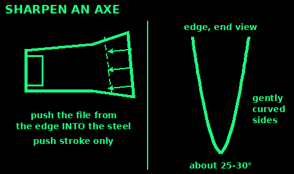
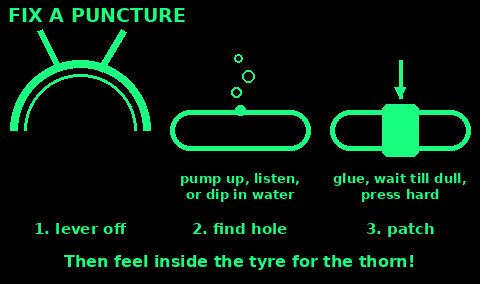
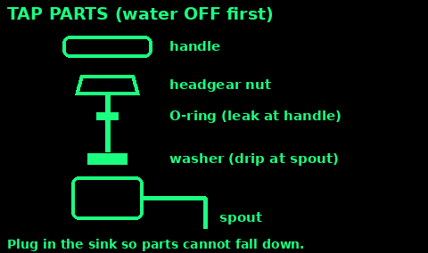
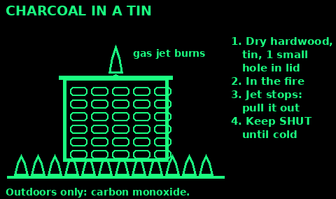
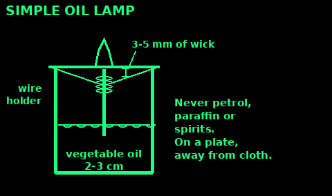

## Tools to keep

A small kit fixes most things. Buy quality where it cuts or turns.

Cutting: a sharp knife, a folding saw or bow saw, a hand axe or hatchet, scissors, a utility knife with spare blades.

Sharpening: a two-sided whetstone (coarse and fine), a 20 to 25 cm flat file, a round file for chainsaw or bow saw if you use one.

Turning and gripping: screwdrivers (flat and cross-head, small and large), pliers, long-nose pliers, an adjustable spanner, a set of hex (Allen) keys, slip-joint (water pump) pliers.

Hitting and fixing: a claw hammer, a cold chisel, assorted nails, screws, washers, cable ties, wire, duct tape, epoxy glue.

Measuring: a tape measure, a pencil, a spirit level.

Electrical: a test meter, insulated screwdrivers, a soldering iron (if you have power), spare fuses, insulating tape.

Other: a hand drill and bits, a spade, a bucket, a sewing kit and awl (see Clothing: Repair and sewing), a puncture kit and tyre levers, plumber's tape (PTFE) and spare tap washers.

Keep tools dry and lightly oiled. A rag with a drop of oil wiped over steel stops rust.

## Sharpen an axe

A sharp axe is safer than a blunt one. Blunt axes bounce off.

1. Clamp or wedge the axe head so it cannot move, edge toward you, on a log or bench. Wear gloves.

2. File: push a flat file from the edge back into the steel, away from the edge, along the line of the old bevel. File only on the push stroke. Lift it back.

3. Keep the bevel slightly curved (convex), not a flat steep edge. A felling axe edge is about 25 to 30 degrees; a splitting axe blunter.

4. Work the whole edge evenly from heel to toe, until you feel a small burr along the far side. Then turn it over and do the other side the same.

5. Finish with a stone in small circles, both sides, until the burr is gone.

6. Test: it should bite into end grain, or shave a hair on your arm.

Never file toward your hand. Check the head is tight on the handle: soak a loose wooden handle in water overnight, or drive in a new wedge.

## Saws: care and sharpening

Many modern saws have hard teeth (often black or gold tipped) that cannot be filed. When they go blunt, change the blade.

Bow saw blades: cheap. Keep spares and change them. Keep them tight in the frame.

Old-style hand saws can be sharpened:

1. Clamp the blade between two boards, teeth just showing.

2. Joint: run a flat file lightly along the tops of the teeth until each has a tiny flat spot. This evens them up.

3. File: a triangular saw file, held level and at the same angle as the existing teeth. 2 or 3 strokes in every second gap, from one end to the other. Then turn the saw round and do the gaps you missed from the other side.

4. Stop each tooth as soon as the flat spot disappears.

Care: wipe and oil the blade after use. Do not cut into soil, nails or stones. Push hard enough to cut, let the saw do the work, and use the full length of the blade.

Pinching in the cut: put a wedge in behind the saw, or cut from the other side.

## Fix a bike puncture

You need: tyre levers, a patch kit (patches, rubber glue, sandpaper), a pump.

1. Take the wheel off: open the brake, undo the quick release or nuts. Rear wheel: shift to the smallest sprocket first.

2. Let all the air out. Push the tyre bead into the middle of the rim all the way round.

3. Hook a tyre lever under the bead opposite the valve, lever it over the rim, clip it to a spoke. A second lever 10 cm along, then slide it round.

4. Pull the tube out. Pump it up and listen, or pass it through water, to find the hole. Mark it.

5. Run your fingers carefully round the inside of the tyre to find the thorn or glass and pull it out. If you miss it, it punctures again.

6. Sand the area round the hole. Spread a thin film of glue wider than the patch. Wait until it goes dull, about 5 minutes.

7. Press the patch on firmly from the middle out. Hold for a minute.

8. Put a little air in the tube. Valve in first, push the tube into the tyre, then push the bead back on with your thumbs, finishing at the valve. Avoid levers here: they pinch tubes.

9. Pump to the pressure written on the tyre wall. Spin the wheel and check the tyre sits evenly.

No kit: a patch of inner tube and contact glue, or tie a tight knot in the tube on each side of the hole as a get-you-home fix.

## Bike checks

Check before every long ride. A bike may be your best transport.

1. Tyres: pumped hard, no cuts or bulges, pressure on the tyre wall.

2. Brakes: squeeze each lever. It should stop well before touching the handlebar. Pads not worn to the grooves.

3. Chain: clean and lightly oiled. Wipe off the extra oil. Dry and squeaky or rusty: oil it. Cooking oil works short term.

4. Bolts: wheels tight, handlebars and seat do not twist.

5. Lights and a bell.

Carry: a pump, tyre levers, a patch kit or spare tube, a multi-tool, a chain tool if you have one.

Slipped chain: put it back on the smallest front ring first, turn the pedals slowly by hand.

## Fix a dripping tap

Most drips are a worn washer or ceramic disc.

1. Turn off the water: the small valve on the pipe under the sink (turn the slot with a screwdriver so it sits across the pipe), or the main stop tap. Open the tap to drain it.

2. Put the plug in so small parts cannot fall down the drain.

3. Prise off the cap on the handle. Undo the screw. Pull the handle off.

4. Undo the big nut (headgear) with a spanner. Hold the tap body still with your other hand so you do not twist the pipes.

5. Old-style tap (turns several times): the rubber washer is on the bottom. Prise it off, press on a new one of the same size.

6. Quarter-turn tap (ceramic disc): take the cartridge to a shop and replace it with the same one.

7. Leaking round the handle, not the spout: replace the small rubber O-ring on the spindle.

8. Put it back together. Turn the water on slowly. Check for drips.

A smear of silicone tap grease on new O-rings helps.

## Frozen and burst pipes

Prevent it: lag pipes in lofts, garages and outside walls. Keep some heat on. Fix dripping taps. Know where your stop tap is: usually under the kitchen sink.

Frozen pipe (no water from a tap):

1. Turn off the water at the stop tap.

2. Open the frozen tap so water and steam can escape as it thaws.

3. Thaw slowly from the tap end back toward the frozen part: a hot water bottle, towels soaked in hot water, or a hairdryer on low, moving it along.

4. Never use a blowtorch or any flame. It can crack the pipe or start a fire in the walls.

5. Once water flows, check for leaks before turning the stop tap back on fully.

Burst pipe:

6. Stop tap off. Open all cold taps to drain the system. Flush toilets.

7. Turn off boilers, water heaters and the central heating.

8. Water near electrics or light fittings: switch off at the fuse box if you can reach it safely and dry. Do not touch switches with wet hands.

9. Catch drips with a bucket. Wrap a quick fix round a split pipe: a rubber strip and tight hose clamp, or self-amalgamating tape stretched round.

## Glue and fixings

Pine pitch glue (sticks hafts, patches leaks, waterproofs):

1. Collect hardened resin from cuts and wounds on pine or spruce trees. Do not cut the tree.

2. Melt it slowly in a tin at the edge of the fire, not over flames. Resin catches fire easily.

3. Stir in fine crushed charcoal, about 1 part to 4 parts resin. Add a pinch of dried grass, dung fibre, or a little beeswax or fat to make it less brittle.

4. Dip a stick in it and let it cool into a glue stick. Warm it to use. Press the joint and hold until cool.

Hide glue: boil scraps of rawhide, skin or hooves for hours, strain, and simmer to a thick syrup. Paint it on hot. Not waterproof.

Other fixings:
- Lashings and wedges hold where nails will not: see the Knots cards.
- Wet rawhide or sinew shrinks tight as it dries.
- Screws hold better than nails in soft wood. Drill a small pilot hole to stop splitting.
- Epoxy: mix equal parts exactly. Rough up both surfaces. Clamp until hard.
- Duct tape, cable ties and fencing wire fix almost anything for a while.

## Make charcoal

Charcoal burns hot with little smoke. Good for cooking, forging, and filtering water.

Tin method (small batch):

1. A metal tin with a lid, like a biscuit or paint tin. Punch one small hole (5 mm) in the lid.

2. Fill with dry hardwood pieces, thumb-thick, packed close. Lid on tight.

3. Put the tin in a hot fire, covered with burning wood.

4. Gas and smoke jet out of the hole and catch light. That is the wood gas burning off.

5. When the jet stops (often 1 to 2 hours), pull the tin out and leave it closed until cold. Opening it hot lets air in and the charcoal bursts into flame.

6. Inside: black, light pieces that ring when tapped. Brown, heavy bits need longer.

Pit method (big batch): dig a pit, build a hot fire, fill with wood, and once it is burning well, cover with green leaves and then 10 to 15 cm of soil. Leave for a day or two until cold.

Make it outside, away from buildings. Charcoal gives off carbon monoxide: never burn it indoors or in a tent.

## Candles and rushlights

Rushlight (a very old, cheap light):

1. Cut soft rush stems (Juncus) in summer when they are full grown. The inside is white pith.

2. Peel the green skin off, leaving one narrow strip down the side to hold it together.

3. Dry them for a week.

4. Dip in hot melted fat (tallow, dripping, or cooking fat) a few times. Let them dry.

5. Hold in a clip or split stick at an angle. A long rush burns for half an hour or more.

Dipped candle:

1. A wick of plain cotton string, soaked in salty water and dried, or a twisted strip of cotton cloth.

2. Melt tallow or wax in a tall tin in a pan of hot water, never over direct flame.

3. Dip the wick, lift out, let it cool 30 seconds, dip again. 20 to 30 dips make a candle.

4. Pour candle: stand a wick in a jar or tin and pour melted wax round it.

Fire safety: on a plate or in a jar, away from curtains and bedding, never left alone, never in a tent. Tallow smokes and smells. Beeswax burns cleanest.

## Simple oil lamp

Burns cooking oil or melted animal fat. Not engine oil: it smokes badly. Never use petrol, paraffin or spirits in a home-made lamp: they explode.

1. A small glass jar or tin.

2. Wick: a strip of cotton cloth, a cotton string, or a twist of cotton wool.

3. Wick holder: a piece of thin wire coiled round the wick, with legs that rest on the rim. Or a small square of foil with a hole, folded over a cork disc so it floats.

4. Pour in 2 to 3 cm of vegetable oil.

5. Let the wick soak up oil for a few minutes. Only 3 to 5 mm of wick should stand above the holder.

6. Light it. Too much smoke or a big flame: trim the wick shorter.

A shallow dish of melted fat with a wick laid in it is the same idea, a fat lamp.

Stand it on a plate, away from anything that burns. Keep a lid nearby to smother it.

## Soldering

Joins wires and fixes electronics for good. Low-voltage work only.

You need: a soldering iron, solder (lead-free is safer; it has flux inside), a damp sponge, heat-shrink tube or tape.

1. Power off and unplugged first. Batteries disconnected.

2. Strip about 1 cm of insulation off each wire. Twist the strands tight.

3. Slide heat-shrink tube onto one wire now, before joining.

4. Hot iron: wipe the tip on the damp sponge, melt a little solder on it to make it shiny ("tinning").

5. Twist or hook the wires together. Hold the iron under the joint for 2 to 3 seconds.

6. Touch solder to the wire, not the iron. It should flow in and look smooth and shiny.

7. Take the solder away, then the iron. Do not move the wires until cool.

8. Slide the heat-shrink over and warm it until it grips.

Safety: the tip is about 350°C. Always put the iron in its stand. Work in moving air: flux fumes can cause asthma. Wash your hands after, especially with old lead solder. Wear glasses: solder can spit.

No mains? 12 V soldering irons run from a car battery, and gas irons need no power.

## Electrical safety

Mains power (230 V) kills. Leave mains wiring to an electrician.

1. Before any work: switch off at the fuse box (consumer unit) and take out the fuse or lock the switch. Test the circuit is dead with a tester you have just checked on a live socket.

2. Never touch anything electrical with wet hands or while standing in water.

3. Every 12 V circuit needs a fuse near the battery, rated for the wire. See Power: Wiring and fuses.

4. Batteries: a spanner across car battery terminals can melt and explode. Take watches and rings off. Disconnect the black (negative) lead first, reconnect it last.

5. Lithium batteries that are swollen, hot or hissing: get them outside onto soil or concrete, away from people. Do not puncture or charge them.

6. Generators: outside only, well away from doors and windows (carbon monoxide). Never plug one into a house socket to "backfeed" the house: it can kill line workers and you. Use an extension lead straight to appliances.

7. Damaged cables: replace them. Tape is for 12 V and short-term only.

8. Water and power: after a flood, do not switch anything on until it has been checked.

Someone has a shock: see Electric shock in First aid.

## Repairs sources

Written in our own words from:

Water UK and WaterSafe, frozen and burst pipes: watersafe.org.uk/advice/general_plumbing_advice/winter_advice and the Met Office: weather.metoffice.gov.uk/warnings-and-advice/seasonal-advice/your-home/frozen-or-burst-pipes

Electrical Safety First: electricalsafetyfirst.org.uk (mains safety, generators, battery fires). HSE, rosin flux fumes and occupational asthma: hse.gov.uk/asthma

Cycling UK puncture repair and bike checks (facts only): cyclinguk.org

US Army FM 21-76 / ATP 3-50.21 Survival (public domain): pitch glue, charcoal, improvised lamps.

US Forest Service, An Ax to Grind: A Practical Ax Manual (public domain, fs.usda.gov): axe filing and honing.

Museum and heritage sources on rushlights (facts only).

Sewing and patching: see Clothing. Soap: see Sanitation. Knife sharpening: see Tools and wildlife.
