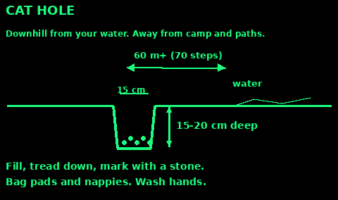
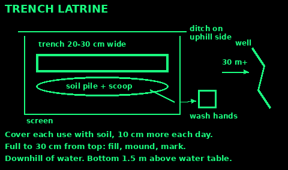
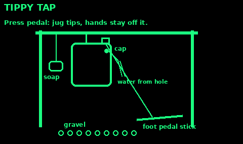
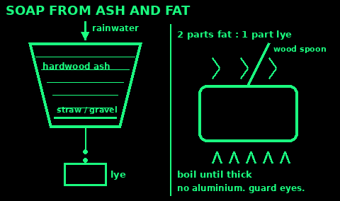
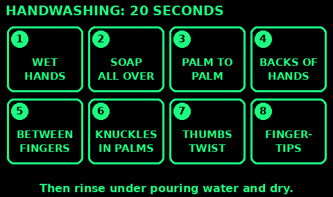
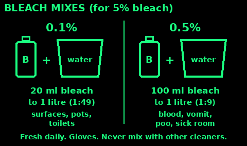
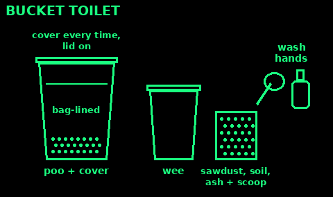
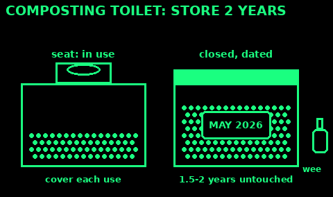
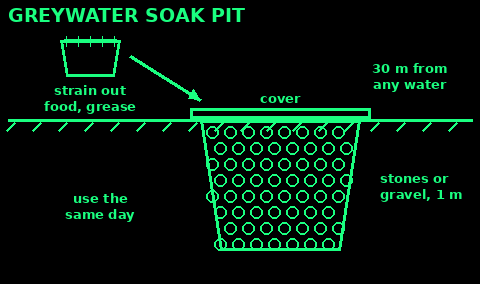

## Sanitation

Poo, dirty hands, flies and dirty water carry most of the illness in a camp. Keep the latrine away from water and food, and wash hands at the right moments.

Wash with soap and clean water for at least 20 seconds. Do it after the latrine, after cleaning a child or a sick person, and before you cook, eat or handle drinking water. Rub backs of hands, between fingers, thumbs and nails. Dry in the air or on a clean cloth.

No soap? Rub with ash or clean sand and rinse. It is better than water alone.

Never wash in the stream you drink from. Carry wash water at least 60 m from it and tip it out on the ground.

Keep drinking water in a closed container. Pour from it. Do not dip a cup or hand into the clean pot.

Hands, boots and tools that touched waste do not touch food until they are washed.

## Cat hole

For one person, or a few people moving through.

1. Walk at least 60 m (about 70 big steps) from water, camp and paths. Go downhill from your water source, never above it.

2. Dig a hole 15 to 20 cm deep and about 15 cm wide. Dark topsoil breaks waste down faster than sand or clay.

3. Use it. Stir in a little soil with a stick.

4. Fill the hole and tread it down. Put a stone or stick on top so nobody digs there again.

5. Wash your hands.

Toilet paper: carry it out in a bag, or bury it deep in the hole. Pads, tampons and nappies do not go in a cat hole. Bag them.

Spread cat holes out. Do not dig the same patch twice.

## Trench latrine

For a group staying more than a day or two.

1. Site it at least 30 m from any well, spring or stream, downhill from them, and downwind of camp. Keep the bottom of the trench at least 1.5 m above any water you hit when digging. In gravel or cracked rock, go further away.

2. Dig a trench 20 to 30 cm wide, narrow enough to squat across, as deep as you can. Make some narrower for children.

3. Pile the soil along one side with a scoop or spade in it.

4. After each use, throw on soil to cover it. This keeps flies and smell down. Cover the whole trench with about 10 cm of soil each day.

5. Put a screen round it for privacy. Dig a small ditch round the uphill side so rain runs past it, not into it.

6. When the waste is 30 cm from the top, fill the trench with soil, mound it, and mark it. Dig a new one.

Put a handwashing station at the exit. Keep a lid or board over the trench when it is not in use if flies are bad.

## Tippy tap

A hands-free handwashing station. You do not touch the container, so dirty hands do not dirty it.

You need: a plastic jug with a handle and cap, a nail, a candle, two cords (long and short), two sticks (long and short), soap, and a frame of two forked posts and a crossbar.

1. Heat the nail in the candle. Melt a small hole in the side of the jug, opposite the handle, about a finger's length below the top.

2. Melt a hole in the cap. Push the long cord through it and knot it inside.

3. Tie the other end of the long cord to the long stick. That stick is the foot pedal. Screw the cap on.

4. Hang the jug by its handle from the crossbar, high enough that the cord holds the pedal just off the ground.

5. Make a hole through the soap, thread the short cord, and hang it from the crossbar. Soap on a string stays clean.

6. Fill with treated water. Step on the pedal: the jug tips and water pours out of the hole.

Put gravel or stones under it so the ground does not turn to mud. Refill daily. Clean the jug every few days.

## Soap from ash and fat

Lye is a strong alkali. It burns skin and can blind you. Wear gloves and eye cover if you have them. Keep children and animals away. Work outside.

Use iron, steel, enamel or clay pots and a wooden spoon. Never aluminium: lye eats it and gives off flammable gas.

1. Make lye: put clean white ash from hardwood (oak, beech, ash) in a container with a small hole near the bottom, over straw or gravel. Pour rainwater through slowly and catch the brown liquid. Pour it through again to make it stronger.

2. Render fat: cut animal fat small, heat it slowly with a little water, stirring. Strain off the clear grease.

3. Mix about two parts grease to one part lye in the pot. Boil gently, stirring, until it thickens.

4. Let it cool. You can use the soft soap straight from the pot, or set it in a tray and cut it into bars.

Test a dab on the back of your hand. If it stings or feels slippery after rinsing, it has too much lye. Boil it again with more fat.

Lye on skin or in an eye: wash it off with lots of cool running water, for a long time. The NHS says about an hour for a chemical burn. Take off splashed clothing. Get medical help. Do not put vinegar or cream on it.

## Waste and rubbish

Rubbish draws flies, rats, foxes and bears. Rats and flies carry disease back to your food.

Keep a rubbish point downwind, at least 30 m from camp and water. Keep it covered.

Food scraps: burn them in a hot fire, or bury them at least 30 cm deep, well away from water and camp. A shallow pit gets dug up.

Do not burn plastic, foam or painted wood. The smoke is poisonous. Keep it in a bag and carry it out, or store it away from camp.

Wash water: strain out food bits and add them to the rubbish. Scatter the water on the ground at least 60 m from streams and lakes. Use little soap.

Sharp things (broken glass, cans, needles): put them in a sealed tin or bottle, so nobody gets cut when they move the rubbish.

Dead animals and animal guts: bury deep or burn, far from water.

## Teeth

Brush twice a day for about 2 minutes, one of them last thing at night. Use fluoride toothpaste. Spit it out, but do not rinse straight after. The fluoride left behind protects the teeth.

Clean every surface: outside, inside and the chewing tops. Floss or use thread between the teeth.

No brush: make a chewing stick. Take a fresh twig about 20 cm long and as thick as a pencil, from a tree you know is safe. Never yew. Chew one end until the fibres splay into a brush, then scrub.

Or wrap clean cloth round a finger and rub the teeth.

Cut down on sugar between meals. In hard times, dental pain is miserable and abscesses can be dangerous.

A swollen face, fever, or swelling under the jaw that makes it hard to swallow or breathe needs medical help urgently. For pain, see the doses in First aid.

## Periods

Plan for periods like you plan for food. Each person needs supplies, soap, water, a private place to wash, and a place to dry cloths.

Disposable pads: change them often, and wrap used ones before putting them in the rubbish. Do not put them in a cat hole, trench, river or drain.

Reusable cloth pads, or folded clean cotton cloth:
1. Soak used cloths in cold water first.
2. Wash with soap and clean water.
3. Rinse well.
4. Dry fully before reuse. Sun helps. A damp cloth breeds germs.
5. Keep clean ones in a clean bag.

A person needs at least five reusable pads to keep a cycle going.

Tampons and menstrual cups: wash hands first, follow the pack, and do not leave them in longer than it says.

Toxic shock syndrome is rare but deadly. Sudden high temperature, a rash like sandpaper, vomiting and diarrhoea, dizziness or confusion while using a tampon or cup: take it out and get urgent medical help.

## Head lice and body lice

Head lice spread by head-to-head contact. They do not jump or fly. Itching is the usual sign.

Wet combing (NHS method):
1. Wash the hair with ordinary shampoo and put in lots of conditioner.
2. Comb the whole head from the roots to the ends with a fine-toothed detection comb. Wipe the comb after each stroke.
3. Comb it all through a second time.
4. Repeat on days 1, 5, 9 and 13 to catch lice that hatch. Check again on day 17.

Lotions and sprays from a pharmacy also work. Follow the pack. They do not prevent lice.

Body lice live in the seams of clothes, not on the skin. They spread in crowded camps with no washing, and can carry typhus.

Wash clothes and bedding in water of at least 54°C, then dry on high heat. If you cannot, seal clothing in a bag for 2 weeks. Bathe, and change into clean clothes at least once a week. Do not share clothes, towels or bedding.

## Scabies

Scabies is a tiny mite under the skin. It causes intense itching, worst at night, and a rash. Look for lines with a dot at one end, often between the fingers and on the wrists. It spreads by close skin contact. It is not about being dirty.

Treatment from a pharmacy (usually permethrin 5% cream):
1. Treat everyone in the household on the same day, even with no rash.
2. Put the cream over the whole body, including scalp and face, but not round the eyes. Get between fingers and toes and under nails.
3. Leave it on for 8 to 12 hours, usually overnight, then wash it off. If you wash your hands in that time, put more on them.
4. Repeat 7 days later.

Children under 2 need a doctor, not pharmacy treatment.

On the first day, wash all bedding and clothing at 60°C or higher and dry it hot. Put things you cannot wash in a sealed bag for at least 3 days.

The itch can last for weeks after treatment. Itching 2 to 4 weeks after treatment, or skin that looks infected, needs a doctor.

## Clean water and food

WHO's five keys to safer food:

1. Keep clean. Wash hands, pots and surfaces. Keep flies, rats and pets away from food.

2. Keep raw and cooked apart. Raw meat and fish have their own board and knife, or the board is washed between.

3. Cook thoroughly. Meat, fish, eggs and poultry to at least 70°C, until steaming hot right through and the juices run clear. Bring soups and stews to the boil.

4. Keep food at safe temperatures. Do not leave cooked food at room temperature for more than 2 hours. Keep cold food below 5°C, hot food above 60°C. Reheat leftovers until steaming hot, once only.

5. Use safe water and safe raw food. Wash fruit and vegetables in treated water. Do not eat food that is past it, smells wrong, or comes from a swollen tin.

Treat or boil all drinking water. See Water.

Cover food and water from flies. Wash up in hot soapy water and dry pots upside down off the ground.

The person cooking must not be the person who has diarrhoea.

## Cholera and dysentery

Diarrhoea outbreaks spread through poo getting into water and food. Act at the first case.

Cholera: lots of watery diarrhoea that can look like rice water, vomiting, leg cramps, weakness. It starts 12 hours to 5 days after swallowing the germ. It can kill in hours from loss of water.

Give oral rehydration solution at once and keep giving it. WHO says ORS alone treats most cases. See First aid for the home recipe. Get the person to a health centre or cholera treatment point as fast as you can. Severe cases need a drip and antibiotics.

Dysentery: diarrhoea with blood or mucus, belly pain, often fever. It needs a doctor, and may need antibiotics. Keep up fluids and ORS. Do not use anti-diarrhoea medicine such as loperamide when there is blood in the stool.

In an outbreak:
1. Boil or treat every drop of drinking water, including water for brushing teeth.
2. Give the sick their own latrine or bucket, close to their bed.
3. Carers wash hands with soap after every contact. Keep carers away from cooking.
4. Wash soiled clothes and bedding hot, away from the water source.
5. Nobody washes, or washes clothes, near where drinking water is drawn.
6. Cook food fresh, keep it covered, eat it hot.
7. Sick people stay away from shared food and work until 48 hours after the diarrhoea stops.

Look up cholera, dysentery and dehydration in Medicine.

## Handwashing step by step

Soap and water for at least 20 seconds: about as long as singing Happy Birthday twice.

1. Wet your hands with clean water.

2. Soap: enough to cover all of both hands.

3. Rub palm to palm.

4. Right palm over the back of the left hand, fingers laced. Then swap.

5. Palm to palm with fingers laced, to clean between them.

6. Backs of fingers into the opposite palm, fingers locked.

7. Grip each thumb in the other hand and twist.

8. Rub fingertips in circles in the other palm. Swap.

9. Rinse under pouring water (a tippy tap or a jug held by someone else).

10. Dry in the air or on a clean towel used only by you.

Short of water? Wet, turn the water off, soap and scrub, then rinse. Ash or clean sand instead of soap works better than water alone.

Hand gel (60% alcohol or more) works when hands look clean. It does not work well on dirty or greasy hands, or against some stomach bugs. Wash with soap after diarrhoea and vomiting.

## Bleach for cleaning

Bleach kills germs on surfaces, not dirt. Clean with soap and water first, then disinfect.

Check the strength on the label: most UK household bleach is about 4 to 5% (sodium hypochlorite). Plain bleach, no added scents or thickeners if you can get it.

For 5% bleach:
- Surfaces, toilets, door handles, pots: 0.1% solution. 1 part bleach to 49 parts water: 20 ml (4 teaspoons) of bleach, topped up with water to 1 litre.
- Blood, vomit, poo, and a sick person's room: 0.5% solution. 1 part bleach to 9 parts water: 100 ml of bleach, topped up with water to 1 litre.

1. Wear gloves. Open windows.

2. Wipe on with a cloth. Leave wet for at least 1 minute (10 minutes for spills), then rinse surfaces that touch food.

3. Spills: cover with cloth or paper, pour the 0.5% solution on, wait 10 minutes, wipe up, then clean again.

4. Make it fresh every day in a covered, labelled container. It weakens with time and sunlight.

Never mix bleach with other cleaners, especially ammonia, vinegar or acids: it makes toxic gas.

Drinking water uses far less: see Bleach and tablets in Water.

## Laundry by hand

1. Sort: very dirty and sick-room laundry separate. Shake off solids outside first (into the latrine).

2. Soak in warm soapy water for at least an hour. Overnight for heavy dirt.

3. Wash: squeeze, rub on a washboard or against itself, or agitate in a bucket with a lid and a plunger (a clean sink plunger works).

4. Rinse twice in clean water, until no soap comes out. Soap left in cloth irritates skin.

5. Wring out: twist, or roll in a towel, or fold over a pole and twist the ends.

6. Dry in sunshine where you can. Sun and wind kill many germs. Shake out and stretch while damp to reduce creases.

Sick person's bedding and clothes: wash separately, hot (60°C or more, or bring to the boil in a big pot for 10 minutes), or soak in 0.1% bleach for 30 minutes before washing. Wear gloves.

Wash away from drinking water sources, and tip waste water onto the ground or a soakaway at least 30 m from water.

Lice and scabies: see those cards. Hot wash or seal clothes in a bag for 3 days.

## Nursing someone infectious

Flu, Covid, diarrhoea and vomiting, chest infections. Keep it from spreading.

1. Their own room, or a corner screened off, with a window that opens.

2. One carer if possible: not someone old, pregnant or with a weak immune system.

3. Carer wears a mask when close, and gloves for body fluids. Wash hands after every contact and after taking gloves off.

4. Their own cup, plate, towel and bucket or toilet. Wash dishes in hot soapy water.

5. Clean surfaces they touch daily: 0.1% bleach. Spills of vomit or poo: 0.5% (Bleach for cleaning).

6. Laundry: carry it to the wash in a bag, do not shake it.

7. Tissues into a bag, then tie it. Catch coughs and sneezes in a tissue or elbow.

8. The sick person and their carer do not cook for others.

9. Isolate until 48 hours after diarrhoea and vomiting stop. For fevers, until the fever has gone for a day without medicine.

Care for them well: see Caring for a sick person and Observations in First aid.

## Bucket toilet

Use: the toilet will not flush (no water, sewer blocked or flooded), at home or in camp.

1. Two buckets with lids if you can. One for poo, one for wee. Keeping them apart cuts smell a lot.

2. Line the poo bucket with a strong bin bag, or two. Put a layer of sawdust, soil, cat litter or ash in the bottom.

3. After each poo, cover it with a cupful of the same dry material. Keep the lid on.

4. Wee: dilute it about 1 part to 10 of water and pour it on soil or a lawn away from food crops, or down a working drain.

5. When the bag is about half full, tie it, put it in a second bag and store it in a covered bin away from the house until it can be collected or buried in a latrine 30 m from water.

Mistakes: filling the bag too full to lift; no lid; no handwashing next to it.

Check: no smell and no flies means you are using enough cover material.

## Composting toilet

Use: a long stay with no sewer, when you have a place to store the compost safely.

1. A seat over a large container or chamber, with a bucket of dry cover: sawdust, wood shavings, dry leaves or straw.

2. Divert wee if you can (a funnel at the front to a separate container). Wet piles smell and do not compost well.

3. Cover every deposit. When the container is full, seal it, label it with the date and start a second one.

4. Store it, untouched, for at least 1.5 to 2 years at normal UK temperatures (about 1 year if kept above 20 °C). Keep it covered, out of the rain, and 30 m from any water.

5. Use the finished compost only around trees, shrubs and flowers. Not on vegetables you eat raw or root crops.

Mistakes: emptying too early; adding water; putting it on the vegetable patch.

Check: finished compost is dark, crumbly and smells of soil.

## Greywater

Use: dish, washing and laundry water when you have no drains.

1. Grey water is wash water. Black water has poo in it and must go to the toilet or latrine.

2. Strain out food bits and grease through a cloth. Bin them.

3. Use little soap. Plain soap is better than detergent or bleach for the soil.

4. Pour it onto soil or a soak pit at least 30 m from water, wells and springs, and away from camp. Move the spot often.

5. A soak pit: a hole about 1 m deep filled with stones or gravel, covered with leaves or a board so children and animals cannot get in.

6. Use the same day. Stored grey water starts to smell and breed germs within a day.

You can water ornamental plants and fruit trees with it, at the roots. Not on leaves or vegetables you eat raw.

Check: no puddles. If water pools, dig a new pit or spread it more.

## Sanitation sources

Written in our own words from public guidance:

US National Park Service, Leave No Trace (cat holes 6 to 8 inches deep, 200 ft from water): nps.gov/articles/leave-no-trace-seven-principles.htm

WHO technical note 14, excreta disposal in emergencies (trench latrines): cdn.who.int/media/docs/default-source/wash-documents/who-tn-14-technical-options-for-excreta-disposal.pdf

WHO cholera fact sheet and Q&A: who.int/news-room/fact-sheets/detail/cholera and who.int/news-room/questions-and-answers/item/cholera-outbreaks

WHO Five keys to safer food: who.int/publications/i/item/9789241594639

CDC, How to make a tippy tap: cdc.gov/global-water-sanitation-hygiene/communication-resources/index.html

CDC body lice: cdc.gov/lice/about/body-lice.html

NHS: nhs.uk/conditions/scabies, nhs.uk/conditions/head-lice-and-nits, nhs.uk/conditions/dysentery, nhs.uk/conditions/toxic-shock-syndrome, nhs.uk/conditions/acid-and-chemical-burns, nhs.uk/live-well/healthy-teeth-and-gums/how-to-keep-your-teeth-clean, nhs.uk/live-well/best-way-to-wash-your-hands

WHO, How to handwash: who.int/publications/m/item/hand-hygiene-why-how-and-when-brochure. WHO bleach dilution guide (0.1% surfaces, 0.5% spills): who.int/docs/default-source/wpro---documents/wpro---pdf-infographics/covid-19/bleach-dilution-and-guidance-for-visitors-20200622.pdf. CDC chlorine solution preparation: cdc.gov/healthcare-associated-infections/hcp/cleaning-global/appendix-e.html

NHS, how to avoid spreading infections at home and laundry at 60°C: nhs.uk/conditions/norovirus and nhs.uk/conditions/flu

UNICEF guide to menstrual hygiene materials: unicef.org/media/91346/file/UNICEF-Guide-menstrual-hygiene-materials-2019.pdf

US Army FM 21-76 / ATP 3-50.21 Survival (public domain): soap from fat and ash, chewing stick, personal hygiene.

WHO Guidelines for the safe use of wastewater, excreta and greywater, volume 4 (2006): storage of dry toilet waste 1.5 to 2 years at 2 to 20 °C, or 1 year above 20 °C; greywater use on non-food plants.

GOV.UK Prepare and water companies' advice for when toilets cannot be flushed: bagged bucket toilet. Sphere Handbook WASH chapter: 30 m from water sources.

Oxfam and WEDC (Loughborough University) technical briefs: soak pits for greywater.

