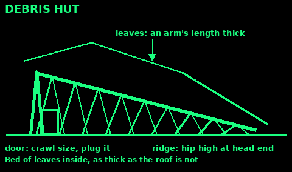
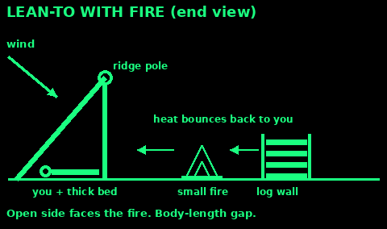
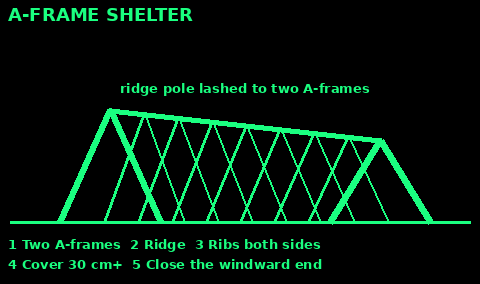
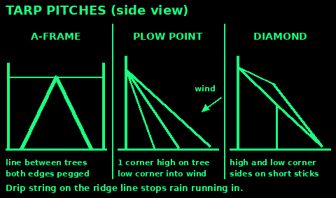

## Choose a site

Look up before you look down. Dead limbs, loose rock, and slab snow fall on people who liked the flat spot underneath them.

Do not camp in a dry wash, a gully, or the bottom of a valley. Rain a long way upstream arrives as a wall of water. A bench a few body-lengths above the channel is safer than the sand in the channel.

Wind takes heat faster than cold air alone. Put rock, a bank, or thick brush on the windward side. Face the door and the low edge away from the wind.

In cold weather, take morning sun. In hot weather, take shade and any breeze that is not a sandblast.

Clear the ground you will lie on. A stick under your ribs will keep you awake, and awake costs heat. The earth under you is a heat sink. A bed of dry leaves, grass, or spruce tips as thick as your open hand matters more than a thin roof.

Stay back from the water's edge. You want the walk for drinking water to be short, and you want the flood line and the insects to stay over there.

## Debris hut

This is the shelter to build when you have no tarp and the night will be cold. The room inside must be small. If you can sit up in it, it is too big to warm with your body.

1. Find a ridge pole longer than you are tall, strong enough to hold a wet pile of leaves. A wrist-thick pole is a start. Thicker is safer.

2. Lift one end to about hip height in the fork of a tree, or lash two sticks into a bipod and rest the ridge in the crotch. The other end of the ridge sits on the ground. You will lie along this slope, head at the high end.

3. Lay rib sticks down both sides, from the ridge to the ground. Space them about a hand apart. If leaves would fall between them, they are too far apart.

4. Lay fine twigs across the ribs so the leaves have something to sit on.

5. Pile dry leaves, ferns, grass, or bark on the ribs. The layer should be as thick as your arm is long, including over the ridge. If rain is likely, add more, and comb the outside so water sheds downhill.

6. Build the same thickness under your body. The ground will empty your heat faster than the air above you.

7. The door is only big enough to crawl through. Once you are inside, plug it with your pack or a bag stuffed with leaves.

8. A fire does not belong inside this hut. There is no chimney and the leaves will burn.

If the only leaves are wet, use them anyway. Wet insulation is poor, but wind on bare skin is worse. Keep a dry layer against you if you have one.

## Lean-to

Use a lean-to when you have a fire and a clear, wind-safe place to put it. The roof is a windbreak. The fire is the heater. One does not work well without the other.

1. Set a ridge pole between two trees, about chest to head height. If you have one tree, run the ridge from the tree down to the ground and sleep with your head at the high end.

2. Lay ribs on the windward side only, sloping to the ground. Cover them with browse, bark, or a tarp. Shingle the cover so water runs down the outside, not into the bed.

3. The open side faces the fire. Lie a full body-length back from the flames. Sparks and a rolling log are the failure mode.

4. A low wall of green logs or sticks on the far side of the fire reflects heat onto you. Stack it so it cannot fall into the fire. Do not use stones from a stream bed in or next to the fire. Trapped water can burst them.

5. The bed is still mandatory. Bare ground under a good roof is still a cold night.

Keep the fire small. A fire you can step over is easier to sit close to than a bonfire you have to flee.

## Tarp or sheet

A tarp is a roof, not a tent, until you close it. Pitch it so a gust cannot turn it into a sail. Tie the corners. Do not rely on the grommet alone if the cloth is old. Use a small stone in a fold, with the line around the neck of the fold, when a grommet is torn.

Lean-to: ridge line about chest height, windward edge staked to the ground, open side away from the wind. Fast to pitch. Cold, because one side is open.

A-frame: ridge lower, both long edges staked to the ground, a small opening at one end. Warmer. Pitch it so rain sheds off the sides and does not pool in the belly. If the belly holds water, lower the edges or raise the ridge.

Plow point: tie one corner to a tree at about head height. Stake the opposite corner downhill. Stake the remaining two corners out to the sides. Use this when the wind has one obvious direction. The nose points into the wind.

In every pitch, the line that takes the load should be adjustable. A taut-line hitch or a trucker's hitch lets you retighten after the cloth stretches. See Knots.

Get the cloth off your face. Condensation will wet a tarp that touches your mouth and nose all night.

## Cold ground and wet clothes

Most of the heat you lose in a shelter goes into the ground and into wet cloth, not through a thin spot in the roof.

Do not lie on bare earth, rock, or a wet log. Pile dry plants, a pack, a spare layer, or boughs under your torso and hips. If the pile is only under your shoulders, your hips still pour heat downward.

Change out of wet clothes before you climb in if you have anything dry, including a dirty dry layer. Wet cotton against the skin is a cooling system. Hang the wet layer in the smoke only if you can do it without burning the shelter. Wring it first.

Eat and drink before sleep if you have safe water and food. Shivering is a fire that burns your reserves. A full belly keeps it going longer.

Vent a tight shelter a finger's width if your breath is soaking the inside. A soaked leaf pile stops insulating. A small vent and a dry plug for the door is the balance.

If you are already shivering hard, slurring, or fumbling the knots, stop improving the camp and get inside the best shelter you have. Look up hypothermia in Medicine once you are out of the wind.

## A-frame shelter

An A-frame is a debris hut with two high ends, or a lean-to with a second roof. It sheds rain on both sides and keeps wind off you from both sides.

1. Lash two poles into an A at each end, about sitting height. Or use one tree fork and one A.

2. Lay a ridge pole across the two tops and lash it.

3. Lean ribs against the ridge on both sides, about a hand apart. The steeper the roof, the better it sheds rain.

4. Lattice with twigs, then cover. Leaves, grass or bracken: pile them at least 30 cm thick, more for cold nights. Bark, turf or browse: lay them like roof tiles, starting at the bottom so each row overlaps the one below.

5. Close the windward end. Leave a small door on the other end.

6. Bed of dry material at least 15 cm thick when squashed.

Keep it small. Every bit of air inside is air you have to warm.

## Tarp pitches in detail

Three pitches that work with one tarp about 3 m by 3 m, a ridge line and some pegs. Set the ridge line with a taut-line or trucker's hitch so you can tighten it when the cloth stretches.

A-frame: run a line between two trees at about waist height. Hang the tarp over it on the diagonal or square. Peg both long edges to the ground. Low and tight is warm. Pitch the closed end into the wind.

Plow point: tie one corner up to a tree at chest or head height. Peg the opposite corner to the ground, pointing into the wind. Peg the two side corners out and down. You sleep in the tall end, feet toward the low corner. Good for one person in steady wind.

Diamond: tie one corner high to a tree, peg the opposite corner low, and lift the two side corners on short sticks or lines, so the tarp makes a diamond-shaped roof. More headroom, less shelter from side wind.

All three: tie a short piece of string to the ridge line just outside the tarp and let it hang. Rain running along the line drips off there and does not run into your bed.

## Snow trench

The quickest snow shelter. Use it when the snow is deep and firm and you have little time or energy.

1. Mark out a trench a little longer than you are tall and about shoulder width.

2. Dig it about 1 m deep. In crusty snow, cut blocks and stack them along the edges. In soft snow, pile the snow along the edges and pack it.

3. Roof it: lay branches, skis or poles across, then a tarp or more branches, then 20 to 30 cm of snow on top. A pitched roof of snow blocks sheds drips better than a flat one.

4. Line the floor with boughs, a pack or anything that keeps your body off the snow. The floor matters more than the roof.

5. Block the door with your pack or a snow block. Keep a stick inside to poke a vent hole clear.

Build slowly. Sweat freezes. Take off a layer while you dig and put it back on when you stop.

## Quinzhee and snow cave

Use these when you have hours and expect to stay. Snow insulates very well, and inside it can stay near freezing while the air outside is far colder.

Snow cave: dig into a deep, firm drift, about 3 m deep. Keep the roof domed so melt water runs down the walls, not onto you. Make the sleeping bench higher than the door, because cold air sinks out of the low door. Walls and roof at least 30 cm thick.

Quinzhee: when there is no drift, make one. Pile and mix snow into a mound about 2 m high and wide enough to lie down in. Push sticks about 30 cm long into the mound all over. Wait at least an hour or two for the snow to set. Then hollow it out from a low door. Stop digging at each stick end you meet: that is your wall thickness.

Both: poke a vent hole in the roof, about the width of a fist, and keep it clear. Never run a stove, candle or fire inside without a vent. Carbon monoxide has no smell and kills in your sleep. If you cannot see your breath inside, it is too warm and the roof will drip.

Never dig a snow shelter where snow could slide onto it.

## Insulation and bedding

The ground pulls heat from you faster than still air does. Your bed is the most important part of any shelter.

1. Bed thickness: gather far more than looks needed. Dry leaves, grass, bracken, heather, pine needles or spruce tips, piled thick enough that it stays at least a hand thick when you lie on it.

2. Make a frame: two logs either side of the bed hold the pile together, so you do not roll off it in the night.

3. Dry it first if you can. Spread damp grass in the sun or wind for an hour.

4. Put boughs at the bottom, finest material on top, against your body.

5. Above you: 15 to 30 cm of loose insulation in the roof keeps heat in. More in cold weather.

6. Close every gap except one small vent. A gap at floor level lets cold air run in under you.

7. Wear your hat. Sleep in dry layers. Put tomorrow's damp socks inside your clothes to dry on your body.

Check bedding for ticks and ants. Shake it out each morning. Replace it when it goes flat.

## Shelter sources

Written in our own words from:

US Army ATP 3-50.21 Survival, chapter 6: shelter site, poncho lean-to and tent, field-expedient lean-to, debris hut, snow cave, tree-pit shelter, insulation and ventilation (public domain, armypubs.army.mil/epubs/DR_pubs/DR_a/pdf/web/ARN12086_ATP%203-50x21%20FINAL%20WEB%202.pdf).

US Army FM 21-76 Survival (1992, public domain): shelters and cold weather.

NHS hypothermia: nhs.uk/conditions/hypothermia

Snow trench and quinzhee steps are standard winter-camping practice consistent with ATP 3-50.21 snow-cave guidance (wall thickness, raised bench, ventilation, carbon monoxide).
