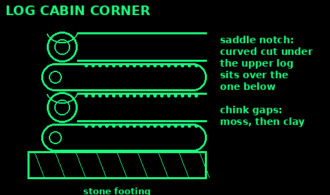
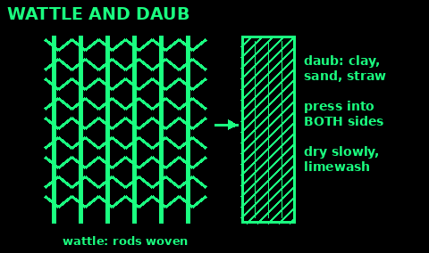
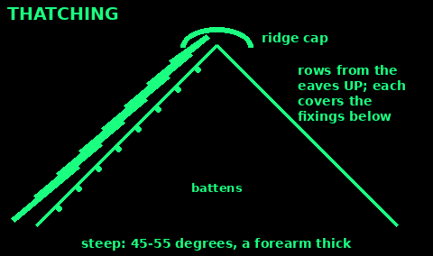

## Plan a long-term shelter

Use: you will stay for months or years.

1. The law: in Britain you need the landowner's permission, and usually planning permission and building control. Ask the council first.

2. Site: dry ground, out of flood zones, a gentle south-facing slope, shelter from the west wind, near water and wood but not in a frost hollow.

3. Good boots: walls stand on a plinth of stone or brick, 30 to 50 cm high, so ground water and splash do not rot them.

4. A good hat: a roof that overhangs the walls by a forearm or more.

5. Small and low is easier to heat. One room and a sleeping loft is plenty.

6. Plan the fire and chimney first. Keep chimney and flue well clear of thatch and timber.

Mistakes: building in a hollow; no footings; a roof that stops at the wall.

Check: you know where the water goes when it rains hard.

## Log cabin basics

Use: forests with plenty of straight trees, and time. Heavy work; two or more people.

1. Pick straight logs of similar thickness, 20 to 30 cm across. Peel the bark so insects do not get in.

2. Lay a stone footing. The first two logs sit on it, on opposite sides.

3. Saddle notch: at each corner, cut a curved notch in the underside of the upper log so it sits snug over the log below.

4. Lay the thick end of each log on the thin end of the one below, so the walls stay level.

5. Cut doors and windows after the walls are up. Frame the openings with planks.

6. Chink the gaps between logs with moss pressed in, then clay or lime mortar.

7. Roof: a ridge pole and rafters, covered with bark, turf, shingles or thatch. Overhang the walls.

Mistakes: green logs that shrink and open gaps; no footing; lifting logs alone.

Check: the walls rise level and the notches leave no daylight.

## Wattle and daub

Use: walls from thin rods and mud, where you have hazel or willow and clay soil.

1. Set strong upright posts (oak or sweet chestnut) on a footing, in a frame.

2. Wattle: fix thinner upright stakes about 30 cm apart. Weave long hazel or willow rods in and out between them, like a basket.

3. Daub: mix clay subsoil, sand and chopped straw (dung or hair are traditional too) with water. Tread it to a stiff dough.

4. Test: a ball dropped from waist height should flatten but not split apart. Too cracked when dry: add sand. Crumbly: add clay.

5. Press daub hard into both sides at once, working it through the weave. Build up 2 to 5 cm thick.

6. Let it dry slowly in shade. Fill cracks with more daub.

7. Finish with limewash. Renew it every year or two.

Mistakes: daub too wet (it slumps); drying in hot sun or frost; no roof overhang.

Check: tap it when dry. It sounds solid and does not dust away.

## Cob walls

Use: thick, warm walls from earth, where the subsoil has clay.

1. Mix: clay subsoil, sharp sand and straw, with water. Tread it on a tarp with bare feet or boots until it is stiff and even.

2. Test a brick of it. Dried, it should be hard and not crack badly. Adjust clay and sand as for daub.

3. Build on a stone plinth (see Plan a long-term shelter).

4. Lay it in layers called lifts, about 30 to 50 cm high and 45 to 60 cm thick. Press and tread each one well.

5. Let each lift firm up for days before the next one. Trim the faces straight with a spade.

6. Cover the wall top from rain every night while you build.

7. Put door and window frames in as you go, with a lintel over each.

Mistakes: lifts too tall (the wall slumps); building in frost; letting rain soak the top.

Check: the wall is firm enough to press with your thumb without a deep dent before you add more.

## Thatching basics

Use: a roof from reed, straw, heather, rushes or bracken.

1. The roof must be steep: about 45 to 55 degrees. Flatter thatch leaks and rots.

2. Fix horizontal battens across the rafters about 20 to 30 cm apart.

3. Tie the material into bundles about as thick as your arm can circle.

4. Start at the eaves. Lay the first row with the cut ends down and pointing out. Tie or peg each bundle to the batten.

5. Each new row overlaps the one below so it hides the fixings. Work up to the ridge.

6. Build it a forearm thick. Comb or beat it so the stalks lie straight and shed water.

7. Cap the ridge with bent bundles, turf or bark held down with pegs or rods.

Mistakes: too shallow a pitch; thin thatch; sparks from a chimney. Thatch burns fast: chimney tall and clear above it.

Check: from inside, after rain, the underside is dry.

