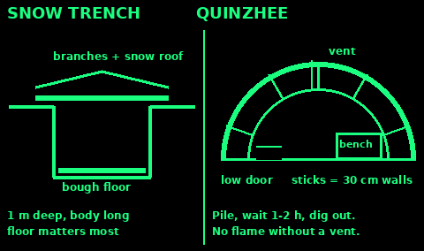
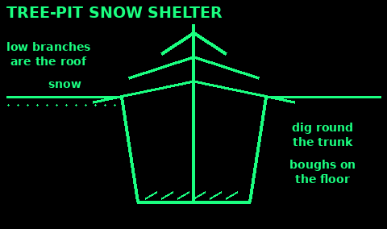
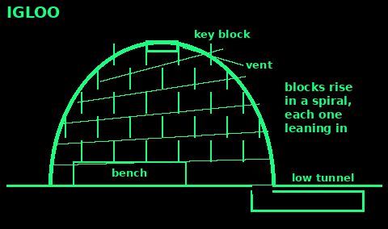

## Snow trench

The quickest snow shelter. Use it when the snow is deep and firm and you have little time or energy.

1. Mark out a trench a little longer than you are tall and about shoulder width.

2. Dig it about 1 m deep. In crusty snow, cut blocks and stack them along the edges. In soft snow, pile the snow along the edges and pack it.

3. Roof it: lay branches, skis or poles across, then a tarp or more branches, then 20 to 30 cm of snow on top. A pitched roof of snow blocks sheds drips better than a flat one.

4. Line the floor with boughs, a pack or anything that keeps your body off the snow. The floor matters more than the roof.

5. Block the door with your pack or a snow block. Keep a stick inside to poke a vent hole clear.

Build slowly. Sweat freezes. Take off a layer while you dig and put it back on when you stop.

## Quinzhee and snow cave

Use these when you have hours and expect to stay. Snow insulates very well, and inside it can stay near freezing while the air outside is far colder.

Snow cave: dig into a deep, firm drift, about 3 m deep. Keep the roof domed so melt water runs down the walls, not onto you. Make the sleeping bench higher than the door, because cold air sinks out of the low door. Walls and roof at least 30 cm thick.

Quinzhee: when there is no drift, make one. Pile and mix snow into a dome about 1.5 to 2 m high and 2.5 to 3 m across: your height plus a metre or more. Leave it at least 2 hours to set (longer is better). Push sticks about 30 cm long into the mound all over. Then hollow it out from a low door. Stop digging at each stick end you meet: that is your wall thickness.

Both: poke a vent hole through the roof, about 5 to 10 cm across (smaller in hard cold), and keep it clear. Never run a stove, candle or fire inside without a vent. Carbon monoxide has no smell and kills in your sleep. If you cannot see your breath inside, it is too warm and the roof will drip.

Never dig a snow shelter where snow could slide onto it.

## Tree-pit shelter

Use: deep snow under a big conifer with low branches. Quick, because the tree is the roof.

1. Pick a spruce, fir or pine with thick low branches, away from slopes that could slide.

2. Dig the snow away round the trunk, as deep as the snow and as wide as you need.

3. Pack the walls of the pit firm.

4. Lay more boughs over any gaps in the roof.

5. Line the floor thick with boughs.

6. Knock snow off the branches above the pit first, so it does not fall in on you.

Mistakes: a tree on an avalanche slope; heat from a fire melting snow off the branches onto you.

Check: you sit in the pit out of the wind with branches over your head.

## Igloo basics

Use: open snowfields with wind-packed snow. It takes practice and two or three hours for two people. A trench or quinzhee is easier.

1. Test the snow: you should barely leave footprints, and a cut block holds together.

2. Mark a circle about 2.5 to 3 m across for two people.

3. Cut blocks with a snow saw or long knife, about 60 cm long, 40 cm high and 20 cm thick, from inside the circle so the floor sinks.

4. First row round the circle. Then cut a slope across a few blocks so the rows climb in a spiral.

5. Lean each block inward. Bevel its edges so it touches its neighbours at three points.

6. The last key block goes in the top from inside.

7. Fill gaps with loose snow. Dig the door as a low tunnel, below the sleeping floor.

8. Make a vent near the top.

Mistakes: soft powder (blocks crumble); walls too upright; no vent.

Check: no daylight through the walls, and a clear vent.

