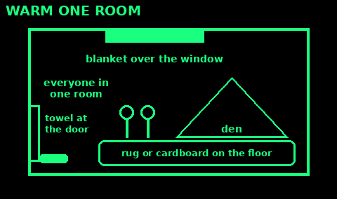
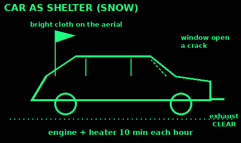

## Choose a building

Use: when home is unsafe and you need another roof.

1. First choice: friends, family, or a council rest centre. Local radio and the council say where they are.

2. Look at it from outside. Leave it if it leans, has big new cracks, a sagging roof, or fire damage.

3. Smell for gas. If you smell it, do not use switches, phones or flames inside. Leave and call 0800 111 999.

4. Flood risk: avoid basements and low ground. Go upstairs if water may rise.

5. Prefer brick, stone or concrete. Small rooms keep heat. Two ways out.

6. Water, a toilet you can use, and somewhere to cook outside.

Do not break into property. In a real emergency, ask, and tell the police or council where you are.

Mistakes: sheltering in a damaged building after an earthquake or explosion; a cellar in a flood.

Check: solid walls, a sound roof, no gas smell, two exits.

## Warm one room

Use: no heating, cold weather. Heat the people, not the house.

1. Pick one small room, with the fewest outside walls and windows. A sunny side helps.

2. Everyone lives and sleeps in it.

3. Stop draughts: rolled towels at the foot of doors, tape over gaps, close unused room doors.

4. Windows: curtains closed at dusk, open on sunny days. Hang blankets, duvets or bubble wrap over the glass.

5. Rugs, cardboard or blankets on a cold floor.

6. A tent or a blanket den inside the room keeps a small pocket warm.

7. Leave a little air: open a window a crack for a few minutes each few hours, especially with many people.

Mistakes: blocking air bricks and vents; a camping stove or BBQ for heat.

Check: the room feels warmer than the rest of the house within an hour.

## Warm indoors without power

Use: a power cut or no fuel in winter.

1. Dress in layers, with a hat, socks and slippers. Several thin layers trap more heat than one thick one.

2. Hot food and hot drinks through the day. Eat regularly.

3. Move about: get up and walk round once an hour.

4. Hot water bottle: hot, not boiling, water. Fill it two-thirds, in a cover. Do not sleep with it against bare skin. Replace bottles every two years or if worn.

5. Sleep under several blankets, a duvet and coats. Share a bed or room.

6. The NHS says keep rooms you use at 18 degrees C or more if you can.

7. Check on older neighbours and people living alone.

Never use a BBQ, patio heater, camping stove or generator indoors or in a garage. Carbon monoxide kills. Fit a CO alarm. See Power.

Mistakes: lots of candles (fire risk); sitting still for hours.

Check: hands and feet are warm and nobody is shivering.

## Car as shelter

Use: stuck in snow or a storm. Usually it is safest to stay with the car.

1. Pull well off the road if you can. Hazard lights on.

2. Clear snow from the exhaust pipe before you run the engine. Keep checking.

3. Run the engine and heater for about 10 minutes each hour. Open a window a little while it runs.

4. Wrap up: everyone in coats, blankets, maps, seat covers. Cover your head.

5. Keep moving arms and legs. Stay awake if you can.

6. Tie a bright cloth to the aerial or door. Dome light on only while the engine runs.

7. Do not walk off into a blizzard. Only leave if help is very close and you can see it.

Never run the engine in a garage, with the exhaust blocked, or parked in deep snow without checking. Carbon monoxide.

In heat: never stay in a closed car. It becomes an oven in minutes.

Check: exhaust clear, window cracked, engine running only 10 minutes in each hour.

