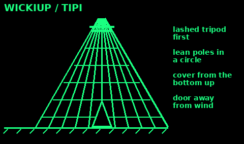
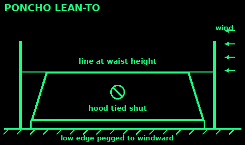
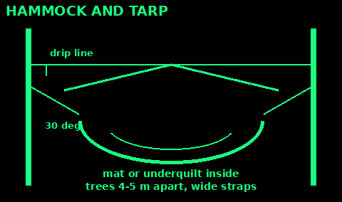
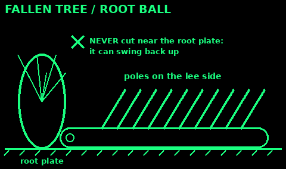
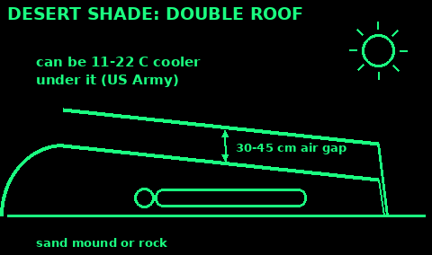
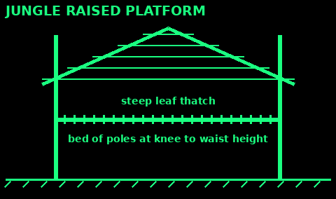
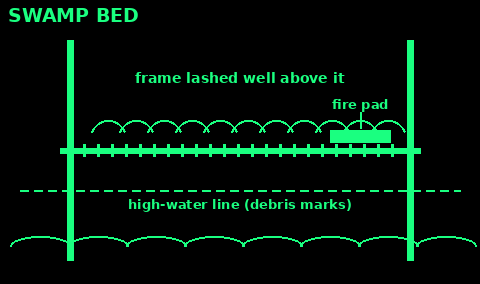

## Wickiup or tipi

Use: a round, steep shelter of poles where there are many straight sticks. Sheds rain well.

1. Three strong poles, a bit longer than twice your height. Lash them near the top and stand them up as a tripod.

2. Lean 10 to 20 more poles into the forks all round, in a circle. Leave a gap for a door, away from the wind.

3. Cover from the bottom up with bark slabs, brush, grass bundles or turf. Each layer overlaps the one below.

4. Leave a smoke hole at the top only if it is big enough for a fire.

5. Bed round the edge, feet toward the middle.

Fire inside: only a small one, in a big bark-covered shelter, with a smoke hole and flames far from the walls. Never in a leaf or grass one.

Mistakes: too flat (it leaks); poles not locked in the tripod top; too wide to cover.

Check: the walls are steeper than 60 degrees and you see no daylight through them.

## Poncho shelter

Use: a quick roof from a poncho or a small tarp.

1. Tie the hood shut, tight, so rain cannot get in.

2. Lean-to: tie a line between two trees about waist high. Tie the poncho's top edge to it. Peg the other edge to the ground on the windward side.

3. Tent: run the line through the middle, under the poncho. Peg both sides out low.

4. Use sticks as short poles at the corners if you need more room.

5. Drip lines on the ridge line. Bed underneath, off the ground.

Mistakes: an untied hood; too high (wind and rain blow in); no drip line.

Check: you can lie under it with your feet covered.

## Foil blanket and bivvy bag

Use: an emergency cover when you are caught out.

Foil blanket (space blanket):
1. Wrap it round your body under your coat, not over it. It stops wind and reflects some heat.
2. Or hang it behind you as a reflector, with a fire in front.
3. Sit on your pack, foam or a bag of leaves. The blanket does not insulate you from the ground.
4. It tears easily and gets wet inside with sweat. Tape or tie, do not pin.

Bivvy bag (orange plastic or a breathable one):
1. Get in with all your clothes on, legs first.
2. Sit on your pack inside it, out of the wind.
3. Leave a small gap at your face for air.
4. Bright orange is also a signal. See Signals & Radio.

Mistakes: lying on bare ground; sealing your face in.

Check: wind no longer reaches your skin, and something is under you.

## Hammock and tarp

Use: sleep above wet ground, bugs and slopes. Needs two strong trees 4 to 5 m apart.

1. Healthy trees, at least thigh thick. Look up for dead branches.

2. Wide straps round the trunks to protect the bark, about head height.

3. Hang it with a sag, so the ends make a 30 degree angle down from the strap. Not tight like a washing line.

4. Lie slightly diagonally. It lies flatter.

5. Ridge line above, with the tarp over it and drip lines on both ends.

6. Put insulation under you: a foam mat inside, or an underquilt. Air under a hammock is cold.

Mistakes: hanging it too tight (strain on the knots and trees); no insulation; trees too far apart.

Check: sit in it first. Your bottom is about chair height off the ground.

## Fallen tree and root ball

Use: a fallen tree or its upturned root plate gives a ready-made wall.

1. Check it is settled: the trunk is on the ground all along, not hung in other trees.

2. Never cut the trunk near the root plate. The plate can swing back upright and crush you.

3. Build on the side away from the wind. Lean poles against the trunk to make a lean-to.

4. Under a root plate: only if the soil is firm and dry, and you can see what holds it.

5. Cover with leaves and bark as for a debris hut.

Mistakes: crawling under a hung-up tree; digging under the root plate; rotten trunks full of ants.

Check: push the tree hard. If anything moves, build somewhere else.

## Rock overhang and caves

Use: a dry roof that is already there. Check it hard first.

1. Look for fresh rock on the ground and cracks above. Loose rock means move on.

2. Look for flood signs: water marks, mud, flotsam. Caves and overhangs flood.

3. Animal signs: dung, bones, bedding. Do not move in on a den.

4. Stay near the entrance. Do not go deep: you can get lost, cold air pools, and the air can be bad in low spots.

5. Build a wall of rocks or brush across the front to keep the wind out.

6. A fire at the mouth only, small, with the smoke going out. Heat can crack rock above.

Never go into old mines: shafts, gas and collapse.

Bats roost in caves. In Britain they are protected by law. Do not disturb them.

Mistakes: lying on bare rock (it drains heat fast); a fire at the back.

Check: no fresh rockfall, no water line, and you can see daylight from your bed.

## Desert shade shelter

Use: hot sun. Shade with an air gap keeps you far cooler than a single sheet.

1. Build it in the early morning or evening. Rest in the shade during the heat of the day.

2. Use a rock outcrop or a sand mound as one side.

3. Weight one edge of the cloth on top with rocks or sand. Stretch and weight the other edge to give the most shade.

4. Better: a double roof. Fold the cloth, or use two sheets, with a 30 to 45 cm air gap between them. The US Army says this can cut the heat underneath by 11 to 22 degrees C.

5. Light-coloured outside, darker inside, if you have both.

6. Lie off the hot ground: dig down 30 cm or more to cooler sand, or lie on a mat.

Mistakes: working hard in the midday heat; a single sheet lying on you.

Check: air moves through the gap, and the roof cloth does not touch the lower one.

## Jungle raised platform

Use: wet tropical ground, bugs, snakes and floods. Get up off the floor.

1. Four trees or stout poles in a rectangle a bit longer than you are tall.

2. Lash two long side poles at least knee to waist height above the ground.

3. Lash cross poles close together on top, or slide two poles through the sides of a sack or sheet to make a stretcher bed.

4. Roof: a steep A-frame above it, thatched with big leaves from the bottom up.

5. Mosquito net if you have one.

Mistakes: a flat roof; trees with ants, wasps or dead branches; camping by a river that can rise.

Check: the bed holds your weight with a bounce, and rain runs off the roof, not through.

## Swamp bed

Use: marsh, bog or swamp, where the ground is water.

1. Look for the high-water line: debris caught on trunks and branches. Build well above it.

2. Four trees in a rectangle, or four poles driven deep into firm ground.

3. Lash two long poles across, one each side, above the high-water line.

4. Lay cross poles on them, close together. Lash them.

5. Pile on soft boughs, grass or leaves for the bed.

6. A small fire needs its own pad: a thick layer of mud or clay on part of the poles, well away from the bed.

Mistakes: building below the high-water line; rotten trees; no fire pad.

Check: the bed sits above every mark the water has left.

