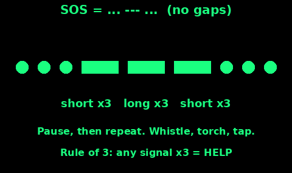
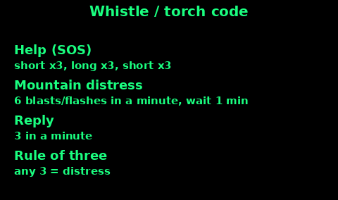
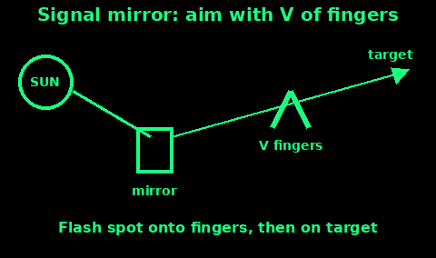
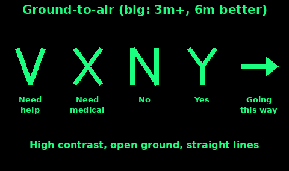
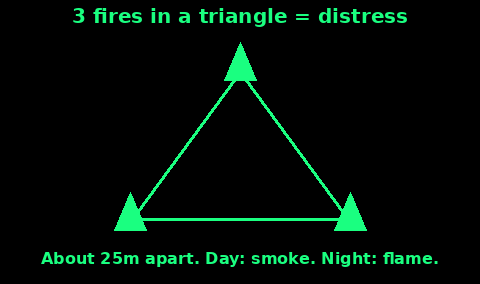
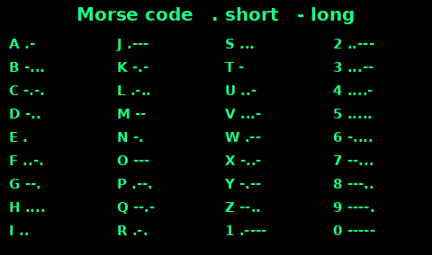
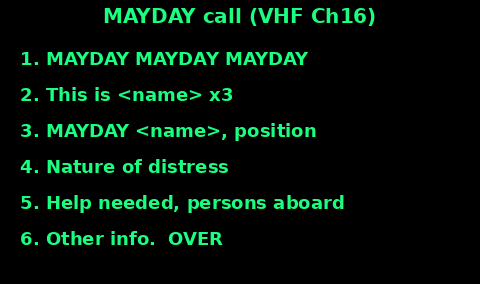

## Rule of Three and SOS

Three of anything means "I need help": three whistle blasts, three flashes, three fires, three rock piles. One shout is a person talking. Three is a person asking.

SOS in Morse is ... --- ... (short x3, long x3, short x3), sent as one block with no gaps between letters.

1. Send the signal.

2. Pause about a minute.

3. Repeat until answered or you run low.

Save torch and phone battery: signal hard when you hear or see aircraft, people or vehicles.

## Whistle and Torch Signals

A whistle carries further than your voice and costs less breath. Keep one on your jacket zip.

Mountain distress signal used by UK mountain rescue:

1. Six good long blasts or flashes in one minute.

2. Stop for one minute. Repeat.

3. Keep going until someone reaches you, even after you hear a reply. Your signal helps them find you.

The reply is three blasts or flashes in a minute.

Torch at night: point it at the searchers and cover and uncover the lens to make the pattern.

Do not use these signals for fun. Rescuers respond to them.

## Signal Mirror

A sun flash can be seen from a long way off by aircraft. Any shiny flat thing works: CD, phone screen, foil, a polished tin lid.

1. Hold the mirror near your eye and catch the sun.

2. Hold out your other hand and make a V with two fingers.

3. Put the target (aircraft, boat, vehicle) inside the V.

4. Tilt the mirror until the light spot lands on your fingers.

5. Rock it gently so the flash sweeps across the target. Flash in threes.

Sweep the horizon even when nothing is in sight. Once a pilot has clearly seen you, stop: a held beam into a cockpit dazzles the person flying it.

## Ground-to-Air Signals

Make each symbol big: 3 m long at the very least, 6 m or more is better. Use strong contrast: logs on snow, rocks on grass, trenches in sand, bright cloth on dark ground.

V = need assistance. X = need medical help. N = no. Y = yes. Arrow = we have gone this way.

Use straight lines and square corners. Nature rarely makes them, so they stand out from the air.

Pick the biggest open, high, flat spot you can. Heap earth or snow along one side of each line, or stamp a trench in snow, so it throws a shadow when the sun is low.

An aircraft that rocks its wings, flies low or flashes its lights has usually seen you.

## Smoke and Fire Signals

Three fires in a triangle, or in a line, mean distress. Space them about 25 m apart if you can.

Build them ready but unlit, keep them dry, and light them when you hear an aircraft.

Day: you need smoke. Pile green leaves, moss or damp grass on a hot fire for white smoke against dark ground. Rubber or oily rags give black smoke for snow or sand, but the fumes are toxic: stand upwind.

Night: you need bright flame from dry fuel.

If you are alone, one fire you can keep going beats three you abandon.

Safety: clear down to bare soil, keep water near, and never light in dry heath, peat or brush, or on a windy dry day. UK moorland wildfires are real. If you cannot keep the fire under control, do not light it.

## Group Signal Plan

Before anyone walks away from the group, agree:

1. Where you will wait if you get separated.

2. What your own signals mean, for example one short whistle blast = "I'm here".

3. When you will next meet or check the radio.

A plan you invent after you are separated is only a wish.

## Morse Code Table

Dot = short. Dash = three dots long. Gap inside a letter = one dot. Gap between letters = three dots. Gap between words = seven dots.

Useful: SOS = ... --- ...   OK = --- -.-

To send SOS by torch: three quick flashes, three long flashes, three quick flashes, then pause and repeat.

The same pattern works by whistle, car horn, tapping on pipes or walls (useful if trapped under rubble), or a radio key.

## UK Emergency Numbers

Call 999 or 112. Both reach the same UK emergency service: police, fire, ambulance, coastguard (and mountain or cave rescue via police).

From a mobile, a 999 or 112 call can use another UK network if your own has no signal.

Say which service you need, then where you are. Give a grid reference or what3words if you have one.

Can't speak? From a mobile: dial 999, listen, cough or tap if you can, and press 55 when the recording asks (Silent Solution). That puts you through to police. Do not hang up. 55 only works on mobiles and does not give your location.

emergencySMS (for deaf or speech-impaired people): you must register first. Text "register" to 999, read the reply, then text "yes". Do it now. It will not work unregistered.

Non-emergency: 101 police, 111 NHS.

## Broadcast Radio for News

A battery or wind-up radio with FM, MW and DAB is key kit.

BBC Radio 4 on Long Wave 198 kHz closed on 27 June 2026. Do not rely on LW.

Instead try:

- BBC local radio on FM (best for regional news)
- BBC Radio 4 on FM: 92.5-96.1 MHz or 103.5-104.9 MHz, varies by area
- DAB digital radio
- BBC Radio 5 Live on MW 693/909 kHz, but MW transmitters are being switched off in stages, so it may not reach you

MW carries further at night, with more interference.

Write down your local station frequencies now. Listen on the hour for news. Carry spare batteries and switch off between bulletins.

## PMR446 Walkie-Talkies

Licence-free if the radio is approved PMR446 kit: max 0.5 W, fixed built-in aerial, handheld only. No base stations, repeaters or modifications.

Analogue: 16 channels, 446.00625-446.19375 MHz, 12.5 kHz apart. Older sets have only ch1-8:

1 446.00625, 2 446.01875, 3 446.03125, 4 446.04375, 5 446.05625, 6 446.06875, 7 446.08125, 8 446.09375

Range: about 1-3 km in the open, far less in towns or woods.

There is no official calling channel. Ch1 and ch8 are both used informally, so agree a group channel, tone code and a backup in advance.

Etiquette: listen first, keep it short, say who you are calling and who you are, and "over" when done.

## Marine VHF Channel 16

Channel 16 (156.8 MHz) is for distress, urgency, safety and calling. HM Coastguard listens on it.

UK licence rules: the radio needs an Ofcom Ship Radio Licence or Ship Portable Radio Licence, and the operator needs a certificate, at least the Short Range Certificate (SRC).

Where: on board a vessel or its tender, at sea within the licence limits or on UK inland waterways. Not from land, except in a real emergency, when the licence lets you use it anywhere.

Switch to a working channel after first contact.

DSC radios: lift the cover and hold the red DISTRESS button about 5 seconds to send an automatic alert with your position.

## Mayday and Pan-Pan

MAYDAY = grave and imminent danger to life or vessel. PAN-PAN = urgent, but no immediate danger to life.

Mayday on VHF Ch16, high power:

1. MAYDAY MAYDAY MAYDAY

2. This is (vessel name) x3, call sign or MMSI

3. MAYDAY (vessel name), call sign or MMSI

4. Position (lat/long, or bearing and distance from a landmark)

5. Nature of distress (sinking, fire...)

6. Assistance required

7. Number of people on board

8. Other info (abandoning to liferaft...). OVER.

Pan-Pan: same layout, starting PAN-PAN x3. Speak slowly. If there is no reply, repeat.

## Amateur Radio Notes

Anyone may listen to the amateur bands. To transmit you need an Ofcom amateur licence.

Route: Foundation, then Intermediate, then Full. Exams are run by the RSGB. Foundation is 26 multiple-choice questions, usually taken online, with the result straight away. About 12 hours of study is typical.

Useful facts:

- 2 m band: 144-146 MHz. FM calling channel 145.500 MHz.
- 70 cm band: 430-440 MHz.
- HF bands can reach other countries via the ionosphere.
- Local clubs and volunteer emergency comms groups such as RAYNET help in civil emergencies.

Get licensed before a crisis: you learn the skills and meet local operators who can help.

## RTL-SDR: What You Can Listen To

An RTL-SDR dongle and a Pi make a receive-only scanner. Receivers generally need no licence.

The Wireless Telegraphy Act 2006 (section 48) makes it an offence to use a receiver to get the content of messages not meant for you, or to pass on anything you heard that way.

Ofcom says receivers are for "general reception", such as licensed broadcast stations and hobby radio:

- Broadcast radio: FM, DAB, AM, digital TV
- Amateur radio and CB
- Time signals such as MSF on 60 kHz (from Anthorn, Cumbria; sometimes off for maintenance)

Not OK: police, ambulance, private business radio, phone calls. Airband, marine and PMR446 chat are not clearly "general reception": if unsure, don't, and never repeat what you hear.

An RTL-SDR cannot transmit.

## Sources

Written in our own words. Checked against these pages (October 2026):

- relayuk.bt.com/how-to-use-relay-uk/contact-999-using-relay-uk.html
- police.uk/pu/contact-us/what-and-how-to-report/how-to-report/how-to-make-a-silent-999-call/
- gov.uk/guidance/999-and-112-the-uks-national-emergency-numbers
- ofcom.org.uk/spectrum/radio-equipment/vhf-faq
- ofcom.org.uk/spectrum/radio-equipment/radio-spectrum-and-the-law
- legislation.gov.uk/ukpga/2006/36/section/48
- bbc.co.uk/mediacentre/articles/2026/radio-4-broadcasts-on-long-wave-to-end
- bbc.co.uk/reception/help-guides/fmmw-radio/fm-and-am-radio-frequencies
- radiotrefpunt.nl/entry/10601-steeds-meer-bbc-zenders-verdwijnen-van-de-middengolf/
- npl.co.uk/products-services/time-frequency/msf-radio-time-signal
- mountain.rescue.org.uk/fact_file/fact-file-6-stay-safe-information/
- rsgb.org/main/faq-2/becoming-a-radio-amateur-faq/
- rsgb.org/main/operating/band-plans/vhf-uhf/144mhz-band/
- rsgb.org/main/blog/news/rsgb-notices/2024/02/06/an-update-on-the-amateur-radio-licence-exams/
- hfunderground.com/wiki/index.php/PMR446 (PMR446 channel plan, ECC Decision (15)05 text)
- landsurvival.com/fm2176/19.htm (US Army survival manual, signalling chapter)
