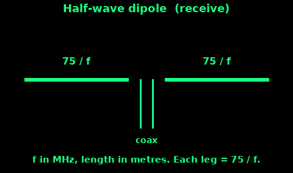
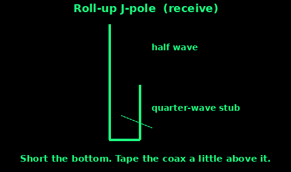
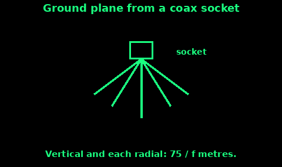

## A receive dipole

A dipole is two pieces of wire in a straight line, fed in the middle. It is the simplest aerial that is actually the right length for a station.

This card is for receiving: broadcast FM, or the amateur bands if you are listening. Transmitting on those wires is a different question. On the amateur bands you need a licence. On PMR446 you must use the aerial that came with the handheld. Do not unscrew it and clip this wire on.

Free-space lengths, with the frequency in MHz and the answer in metres:

1. A full wavelength is 300 divided by the frequency.

2. A half-wave dipole, total, is 150 divided by the frequency.

3. Each leg is half of that: 75 divided by the frequency.

Cut two wires to the leg length. Strip a centimetre at the inner ends. One leg goes to the centre of the coax. The other leg goes to the braid. Twist, solder if you can, and cover the joint so the two sides cannot touch. A chocolate-block connector is fine for a temporary receive aerial.

Stretch the wire horizontal if you can, or as a shallow V with the feed at the bottom. Keep it off the gutter and off your body. The next card has the lengths for FM and for 2 metres. For receive, a centimetre of error is not important. Cut it, hang it, and see if the station gets clearer.

## Lengths for FM and 2 m

Worked examples of the same formula. Leg length in metres = 75 / frequency in MHz.

FM broadcast, around 100 MHz (BBC Radio 1 sits near there; Radio 4 is a little lower, so the wire is a little longer):

- Each leg about 0.75 m at 100 MHz.

- At 95 MHz, 75 / 95 is about 0.79 m.

- Total wingspan about 1.5 m.

Cut for the station you actually want. One dipole will hear the whole FM band well enough for a strong local transmitter. A weak station is worth a wire cut for its frequency.

2 m amateur band, 145 MHz:

- Each leg 75 / 145 is about 0.52 m.

- Total about 1.03 m.

Hang a 2 m dipole vertical if you are listening to local FM contacts, because those stations are almost all vertical. A horizontal wire still hears them, just more weakly. Broadcast FM is a mixture. Try both orientations and keep the one that is clearer.

If you later transmit on 2 m, with a licence, builders often start a few percent shorter than the free-space figure and trim. For a receive wire, do not bother. The free-space cut is the right first cut.

Write the frequency and the length on a piece of tape on the wire. Next time you will not measure it again.

## A roll-up J-pole

A J-pole is a vertical half-wave aerial with a quarter-wave matching stub beside the bottom. It needs no radials, so it rolls up into a pocket. It is a receive aerial here. The same warning applies: not a PMR446 modification, and not a transmit aerial unless you are licensed for that band and the aerial is legal for it.

Lengths, again in metres, frequency in MHz:

1. The long element is a half wavelength: 150 / frequency. At 145 MHz that is about 1.03 m.

2. The stub beside the bottom is a quarter wavelength: 75 / frequency. At 145 MHz that is about 0.52 m.

Build:

1. Two wires, or a length of twin-lead. The long one is the radiator. The short one runs beside its lower part.

2. Join them at the bottom. That short is a hard connection, wire to wire.

3. The coax attaches a short distance up from that short. Centre to one wire, braid to the other. For receive, start about a tenth of the way up the stub. If the station is weak, slide the connection a little and try again.

4. Keep the two wires a couple of centimetres apart, not touching except at the bottom short and at the feed.

5. Hang it vertical, from a tree, a window, or a fibreglass pole. Metal next to it detunes it. A loft works. A window is often better. Outside and high is best.

For FM broadcast near 100 MHz the same shape is simply bigger: radiator about 1.5 m, stub about 0.75 m. A dipole is easier at that size. Use the J-pole when you want a vertical with nowhere to put radials.

## A ground plane

A ground plane is a quarter-wave vertical over three or four wires that pretend to be the ground. It is a good receive aerial for a band where the signals are vertical, including 2 m FM.

1. You need a coax socket if you have one (an SO-239 is the usual ham part) or any way to hold the wires. The vertical wire solders to the centre pin. The radials solder to the body, which is the braid.

2. Vertical length = 75 / frequency in metres. At 145 MHz, about 52 cm. Each radial is the same length.

3. Three radials work. Four are a little steadier. Slope them downwards, roughly halfway from sticking straight out to hanging down. They are not a flat sheet.

4. The coax hangs below the socket. The aerial sits on a pole, a mast, or a broom handle. Fibreglass or wood, not a metal window frame touching the radials.

5. Tape every joint. A radial in the eye is a bad end to a listening session.

Same legal line as the other cards. This is a receive aerial for a scanner or a broadcast receiver, or for a licensed amateur station. It is not an add-on for a PMR446 handheld.

## Height and placement

The US Army survival manual's radio notes match what you will see on a hill: these frequencies are line of sight, and anything touching the aerial, including you, your coat, a wet leaf, or the ground, throws range away.

1. Higher is better, until the wire is in the clear. A loft beats a cellar. An upstairs window beats a downstairs one. A ridge beats a valley.

2. Out of the building if you can do it safely. Stone, foil insulation, and a steel roof all screen the signal. Even a metre of wire outside the window helps FM.

3. Clear of metal. Gutters, radiators, and a car roof right against the wire will quieten it. A few feet of air matters.

4. Vertical for 2 m FM and for most handheld-style signals. Try horizontal as well for broadcast FM, and keep the louder one.

5. The feed should not be a coil of spare coax wrapped around the aerial. Run the coax away from the wire, then coil any spare on the floor.

6. Lightning: do not leave a wire up in a storm, and do not hold it while thunder is overhead. Unplug it from the receiver and throw the end outside, or take it down.

7. Test by ear. Tune a station you know, then move the wire. Louder and cleaner is the right place. Mark it.

A good aerial does not need power. Build it before the batteries are the thing you are rationing.
