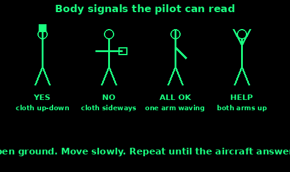
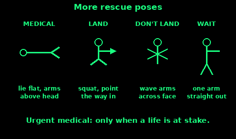

## Yes, no, need help, all OK

Use these when a pilot can see you. The FAA instructions are: stand in the open, pick a background that is not confusing from the air, go through the motion slowly, and repeat until you are sure the pilot has it.

The four you are most likely to need:

Yes. Hold a cloth, a shirt, or a light jacket, and wave it up and down. Vertical waves mean yes.

No. Wave the same cloth from side to side. Horizontal waves mean no.

All OK, do not wait. Stand and wave one arm overhead. The other arm stays down. This tells them you do not need a pickup.

Need help, pick us up. Stand with both arms straight up. The FAA figure for this is "pick us up, plane abandoned". Use it when you need to be taken off, not when you are simply saying hello.

A cloth makes the yes and no readable. Bare hands are small. A bright jacket in one hand is enough.

At sea there is a different arm signal, from the collision rules: both arms out to the sides, raised and lowered slowly and repeatedly. That is distress, for a vessel or a person in the water. It is not the same as both arms held still overhead. If you are in the water or on a small boat, use the slow raise-and-lower. If you are on the ground talking to a searching aircraft, use the four poses above.

## The standard rescue poses

The same FAA set has more poses. Learn the ones that change what the aircraft does.

Urgent medical help. Lie on your back with both arms stretched above your head. The figure is marked for use only when a life is at stake. Do not use it to mean "we are tired".

Can proceed shortly, wait if you can. One arm held straight out to the side. The other arm down.

Need mechanical help, or a long delay. Both arms held straight out to the sides, like a T.

Do not land here. Wave both arms back and forth across your face.

Land here. Squat, both arms forward and horizontal, and point along the landing direction. Repeat the point. Pick ground into wind if you can, clear of wires, bogs, and stock.

Drop a message. Make a throwing motion. Use this if you want them to drop instructions or a radio.

Our receiver is working. Cup both hands over your ears. Only if you really are listening on a radio they might call.

Do the pose, hold it, and repeat. A frantic wave of everything at once is just a person. One clear pose is a message.

If you cannot stand, the ground symbol X still means "need medical assistance". Build that if you can, and lie beside it.

## How the aircraft answers

Watch the aircraft after you signal. The answer is in how it flies, not in a guess.

ICAO, for a ground signal it has understood:

- By day: the aircraft rocks its wings.
- By night: it flashes its landing lights twice. If it has no landing lights, it switches the navigation lights off and on twice.

If it does not do that, it has not understood. Change the signal. Make the ground mark bigger, or switch to a slower body pose.

The FAA body-signal pages also show replies a pilot may use:

- Yes: the nose dips several times.
- No: the aircraft fishtails, the tail wagging side to side.
- Message received and understood: rocking wings by day or moonlight. At night, a green light from a signal lamp.
- Received but not understood: a full right-hand circle by day. At night, red flashes.

Treat the ICAO rock-the-wings as the one to trust internationally. The nose-dip and the fishtail are extra signs from the American chart. If you are not sure what you saw, repeat your message once, slowly.

A low pass, a circle, or a flash is still "they have seen something". Keep signalling until the meaning is clear, then follow what they show you. If they drop a written message, read it before you move. Do not walk off a site they have just found.
