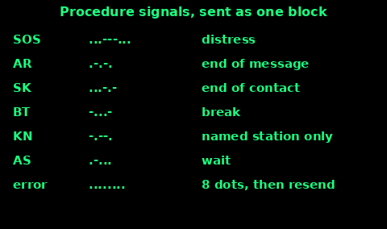
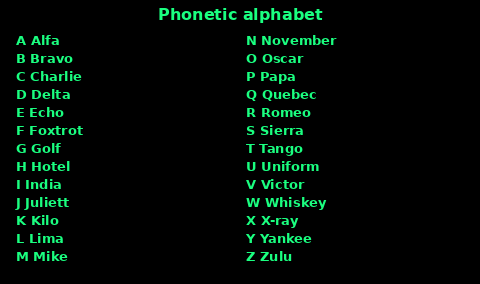
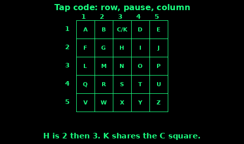
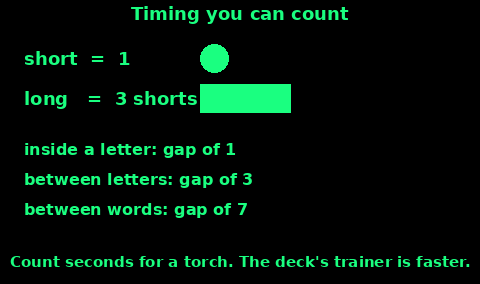

## Morse Code Table

A short is a dot. A long is a dash, three times as long as a dot. The gap inside a letter is one dot. The gap between letters is three dots. The gap between words is seven dots.

SOS is ... --- ... sent as one character, with no letter gaps. OK is --- -.-

The same code works by torch, whistle, car horn, a radio key, or taps on a pipe. The Light and Sound topics use it. The deck's MORSE screen trains the rhythm at a speed that is too fast to count on your fingers. For a torch, use the timing card and count seconds.

Learn E, T, A, N, I, M, S, O first. They are the short ones, and they include SOS. The full table is on the diagram. Do not trust a half-remembered letter in a real message. Spell it from the card, slowly.

## Procedure signals

A procedure signal is two letters run together, with no gap, so they sound like one character. You do not need them for a torch SOS. You need them if you are working a Morse contact and the other station is using them.

SOS ...---... distress. One block.

AR .-.-. end of this message. I have finished this text. A reply may follow.

SK ...-.- end of contact. I am closing down.

BT -...- break. A new sentence or a pause in the sense.

KN -.--. "go ahead" to a named station only. Other listeners stay quiet.

AS .-... wait. I will be back.

Error: eight dots, then send the word again from the start. Do not try to patch one wrong letter in the middle.

On a voice radio you do not tap these. You say the prowords on the Radio procedure topic instead.

## NATO phonetic alphabet

When a radio is noisy, spell with the international alphabet, not "A for apple". The names below are the ICAO spelling, which NATO uses. Alfa and Juliett are spelled that way on purpose.

Say the word, then spell it: "surname Morris, Mike Oscar Romeo Romeo India Sierra".

Digits, said one at a time: zero, one, two, tree (three), fower (four), fife (five), six, seven, eight, niner (nine). "Tree", "fower", "fife" and "niner" are the taught pronunciations so the digit is not heard as another word. A grid reference is "one six", not "sixteen", if the channel is bad.

Use this on PMR446, on a marine radio, and on the phone when a call sign or a place name is being lost. It is not a secret code. Anyone can read the diagram.

## Tap code

The tap code spells letters with knocks. It is for a wall, a pipe, or a hull, when you can hear each other and cannot talk. C and K share one square, so the grid is 5 by 5.

Each letter is two numbers: the row, a short pause, the column.

1. A is one tap, pause, one tap.

2. H is row 2, column 3: two taps, pause, three taps.

3. Pause longer between letters. Pause longer still between words.

4. K is the same square as C. The reader picks from the word.

5. If you lose the count, tap eight times fast (the Morse error) and start the word again. Or just stop, pause, and start the letter again. Agree which, if you can, before you need it.

A simple question when you cannot spell: one tap for yes, two taps for no. Agree that first. It is not the same as the grid. Do not mix them in one sentence.

Bang so the sound is one hit, not a rattle. Then be quiet. The answer will use the same code. Three taps with no pause can also be heard as distress (see Sound). If you mean a letter, keep the row-pause-column shape obvious.

## Light and sound timing

Hand sending is counted, not rushed.

1. Pick a speed you can keep when you are cold. One second for a short is slow and clear.

2. A long lasts three shorts. Count "one-two-three" while the torch is uncovered or the whistle is blowing.

3. Gap inside a letter: one short, with the light off or the whistle silent.

4. Gap between letters: three shorts.

5. Gap between words: seven shorts. This gap is where the other person knows the word has ended. Do not shorten it.

6. SOS at this speed is about ten seconds of signal, then a rest. Rest longer than the signal so they can answer.

The deck's Morse trainer uses standard word timing, much faster than this. A dit at its practice speed is a fraction of a second. Use that screen to learn the shape of a letter. Use the one-second count when you send SOS across a valley.

Whistle: a short blast is a sharp peep, a long blast is a steady blow you can count. Do not try to peep at radio speed. The person on the next ridge cannot hear a rattle.

## A code-word scheme

A code word is for your own group. It is not Morse, and a stranger will not know it. Agree it at home, write it on the wallet card, and do not use the words in ordinary chat.

Pick three words that do not come up by accident. Names of pets and "help" are poor choices. Unusual, easy to say on a bad radio, hard to guess.

1. A safe word. It means "I am fine, this message is really me, do not come". You say it when you check in.

2. A help word. It means "I need you to come" or "start the backup plan", even if the rest of the sentence sounds calm.

3. A duress word. It means "I am talking, and I am not free to speak". Use it if you are on the phone and cannot say what is wrong. The person who hears it does not argue. They follow the plan you agreed: call 999, or come to the rally point, or call the out-of-area contact.

Rules:

- Say the word once, inside a normal sentence, if you might be overheard. On your own radio net you can say it plainly.

- If a word is spoken by mistake, or written on a photo, retire it and pick another.

- Children get the safe word and the help word. Tell them the duress word only if they are old enough to use it without treating it as a game.

- The words do not replace 999. They tell your own people what to do when a plain question would make things worse, or when the radio is full of other listeners.

Practise once: a check-in that includes the safe word, and a sentence that includes the help word. Then stop. Drilling it in public teaches it to everyone else.
