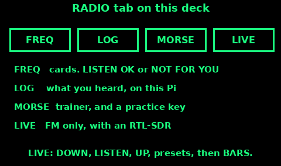

## RTL-SDR: What You Can Listen To

An RTL-SDR dongle on this Pi is a receiver. It does not transmit. A receiver that cannot transmit needs no licence. What you may listen to is a different rule.

Section 48 of the Wireless Telegraphy Act 2006 makes it an offence, without lawful authority, to use wireless apparatus with intent to obtain the contents, the sender, or the addressee of a message you are not an intended recipient of. It is also an offence to pass on what you learned that way. Ofcom's guidance says receivers and scanners are for general reception, and it gives licensed broadcast stations and hobby radio as the examples. Ofcom also says that if you are unsure, get legal advice. This card is not legal advice.

Treat these as general reception, and fine to listen to:

- Licensed broadcast: FM and AM radio, DAB, digital television.

- Hobby radio: the amateur bands, and CB.

Treat these as other people's conversations. You are not the intended recipient. Do not go looking for them, and do not repeat what you hear:

- Airband. That is pilots and controllers talking to each other.

- Marine radio, apart from a distress call that is addressed to anyone who can help. Routine ship chat is not a broadcast.

- PMR446 and other business or private radio. The people on that channel are talking to their own group.

The frequency cards on the RADIO tab are marked. "LISTEN OK" is a broadcast. "NOT FOR YOU" is a card stored so you know the frequency, not an invitation to sit and listen.

If a distress call is the thing you have stumbled on, a Mayday or a person calling for help, that call is meant for anyone who can assist. Phone 999 or the coastguard and pass the facts they need: who, where, what is wrong. That is not the same as retelling someone's private chat.

The dongle cannot transmit. Do not add a transmitter to it.

## The RADIO tab

Open the RADIO tab from the bar at the top of the screen. Four modes sit under it.

FREQ. The UK cards in the frequency file. Each card shows a name, a frequency, and either LISTEN OK or NOT FOR YOU. Step through them. A line at the top reminds you that airband, marine, and PMR are not for casual listening. The long notes are this Signals guide.

LOG. A listening log kept on this Pi. Use it for stations you are allowed to hear: what you tuned, whether it was clear, noisy, or absent. It is a paper replacement, not a record of other people's conversations.

MORSE. A trainer for the code on the Codes topic. It flashes SOS and the letters at a proper Morse speed, which is faster than the one-second count you use with a torch. There is a practice key: hold it, and the screen reads your dots and dashes. Use it to learn. The valley is a bad classroom.

LIVE. Broadcast FM, and only when an RTL-SDR is plugged in. The next card is the live screen itself.

The status line at the bottom tells you whether the dongle is there. If it says there is no radio hardware, plug the dongle in and give it a few seconds. The screen checks the USB port on a short timer.

Nothing on this tab transmits. Pressing buttons cannot put a signal on the air.

## The live screen

LIVE is for FM broadcast, 87.5 to 108 MHz. It starts near 93.5 MHz, or on the preset of a broadcast card if you came from one.

1. Plug in the RTL-SDR. Wait until the status line says it is ready. Without it, the screen tells you to plug one in. There is nothing to press until then.

2. Read the big frequency. DOWN steps it lower. UP steps it higher. Each step is a tenth of a megahertz.

3. LISTEN starts the audio. The button then shows STOP. Press STOP when you have the bulletin. Audio is FM only. It will not demodulate airband or marine, and you should not be hunting those anyway.

4. Up to four short presets sit under the tuning buttons, taken from the broadcast cards. Tap one to jump. R4 is the Radio 4 preset.

5. BARS asks for one low-resolution sweep of the FM band, drawn as columns. Tap it when you are not sure where a station is. If the Pi is too slow, the screen says the sweep was skipped. Tune by ear instead.

6. A weak station is often the aerial, not the dongle. A short wire in the clear, from the Antennas topic, does more than another menu.

7. Write a useful frequency into the log, then leave LIVE. A dongle left running is a dongle drawing current.

If a later build has an RDA5807 tuner on the Cave Mapper cable, the status line will say so. Until that line appears, the live sound is the RTL-SDR, and only the RTL-SDR.
