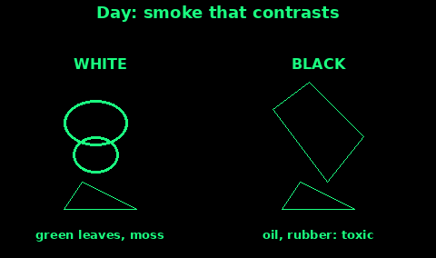

## Smoke and Fire Signals

Fire is a signal and a hazard. Use it when a torch or a mirror will not do, and when you can keep it under control.

The US Army survival manual treats three fires in a triangle, or in a straight line, as the international distress signal. Space them about 25 metres apart if the ground allows. Build them as soon as you can, keep them dry, and light them when you hear an aircraft or see people.

By day you need smoke. By night you need flame. A smoky fire at night hides the light. A clean flame by day is hard to see.

If you are alone, one fire you can keep going beats three you abandon. A hot coal bed can also show up to an aircraft that looks for heat. Do not count on that. Most search aircraft are looking with eyes.

The cards under this one are the build, the smoke colour, and when not to light.

## Three-fire triangle

1. Pick open ground. In trees, use a clearing, a river bar, or the edge of the canopy. A fire under leaves is invisible from the air and can climb into the crowns.

2. Mark three points of a triangle, about 25 metres on a side. A line of three is fine if a triangle will not fit. Both mean distress.

3. At each point, clear a circle down to mineral soil, twice as wide as the fire will be. Scrape peat, needles, and dry grass away. The Fire topic in this guide covers a safe lay.

4. Build each fire ready to light: tinder, a small kindling stack, then finger-thick sticks, then larger wood. Do not light them yet.

5. On snow, build on a platform of green logs or stones so the melt does not put the fire out. The survival manual says the same.

6. When you hear the aircraft, light all three if you have help. If you are alone, light the one you can reach and feed.

7. At night, keep the flame bright and high. By day, go to the smoke card once the fire is hot.

Put them out when the searcher has gone and you do not need them. Water, stir, water, until you can hold your hand on the ash. A signal fire that restarts in the night is a wildfire.

## A signal fire ready to light

A fire you start after the aircraft has passed is a fire nobody saw. The work is done beforehand.

1. Build the lay as above. Cover it. Bark, a bin bag, a bivi, or a flat stone keeps rain off the tinder. Weight the cover so the wind does not take it.

2. Keep a dry tinder bundle in a pocket or a bag: cotton wool, birch bark, a candle stub, dry grass. The fire on the ground can be damp. The bundle in your pocket must not be.

3. Stack extra fuel within arm's reach, split into "flame wood" (dry) and "smoke stuff" (green leaves, moss, damp grass).

4. Listen. When you hear an engine, uncover, light the tinder, and feed small wood until it holds.

5. Only then add the smoke fuel, and only by day. At night, leave the smoke stuff off the fire.

6. Have a second person, if you have one, light the other fires. Agree who lights which, so you do not all run to the same pile.

7. If the aircraft goes and you are staying, damp the flames down to a coal you can blow back to life, and re-cover the spare wood.

A tree set alight is a signal the survival manual describes, and also a way to start a forest fire. Do not use it. A fire on bare ground, in a cleared circle, is the one you can stop.

## White smoke and black smoke

Smoke works when its colour fights the background. The survival manual is direct: dark smoke on a light background, light smoke on a dark one. Three columns are the distress pattern. Wind, rain, and snow tear smoke apart, so a calm clear day is when it pays.

White smoke, for dark ground (forest, peat, rock):

1. Get the fire hot with dry wood first. A cold, smoky mess just smoulders and dies.

2. Pile green leaves, moss, damp grass, or a little water on the hot coals. The fire should choke and throw white smoke, not go out.

3. Stand to the side. Feed more green stuff as the smoke thins.

Black smoke, for snow, sand, or pale grass:

1. Add oil-soaked rags or rubber once the fire is hot. The manual names those for black smoke.

2. The fumes are toxic. Stand upwind. Do not breathe the plume. Do not use this in a shelter, a tent, or a hollow you are sitting in.

3. A little goes a long way. You are making a mark, not a tyre dump.

Red smoke, if you have a proper distress canister, is a distress colour. Any colour that contrasts will still attract attention. Keep canisters dry, and do not set the hillside alight with them.

Desert and pale sand: smoke sits low, but a pilot can still see a column in open country. Do not expect smoke to punch through a gale.

## Fire safety

UK moors, heath, and peat burn, and they burn underground after you think the fire is out. If you cannot keep a fire under control, do not light it.

Do not light a signal fire:

- In dry heath, grass, bracken, or peat.
- On a windy dry day, or when a wildfire warning is in force.
- Under trees, or where roots can carry fire away.
- Where you have no water, sand, or soil ready to kill it.

Before you light:

1. Clear to bare soil. A metre of clear ground all round is a minimum. More is better.

2. Put water, wet earth, or sand where you can reach it without stepping over the fire.

3. Tie hair and loose cloth back. One person watches. Nobody leaves it.

4. Keep the triangle's fires small enough that one person can put one out.

After:

1. Soak it. Stir the ash. Soak it again.

2. Feel for heat with the back of your hand, close, then touching. Hot means it is not out.

3. Peat can smoulder out of sight. If you are on peat, do not light. If you already did, drown it and check again later.

The same rules as the Fire topic in this guide still apply. A signal that burns the hill is not a rescue. It is a second emergency.
