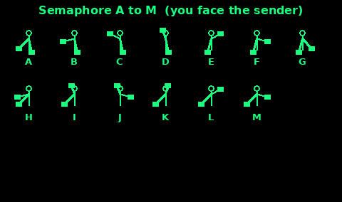
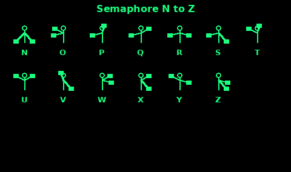
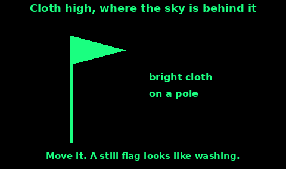

## Semaphore

Semaphore is two flags, or two sticks, or just your arms. Each arm points to one of eight directions: down, low, out, high, or up, on the left or the right. You read the letter when the arms stop, not while they are moving.

The diagrams are drawn as you look at the sender. Their right hand is on your left. The Australian National Botanic Gardens chart is the source of the positions. Flags are usually square. At sea they are often red and yellow. On land, white and blue, or any two rags that show up. Bare arms work at close range.

Numbers: give the numerical sign first (sender's left arm high, right arm straight up). Then A is 1, B is 2, on through I as 9, and K as 0. J means "back to letters".

Annul, "ignore that", is the sender's left arm low and right arm high. Error is both arms raised and lowered together.

Learn A to G first. They are one arm moving and the other down. The rest keep one arm still and move the other. The next card is how to send a word.

## Sending semaphore

1. Face the other person. You need to see each other. A ridge between you is a failed message. Get both people on the skyline only if that is safe.

2. Hold the flags so the cloth hangs clear of your hands. Arms straight. The chart's circles are built on straight arms.

3. Start with both flags down in front of you, so they can see you are ready.

4. Move to the letter and stop. Count "one" in your head. Then move to the next letter. Slurred positions become the wrong letter.

5. Between words, bring both flags down and pause. That gap is the space.

6. If you muddle a letter, give the error signal (both arms up and down together) and send the word again.

7. The receiver should send C, which is also used to mean "correct" or acknowledge, when they have the word. If they do not, send it again more slowly.

8. For a long message, send a few words and wait. Wind and distance eat the rest.

At night, a light stick or a torch in each hand can stand in for a flag, the same positions. Keep the lights pointed at the receiver.

Semaphore is slow. For "help" you are better with SOS or six blasts. Use semaphore when both people know it and you need words: a name, a number, a direction.

## Bright cloth on a pole

A flag or a jacket on a pole is a daylight marker. It does not spell a message unless you wave a code. It says "look here".

1. Pick the brightest cloth you have that fights the background. Orange, red, or white on peat. Dark cloth on snow. The survival manual says to choose the colour that contrasts, and that flashing a panel makes it easier to see.

2. Tie it to a pole, a walking stick, a branch, or the tallest thing you can plant in open ground. High, with sky behind it, beats low in the heather.

3. Move it. Wave it in a slow arc when you hear an aircraft. A still flag looks like washing or a waymark.

4. If you leave the spot, leave the cloth flying and add a ground arrow showing where you went. A bare pole after you have gone is a puzzle.

5. At camp, fly it only as a signal. Take it down when you are no longer asking for help, so the next walker does not report you.

A panel on the ground, weighted at the corners, is the ground-to-air symbol. A panel on a pole is the attention-getter. Use both if you can.

## Upside-down flag

Flying a national flag upside down is a distress custom in some countries. In the United States the flag code treats the union (the stars) downward as a signal of dire distress, and only then. Do not assume a pilot or a hill walker in the UK will read an upside-down flag that way.

The Union Flag has a correct way up: at the hoist (the edge against the pole), the broad white diagonal sits above the red diagonal. Hung the other way it looks slightly wrong, and many people will not notice.

So:

1. Do not rely on an upside-down flag as your only signal.

2. Do use any flag, right way up or not, as the bright cloth on a pole in the card above. Wave it.

3. If you want a symbol that is trained, build a V or an X on the ground, or send SOS.

4. A flag flown where no flag should be, on a car, a bothy, or a beach, plus a note, is a reasonable "we need help" for people on the ground. Say so in the note. Do not make them guess.
