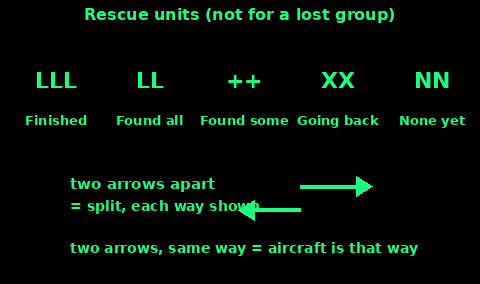
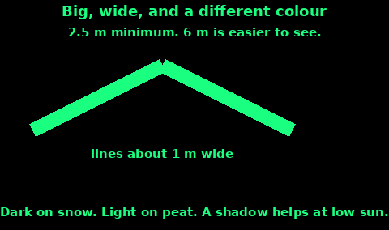

## Ground-to-Air Signals

These five symbols are the ICAO ground-air code for survivors. Use them only with these meanings. ICAO says not to invent lookalikes.

1. V means require assistance.

2. X means require medical assistance.

3. N means no, or negative.

4. Y means yes, or affirmative.

5. An arrow means proceeding in this direction. Point it the way you are going, or the way you want the search to look.

If you are unsure of the letter, spell SOS. The FAA chart says the same: if in doubt, use the international symbol SOS.

ICAO says each symbol shall be at least 2.5 metres (8 feet) long, and as conspicuous as you can make it. The FAA chart asks for at least 10 feet, and bigger is better. The US Army manual, for its own pattern, asks for something like 6 metres long and 4 metres wide, with strokes about a metre wide. Aim for that larger size. A symbol you can step over will not be read from a search height.

How to lay one out:

1. Find the biggest open, flat, high place you can. A symbol in a wood is a symbol nobody sees.

2. Use straight lines and square corners. Nature does not make them. That is why they show up.

3. Build with whatever contrasts. The materials card is next.

4. Make the strokes about a metre wide. A thin line of stones disappears.

5. Leave it. Do not stand on it while the aircraft is overhead. Stand to the side and do the body signals.

A pilot who has understood a ground signal, by the ICAO rule, rocks the wings in daylight, or flashes the landing lights twice at night (or the navigation lights twice if there are no landing lights). If the aircraft does none of that, the signal was not understood. Make it bigger, or simpler, or switch to SOS.

## Rescue-unit symbols

ICAO also publishes a code for rescue units, not for a family who is lost. You will not need it to be found. It is here so you can read it if you see it, and so a search party in your own group can leave a clear mark.

1. LLL means the operation is completed.

2. LL means we have found all the personnel.

3. Two plus signs mean we have found only some of the personnel.

4. XX means we cannot continue and we are returning to base.

5. Two arrows pointing apart mean the party has split, and each arrow is the way that half went.

6. Two arrows pointing the same way mean information received that the aircraft is in this direction.

7. NN means nothing found, and the search will continue.

Same size rule: at least 2.5 metres, conspicuous, exact shapes. A lost group should stick to V, X, N, Y, the arrow, or SOS. Mixing the two codes will be read as the wrong message.

## Materials for snow, sand, grass and forest

Use what the ground is not.

Snow:

1. Stamp or shovel the symbol into the snow. The trench looks dark from the air. The FAA chart says depressed marks on snow appear black.

2. Pile the snow you removed along one side of each stroke, so the ridge throws a shadow when the sun is low.

3. Fill the trench with twigs, branches, or soot if the snow is too flat to shadow. The survival manual suggests twigs or branches in the depression.

4. Build on a slope the aircraft can see, not in a hollow.

Sand and pale beach:

1. Dig the lines, or lay dark rock, seaweed, or driftwood.

2. A trench with a lip of sand on the sunward side makes a shadow.

3. Do not pour oil or fuel to stain the sand. It pollutes, and you may need the fuel. Stones and a trench are enough. ICAO allows staining with oil as one method. Leave it.

Grass and open moor:

1. Trample the shape, or turn sod upside down so the dark soil shows.

2. Logs, rucksacks, and bright cloth make the strokes if the grass is short.

3. Do not cut a living tree to get the logs if dead wood is there.

Forest:

1. You need a clearing, a ride, a river bar, or a road. A symbol under a closed canopy is invisible.

2. In the clearing, use logs, rocks, or cloth. Cut brush only as much as you must, and only if you can do it without starting a larger mess you cannot explain to a landowner later. In a real emergency, being found comes first.

3. A bright jacket in the top of an isolated tree can mark the clearing. The survival manual suggests clothing laid out or hung where the colour fights the background. Do not climb a tree you might fall from.

Anywhere: parachute cloth, a tent fly, or a space blanket works if you weight it down. A flyaway symbol is not a symbol.

## Contrast and size

Contrast and size matter more than neatness.

1. Dark on light: charcoal, branches, rocks, or a trench on snow and sand.

2. Light on dark: snow blocks, pale stones, a torn sheet, or the pale underside of turf on peat and heather.

3. Shadow is free contrast. Bank earth or snow on one side of each line. The survival manual suggests laying the signal north-south so the low sun, east or west, throws a shadow across the strokes.

4. Minimum length is 2.5 metres. Build 6 metres or more if you have the materials and the space. Keep the shape the same if you scale it up.

5. Strokes about a metre wide. A boot-wide line is a sheep track.

6. Square corners, straight sides. Walk the line and kick it straight before you call it done.

7. Attract attention to the symbol as well. ICAO names radio, flares, smoke, and reflected light. A mirror flash or a smoke column brings the eye to the letter.

8. Rebuild after wind or fresh snow. A buried V is a blank field.

Stand clear when you hear the aircraft, and use the body signals. The symbol can stay. You are the thing that moves.
